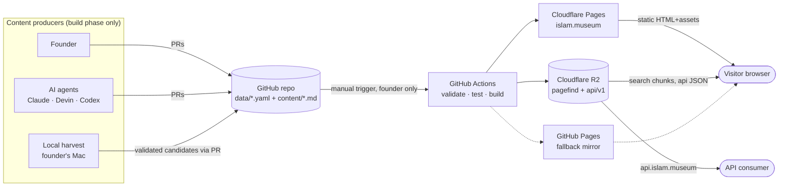
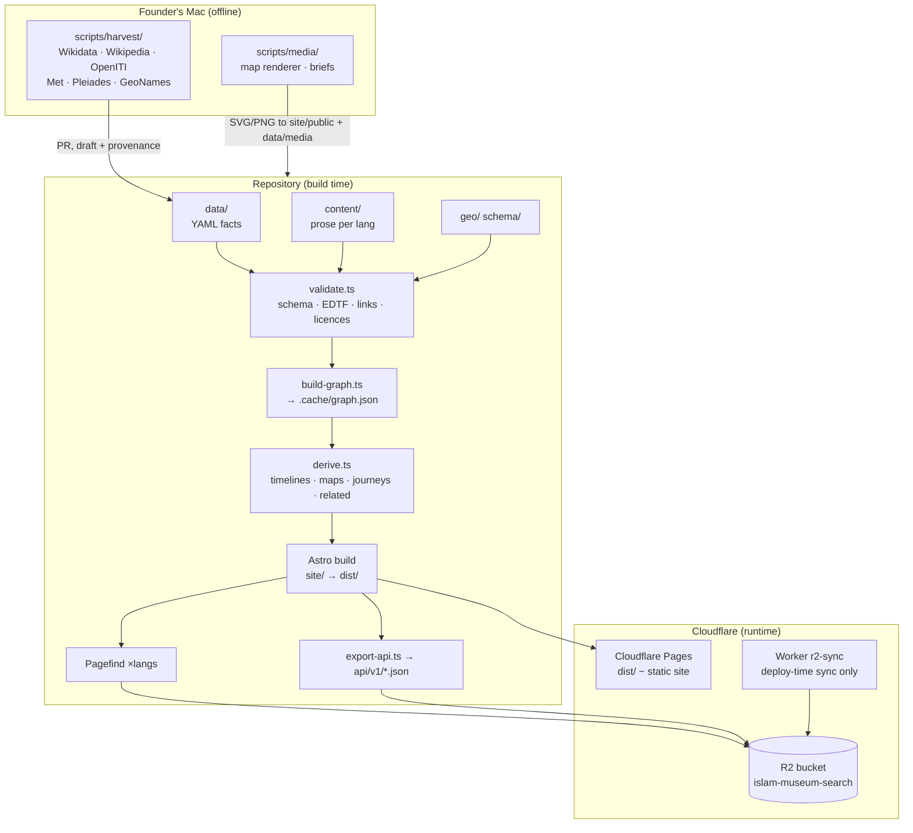
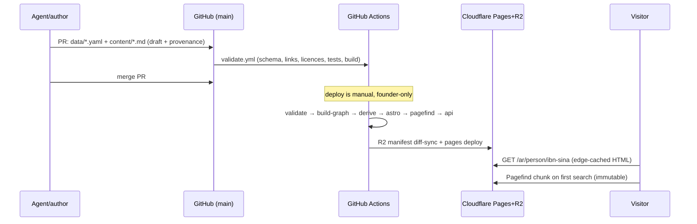

# 02 · Architecture

_Engineering view. Canonical source: [`docs/plan/03-architecture.md`](../plan/03-architecture.md),
ADRs [`0001`](../adr/0001-static-git-knowledge-graph.md) and
[`0002`](../adr/0002-no-ai-or-compute-at-runtime.md), and `AGENTS.md`
("rules that never bend"). Where practice evolved past plan 03
(Cloudflare Pages is now the host; deployment is manual and founder-only)
this document records the current state._

## 1. The one-sentence architecture

> **The museum is a git repository of plain files, compiled offline into a
> graph and then into static HTML + JSON, served from a CDN. There is no
> backend to secure, scale or pay for.**

## 2. System context

## 3. Containers

Three physically separate worlds:

1. **Authoring** — humans and AI agents editing YAML/Markdown in git.
2. **Building** — GitHub Actions + the founder's Mac; the only place models,
   databases (DuckDB) and large downloads exist.
3. **Serving** — Cloudflare's edge cache reading static objects. Nothing in
   the visitor's path executes our code.

## 4. Key architectural decisions

| Decision | Consequence | ADR / source |
|---|---|---|
| Knowledge graph in git, not a CMS/DB | Full history, offline work, PR review on facts, zero infra | ADR 0001 |
| No AI or compute at runtime | Static files only; search/maps/graphs are precomputed or client-side | ADR 0002, plan 03 §13 |
| Cloudflare Pages (paid plan) as host | GitHub Pages' file-count/soft limits could not hold a 60k+ file site; CF Pages chosen 18 Oct 2026 for its limit; GitHub Pages kept as fallback mirror | AGENTS.md |
| Search index + API JSON on R2, not in the Pages deploy | Keeps Pages under the file limit; content-addressed pagefind chunks are immutable-cached; R2 sync is manifest-diffed (hundreds of ops, not tens of thousands) | plan 03 §4, `workers/r2-sync/` |
| Manual deployment by the founder | `main` pushes publish nothing; `deploy.yml` runs only when the founder starts it (≈ daily), keeping R2 and build cost down | AGENTS.md §"Deployment" |
| IDs immutable (`class/slug`), renames via `aliases` | Stable URLs forever; aliases emit 301 redirects | plan 03 §5 |
| One edge written once; inverses computed | No contradictory relation pairs; single predicate registry | `schema/predicates.yaml` |
| Frozen Qur'an text (Tanzil) verified byte-for-byte | Sacred text never typed or corrected by a contributor | validator, `data/work/quran-source/` |
| AI content always lands as `draft` + provenance | Human review remains the gate to publication quality | `docs/ai-change-gates.md` §6 |

## 5. Data flow (author → visitor)

## 6. Trust boundaries

- **Git ↔ visitor:** only CI-built output reaches the edge; the repo is the
  audit log.
- **Harvest workspace ↔ repo:** hundreds of GB of raw/copyrighted source
  material live outside git (`docs/sources-policy.md`); only rewritten,
  cited, licence-clean candidates cross the boundary — by PR, as `draft`.
- **Cloudflare account:** deploy secrets live in GitHub repo secrets; only
  the founder runs `deploy.yml`.

## 7. What this architecture deliberately sacrifices

- No server-side personalization, comments or search-as-you-type backend.
- "On this day", wander, related-entities and share cards are **precomputed**
  rather than dynamic — a constraint accepted for zero runtime cost and
  perfect cacheability (plan 03 §6 last bullet).
