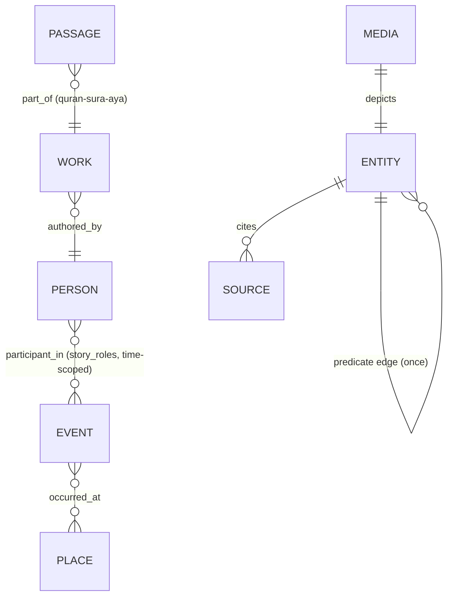
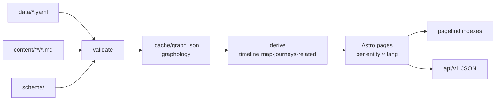

# 03 · Design

_Canonical sources: [`docs/plan/02-content-model.md`](../plan/02-content-model.md)
(the graph), [`docs/plan/04-experience.md`](../plan/04-experience.md)
(halls and pages), [`docs/style-guide.md`](../style-guide.md),
[`docs/language.md`](../language.md)._

## 1. Content model (the Graph)

### 1.1 Two files per entity

```
data/<class>/<slug>.yaml          # language-neutral facts, CC0
content/<lang>/<class>/<slug>.md  # prose in one language, CC BY-SA 4.0
```

The ID `class/slug` is immutable. A rename is an entry in `aliases:` which
the build turns into a 301 redirect. A duplicate found later becomes an
alias of the richer entity — never a blind delete.

### 1.2 Classes (21)

Actors: `person`, `group`, `polity`.
Happenings: `event`, `period`, `journey`.
Where: `place`, `building`, plus `geo/` GeoJSON extents and routes.
Things: `object`, `media` (with `map`/`illustration` kinds), `dataset`.
Thought and word: `concept`, `language`, `work`, `passage`, `source`.
Lived: `practice`, `question`.
Curatorial: `exhibit`, `listing`, `screen`, `theme` (124 themes atlas).

Each class has a JSON Schema in `schema/<class>.schema.json` extending
`_base.schema.json` (id, label per lang, summary per lang, dates, sources,
status, provenance, external_ids, aliases …).

### 1.3 Edges



- The predicate registry `schema/predicates.yaml` defines each allowed edge
  with domain, range, inverse and per-language labels. Authors write an edge
  once; `build-graph.ts` materialises the inverse.
- `story_roles` on edges are time-scoped — opponents, critics and allies are
  included with their role and period, never a label like "enemy of Islam".

### 1.4 Dates

`{ edtf: "0622", hijri: "1 AH", calendar: gregorian|hijri, precision: year|month|day,
derived: true|false }`. EDTF strings are parsed and sanity-checked at
validate time; Hijri↔Gregorian conversions are computed by `scripts/hijri/`
(modern: `@umalqura/core`; historical: tabular arithmetical converter with
anchor tests) and always flagged `derived`.

### 1.5 Perspectives

Contested topics carry a `perspectives` block: Sunni position(s) first,
then the academic view, then any other view — each cited and labelled, no
verdict. This is schema-enforced structure, not a style suggestion.

## 2. Pipeline design



Design properties:

- **Single compiled graph.** `.cache/graph.json` is the one artefact every
  downstream consumer reads (Astro loader, API export, coverage report).
- **Determinism.** Given the same git tree, builds are reproducible; the map
  renderer and derived indexes take no random input.
- **Append-mostly.** Content accretes; validation is total (every file,
  every run) so a bad file can never hide behind incremental builds.

## 3. Site design

| Aspect | Design |
|---|---|
| Generator | Astro 5, content-layer loader reads `.cache/graph.json`; zero JS shipped by default |
| Islands | Svelte/Preact components (`DepthDial`, timeline, map, graph, search, kids' interactives) lazy-mounted with `client:visible`; every page is fully readable without JS |
| Styling | Tailwind 4 + design tokens in CSS variables; **logical properties** (`margin-inline-start`) so RTL is structural, not a theme |
| i18n | `i18n/<lang>.yaml` UI strings; URL pattern `/[lang]/[class]/[slug]`; same slug in every language, labels localized; `ar`, `en`, `ur` ship together |
| Typography | Arabic-first fonts preloaded; honorifics rendered by the UI layer, never typed into prose |
| Page anatomy | "The Label" (plan 04 §3): name + dates + one-line significance, then tabs — Brief / Life / Work / Legacy / For young visitors / Notes for scholars — resolved by the depth dial |
| Discovery | Hall pages (time, place, people, ideas, objects, words, living, today), themes, exhibits, questions, screening room, `wander` (random via a static index), `today` (dual-calendar) |
| Education | `/[lang]/learn/` front door + age-band hubs under `/[lang]/sighar/` (sprouts, explorers, storytellers) + passport/study-mode/QR tools; data in top-level `edu/` (bands, stamps); strict per-route page-weight budgets (`check:weight`); no accounts or student data — `localStorage` in try/catch only |
| SEO/machine | JSON-LD per entity, sitemap index, `llms.txt`, OpenGraph cards rendered at build (satori), RSS for new entities |
| Maps | MapLibre GL + a single PMTiles basemap served by range requests + GeoJSON overlays; event maps are pre-rendered SVG/PNG from `scripts/media/maps/` |
| Graph explorer | Sigma.js (WebGL) over a graphology subgraph — tens of thousands of nodes client-side |

## 4. Honour system enforced in design

| Rule | Where the design enforces it |
|---|---|
| No typed honorifics | Validator regexes on all prose; UI injects them |
| No typed Qur'an text | Validator rejects ﴿ ﴾ in prose; `passage` entities only from frozen Tanzil, re-hashed byte-for-byte |
| Media licences | `data/media/*.yaml` sidecars; kind/license enums whitelisted in `schema/enums/licenses.yaml` |
| AI provenance | `status.review` + `provenance` block is schema-required for agent content |

## 5. Licensing design

| Artefact | Licence |
|---|---|
| Code (site, scripts) | MIT (`LICENSE`) |
| Prose (`content/`) | CC BY-SA 4.0 (`LICENSE-CONTENT.md`) |
| Data (`data/`) | CC0 |
| Third-party media | Keeps its own licence, recorded on the media sidecar; whitelist enforced |
| Source dumps/corpora | **Never committed** — they live in the harvest workspace (`docs/sources-policy.md`) |
