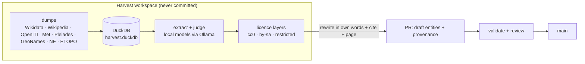

# 04 · Implementation

_High-level structure then the detailed flows. Run order and commands are in
`package.json`; agent procedure in `docs/agents/workflow.md`._

## 1. Module map (HLD)

```
islam-museum/
├─ schema/            JSON Schemas per class + _base, predicates.yaml, enums/, external-id-patterns
├─ data/              one YAML per entity + _stubs.yaml + _stubs.d/<lane>.yaml
├─ content/<lang>/    prose mirroring data/ (ar first; en + ur ship together)
├─ geo/               GeoJSON polity extents, routes, regions
├─ i18n/              UI strings per language
├─ datasets/          CSVs referenced by data/dataset/*.yaml
├─ edu/               education programme data (bands.yaml, stamps.yaml)
├─ templates/         authoring templates (yaml + md) per class
├─ tools/dashboard/   local build dashboard (npm run dashboard)
├─ scripts/
│  ├─ validate.ts            total validation (schema + rules)
│  ├─ build-graph.ts         YAML+MD → .cache/graph.json (graphology)
│  ├─ derive.ts              timelines, map features, journeys, related, on-this-day
│  ├─ export-api.ts          api/v1 JSON endpoints
│  ├─ gen-schema.ts          schema generator
│  ├─ check-static.ts        "no runtime code/cookies/forms" site audit
│  ├─ check-site.ts          site integrity checks (runs in npm run build)
│  ├─ check-weight.ts        per-route page-weight budgets for education routes (in build)
│  ├─ edu.test.ts            education lane tests (routes, bands, stamps, i18n)
│  ├─ wings.ts / wordmap.ts  wing membership, word maps
│  ├─ indexnow.mjs           IndexNow URL notification at deploy
│  ├─ git-dates.ts           entity created/updated dates from git history
│  ├─ hijri/                 date conversion + anchor tests
│  ├─ media/                 thumbnails, license-check, maps/ renderer, brief.py, accuracy.yaml
│  ├─ import/                wikidata, met-open-access, pleiades
│  ├─ harvest/               LOCAL-ONLY on the founder's Mac (Python, .venv-harvest):
│  │    download_dumps.py, download_misc.py, status.py, promote.py,
│  │    wikidata/ (queries + two-pass filter_dump.py), wikipedia/ (load_sql,
│  │    select_pages, extract, rank_sources), collections/ (duckdb loaders,
│  │    reconcile_places), quran/, directories/, web/
│  │    audio/ (download.py, transcribe.py: lecture recordings, mlx-whisper;
│  │    see docs/agents/audio-video-harvest.md)
│  └─ report/coverage.ts     → docs/coverage.md + api/v1/meta/coverage.json
├─ site/              Astro project
│  ├─ src/layouts/           BaseLayout, EntityLayout (data-pagefind-body)
│  ├─ src/components/        ~30 Astro/Svelte components (halls, kids, islands)
│  ├─ src/pages/[lang]/...   entity pages + hall pages + api endpoints + feeds
│  ├─ src/loaders/graph.ts   content-layer loader for .cache/graph.json
│  └─ public/                fonts, manifest, sw.js, rendered media (maps…)
├─ workers/
│  ├─ r2-sync/               deploy-time manifest diff-sync to R2 (not visitor-facing)
│  └─ site/                  edge worker(s) used at deploy/config time
├─ .github/workflows/  validate.yml (PRs) · build.yml · deploy.yml (manual,
│                      founder-only) · r2-*.yml (sync tests/seed)
└─ docs/              plan/, adr/, agents/, engineering/ (this set), status.md, coverage.md
```

### npm scripts (root)

`npm run validate` · `npm test` (vitest) · `npm run graph` · `npm run derive`
· `npm run api` · `npm run coverage` · `npm run wordmap` · `npm run dashboard`
(local build dashboard) · `npm run build` (prebuild = validate+graph+derive+api,
then `site` build, then `check:site` + `check:weight`) · `npm run check:static`
· `npm run check:site` · `npm run check:weight`.

## 2. Detailed flows (LLD)

### 2.1 Authoring an entity

1. Pick the class; copy `templates/<class>.yaml` + `templates/<class>.md`.
2. Write `data/<class>/<slug>.yaml`: facts, dates (EDTF+Hijri), edges from
   `predicates.yaml` only, `sources:` with real citations, `status.review:
   draft`, `provenance` (agent + model + run + source).
3. Write `content/ar/<class>/<slug>.md` first; add `en` and `ur` in the same
   commit (language policy since 18 Oct 2026).
4. Unresolved references go to your lane's `data/_stubs.d/<lane>.yaml` —
   never edit `data/_stubs.yaml` wholesale.
5. `npm run validate && npm test && npm run coverage` (coverage regenerates
   `docs/coverage.md`; commit it in the same commit).
6. PR with explicit paths, ≤25 entities per content batch, attribution
   trailers.

### 2.2 Validation (every build, total)

`scripts/validate.ts` checks, failing on errors:

- JSON Schema per class (ajv + formats); `label.ar` and `summary.ar` required.
- EDTF parses; Hijri sanity; date precision flags.
- Every edge uses a registered predicate; every reference resolves to an
  entity or a declared stub.
- Slug rules (ASCII, lowercase, hyphenated); duplicate `external_ids`.
- License whitelist for media; required alt text.
- Prohibited content: typed honorifics, ﴿ ﴾ in prose, forbidden patterns.
- Qur'an passages re-verified byte-for-byte against frozen Tanzil files
  (sha256 committed in `data/work/quran-source/`).
- Orphan detection and warnings (non-fatal) for completeness.

### 2.3 Graph build and derivation

`build-graph.ts`: loads all YAML → graphology nodes; materialises inverse
edges; normalises dates to `[earliest, latest]`; attaches per-language prose;
computes contemporaries, degree, wing membership, breadcrumbs, snapshot-year
indices, coverage stats → `.cache/graph.json` (gitignored, rebuilt every run).

`derive.ts`: reads the graph → timeline rows (dual calendar), GeoJSON map
features per wing/period, journey lines, ego-graph subgraphs and dynasty
trees, "on this day" index, related-entity recommendations (shared
neighbours + tags).

`export-api.ts`: emits `api/v1/` — per-entity JSON, per-class indexes,
`graph/nodes.ndjson` + `edges.ndjson`, `meta/coverage.json`.

### 2.4 Site build

`site/` Astro build (content-layer loader `loaders/graph.ts` consumes
`.cache/graph.json`): one page per entity per language, hall pages, the
education routes (`learn/`, `sighar/` band hubs, passport, study modes —
fed by `edu/` data via `site/src/lib/edu.ts`),
exhibits, questions, screen entries, themes, `wander`, `today`, JSON-LD,
OG images (satori), sitemaps, RSS, `api/` passthrough, `_redirects` (API
301s to `api.islam.museum`, slug renames). Passage (Qur'an verse) pages are
rendered but excluded from Pagefind via `data-pagefind-body` (plan 03 §7).

Pagefind runs once per published language; chunks are content-addressed and
deployed to R2 (immutable), not to Pages.

### 2.5 Deploy (manual — founder only)

`.github/workflows/deploy.yml` on `workflow_dispatch` only:

1. Full pipeline (validate → graph → derive → astro → pagefind → api).
2. Content-change gate: `git diff` on `data/` + `content/` — nothing changed
   ⇒ R2 sync skipped entirely.
3. `workers/r2-sync`: per directory (`pagefind-*`, `api`) build local
   manifest → fetch previous manifest from R2 → upload only changed files →
   delete removed → write manifest. ~4 GETs + N PUTs + 4 manifest PUTs.
4. Strip `dist/pagefind-*` and `dist/api` → `wrangler pages deploy`.
5. `indexnow.mjs` notifies changed URLs.
6. GitHub Pages mirror updated as fallback.

### 2.6 Harvest → repo path



Rules of the road (plan 15 §5): only CC0/BY facts or our own cited research
enter `data/`; verbatim text beyond a 40-word quotation never enters git;
every candidate is `draft`.

## 3. Conventions

- **Commits:** conventional (`content(...)`, `feat(...)`, `fix(ci):` …);
  explicit paths, never `git add -A`; trailers `AI-Agent:`, `AI-Model:`,
  `AI-Editor:` on every agent commit.
- **PRs:** `main` is ruleset-protected (PR-only, no force-push, no delete);
  agents open and may merge their own PRs; Validate workflow runs on each.
- **Shared files are append-only:** `_stubs.yaml`, `_stubs.d/*`, `status.md`,
  enums, i18n — key-level merges, never wholesale replacement.
- **Change gates:** every non-lane change needs an approved written proposal
  labelled `submission-impacting` or `non-impacting`
  (`docs/ai-change-gates.md`). Formal submissions (DPGA GID0094424, UNESCO
  dossier) quote this repo — claims must not drift.
