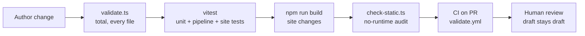

# 05 · Testing

_Gates are defined in `docs/ai-change-gates.md` §5 and
`docs/agents/workflow.md` §4. This document catalogues what exists and when
to run it._

## 1. Test layers

## 2. Automated checks

| Layer | Command | What it proves |
|---|---|---|
| Schema + rule validation | `npm run validate` | Every YAML/MD conforms; links resolve; licences whitelisted; no honorifics; no typed Qur'an text; Qur'an passages byte-identical to frozen Tanzil; alt text present |
| Unit tests | `npm test` (vitest, `scripts/*.test.ts`) | hijri converter against known anchors (`hijri/anchors.test.ts`, `dates.test.ts`), git-dates, graph endpoint, pipeline, wings, kids, cards (stories/lists/explainers validators), seo, site-deps, tour, **edu** (`edu.test.ts`: bands/stamps data, routes, i18n parity) |
| Build integrity | `npm run build` tail: `check-site` + `check-weight` | site integrity, plus per-route HTML/JS page-weight budgets on education routes (breach fails; fix = remove weight, never raise the budget) |
| Harvest self-tests | `scripts/harvest/wikidata/test_filter.py` | two-pass dump filter correctness before running on the 96 GiB dump |
| Audio harvest (`scripts/harvest/audio/`) | no automated test yet; smoke tests in the method doc: one 44-minute episode per engine, `meta.json` checked by hand, `agree.py` on two engines (`docs/agents/audio-video-harvest.md` §4, §3.2) | unit tests for the manifest reader, the window agreement and the timestamp format are still to write |
| Static-site audit | `npm run check:static` | No forms/cookies/third-party calls sneaking into the published shell — the privacy posture is executable |
| Site checks | `tsx scripts/check-site.ts`, `check-static.ts` | Internal integrity of built output |
| Full build | `npm run build` | 0 validation errors; graph, derive, API and Astro all complete — ~12,900+ pages at last status snapshot (now larger) |
| PR CI | `.github/workflows/validate.yml` | validate + tests + build on every pull request |
| Deploy hygiene | `r2-secrets-check.yml`, `r2-sync-test.yml`, `r2-sync-parallel-test.yml`, `r2-html-test.yml`, `r2-seed.yml` | R2 deploy path is testable without touching production |
| Worker tests | `workers/*/test` | r2-sync manifest diff logic |

## 3. Performance regression

`lighthouserc.json` runs Lighthouse CI on built **Arabic** pages (RTL is the
stress case). The recent fix reserved space for the date line and preloads
Arabic fonts to keep layout-shift and first-paint budgets green. Budgets
cover the static site only — islands are lazy and measured separately.

## 4. Content review gates (human, by design)

Automated tests can never mark content good — that is intentional:

- All agent-produced content enters `status.review: draft` with a
  `provenance` block. **No agent may mark anything `reviewed`/`verified`.**
  Sole exception: illustrations passing the full automated gate suite of
  `docs/agents/lanes/illustrations.md` §3 may be `approved_by: "pipeline"`
  with the gate-report hash recorded.
- Every dated fact requires two sources or an explicit flag — enforced as
  data, reviewed as judgement.
- Perspectives blocks, story_roles and "no verdict" tension cards are
  structural requirements checked in review, not by lint.
- Bibliographic details of real cited books still get a human pass (called
  out in `docs/status.md`).

## 5. Per-change checklist

| Change | Run before push |
|---|---|
| `data/`, `content/`, stubs, edges | `npm run validate && npm test && npm run coverage` (coverage in same commit) |
| `site/`, dates, i18n, schema | all of the above **and** `npm run build` |
| `workers/`, workflows | validate + test; R2 workflows on the matching test workflow; tell the founder a Worker changed (deploy is manual) |
| anything | `git fetch origin` + three-way merge first; explicit paths; trailers |

Never: lower a rule, skip a test, widen a timeout, or add a crash guard to
hide bad data (change gates §5). A `main` already broken by someone else is
fixed in its own small commit that says so.

## 6. Coverage as a test artefact

`docs/coverage.md` (regenerated, never hand-edited) and
`api/v1/meta/coverage.json` are the public quality dashboard: entities per
class, language coverage, sourced percentage, review status. Reviewers use
it to spot lanes drifting on sourcing or translation completeness.
