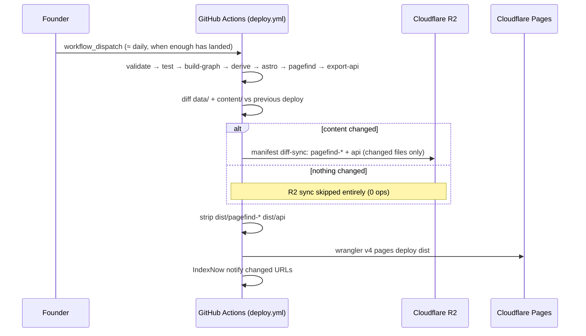

`gift-shop/`, `brand/`, `openapi/`, and the root data files: `sitemap*.xml`, `feed.xml`, `llms*.txt`, `search-synonyms.*.json`, `favicon*`, `apple-touch-icon.png` |# 06 · Deployment

_Canonical rules: `AGENTS.md` ("Deployment is manual and the founder's
alone"), `docs/agents/workflow.md` §9, `workers/r2-sync/README.md`, and the
workflow files in `.github/workflows/`._

## 1. Environments

| Environment | Where | Updated by |
|---|---|---|
| Production site | Cloudflare (site Worker `islam-museum-site` on R2 bucket `islam-museum-search` + Pages project `islam-museum` for code), `islam.museum` (+ `www`), API at `api.islam.museum` | `deploy.yml`, manual, founder only |
| UAT site (since 1 Nov 2026, section 8) | Cloudflare (site Worker `islam-museum-site-uat` on R2 bucket `islam-museum-uat` + Pages project `islam-museum-uat`), `uat.islam.museum`, API at `uat-api.islam.museum`; never indexed | `deploy-uat.yml`, manual, founder only |

**What goes where (founder rule, 28 Oct 2026).** Cloudflare Pages and the site Worker's static assets hold only code and logic (scripts, styles and a few root pages); the HTML pages, data, content, maps, images, pictures, video, search indexes and the open-data JSON are on Cloudflare R2, served through the site Worker or at api.islam.museum (founder rule, 28 October 2026).

| Goes to Cloudflare Pages / Worker assets | Goes to Cloudflare R2 |
|---|---|
| `_astro/` (built JS and CSS), `vendor/`, `_headers`, `_redirects`, root `index.html` and `404.html` | `ar/`, `en/`, `ur/` (HTML pages), `pagefind-*` (search), `api/` (open data), `media/` (images, maps, cards, Explorer images), `edu/`, `timeline-data/`, `gift-shop/`, `brand/`, `openapi/` |

Adding a new data or media folder: add it to `R2_DATA_DIRS` (`workers/site/src/route.js`), the publish list (`workers/r2-sync/batch/publish.mjs`), `run_worker_first` (`workers/site/wrangler.production.toml`) and the exclude list of the assets-only step in `deploy-env.yml` (one `rsync` list since 13 November 2026; it replaced the two `rm -rf` lines). A new root-level data file: add its pattern to `R2_ROOT_FILES` (`route.js`) and `ROOT_FILES` (`publish.mjs`), to `run_worker_first`, and to both `rm -f` lines in `deploy.yml`. Only `robots.txt`, the search-engine verification files, `_headers` and `_redirects` stay at the root on Pages, because they are configuration.
| Search + API | R2 bucket `islam-museum-search`; `api.islam.museum` custom domain; public R2 URL for pagefind base | r2-sync worker in `deploy.yml` |
| Fallback for a Cloudflare outage | None live: the site is rebuilt from git if ever needed (founder's decision, 13 November 2026, section 5a) | none |
| CI checks | GitHub Actions `validate.yml` | every PR |
| Local preview | `npm run dev` (graph+derive+api, then Astro dev), `npm run build` for prod-like output | developer |

## 2. Deploy pipeline

Key detail: HTML is also publishable via R2 (the `r2-html-test` workflow
exists), but the primary static host remains CF Pages; R2 carries the
content-addressed pagefind chunks and `api/v1` JSON.

### Keeping a deploy small (since 6 November 2026)

A deploy uploads every file whose bytes changed. Until 6 November that was 174,000 to 206,000 files a day
(53 to 66 minutes, about 19 GB), because things that change often sat inside every page. Now:

- The header, theme, menu and accessibility script is the plain file `/shell/shell.js`, and the entity page script
  `/shell/entity.js` (`site/public/shell/`, loaded with `defer`). Both are cached for five minutes, then revalidated in the
  background (`site/public/_headers`), not as immutable.
- The footer version is filled in by `shell.js` from `api/v1/meta/deploy.json`, which the deploy writes from the top block
  of `CANARY.md`. The pages carry only the changelog link. Because the site Worker redirects `/api/*` to the
  environment's own API host, the Content Security Policy in `site/public/_headers` must allow that host in
  `connect-src` for every environment (production `api.islam.museum`, UAT `uat-api.islam.museum`); if one is
  missing, the browser blocks the fetch on that environment and the footer never shows the version.
- The accessibility EPUBs carry the day their source last changed, not the build clock.
- `publish.mjs` prints an "R2 publish churn" table in the job summary and warns when more than a fifth of the HTML
  pages are re-uploaded, naming the shell files that changed (`tools/deploy/shell-paths.list`).
- `validate.yml` labels a pull request `rewrites-all-pages` when it touches a shell file.

The compiled stylesheet is still inlined into every page, so a stylesheet edit still rewrites the whole site: linking
it was measured to fail the Lighthouse gate. The measurements, the alternatives considered and what was left for later
(including the fix for this) are in [`16-deploy-churn-proposal.md`](16-deploy-churn-proposal.md).

### What the two workflows do, and how long they take (since 13 November 2026)

The diagram above predates the move of the HTML pages to R2 (28 October 2026). The steps today, with the times of UAT
build run 43300358009 and deploy run 43334841849 ([45 · Build and deploy review](45-build-deploy-review.md)):

| Workflow | Step | Time |
|---|---|---|
| `build.yml` | unit tests (own job, in parallel; a failure cancels the run) | 8 min |
| | `npm run build`: validate, graph, derive, API, Astro, Pagefind, site checks | 1 h 13 min |
| | `check:static` | 6 min |
| | pack `dist/` into one zstd tar and upload it as the artifact `dist-tar` | under 3 min |
| `deploy-env.yml` | download and unpack the artifact (a plain `dist` artifact of an older build is accepted too) | 4 min |
| | deploy the seven R2 sync Workers | 41 s |
| | build the assets-only folder (one `rsync` exclude list) and deploy the site Worker | 22 s |
| | publish to R2 through the sync Workers (a full rewrite; a small day is minutes) | 42 min |
| | deploy the same assets-only folder to Cloudflare Pages; smoke test | 20 s |

A deploy waits for a free runner like any other job; when many pull-request builds are running it can wait hours
(doc 45 §7.2).

There is no fallback mirror: no workflow publishes one, and GitHub Pages could not hold the site (section 5a).

## 3. Secrets and variables (GitHub repo settings)

| Name | Kind | Purpose |
|---|---|---|
| `CLOUDFLARE_API_TOKEN` | repository secret | Pages deploy + Worker deploy (scoped); shared by both environments |
| `CLOUDFLARE_ACCOUNT_ID` | repository secret | account; shared |
| `R2_ACCESS_KEY_ID` / `R2_SECRET_ACCESS_KEY` | repository secret, overridden in the `uat` Environment | S3 keys of the bucket the deploy publishes to: the repository pair writes `islam-museum-search`; the `uat` pair is scoped to `islam-museum-uat` only |
| `R2_SYNC_TOKEN` | repository secret, overridden in the `uat` Environment | bearer token of that environment's sync Workers (the deploy copies it into them) |
| `R2_BUCKET`, `WRANGLER_ENV`, `PAGES_PROJECT`, `SITE_URL`, `SYNC_WORKER_COUNT` | Environment variables (`production`, `uat`) | where a deploy goes: see `deploy-env.yml` and section 8 |
| `PAGEFIND_BASE_URL` | repository variable | baked into HTML at build (`PUBLIC_PAGEFIND_BASE`). Empty: the search page loads `/pagefind-<lang>/` from the site's own Worker, which serves those folders from R2 (same origin, no CORS). Set it to a public R2 URL only to point search at another origin. |
| `INDEXNOW` | repository variable | `off` skips the IndexNow ping (production only; UAT never pings) |

No secrets ever enter the repo or the published files — `check-static.ts`
and review keep it that way.

## 4. Cloudflare edge configuration (manual, documented in plan 03 §6)

- DNS proxied; SSL Full (strict); HSTS.
- Cache: HTML edge ~1h / browser ~10min; hashed assets 1y; `/api/` 1 day +
  stale-while-revalidate; pagefind chunks `immutable, max-age=31536000`.
- Redirects: `_redirects` handles `/api/*` → `api.islam.museum` (301 — Pages
  cannot proxy cross-host) and entity slug renames; root → language by
  Accept-Language rule.
- Transform rules: CORS `*` on `/api/*`; `remove-logging` strips NEL/
  Report-To; **Scrape Shield email obfuscation OFF** (injected JS broke the
  no-JS and privacy claims — do not re-enable).
- Web Analytics: cookieless.

## 5. Rollback

| Failure | Rollback |
|---|---|
| Bad content build | Revert the commit on `main` via PR, founder re-runs `deploy.yml`; CF Pages also keeps prior deployments for instant rollback |
| Broken deploy workflow | Site keeps serving last good build — deploys are additive |
| R2 desync | Re-run r2-sync (manifest is the source of truth; re-seed via `r2-seed.yml` if the bucket is empty) |
| Cloudflare outage / account issue | No live fallback (section 5a). A short outage is waited out. For a long one or the loss of the account: build from `main` (about an hour and a half) and publish `dist/` to another host, then move the DNS |

## 5a. Fallback for a Cloudflare outage: the decision, and the options to revisit

**Decision (founder, 13 November 2026; decision record `dec-20261113-270`): accept the risk.** There is no live copy of
the site outside Cloudflare. If Cloudflare or the Cloudflare account is unavailable, `islam.museum` is down until it
returns, or until the site is rebuilt from git and published elsewhere. Nothing is lost in either case: every record,
every page source and the whole history are in the public repository, and a build takes about an hour and a half.

**Why this came up.** The documents named a "GitHub Pages fallback mirror". The review of November 2026
([doc 45](45-build-deploy-review.md) §5) found that it does not exist as described: the GitHub Pages site of the
repository (`amado2k5.github.io/islam-museum/`) was last deployed on 18 October 2026, the day the site moved to
Cloudflare; no workflow has published to it since; and it cannot be brought up to date, because GitHub Pages allows a
published site of 1 GB and a deployment of ten minutes, and the site is about 19 GB and 456,000 files. That snapshot is
also under another address and path, so it would not work as `islam.museum` without a rebuild.

**What a Cloudflare outage takes down.** The DNS, the site Worker, the R2 bucket with every page, the search indexes and
the API are all Cloudflare. There is no second place to point the domain today.

**The options, kept for the day this is revisited:**

| # | Option | What it gives | What it costs |
|---|---|---|---|
| 1 | **Accept the risk** (chosen) | Nothing to run. The repository is the backup; recovery is a rebuild and a publish to another host | Downtime for as long as the outage lasts, or the hours it takes to stand the site up elsewhere, and a DNS that must be movable (see below) |
| 2 | A reduced mirror on GitHub Pages | A small site that stays up: the home pages, the browsers' landing pages and a notice with the open-data links, under 1 GB, refreshed by a workflow | A second build target to keep working; most entity pages absent; the domain must still be repointed by hand |
| 3 | A full copy with a second provider | A real fallback: the same `dist/` synced to another object store with a CDN in front on every deploy | Storage and transfer fees, a second publish step in every deploy (the full site is about 360,000 writes), a second set of credentials, and a routing layer that does what the site Worker does (redirects, headers, trailing slashes, aliases) |

**Revisit when** any of these becomes true:

- an outage of Cloudflare, or a problem with the account, takes the site down for more than a few hours;
- a partner, a funder or a submission (the DPGA or UNESCO files) asks for a stated availability or a recovery plan;
- the site becomes something others depend on at run time (a school using it in class, an app reading the API);
- the build can no longer be reproduced from git in a couple of hours;
- the full site becomes small or cheap enough to copy that option 3 is no longer a second system to maintain.

**What makes option 1 safe enough, and must stay true:** the repository is public and complete (no page depends on
anything outside git except the media files, which are in the media repository); the build runs on any machine with
Node (`14-local-development.md`); and `dist/` is plain static files that any static host can serve. Not yet checked, and
worth checking before relying on it: that the domain's registrar and DNS can be moved away from Cloudflare without
access to the Cloudflare account.

## 6. Agent procedure around deployment

- Pushing to `main` (via merged PR) publishes **nothing**. No agent may run
  `deploy.yml` (`gh workflow run`, Actions tab, or a push trigger).
- If work needs to be live: say so — name the commits, what changed, and
  whether a Worker or workflow file is among them. The founder deploys.
- PRs DO run `validate.yml` (validate + tests + build) — that is the agent's
  CI feedback loop.

## 7. Pre-deploy checklist (founder)

1. `main` green on `validate.yml` for the latest merge.
2. `npm run coverage` current if entities changed.
3. No pending `submission-impacting` items contradicting DPGA/UNESCO claims.
4. Dispatch `deploy.yml`; verify a sample: an entity page, `/api/v1/meta/coverage.json`, one Pagefind search, `https://islam.museum` root redirect.

## 8. UAT environment (founder, 1 November 2026)

A full, independent copy of the production hosting, so a build can be reviewed on
`https://uat.islam.museum` before the same build is published to `islam.museum`.
Nothing is shared with production but the code, the build artifact and the two
account-level secrets (`CLOUDFLARE_API_TOKEN`, `CLOUDFLARE_ACCOUNT_ID`).

**One build, two deploys.** `build.yml` builds `main` as before and keeps `dist`. The
deploy procedure lives once, in `.github/workflows/deploy-env.yml` (a reusable workflow),
and two thin workflows start it: `deploy.yml` ("Deploy islam.museum to Cloudflare") with
the `production` GitHub Environment, and `deploy-uat.yml` ("Deploy islam.museum to UAT")
with the `uat` Environment. Same artifact, same steps, same Worker code; only the
Environment's variables and secrets differ. The usual flow is: start the UAT deploy
(empty `build_run_id` = the latest successful build of `main`), review
`uat.islam.museum`, then start the production deploy with the same `build_run_id`
(the UAT run's summary names it).

| | production | uat |
|---|---|---|
| GitHub Environment | `production` | `uat` |
| R2 bucket (`R2_BUCKET`) | `islam-museum-search` | `islam-museum-uat` |
| wrangler environment (`WRANGLER_ENV`) | top level (unset) | `uat` (`[env.uat]` in both `wrangler.production.toml`) |
| Site Worker | `islam-museum-site` | `islam-museum-site-uat` |
| Sync Workers (`SYNC_WORKER_COUNT` = 7) | `islam-museum-r2-sync`, `-2` … `-7` | `islam-museum-r2-sync-uat`, `-uat-2` … `-uat-7` |
| Pages project (`PAGES_PROJECT`) | `islam-museum` | `islam-museum-uat` |
| Site (`SITE_URL`) | `https://islam.museum` (domain attached in the dashboard) | `https://uat.islam.museum` (Custom Domain in `[env.uat]`, created by the first deploy) |
| API (R2 custom domain on the bucket) | `api.islam.museum` | `uat-api.islam.museum` |
| S3 keys | repository `R2_ACCESS_KEY_ID`/`R2_SECRET_ACCESS_KEY` | the `uat` Environment's pair, scoped to the UAT bucket only |
| Sync token | repository `R2_SYNC_TOKEN` | the `uat` Environment's `R2_SYNC_TOKEN` |
| IndexNow ping | yes (unless `INDEXNOW=off`) | never |
| Indexing | normal | `/robots.txt` answers `Disallow: /`, every response carries `X-Robots-Tag: noindex, nofollow` |

**How the same build works on both hosts.** Everything in `dist` is relative except a
few production hostnames in metadata (canonical URLs, JSON-LD, sitemap, feed), which UAT
keeps as they are (a canonical URL pointing at production is exactly right for a copy
that must not be indexed), and one functional one: the `/api/*` rule in
`site/public/_redirects` sends API requests to `api.islam.museum`. The site Worker
translates that at serve time from its environment's `HOST_REWRITES` var
(`api.islam.museum=uat-api.islam.museum` in `[env.uat.vars]`; production has none, so its
Locations are byte-identical to before). `ROBOTS=disallow` in the same section drives
the noindex behaviour. Both are in `workers/site/src/route.js` (`rewriteHost`,
`robotsDisallowed`) with unit tests. The search page loads Pagefind from
`PAGEFIND_BASE_URL`, which is baked in at build time and points at the production
bucket's public URL, so UAT search queries the production indexes until that variable is
made relative (a founder decision; see "Known limits").

**Guard rails.** `deploy-env.yml` refuses a non-production run whose Environment names
any production resource (bucket `islam-museum-search`, Pages project `islam-museum`,
`https://islam.museum`, or a `WRANGLER_ENV` that is not the Environment's own name), and
refuses a production run with a non-empty `WRANGLER_ENV` or another bucket. The UAT S3
keys are scoped to the UAT bucket, so even a misconfigured publish cannot write to
production. `[env.uat]` names only UAT resources. A UAT deploy therefore changes nothing
on `islam.museum`, `api.islam.museum`, `islam-museum-search`, the production Workers or
the `islam-museum` Pages project, and causes no production downtime: production is
deployed by `deploy.yml` alone, and both deploys are additive (the site keeps serving
the last good publish while a run is in progress).

**One-time setup** (`tools/deploy/setup-uat.sh`, idempotent):

1. `setup-uat.sh github`: the two GitHub Environments and their variables, and a generated
   `R2_SYNC_TOKEN` for `uat` (done 1 Nov 2026).
2. Cloudflare: bucket `islam-museum-uat` (created 1 Nov 2026), custom domain
   `uat-api.islam.museum` on it and the Pages project `islam-museum-uat`
   (`setup-uat.sh cloudflare`, needs `npx wrangler login` and the zone id).
3. An R2 API token (Object Read & Write, bucket `islam-museum-uat` only) created in the
   dashboard, stored with `setup-uat.sh r2-keys` as the `uat` Environment's
   `R2_ACCESS_KEY_ID` / `R2_SECRET_ACCESS_KEY`.
4. First deploy: "Deploy islam.museum to UAT" with `seed` ticked, once a build of a commit
   that carries the `[env.uat]` sections exists (the deploy takes the Worker code and the
   wrangler configs from the *built* commit, so an older build cannot deploy UAT; the
   workflow checks this and names the problem before deploying anything). The bucket has no
   manifest yet; the publish uploads the whole build once, a few hours). The first deploy
   also creates the UAT Workers and the `uat.islam.museum` Custom Domain (DNS record and
   certificate); the second and later deploys send only what changed.

**Known limits.** UAT search uses the production Pagefind indexes (see above); UAT
pages carry production canonical and hreflang URLs; zone-level rules of `islam.museum`
(transform rules, redirect rules) apply to the UAT hostnames only where their expressions
do not pin the hostname. None of these needs a code change to lift; the first is a
build variable, the others are Cloudflare configuration.

**Removal.** Delete the `uat` Environment, the three Cloudflare resources and the
UAT Workers; the `[env.uat]` sections and `deploy-uat.yml` can stay or go. Production is
untouched either way.

