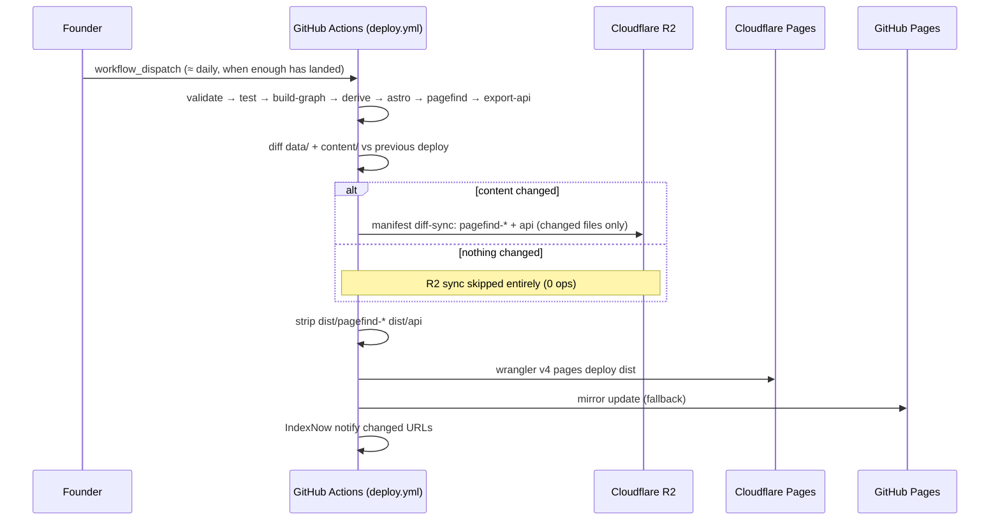

`gift-shop/`, `brand/`, `openapi/`, and the root data files: `sitemap*.xml`, `feed.xml`, `llms*.txt`, `search-synonyms.*.json`, `favicon*`, `apple-touch-icon.png` |# 06 · Deployment

_Canonical rules: `AGENTS.md` ("Deployment is manual and the founder's
alone"), `docs/agents/workflow.md` §9, `workers/r2-sync/README.md`, and the
workflow files in `.github/workflows/`._

## 1. Environments

| Environment | Where | Updated by |
|---|---|---|
| Production site | Cloudflare (site Worker `islam-museum-site` on R2 bucket `islam-museum-search` + Pages project `islam-museum` for code), `islam.museum` (+ `www`), API at `api.islam.museum` | `deploy.yml`, manual, founder only |
| UAT site (since 1 Nov 2026, section 8) | Cloudflare (site Worker `islam-museum-site-uat` on R2 bucket `islam-museum-uat` + Pages project `islam-museum-uat`), `uat.islam.museum`, API at `uat-api.islam.museum`; never indexed | `deploy-uat.yml`, manual, founder only |

**What goes where (founder rule, 28 Oct 2026).** Cloudflare Pages and the site Worker's static assets hold only code and logic (scripts, styles and a few root pages); the HTML pages, data, content, maps, images, pictures, video, search indexes and the open-data JSON are on Cloudflare R2, served through the site Worker or at api.islam.museum (founder rule, 28 October 2026).

| Goes to Cloudflare Pages / Worker assets | Goes to Cloudflare R2 |
|---|---|
| `_astro/` (built JS and CSS), `vendor/`, `_headers`, `_redirects`, root `index.html` and `404.html` | `ar/`, `en/`, `ur/` (HTML pages), `pagefind-*` (search), `api/` (open data), `media/` (images, maps, cards, Explorer images), `edu/`, `timeline-data/`, `gift-shop/`, `brand/`, `openapi/` |

Adding a new data or media folder: add it to `R2_DATA_DIRS` (`workers/site/src/route.js`), the publish list (`workers/r2-sync/batch/publish.mjs`), `run_worker_first` (`workers/site/wrangler.production.toml`) and both `rm -rf` lines in `deploy.yml`. A new root-level data file: add its pattern to `R2_ROOT_FILES` (`route.js`) and `ROOT_FILES` (`publish.mjs`), to `run_worker_first`, and to both `rm -f` lines in `deploy.yml`. Only `robots.txt`, the search-engine verification files, `_headers` and `_redirects` stay at the root on Pages, because they are configuration.
| Search + API | R2 bucket `islam-museum-search`; `api.islam.museum` custom domain; public R2 URL for pagefind base | r2-sync worker in `deploy.yml` |
| Fallback mirror | GitHub Pages | `deploy.yml` |
| CI checks | GitHub Actions `validate.yml` | every PR |
| Local preview | `npm run dev` (graph+derive+api, then Astro dev), `npm run build` for prod-like output | developer |

## 2. Deploy pipeline

Key detail: HTML is also publishable via R2 (the `r2-html-test` workflow
exists), but the primary static host remains CF Pages; R2 carries the
content-addressed pagefind chunks and `api/v1` JSON.

## 3. Secrets and variables (GitHub repo settings)

| Name | Kind | Purpose |
|---|---|---|
| `CLOUDFLARE_API_TOKEN` | repository secret | Pages deploy + Worker deploy (scoped); shared by both environments |
| `CLOUDFLARE_ACCOUNT_ID` | repository secret | account; shared |
| `R2_ACCESS_KEY_ID` / `R2_SECRET_ACCESS_KEY` | repository secret, overridden in the `uat` Environment | S3 keys of the bucket the deploy publishes to: the repository pair writes `islam-museum-search`; the `uat` pair is scoped to `islam-museum-uat` only |
| `R2_SYNC_TOKEN` | repository secret, overridden in the `uat` Environment | bearer token of that environment's sync Workers (the deploy copies it into them) |
| `R2_BUCKET`, `WRANGLER_ENV`, `PAGES_PROJECT`, `SITE_URL`, `SYNC_WORKER_COUNT` | Environment variables (`production`, `uat`) | where a deploy goes: see `deploy-env.yml` and section 8 |
| `PAGEFIND_BASE_URL` | repository variable | public R2 URL baked into HTML at build (`PUBLIC_PAGEFIND_BASE`) |
| `INDEXNOW` | repository variable | `off` skips the IndexNow ping (production only; UAT never pings) |

No secrets ever enter the repo or the published files — `check-static.ts`
and review keep it that way.

## 4. Cloudflare edge configuration (manual, documented in plan 03 §6)

- DNS proxied; SSL Full (strict); HSTS.
- Cache: HTML edge ~1h / browser ~10min; hashed assets 1y; `/api/` 1 day +
  stale-while-revalidate; pagefind chunks `immutable, max-age=31536000`.
- Redirects: `_redirects` handles `/api/*` → `api.islam.museum` (301 — Pages
  cannot proxy cross-host) and entity slug renames; root → language by
  Accept-Language rule.
- Transform rules: CORS `*` on `/api/*`; `remove-logging` strips NEL/
  Report-To; **Scrape Shield email obfuscation OFF** (injected JS broke the
  no-JS and privacy claims — do not re-enable).
- Web Analytics: cookieless.

## 5. Rollback

| Failure | Rollback |
|---|---|
| Bad content build | Revert the commit on `main` via PR, founder re-runs `deploy.yml`; CF Pages also keeps prior deployments for instant rollback |
| Broken deploy workflow | Site keeps serving last good build — deploys are additive |
| R2 desync | Re-run r2-sync (manifest is the source of truth; re-seed via `r2-seed.yml` if the bucket is empty) |
| Cloudflare outage / account issue | GitHub Pages fallback mirror |

## 6. Agent procedure around deployment

- Pushing to `main` (via merged PR) publishes **nothing**. No agent may run
  `deploy.yml` (`gh workflow run`, Actions tab, or a push trigger).
- If work needs to be live: say so — name the commits, what changed, and
  whether a Worker or workflow file is among them. The founder deploys.
- PRs DO run `validate.yml` (validate + tests + build) — that is the agent's
  CI feedback loop.

## 7. Pre-deploy checklist (founder)

1. `main` green on `validate.yml` for the latest merge.
2. `npm run coverage` current if entities changed.
3. No pending `submission-impacting` items contradicting DPGA/UNESCO claims.
4. Dispatch `deploy.yml`; verify a sample: an entity page, `/api/v1/meta/coverage.json`, one Pagefind search, `https://islam.museum` root redirect.

## 8. UAT environment (founder, 1 November 2026)

A full, independent copy of the production hosting, so a build can be reviewed on
`https://uat.islam.museum` before the same build is published to `islam.museum`.
Nothing is shared with production but the code, the build artifact and the two
account-level secrets (`CLOUDFLARE_API_TOKEN`, `CLOUDFLARE_ACCOUNT_ID`).

**One build, two deploys.** `build.yml` builds `main` as before and keeps `dist`. The
deploy procedure lives once, in `.github/workflows/deploy-env.yml` (a reusable workflow),
and two thin workflows start it: `deploy.yml` ("Deploy islam.museum to Cloudflare") with
the `production` GitHub Environment, and `deploy-uat.yml` ("Deploy islam.museum to UAT")
with the `uat` Environment. Same artifact, same steps, same Worker code; only the
Environment's variables and secrets differ. The usual flow is: start the UAT deploy
(empty `build_run_id` = the latest successful build of `main`), review
`uat.islam.museum`, then start the production deploy with the same `build_run_id`
(the UAT run's summary names it).

| | production | uat |
|---|---|---|
| GitHub Environment | `production` | `uat` |
| R2 bucket (`R2_BUCKET`) | `islam-museum-search` | `islam-museum-uat` |
| wrangler environment (`WRANGLER_ENV`) | top level (unset) | `uat` (`[env.uat]` in both `wrangler.production.toml`) |
| Site Worker | `islam-museum-site` | `islam-museum-site-uat` |
| Sync Workers (`SYNC_WORKER_COUNT` = 7) | `islam-museum-r2-sync`, `-2` … `-7` | `islam-museum-r2-sync-uat`, `-uat-2` … `-uat-7` |
| Pages project (`PAGES_PROJECT`) | `islam-museum` | `islam-museum-uat` |
| Site (`SITE_URL`) | `https://islam.museum` (domain attached in the dashboard) | `https://uat.islam.museum` (Custom Domain in `[env.uat]`, created by the first deploy) |
| API (R2 custom domain on the bucket) | `api.islam.museum` | `uat-api.islam.museum` |
| S3 keys | repository `R2_ACCESS_KEY_ID`/`R2_SECRET_ACCESS_KEY` | the `uat` Environment's pair, scoped to the UAT bucket only |
| Sync token | repository `R2_SYNC_TOKEN` | the `uat` Environment's `R2_SYNC_TOKEN` |
| IndexNow ping | yes (unless `INDEXNOW=off`) | never |
| Indexing | normal | `/robots.txt` answers `Disallow: /`, every response carries `X-Robots-Tag: noindex, nofollow` |

**How the same build works on both hosts.** Everything in `dist` is relative except a
few production hostnames in metadata (canonical URLs, JSON-LD, sitemap, feed), which UAT
keeps as they are (a canonical URL pointing at production is exactly right for a copy
that must not be indexed), and one functional one: the `/api/*` rule in
`site/public/_redirects` sends API requests to `api.islam.museum`. The site Worker
translates that at serve time from its environment's `HOST_REWRITES` var
(`api.islam.museum=uat-api.islam.museum` in `[env.uat.vars]`; production has none, so its
Locations are byte-identical to before). `ROBOTS=disallow` in the same section drives
the noindex behaviour. Both are in `workers/site/src/route.js` (`rewriteHost`,
`robotsDisallowed`) with unit tests. The search page loads Pagefind from
`PAGEFIND_BASE_URL`, which is baked in at build time and points at the production
bucket's public URL, so UAT search queries the production indexes until that variable is
made relative (a founder decision; see "Known limits").

**Guard rails.** `deploy-env.yml` refuses a non-production run whose Environment names
any production resource (bucket `islam-museum-search`, Pages project `islam-museum`,
`https://islam.museum`, or a `WRANGLER_ENV` that is not the Environment's own name), and
refuses a production run with a non-empty `WRANGLER_ENV` or another bucket. The UAT S3
keys are scoped to the UAT bucket, so even a misconfigured publish cannot write to
production. `[env.uat]` names only UAT resources. A UAT deploy therefore changes nothing
on `islam.museum`, `api.islam.museum`, `islam-museum-search`, the production Workers or
the `islam-museum` Pages project, and causes no production downtime: production is
deployed by `deploy.yml` alone, and both deploys are additive (the site keeps serving
the last good publish while a run is in progress).

**One-time setup** (`tools/deploy/setup-uat.sh`, idempotent):

1. `setup-uat.sh github`: the two GitHub Environments and their variables, and a generated
   `R2_SYNC_TOKEN` for `uat` (done 1 Nov 2026).
2. Cloudflare: bucket `islam-museum-uat` (created 1 Nov 2026), custom domain
   `uat-api.islam.museum` on it and the Pages project `islam-museum-uat`
   (`setup-uat.sh cloudflare`, needs `npx wrangler login` and the zone id).
3. An R2 API token (Object Read & Write, bucket `islam-museum-uat` only) created in the
   dashboard, stored with `setup-uat.sh r2-keys` as the `uat` Environment's
   `R2_ACCESS_KEY_ID` / `R2_SECRET_ACCESS_KEY`.
4. First deploy: "Deploy islam.museum to UAT" with `seed` ticked, once a build of a commit
   that carries the `[env.uat]` sections exists (the deploy takes the Worker code and the
   wrangler configs from the *built* commit, so an older build cannot deploy UAT; the
   workflow checks this and names the problem before deploying anything). The bucket has no
   manifest yet; the publish uploads the whole build once, a few hours). The first deploy
   also creates the UAT Workers and the `uat.islam.museum` Custom Domain (DNS record and
   certificate); the second and later deploys send only what changed.

**Known limits.** UAT search uses the production Pagefind indexes (see above); UAT
pages carry production canonical and hreflang URLs; zone-level rules of `islam.museum`
(transform rules, redirect rules) apply to the UAT hostnames only where their expressions
do not pin the hostname. None of these needs a code change to lift; the first is a
build variable, the others are Cloudflare configuration.

**Removal.** Delete the `uat` Environment, the three Cloudflare resources and the
UAT Workers; the `[env.uat]` sections and `deploy-uat.yml` can stay or go. Production is
untouched either way.

