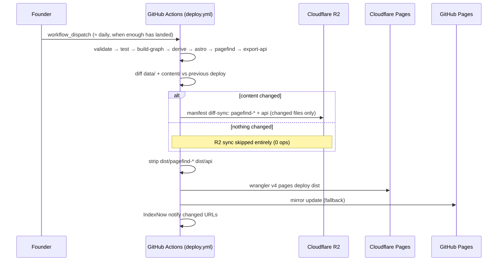

# 06 · Deployment

_Canonical rules: `AGENTS.md` ("Deployment is manual and the founder's
alone"), `docs/agents/workflow.md` §9, `workers/r2-sync/README.md`, and the
workflow files in `.github/workflows/`._

## 1. Environments

| Environment | Where | Updated by |
|---|---|---|
| Production site | Cloudflare (site Worker on R2 + Pages for code), `islam.museum` (+ `www`) | `deploy.yml`, manual |

**What goes where (founder rule, 28 Oct 2026).** Cloudflare Pages and the site Worker's static assets hold only code and logic (scripts, styles and a few root pages); the HTML pages, data, content, maps, images, pictures, video, search indexes and the open-data JSON are on Cloudflare R2, served through the site Worker or at api.islam.museum (founder rule, 28 October 2026).

| Goes to Cloudflare Pages / Worker assets | Goes to Cloudflare R2 |
|---|---|
| `_astro/` (built JS and CSS), `vendor/`, `_headers`, `_redirects`, root `index.html` and `404.html` | `ar/`, `en/`, `ur/` (HTML pages), `pagefind-*` (search), `api/` (open data), `media/` (images, maps, cards, Explorer images), `edu/`, `timeline-data/`, `gift-shop/`, `brand/`, `openapi/` |

Adding a new data or media folder: add it to `R2_DATA_DIRS` (`workers/site/src/route.js`), the publish list (`workers/r2-sync/batch/publish.mjs`), `run_worker_first` (`workers/site/wrangler.production.toml`) and both `rm -rf` lines in `deploy.yml`. Root-level data files (sitemaps, favicons, `llms.txt`, `search-synonyms.*.json`, `feed.xml`) still ship with the assets: moving them needs a root publish target and is the next step.
| Search + API | R2 bucket `islam-museum-search`; `api.islam.museum` custom domain; public R2 URL for pagefind base | r2-sync worker in `deploy.yml` |
| Fallback mirror | GitHub Pages | `deploy.yml` |
| CI checks | GitHub Actions `validate.yml` | every PR |
| Local preview | `npm run dev` (graph+derive+api, then Astro dev), `npm run build` for prod-like output | developer |

## 2. Deploy pipeline

Key detail: HTML is also publishable via R2 (the `r2-html-test` workflow
exists), but the primary static host remains CF Pages; R2 carries the
content-addressed pagefind chunks and `api/v1` JSON.

## 3. Secrets and variables (GitHub repo settings)

| Name | Kind | Purpose |
|---|---|---|
| `CLOUDFLARE_API_TOKEN` | secret | Pages deploy + worker deploy (scoped) |
| `CLOUDFLARE_ACCOUNT_ID` | secret | account |
| `R2_ACCESS_KEY_ID` / `R2_SECRET_ACCESS_KEY` | secret | R2 manifest sync (write to `islam-museum-search`) |
| `PAGEFIND_BASE_URL` | variable | public R2 URL baked into HTML at build (`PUBLIC_PAGEFIND_BASE`) |

No secrets ever enter the repo or the published files — `check-static.ts`
and review keep it that way.

## 4. Cloudflare edge configuration (manual, documented in plan 03 §6)

- DNS proxied; SSL Full (strict); HSTS.
- Cache: HTML edge ~1h / browser ~10min; hashed assets 1y; `/api/` 1 day +
  stale-while-revalidate; pagefind chunks `immutable, max-age=31536000`.
- Redirects: `_redirects` handles `/api/*` → `api.islam.museum` (301 — Pages
  cannot proxy cross-host) and entity slug renames; root → language by
  Accept-Language rule.
- Transform rules: CORS `*` on `/api/*`; `remove-logging` strips NEL/
  Report-To; **Scrape Shield email obfuscation OFF** (injected JS broke the
  no-JS and privacy claims — do not re-enable).
- Web Analytics: cookieless.

## 5. Rollback

| Failure | Rollback |
|---|---|
| Bad content build | Revert the commit on `main` via PR, founder re-runs `deploy.yml`; CF Pages also keeps prior deployments for instant rollback |
| Broken deploy workflow | Site keeps serving last good build — deploys are additive |
| R2 desync | Re-run r2-sync (manifest is the source of truth; re-seed via `r2-seed.yml` if the bucket is empty) |
| Cloudflare outage / account issue | GitHub Pages fallback mirror |

## 6. Agent procedure around deployment

- Pushing to `main` (via merged PR) publishes **nothing**. No agent may run
  `deploy.yml` (`gh workflow run`, Actions tab, or a push trigger).
- If work needs to be live: say so — name the commits, what changed, and
  whether a Worker or workflow file is among them. The founder deploys.
- PRs DO run `validate.yml` (validate + tests + build) — that is the agent's
  CI feedback loop.

## 7. Pre-deploy checklist (founder)

1. `main` green on `validate.yml` for the latest merge.
2. `npm run coverage` current if entities changed.
3. No pending `submission-impacting` items contradicting DPGA/UNESCO claims.
4. Dispatch `deploy.yml`; verify a sample: an entity page, `/api/v1/meta/coverage.json`, one Pagefind search, `https://islam.museum` root redirect.
