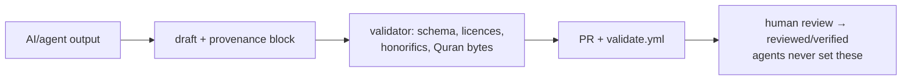

# 08 · Security

## 1. Threat model

A static site with no backend has a small attack surface. The real risks are
**supply chain**, **deploy credentials**, **content integrity** and
**licence/privacy claims** — not injection or session attacks.

| Threat | Likelihood | Impact | Controls |
|---|---|---|---|
| Compromised deploy credentials | low | high | Secrets only in GitHub repo secrets; scoped CF token; deploy is manual founder-only; `r2-secrets-check.yml` validates presence/scope without exposing values |
| Malicious PR (agent or human) | medium | high | PR-only ruleset on `main` (no direct push, no force-push, no delete); `validate.yml` on every PR; change-gate proposals; no-go registry for submission-quoted files; audit via attribution trailers + provenance blocks |
| Bad content (vandalism, invented facts, sectarian slant) | medium | medium | Schema + rule validator; draft-status + human review; two-sources rule; perspectives structure; "describe the act, attribute the judgement" voice rules; AI output never marked verified |
| Dependency supply chain | medium | medium | Small, pinned dependency set (ajv, edtf, graphology, yaml, tsx, vitest, Astro toolchain); `package-lock.json`; site-deps test |
| Copyright/licence leakage into git | medium | high (legal + submission claims) | `docs/sources-policy.md`: no verbatim text >40 words, no source files, no dumps in git; media licence whitelist in `schema/enums/licenses.yaml` enforced by validator; harvest layers keep restricted material outside git |
| Sacred-text corruption | low | very high | Qur'an passages only from frozen Tanzil files; committed sha256; validator re-verifies every ayah byte-for-byte; ﴿ ﴾ banned in prose |
| Privacy regression (cookies/forms/3rd-party JS) | low | medium | `check-static.ts` audits built output; Cloudflare NEL and email-obfuscation disabled deliberately; cookieless analytics only |
| DDoS / bandwidth exhaustion | low | low | Cloudflare edge cache absorbs; static origin; no dynamic endpoints |
| Account/host loss | low | medium | Entire site + history reproducible from the public repo; GitHub Pages fallback mirror; ADR 0001 durability argument |

## 2. Identity and access

- **GitHub:** `main` protected by ruleset; founder is sole owner
  (`GOVERNANCE.md`, CODEOWNERS). Agents merge their own PRs — acceptable
  because validation is executable and every commit is attributable.
- **Cloudflare:** founder's account only; deploy tokens scoped to
  Pages/R2; no visitor-facing Workers (plan 03 §6).
- **No user accounts exist** — nothing to breach, no PII collected.

## 3. Content security pipeline

## 4. Prohibited-content controls

- No figurative depictions of prophets or Companions; no AI-generated
  portraits — media `kind`/`license` enums + review.
- Honorifics are rendered by UI, never typed — validator regex.
- Tension cards: ≥2 cited voices, no verdict — review.
- A person's faith recorded only with its basis, never inferred.

## 5. Data integrity of submissions

Two formal submissions (DPGA GID0094424, UNESCO dossier, both 17 Oct 2026)
quote repository state — record counts, licences, privacy posture,
architecture. `docs/ai-change-gates.md` §3 forces every proposal to carry a
`submission-impacting` / `non-impacting` label and requires the claims
register to be updated in the same commit when facts change. This is a
**security control for institutional truth**, unique to this project.

## 6. Incident response

There is no on-call: nothing runs at runtime. A bad deploy is reverted via
PR + founder redeploy, or by rolling back the CF Pages deployment. A bad
commit found later is reported to the founder with hash + broken gate
(change gates §9) — never reverted blindly, because parallel lanes must not
lose work.
