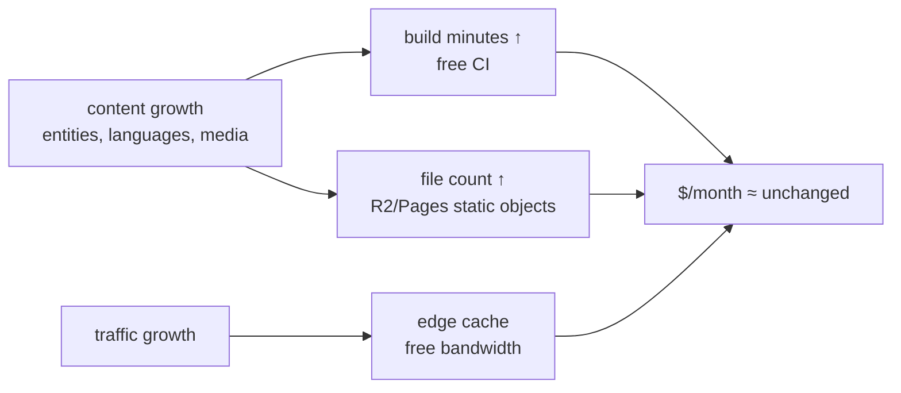

# 09 · Cost analysis

## 1. Runtime cost: effectively $0/month

| Component | Provider / plan | Limit that matters | Cost |
|---|---|---|---|
| Static hosting | **Cloudflare Pages, paid plan** | file count (the reason it was chosen over GitHub Pages on 18 Oct 2026 — a 60k+ file site) | the only recurring paid item (per-site plan) |
| Search index + API JSON | Cloudflare R2 | 10 GB free storage, zero egress, 1M writes/10M reads per month free; manifest-diffed sync keeps writes tiny | ~$0 inside free tier |
| CDN / DNS / SSL / analytics | Cloudflare free | unlimited bandwidth, cookieless Web Analytics | $0 |
| Fallback mirror | GitHub Pages | static, rarely hit | $0 |
| CI | GitHub Actions | generous for public repos; ~35 min builds, PR-validated | $0 |
| Search engine | Pagefind (static index) | no service at all | $0 |
| Maps | MapLibre + self-hosted PMTiles on R2 | no tile API keys | ~$0 |
| Email/community | GitHub Discussions + issue forms | free | $0 |

**Marginal cost per additional visitor: $0.** Bandwidth is free-tier Cloudflare;
there is no origin compute to scale.

## 2. Build-side (harvest) costs — one-time and hobbyist-scale

The expensive part of this project is deliberately **offline and already
owned**:

| Item | Cost |
|---|---|
| Founder's Mac (local models via Ollama, DuckDB, Python venvs) | already owned |
| 1 TB external drive (`/Volumes/exmicroSD/islam-museum-harvest`) | ~$60–90 one-time, owned |
| ~215 GiB of dumps (Wikidata 96 GiB, 35 Wikipedias, OpenITI, GeoNames, Pleiades, Met, Natural Earth, ETOPO1) | bandwidth only |
| Electricity for multi-hour downloads/renders (caffeinated tmux sessions) | negligible |
| AI model usage for content pipeline | API spend on frontier models where used, or $0 for local Ollama models; all spend is one-time content production, never per-visitor |

## 3. Why the architecture keeps costs flat

- Visitor traffic never touches compute → traffic is not a cost driver.
- Content growth only increases build time (free CI minutes on a public
  repo) and object count (well inside free limits).
- The single conscious spend — CF Pages plan — buys a file-count limit, not
  traffic.

## 4. Scale scenarios

| Scenario | Expected cost impact |
|---|---|
| 10× visitors | none (edge cache, R2 egress free) |
| 10× entities (~300k files) | build time ↑ (still free); CF Pages file limit must be re-checked — R2 HTML publishing path (`r2-html-test`) is the pre-built escape hatch |
| +5 languages | linear pagefind/page growth; phased per roadmap |
| Pagefind index too heavy | documented fallback: Worker + D1 FTS5 — small paid Workers tier if ever needed (plan 03 §7) |
| Media-heavy phase (illustrations, 3D) | R2 storage is the only metric to watch; free egress remains |

## 5. Funding context

`docs/funding-justification.md` exists because the project's costs are
**people and curation time**, not infrastructure — plus the paid hosting
line above. The museum will not run ads, sell data, or paywall (the
funding doc lists what it will not do).
