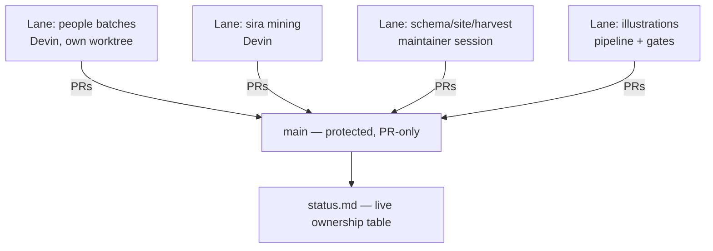

# 10 · Extensibility

## 1. The extension model: everything is a file + a lane

New capability arrives as (a) schema/data changes, (b) pipeline scripts,
(c) site components, or (d) a **delegation lane** — a scoped stream of work
with an owner listed in `docs/status.md` / `docs/agents/lanes.md`. Nothing
requires forking architecture.

## 2. Recipes

### 2.1 Add an entity class

1. Write `schema/<class>.schema.json` extending `_base.schema.json`;
   register enum values if needed (`schema/enums/`).
2. Add templates (`templates/<class>.{yaml,md}`).
3. Add the class to validators/graph builders where class lists are
   enumerated (`scripts/lib.ts`, `wings.ts`, derive maps).
4. Site: the generic entity page `[lang]/[class]/[slug].astro` usually
   suffices; add a layout only for a new anatomy.
5. Proposal label: **submission-impacting** (changes class counts quoted in
   submissions) → founder sign-off required.

### 2.2 Add a language

1. `i18n/<lang>.yaml` UI strings.
2. `content/<lang>/` prose tree; add the language to the validator's
   required/optional lang lists.
3. Pagefind run `pagefind-<lang>` in the build; R2 sync list; `strip` list.
4. RTL if needed — logical CSS already handles direction; add font preload.
5. Phased per `docs/plan/06-roadmap.md` Phase 4; language additions are
   **submission-impacting** (published-language claims).

### 2.3 Add an interactive island

1. Write the component (Svelte preferred, `site/src/components/`);
   lazy-mount with `client:visible`.
2. Guarantee the page is fully readable without it (progressive
   enhancement); `check-static.ts` + Lighthouse keep this honest.
3. Feed it from derived JSON (build-time), never a network call to our
   compute — there is none.

### 2.4 Add a predicate

1. Append to `schema/predicates.yaml`: id, domain, range, inverse, labels.
   Registry is append-only in spirit — never rewrite wholesale.
2. Inverses are free: `build-graph.ts` materialises them.

### 2.5 Add a harvest lane

1. Define scope + owner in `docs/agents/lanes.md` / `docs/status.md` — that
   listing IS the standing approved proposal (change gates §1).
2. Keep raw material in `$HARVEST/` licence layers; only rewritten + cited
   candidates reach `data/` via PR as `draft`.
3. Unresolved refs → `data/_stubs.d/<lane>.yaml` (your own file).
4. ≤25 entities per batch; `npm run coverage` in the same commit.

### 2.6 Add an API endpoint

`scripts/export-api.ts` emits new JSON under `api/v1/`; remember
`/api/*` 301s to `api.islam.museum` and gets `Access-Control-Allow-Origin:
*` at the edge. `api/v1/meta/coverage.json` shows the convention.

## 3. Delegation model (how the project already scales authorship)

Rules that make it safe (docs/agents/workflow.md, ai-change-gates.md):

- One worktree/clone per session; explicit-path commits; fetch + three-way
  merge before every push; never revert others' work; duplicates → aliases.
- Proposals required for anything outside a listed lane; no-go registry
  protects submission-quoted files.
- Shared files append-only; per-lane stubs; coverage regenerated per commit.
- Every commit attributable: `AI-Agent`/`AI-Model`/`AI-Editor` trailers.

## 4. Deliberately open extension points

| Idea | Path paved |
|---|---|
| Heavier search | Worker + D1 FTS5 fallback documented (plan 03 §7) |
| HTML on R2 | `r2-html-test.yml` workflow already proves the route |
| Arabic-slug URLs | aliases → redirects mechanism exists |
| More media kinds | `map`/`illustration` kinds already added to media enum; renderer pipeline in `scripts/media/` |
| New wings/halls | `wings.ts` membership + hall pages are data-driven |
| Third-party reuse | `api/v1` + CC0 data + CC BY-SA prose + `llms.txt` are the product |

## 5. What is NOT extensible by design

Runtime compute, accounts, per-visitor anything — ADR 0002. If a feature
needs a server, it ships as precomputed data or it does not ship.
