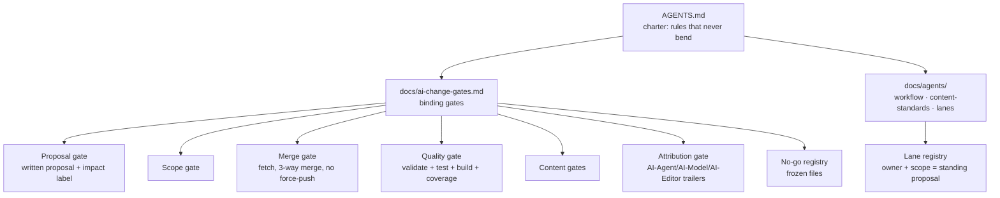

# 12 · The AI ecosystem — how agents build this museum

islam.museum is, as far as we know, one of the first large cultural
knowledge projects built **primarily by AI agents under written law**. This
document describes the whole system: who the agents are, what they do, the
framework that governs them, the guardrails, and where AI can never go.

_Canonical sources: [`AGENTS.md`](../../AGENTS.md) (the charter),
[`docs/ai-change-gates.md`](../ai-change-gates.md) (binding gates),
[`docs/agents/`](../agents/README.md) (vendor-neutral agent documents),
[`docs/plan/09-ai-content-pipeline.md`](../plan/09-ai-content-pipeline.md),
[`docs/plan/15-local-harvest.md`](../plan/15-local-harvest.md),
[`docs/plan/10-image-generation.md`](../plan/10-image-generation.md),
[`docs/plan/22-illustration-run.md`](../plan/22-illustration-run.md),
[`docs/agents/lanes/`](../agents/lanes.md)._

## 1. The two-worlds rule (the master switch)

> **AI exists only in the build phase. On the published site there is none.**

ADR 0002: nothing a visitor requests calls a model, a server or any code of
ours — ever. Search, recommendations, "on this day", maps and share cards
are precomputed artefacts. This single decision removes the entire class of
"AI product" risks (cost per user, hallucination served live, model drift,
vendor lock-in) while letting the project use frontier models for the part
they are good at: research, drafting, extraction and verification at scale.

## 2. The agents

The project is authored by a **multi-vendor agent workforce** plus the
founder — deliberately vendor-neutral so no single model's failure modes
dominate:

| Agent | Typical work | Where it runs |
|---|---|---|
| Claude (maintainer sessions, multiple worktrees) | schema, validator, site, events, places, maps, harvest tooling | founder's Mac, `.claude/worktrees/` |
| Devin | content lanes (Prophetic-era people, sira mining, mawsua/library batches), engineering docs | own clone, PRs |
| Codex / Antigravity / other vendor sessions | book-mining work orders (`docs/delegation/*-prompt-*.md`) | own environments |
| Background content workers | batch lanes: `mawsua-wXX-YY` PRs (library mining) | CI-visible as dozens of small PRs |
| Local models (Ollama on the founder's Mac) | extraction, judging, embeddings, image generation — offline, free | harvest workspace |
| Humans | founder review, merge decisions, deployment, governance | — |

Vendor files (`CLAUDE.md`, `GEMINI.md`, `.kiro/steering/`, copilot
instructions, `.cursor/rules`) are all **one-line pointers to `AGENTS.md`**
— rules exist once, because vendor-specific copies drifted and agents
repeated each other's mistakes (`docs/agents/README.md`).

## 3. What AI actually does (task inventory)

| Task | Where | Status of output |
|---|---|---|
| Mine books into entities (sira: al-Raheeq, Ibn Hisham juz' 4; library "mawsua" batches; al-Azhar academy texts) | `docs/agents/lanes/*.md`, `docs/delegation/` | `draft` + provenance; ≤25 entities/batch |
| Author/extend people, groups, places, works, concepts, events | lanes `prophetic-people`, `library`, … | `draft` |
| Translate prose ar → en, ur (same-commit rule) | lane `en-translation`, every content commit | `draft` |
| Extract facts from Wikidata/Wikipedia/OpenITI dumps | `scripts/harvest/` + local models | licence-layered; only rewritten+cited facts enter `data/` |
| Judge/verify extracted candidates | second model family as judge (plan 09 §5, 15) | advisory; human still owns `reviewed` |
| Generate illustrations | `scripts/media/illustrate/`, Z-Image-Turbo (Apache 2.0) only; FLUX klein cached but non-commercial → never published | `draft`; pipeline may auto-approve after 4 gates |
| Render event maps | `scripts/media/maps/` (deterministic renderer, not a diffusion model) | `draft` |
| OCR library books | harvest drive, `microsd-ocr-status.md` | OCR text stays outside git |
| Write/run CI, validators, site components | maintainer lanes | code, reviewed by tests |
| Reconcile places to GeoNames/Pleiades | `scripts/harvest/collections/` | suggested matches, applied deliberately |

What AI does **not** do: serve anything at runtime, mark content
`reviewed`/`verified`, type Qur'an text, type honorifics, merge or delete
other agents' work, run deploys, or edit submission-quoted files without
sign-off.

## 4. The governance framework

### 4.1 Proposal gate — no drive-by edits

Every change outside a registered lane needs an approved written proposal
stating files, intent and a **risk label**:

- `submission-impacting` — could alter claims in the filed DPGA/UNESCO
  submissions (counts, licences, privacy, architecture). Needs explicit
  founder sign-off **and** a same-commit update to the claims register.
- `non-impacting` — internal/cosmetic. Still needs approval.

A lane listing in `docs/agents/lanes.md`/`docs/status.md` (owner + scope)
**is** the standing approved proposal for that stream — this is what lets
dozens of parallel batches proceed without per-PR permission.

### 4.2 Lanes — scoped work, registered ownership

`docs/agents/lanes/` holds the active lane documents (illustrations, library,
raheeq, hisham, prophetic-people, azhar-academy, en-translation, muwatta,
prose-backfill ×2, maintainer, education — the last a phased lane where the
founder approves each phase in writing before the next starts, recorded in
its master plan). Each lane doc specifies: goal, owned paths,
paths it may *use but never edit*, branch naming, progress file, stub file,
commit format, batch limit. Handoff is documented: a new agent resumes from
the lane's progress file "next step" — the institutional memory lives in
the repo, not in any model's context.

### 4.3 Merge & collaboration gates

- `main` accepts **PRs only** (ruleset since 22 Oct 2026); agents merge
  their own — there is no human review bottleneck, but validation is
  executable and attributable.
- Before every push: fetch + review what arrived, three-way merge keeping
  both sides' intent, never revert others' work, duplicates become aliases.
- Shared files (`_stubs.yaml`, `status.md`, enums) are append-only;
  per-lane stubs in `data/_stubs.d/`.
- `npm run coverage` regenerates `docs/coverage.md` in the same commit —
  the public dashboard can never lag the data.

### 4.4 Attribution gate

Every agent commit ends with `AI-Agent:`, `AI-Model:`, `AI-Editor:`
trailers (`unknown` allowed but must be truthful). The same facts go into
each entity's `provenance` block (`generated_by`, `model`, `run`, `source`).
Result: the founder can always answer *which model wrote this fact* — a
guarantee almost no AI-assisted project elsewhere can give.

### 4.5 Violations

A gate-breaking commit is not blindly reverted (that would break parallel
lanes); it is reported to the founder with hash + gate, and the founder
decides (change gates §9).

## 5. Content guardrails — executable, not advisory

This is the distinctive feature: the rules AI must obey are **code**.

| Guardrail | Enforcement |
|---|---|
| AI output is `draft` forever (until a human reviews) | schema + review; `status.review` settable only by humans; sole exception: pipeline-approved illustrations with gate-report hash + daily audit file |
| Provenance on every AI artefact | schema-required block; commit trailers |
| Never type Qur'an text | validator rejects ﴿ ﴾ in prose; passages only from frozen Tanzil, sha256 re-verified byte-for-byte every build |
| No typed honorifics | validator regex on labels/summaries/prose/alt text; UI renders them |
| Every dated fact: two sources or a flag | validator + content-standards |
| Sunni-first perspectives ordering | validator rejects non-Sunni first view; ordering Sunni → academic → other |
| No "enemy of Islam" voice; describe the act, attribute judgement | content gates + review; exact-pattern scans used in practice |
| Licence walls | media whitelist enum; verbatim source text >40 words banned; source dumps physically outside git |
| Depictions | no prophets/Companions/portraits, no living artists named — see §6 |
| Trilingual rule | ar required at validation; en+ur same-commit by policy |
| No-JS readability, WCAG 2.2 AA | `check-static.ts`, Lighthouse CI |

And the **process** guardrails: ≤25 entities per batch, explicit-path
commits, small validated pushes ("work can be lost if credit runs out —
push often"), progress files as shared memory.

## 6. The image pipeline — the strictest AI lane

`docs/agents/lanes/illustrations.md` is a model of how to let generative AI
into a sensitive domain. Non-negotiables:

1. **No prophet ever depicted** — no figure, silhouette, hand, light-beam
   stand-in: Prophetic-era and `roles: [prophet]`-linked entities render
   `figure_policy: none` (landscape/objects/light only). Companions and
   family likewise.
2. No likeness of any real person; person pages get attribute still-lifes.
3. **No text inside images** — OCR gate fails on any recognised letter.
4. **Nothing invented** — every visible element traces to page data, prose
   cues (with source sentences) or the sourced `accuracy.yaml` table.
5. Licensed models only: Z-Image-Turbo (Apache 2.0) for publication; FLUX
   klein (non-commercial licence) banned from anything reaching `data/` or
   `site/`.
6. Model snapshot, seed, steps, size, quantisation and **prompt hash**
   recorded per image → reproducible.

**Automated approval gates (§3):** an image is `approved_by: "pipeline"`
only if it passes all four — (a) OCR + face detection, (b) anachronism
check via vision-language model against the period's forbidden
architecture, (c) prompt lint, (d) figure-policy compliance — else the seed
is rejected and re-queued once at seed+100. Every approval is appended to a
daily audit file. This is the *only* place in the project where a pipeline
may set anything above `draft`, and even then it's a machine decision with
a hash, not a judgement.

## 7. The AI content pipeline (plan 09) and local harvest (plan 15)

The pipeline stages: discover → pull → verify (extractor + **judge from a
different model family** + embeddings for dedup) → store as static JSON →
serve. Verification depth (plan 09 §5): cross-source agreement, two-source
dating, flag-not-invent. Models: frontier APIs where quality matters, local
Ollama models for bulk extraction/judging — free, offline, private.

The harvest drills: Wikidata two-pass streaming filter (96 GiB dump never
decompressed), Wikipedia per-language category-walks → compressed-block
extraction, OpenITI classical corpus, Met/Pleiades/GeoNames collections,
directory and web harvests — all into licence-separated layers, all outside
git, all entering `data/` only as rewritten, cited, draft candidates.

## 8. Failure modes the system is designed for

| Risk | Design answer |
|---|---|
| Hallucinated facts | two-source rule, draft status, provenance, human-only `verified` |
| Sectarian drift / bias creep | scope doc + enforced perspectives ordering + labelled views |
| Copyright leakage | sources-policy (rewrite, cite, ≤40-word quotes) + licence layers + validator |
| Vendor prompt drift | single `AGENTS.md` + pointers; vendor files are one-liners |
| Credit/session loss mid-work | small pushes, progress files, lane handoff docs |
| Agents clobbering each other | lanes, three-way merges, append-only shared files, no-revert rule |
| Submission claims going stale | impact labels + same-commit claims-register updates |
| Model misuse of licensed weights | per-lane licence rules (FLUX never published), recorded prompt hashes |
| Runaway automation | deploy is human-only; `reviewed`/`verified` is human-only |

## 9. What remains / could be better

- **Review mass** — the bottleneck moved from generation to human review;
  reviewer tooling (diff-review UI, sampling audits per lane) is the next
  leverage point.
- **Judge independence** — the cross-model judge pattern exists; a periodic
  golden-set re-scoring of already-merged draft entities would measure
  drift.
- **Model registry** — provenance records model names per entity; a
  `docs/agents/models.md` register of approved models/licences would make
  the whitelist explicit like the image lane already has.
- **Metrics** — coverage counts entities; a per-lane acceptance rate
  (surviving review) would turn the provenance data into quality signal.
- **No-go registry growth** — as more external claims are filed (funders,
  archives), the frozen-files list will need the same discipline.
