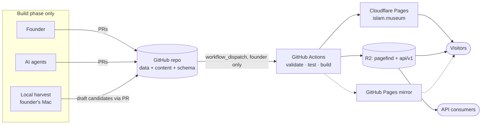
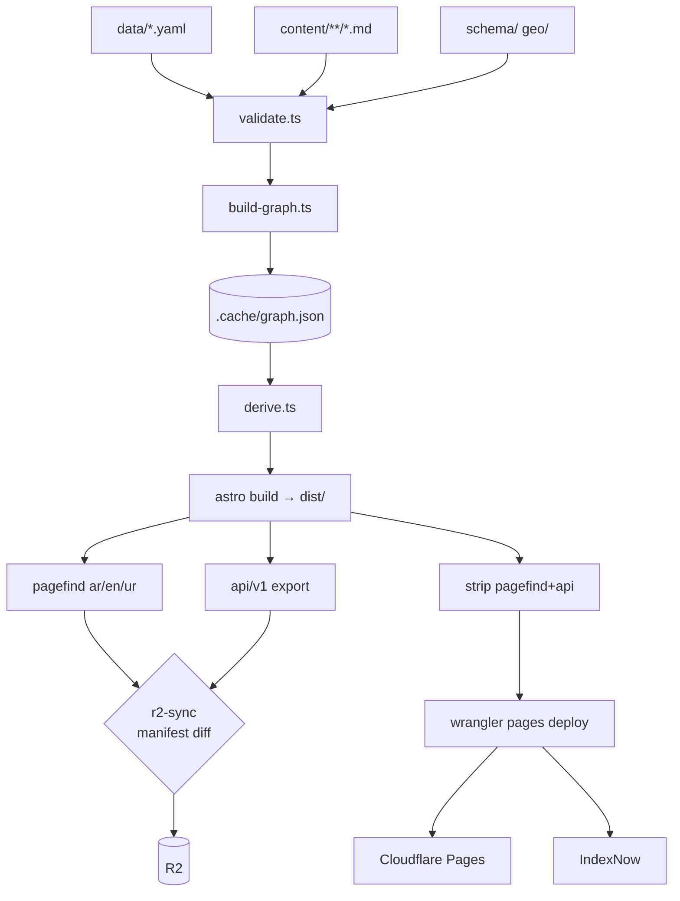
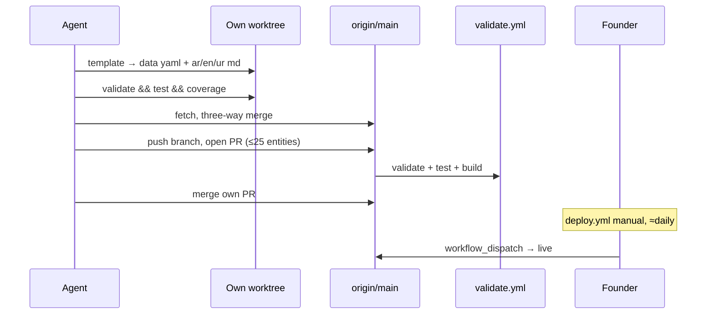
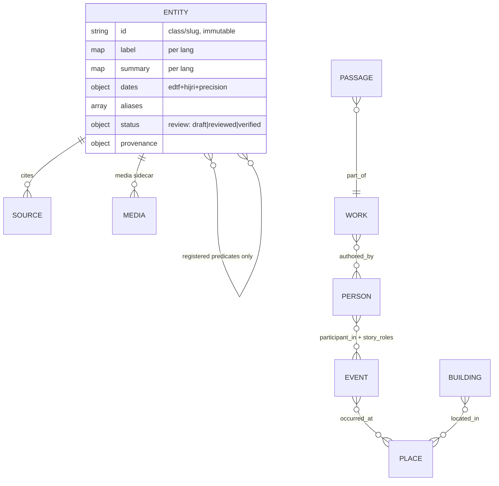
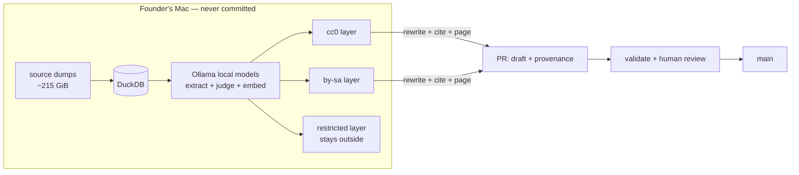
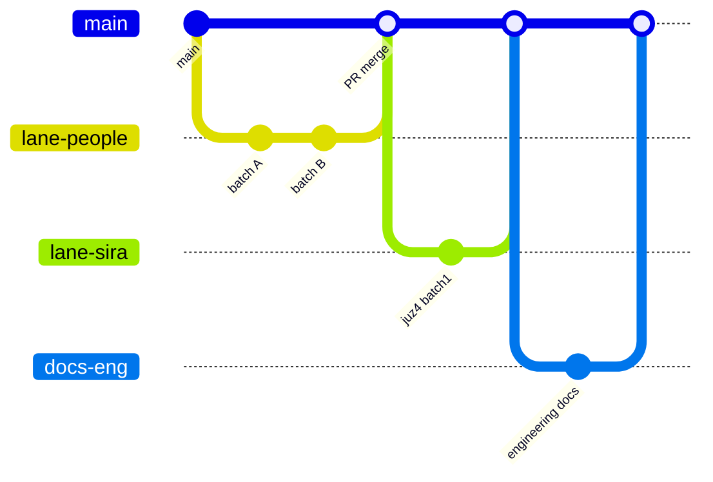
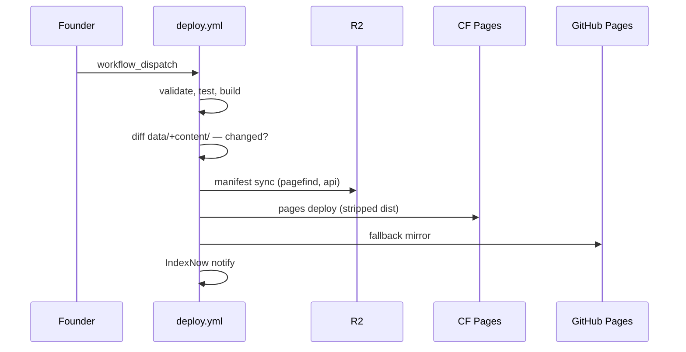

# Diagrams — islam.museum engineering set

All diagrams in one place (also embedded in the numbered docs). Mermaid —
renders on GitHub.

## 1. System context



## 2. Build pipeline flow



## 3. Content authoring sequence



## 4. Content model (simplified ER)



## 5. Harvest data flow (outside → inside git)



## 6. Parallel-lane collaboration (gitGraph)



## 7. Request path (visitor)

```mermaid
sequenceDiagram
    participant B as Browser
    participant CF as Cloudflare edge
    participant P as Pages origin
    participant R2

    B->>CF: GET /ar/person/ibn-sina
    CF-->>B: cached HTML (hit) — or P on miss
    B->>CF: first search → pagefind chunk
    CF->>R2: fetch chunk (miss)
    R2-->>B: immutable, cached forever
    B->>B: search runs locally; islands hydrate
```

## 8. Deploy sequence


