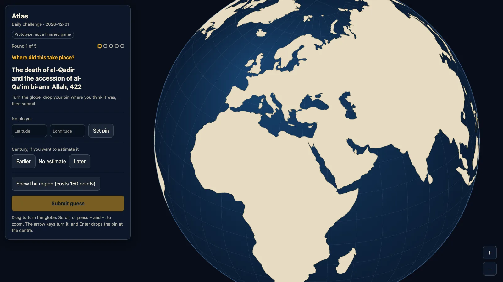
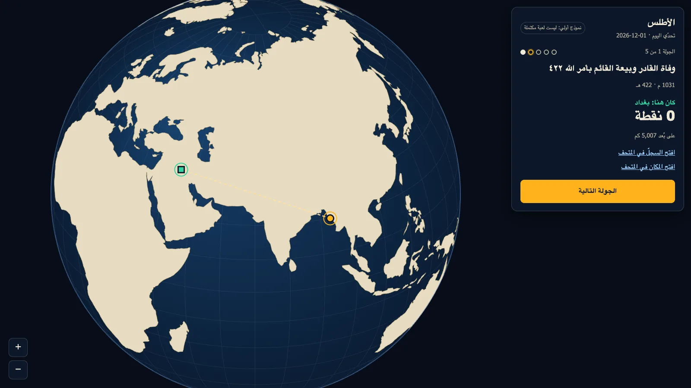
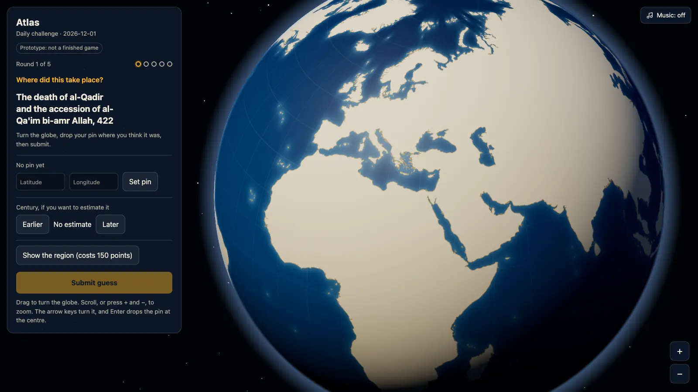
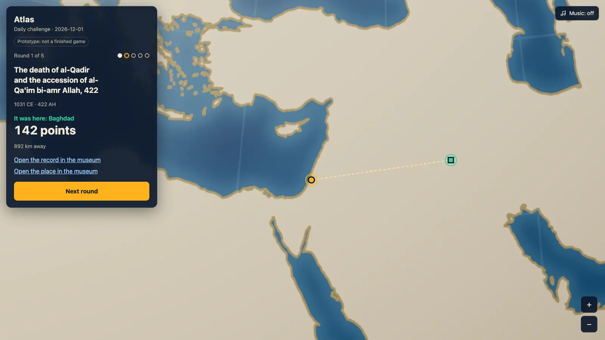

# Atlas — The Historical World Challenge: state of the game

_25 November 2026. Release status: **prototype** (specification scale: planned / prototype / alpha / candidate / validated / released). GDD: [`../spec-v2/games/atlas.md`](../spec-v2/games/atlas.md). Code: `gaming/games/atlas/`. Not on the site._

## What exists

A playable daily game of five rounds, and a practice mode. Each round names one museum record (an event, or a person) and asks where it happened: turn a globe, drop a pin, optionally estimate the century, submit. The reveal draws the great-circle line from the guess to the place, gives the distance and the points, names the place and the year in both calendars, and links to the record and to the place on islam.museum. After five rounds: a total, a row of marks that names nothing, and a copy button.

It plays with the mouse, with the keyboard alone (arrow keys turn the globe, Enter drops the pin), or by typing coordinates. It remembers a daily game across a reload. It runs in the museum's seven languages, right-to-left for Arabic and Urdu, and the globe is never mirrored.




## Where the questions come from

Every round is a museum record joined to the museum place where it happened; the game adds no fact of its own ([G-0006](../adr/G-0006-atlas-content-pack.md)). `gaming/games/atlas/tools/build-pack.ts` reads `data/` and writes a pinned pack. Built from the museum's records as of commit `0efdf22a5ad` (they have not changed since), rebuilt on 25 November 2026 with the fairness rule below (pack digest `60ba50cd200c…`):

| | |
|---|---:|
| Places that qualify (city, town or site; coordinates of `site` or `locality` precision; Arabic and English name) | 1,908 |
| Rounds that qualify | 3,218 |
| of which civic and scholarly events | 771, in 119 places |
| of which births and deaths of historical figures | 1,473, in 337 places |
| of which military events | 974, in 465 places |
| Rounds in the pack (a year's schedule plus 300 in reserve for practice) | 2,125, in 568 places: 465 civic, 946 people, 714 military |
| Days scheduled | 365, using 1,825 rounds, none twice |

**The daily mix was set by this count, not by preference.** The first design had two civic events a day. The museum's precisely located, dated civic events cluster in about 120 places, and the schedule ran out on day 142. A day is therefore one civic event, two people, one military event, and a fifth round from whichever category has most left, which in practice is a second military event. A daily game that is two-fifths battles and sieges is heavier on warfare than a museum game should be, and the cure is more located civic records in the museum (foundations, journeys, books written, buildings raised), not a change in the game.

**What was left out, and why** (`gaming/games/atlas/data/report.v1.json`): 1,073 places whose coordinates the museum marks as approximate; 951 that are regions, provinces, rivers or mountains; 1,429 events and 1,087 people's birthplaces or places of death that fall on one of those; 334 events with more than one place; 203 events with no start year, 438 people with no birth year and 150 with no year of death; 866 people born after 1900; 240 birthplaces or places of death marked low confidence; and 33 events and 28 people the game does not turn into questions (massacre, persecution, expulsion, the events of revelation, schism, and any record with a `sensitivity` field).

## Fair rounds (25 November 2026)

Atlas scores a guess against the place a record is tied to. Some of the museum's events are tied to the nearest city and not to the field where they happened, and a player who pinned the place the question named was marked wrong for it. The corrective work (piece 7 of [`../traceability.md`](../traceability.md)) asked that such rounds be kept out of scoring until looked at.

**The rule** (`gaming/games/atlas/src/fairness.ts`): an event whose English name says where it happened ("Battle of X", "Siege of X", "Treaty of X" and the like) is asked only if, in at least one of its seven languages, its name contains the name of the place it would be scored at. Otherwise it is held back.

| | Before | Now |
|---|---:|---:|
| Events held back by the rule | none | 263 (258 military, 5 civic), tied to 212 places |
| Rounds that qualify | 3,481 | 3,218 |
| Military events that qualify | 1,232 | 974 |
| Rounds in the pack | 2,125 in 528 places | 2,125 in 568 places |
| of which civic, people, military | 465, 951, 709 | 465, 946, 714 |
| Days scheduled | 365 | 365, none of the 1,825 rounds used twice |

- **What is held is listed** in `gaming/games/atlas/data/review.v1.json`, each with its record and the place it is tied to, for the lane that owns the records. Nothing in `data/` was edited from here.
- **It does not tell a wrong place from a missing name.** Counted first on the pack as it was: of 531 place-named events, 133 had an English name unlike the scored place's; 43 of those were cleared because another language's name matched (Adrianople and Edirne, Bougie and Béjaïa); the rest were held. Among the held are true mismatches (Abu Klea at Khartoum, Dandanqan at Merv, Azaz at Aleppo) and spellings the museum's names do not have (Ghazdewan and Gijduvan, Gran and Esztergom). Both are for a reader of the record to settle; until then neither is asked.
- **No coordinate was checked against a source.** The rule compares names. A round that passes it is not thereby proved right, and an event not named for a place at all is not looked at by it.
- **The day's mix was kept.** With 258 battles gone, the year could no longer be laid out the old way, and the first repair made the game ask more battles (830 in the pack, from 709). The fifth round of a day now goes to the category with the most places free that day, with battles counted for less; the builder finds the lowest weight for battles that still lays out the whole year (0.62, in the report) and the pack holds 714.
- A saved daily game from the old pack is set aside, as a save from any other pack always was; the pack's digest is now `60ba50cd200c…`.

## Image rounds: decided, counted, not built

The GDD's first promise is guessing from "visual and contextual evidence", and a picture round was the next piece of work. The rule for one was written down before any code ([G-0008](../adr/G-0008-atlas-image-rounds.md)): a photograph from a museum media record, under a free licence with its author credited, whose subject the museum ties to exactly one place a guess can be scored against; no illustration, map or AI image, no pictured person, no manuscript page, nothing marked sensitive; the picture loaded from where the museum's own pages already load it; before the guess only the author and the licence under it, and the full credit at the reveal.

Then the museum's records were counted against that rule (`npm --prefix gaming run atlas:images`, at commit `361a669c3a5` on 25 November 2026; report in [`../evidence/m2/atlas/image-survey.json`](../evidence/m2/atlas/image-survey.json)):

| | |
|---|---:|
| Media records | 895, of which 658 are photographs or scans |
| Pictures that can be a "where is this?" round | **4, in 4 places** |
| Pictures of objects that can be a "where was this made?" round, free licence | 0 |
| The same under the V&A's terms, which wait for the founder | 8, in 4 places |
| Needed for one image round a week for a year | 52 |
| Needed for one a day | 365 |

**So no image round was built.** Four pictures give four days in a year, and showing the same few again would turn a geography question into remembering a picture. The museum's pictures are of objects (476 records), inventions (267) and concepts (64); 7 depict a building and 1 a place. The rule is kept as tested code (`src/images.ts`), so the count can be taken again whenever pictures are added, and the round is built when it reports enough.

## Rules, in one place

- **Distance.** Great-circle distance on a sphere of radius 6,371.0088 km.
- **Points.** 1,000 within the record's own precision (15 km for `site`, 40 km for `locality`); beyond that 1,000 × e^(−(distance − tolerance) / 450 km), rounded: about 368 at 450 km further, 108 at 1,000 km, 0 from about 3,400 km.
- **Region hint.** Shows the museum's region for the place and costs 150 points on that round. Not offered when the record names no region.
- **Century.** Optional and never part of the points. The summary says how many estimates were exactly right.
- **Daily.** One game per UTC date, the same for everyone in every language. No streak, no penalty for a missed day.
- **Scores** stay on the device and are not compared with anyone's.

## The globe, lit (25 November 2026)

The founder asked for 3D in every game ("build 3d for all the games"). Atlas's globe is now a lit sphere where the browser has WebGPU: the Earth is drawn by Three.js under the canvas that was the whole globe before, and that canvas keeps only the pins, the line from the guess to the place, the air round the limb and, when the globe is brought close, the coastline as a sharp line. Everything that plays the game (turning, zooming, dropping the pin, the keyboard, the typed coordinates) is the same code as before and was not touched. Without WebGPU, or with `&no3d=1`, the drawn globe is the whole globe again, and the game is the same game. The page says which it is showing in `data-globe` on its root (`3d` or `2d`).

- **The same picture, to the pixel.** A pin is drawn by one canvas and the coast under it by the other, so the sphere's arithmetic (`src/ui/sphere.ts`) is held by tests to Three.js's own sphere on one side and to the 2D globe's projection on the other, at more than 500 places in four views. The sphere is seen without perspective, as the drawn globe was.
- **What is on it.** The sea, the land with its coastline, a faint graticule and a paler edge of water along every coast, painted when the page loads from the same coastline the drawn globe uses (8,192 pixels across; 4,096 on a device that reports little memory). No borders and no names, as before, and for the same reason. The paler water is a drawn edge, not depth: no depth is known to the game. **No relief is shown, because the game has no elevation data**; the land is one plain tone. No photograph of the Earth is used and nothing is downloaded for it.
- **The light** stands still to the viewer's upper left and is there to give the sphere its roundness. It says nothing about the hour or the season.
- It is drawn only when the view changes, not sixty times a second.




Not done on it: terrain, rivers, any map of a past age; a view with perspective; a measurement of its cost on a weak device (it was run on one fast machine, where it added no console error, and that is all that can be said); recovery from a lost graphics device. The stars behind it are decoration and are no sky.

## Checked, and how

| Check | Result |
|---|---|
| Unit tests, `npm --prefix gaming test` | 59 Atlas tests pass (four hold the lit sphere to the drawn globe's projection; seven hold the fairness rule, the shipped pack to it, and the day's free slot). 16 are the image rule on records written for the tests (what is accepted, each reason for refusal, the image hosts read from the content security policy, and when there are enough pictures for a schedule); they test the rule, not any screen, because there is none. The other 32: distance at the antimeridian and the poles, century counting, scoring monotonic, pack digest, names in seven languages, the people rule, **every one of 365 days valid**, a broken schedule caught, UTC day counting over month ends and leap days, a full game, hint cost, immutability, share marks, practice dealing, save round trip, unreadable and newer saves, damaged entries, games from another pack not resumed, and the seven string files holding the same keys and placeholders with no typed honorific |
| Real browser, `npx tsx tools/atlas-play.ts <dir> <lang>`, Chrome 158 | A full daily game in each of the seven languages: mouse, keyboard only, typed coordinates, region hint, century estimate, reload in mid-game, unreadable save set aside; no console error (`evidence/m2/atlas/playthrough-7-languages.md`). Totals differ between left-to-right and right-to-left runs because the script clicks fixed pixels and the globe sits on the other side of the window; the rules are the same |
| Image survey, `npm --prefix gaming run atlas:images` | Every one of the 895 media records given one verdict: 12 accepted (4 for the question as asked, 8 under a held licence), 883 refused with a counted reason. The four accepted records were read by the agent; the pictures themselves were not opened, and no licence was checked beyond what the record states |

That is a functional check by the author's own script. It is not a playtest and says nothing about whether the game is fun.

## Not done (against the GDD)

1. **No images, and not for want of a design.** The rule for an image round is decided and the museum's 895 media records were counted against it: four qualify, and one round a week needs 52 (see "Image rounds" above and [G-0008](../adr/G-0008-atlas-image-rounds.md)). What is missing is in the museum's records: photographs of buildings and places.
2. **No terrain on the globe.** Since 25 November 2026 the globe is a lit sphere in 3D where the browser has WebGPU (see "The globe, lit"), with coastlines only: no relief, no rivers, no historical map. It is not yet the "rich terrain/globe" of the brief.
3. **No regional or era modes, no route reconstruction, no artifact-origin mode**, no archive page for past days, no map skins, no clue packs for creators.
4. **Music, and no other sound.** Atlas plays the museum's suite from the shared player, opening with "Fourteen Centuries", silent until the first click, with a switch and a volume control at the top corner ([G-0007](../adr/G-0007-music-and-audio.md)). There are no sound effects, no gamepad, no remapping and no UI scale control.
5. **Fonts are the system's.** Arabic and Urdu use whatever the device has; the museum's web fonts come with the portal.
6. **Names in Turkish and Indonesian are borrowed from English for all 951 people in the pack** (the museum's person records have no `tr` or `id` label yet), and 40 Urdu names are borrowed from Arabic. The game says so on the round. This is a gap in the museum's data, noted for the translation lanes.
7. **Interface strings were written by an AI agent** in all seven languages and have not been read by a native speaker of any of them.
8. **No human has played it** other than through the script.

## Things the pack builder noticed in the museum's data

Written down for the lanes that own the records; nothing was edited.

- 1,073 place records carry `coordinate_precision: approx`. Each one upgraded to `locality` or `site` adds rounds to Atlas and precision to the museum's maps.
- 441 qualifying places have no usable region (none listed, or a region slug with no display name, such as `global`).
- Some events are tied to the nearest city rather than to the field where they happened: the battle of Abu Klea is recorded at Khartoum. Since 25 November 2026 Atlas holds such rounds back ("Fair rounds" above): 263 events, listed in `gaming/games/atlas/data/review.v1.json` with the place each is tied to. For each, either the event's `occurred_at` should name the place it happened, or the place lacks one of its names.
- 93 people who otherwise qualify have more than one `born_in` place, and 19 more than one `died_in` place.

And what the image survey noticed, on 25 November 2026:

- One of the 1,908 places a guess can be scored against has a media record that depicts it, and 7 of the 5,794 buildings do. Each photograph added for a building or place that names one scoreable place is a possible round.
- 247 building records name exactly one place (in `location` or a `located_in` relation); 214 of those places can be scored against, and 98 of those buildings carry a Wikidata id.
- Three free photographs of buildings are recorded and hosted by the museum (`media/photo-building-buyukcekmece-bridge`, `…-galata-tower`, `…-lusail-stadium`), and their building records name no place.
- 460 of the 471 objects the museum has a photograph of do not say where they were made (`made_in`).
- `media/photo-minbar-kutubiyya` is under CC BY-SA and its attribution reads "see file page for author and licence": the author is not in the record.
- `place/medina` has no `coordinate_precision`.
- Seven image records point at hosts the museum's content security policy does not allow images from (`collectionapi.metmuseum.org`, `iiif.wellcomecollection.org` twice, `content.staatsbibliothek-berlin.de`, `muslimheritage.com`, `iiif-images.library.upenn.edu`, `archive.org`). Whether the museum's own pages show them was not checked here.

## To play it

```bash
npm --prefix gaming ci
npm --prefix gaming run dev
# http://127.0.0.1:4330/games/atlas/index.html?lang=ar          today's challenge
# …?lang=en&date=2026-12-25                                      another day
# …?lang=fr&mode=practice                                        practice
```
