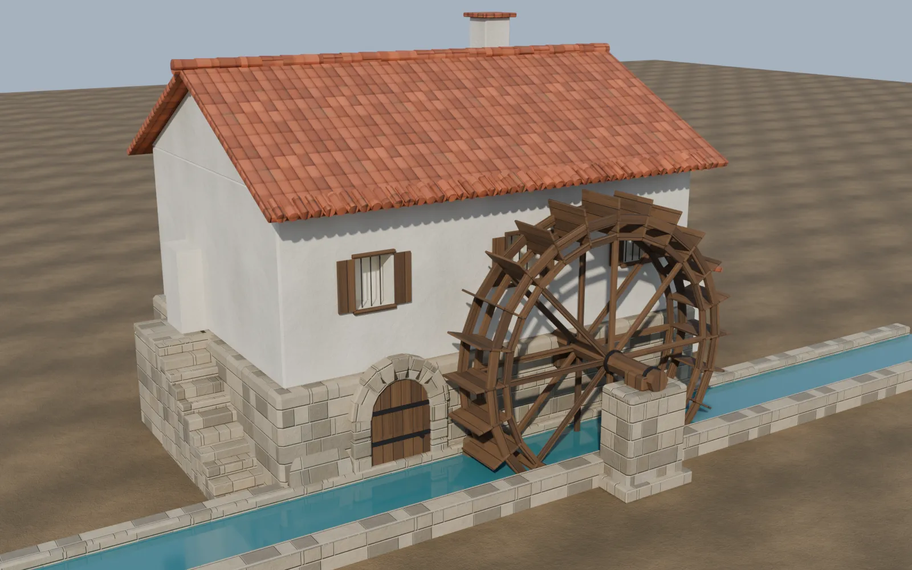
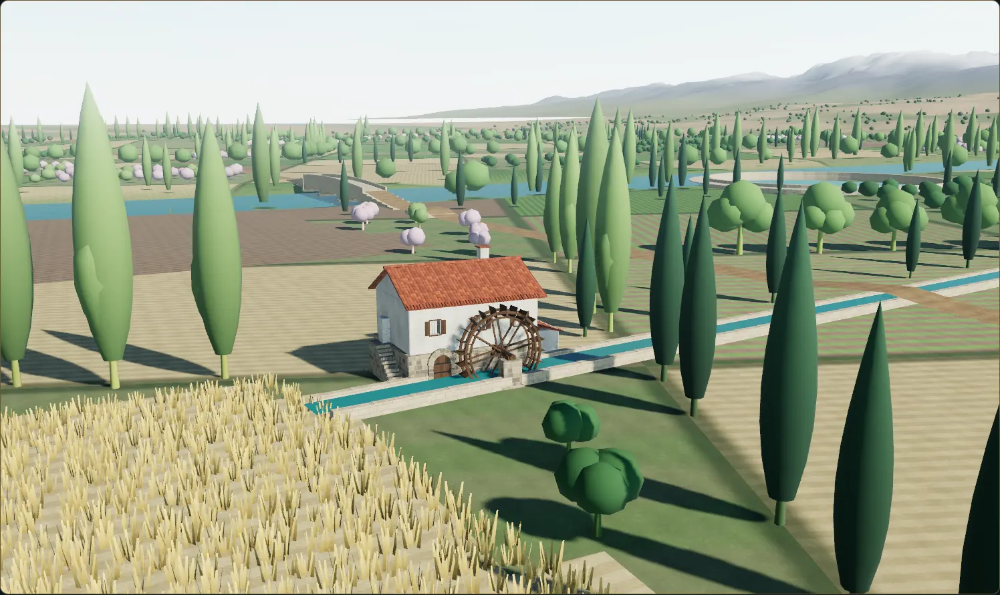
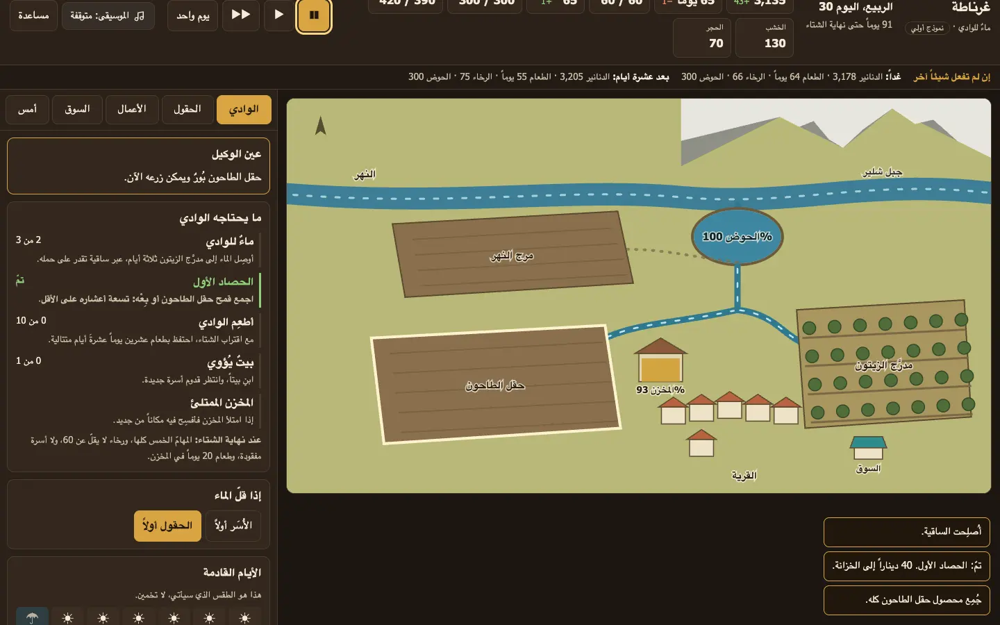

# Granada: state of the game

_Updated 26 November 2026. Release status: **prototype**, on the test address only. Three years of the campaign can be played from start to finish in a browser, in seven languages, with the mouse or the keyboard alone, from panels and a drawn plan of the valley and in a 3D valley. **The 3D valley has the structure of the founder's target picture and not its finish** (see [`../spec-production/proof-granada.md`](../spec-production/proof-granada.md), which awaits his judgement). No person has played it: every playthrough so far is the author's script. Nothing has been measured on the founder's minimum machines. Its history is marked "historical review pending" and no reviewer is named. The step-by-step record is [`../LEDGER.md`](../LEDGER.md); what follows below "Added on 26 November 2026" is older and is corrected where it had become untrue._

The founder's design is in [`../spec-granada/`](../spec-granada/) (the package of 25 November 2026, read in full). What was found before building is in [`../granada/g0-discovery.md`](../granada/g0-discovery.md); the gates are in [`../granada/acceptance.md`](../granada/acceptance.md); the decisions are [G-0009](../adr/G-0009-granada-eleventh-game.md), [G-0010](../adr/G-0010-granada-economy-kernel.md) and [G-0011](../adr/G-0011-granada-village-rules.md).

## What the game is to be

"Granada: The Last Kingdom of Al-Andalus": a strategy game in which a fictional steward repairs water, farms, trades, builds, negotiates and defends in a setting inspired by the Nasrid kingdom in 1475. Its history is to come from museum records; its prices, people, quests and outcomes are simulation and are to be labelled so. The eleventh game of the platform, and not The Golden Age renamed.

## What exists

| Piece | Files | What it does |
|---|---|---|
| Money and goods | `gaming/games/granada/src/sim/economy.ts` | A journal of whole numbers: treasury, warehouse, markets with two prices and a purse, harvests, one recipe, contracts with reservations. Commands can be retried, are refused when stale, and change everything or nothing |
| The sums a panel will show | `src/sim/appraise.ts` | Round trip, harvest forecast, processing forecast, contract appraisal, reserve status, each naming its condition |
| The first scenario | `src/sim/village.ts` (the rules of a day), `src/sim/scenarios.ts` ("Water for the Valley"), `src/sim/players.ts` (six scripted players), `tools/village-lab.ts` | A valley lived a day at a time: water shared between households and fields, crops that grow as they are watered and tended, a harvest carried into a store that may be full, households that eat and stay or leave, works paid through the ledger, five quests that are conditions on the state |
| Random play | `src/sim/random-play.ts`, `tools/fuzz-report.ts` | Random openings and commands, shared by the tests and the report |
| Geography | `src/world/geography.ts` | Great-circle distance in whole metres, a flat map centred on the city with east to the right in every language, compass direction |
| Museum records | `data/museum-records.source.json` (chosen by hand), `data/museum-records.v1.json` (built), `tools/build-records.ts` | 25 records pinned with their labels in seven languages, their review state, and coordinates for the eleven places |
| A check on the tests | `tools/mutate-economy.py` | Breaks the kernel in 18 ways and confirms the tests fail each time |
| The page | `index.html`, `src/ui/app.ts` (the page: top bar, tabs, dialogs, time), `src/ui/model.ts` (every figure shown, worked out from the rules), `src/ui/map.ts` (the valley as a plan, in SVG), `src/ui/granada.css`, `src/save.ts`, `i18n/` (190 strings in seven languages) | See "The page" below |
| A play script | `gaming/tools/granada-play.ts` | Real Chrome through the whole scenario, in a chosen language |
| Tests | `test/economy.gtest.ts` (33), `test/geography.gtest.ts` (8), `test/village.gtest.ts` (28), `test/screen.gtest.ts` (12) | See below |

## What the money and goods promise

- **Two prices.** The player buys at ask and sells at bid. A market whose ask is below its bid cannot be opened. Buying and selling straight back loses the difference: ten units of wheat at the fixture's prices cost 260 and return 180.
- **Finite markets.** A market cannot sell what it does not have or pay what it does not have. A sale it cannot afford is refused with the quantity it could take.
- **A raw crop is worth the raw price.** 6,800 olives at a bid of 28 are worth 190,400 if every unit is taken, and 145,600 if only the 5,200 that fit are. The third concept image's 435,200 is the same quantity at the price of oil.
- **A harvest that does not fit is a decision.** Refuse it, leave the rest in the field, sell the rest from the field, or accept the loss; each is counted, and a loss is written in the journal.
- **Pressing carries cost.** Five olives make one unit of oil, and what the olives cost goes with them.
- **A contract reserves.** An offer past its deadline cannot be accepted. Accepting one sets aside the goods in hand and the carriage and handling. Delivery pays in proportion, to the last minor unit however it is split. Cancelling, or missing the deadline, releases what was held once and charges the penalty once; what the treasury cannot pay is recorded as owed.
- **Where the goods came from matters.** The Málaga contract of the fixture shows 7,200 on paper with oil the player pressed, and loses 1,200 with oil bought at ask. The test does the second by actually buying and delivering.
- **Safe commands.** The same command twice has the effect of once. A command planned against an older state is refused. A refused command returns the very state it was given.

The numbers are the package's illustrations. They make pressing oil worth less than selling olives, which the package itself says must not become the game's balance. No balance has been attempted.

## The first scenario: "Water for the Valley"

Late spring. The steward of a valley district has 60 households, 1,200 dinars, 220 units of grain in a store with room for 200 more, timber and stone in the yard, and 96 days until the end of winter. A wheat field stands ripe. An olive terrace is thirsty behind a broken branch that carries a quarter of its water. A meadow by the river has never been watered.

| The player can | What it costs or does |
|---|---|
| Mend the branch | 140 dinars, 10 stone, 12 worker-days; it then carries the terrace's need |
| Rebuild and extend the channel | 420 dinars, 20 timber, 40 stone, 40 worker-days; the terrace at full flow, and water to the meadow |
| Order a ripe field brought in | Hands carry it in day by day; what does not fit waits, or is sold from the field at the market's buying price |
| Sow a fallow field | Vegetables in spring or summer, wheat in autumn, where water reaches and the crop can grow |
| Build a house or a granary | 160 dinars and 30 timber for ten more households; 240 dinars, 40 timber and 30 stone for 500 more units of store. Since 26 November 2026 the player chooses its ground |
| Buy and sell at the market | At its two prices, while its stock and its purse last |
| Say who gets water first | Households or fields, when there is not enough for both |

Five quests, each a condition the rules check and not a button: water reaching the terrace; the first harvest brought in or sold; twenty days of food held as winter approaches; a house built and a household arrived; the store once full and then with room again. The scenario is won at the end of winter if all five are done, welfare is at least 60, no household has been lost and twenty days of food are in store.

The weather and the river's year are fixed by the seed, so what a forecast shows is what will happen unless the player acts. What the lab found, and what is wrong with the scenario as it stands, is in [G-0011](../adr/G-0011-granada-village-rules.md).

## Added on 26 November 2026

Each of these is its own merged change with tests, a play-through in real Chrome in English and Arabic, and a release to the test address; the figures and what was decided alone are in the ledger.

| System | What a player can do | What it is not yet |
|---|---|---|
| A port, a press, a contract | Press olives into oil, send goods by cart to a port with its own prices and purse, three days off; take a contract that pays as oil arrives, and plan for the road | One port; no route or ship is drawn |
| Prices that move | Sell into a market and see its price fall the next morning and recover; read each price's trend in words | No silk or ceramics; the movement is a rule for play |
| Building on the land | Choose a house, a granary, a cistern or a garden and its ground, in 3D or on the plan; be refused, in words, on water, fields, roads, slopes, trees and what stands | Four things in four kinds; no castle, industry or culture; simple shapes |
| Estates | Read on a field's card who tends it, what thirst has cost, what it will give and when by the rules run forward; put one field first | One kind of estate |
| What lies ahead | See, soonest first, what will go wrong if nothing more is done; each line comes true on its day in tests | Not an adviser as a character |
| A decision and a journal | Answer the village downstream, each answer's price shown first; look back at what happened | One question a year; its two sides are not evenly weighted |
| The region | See Granada, Málaga, Almería and the Sierra Nevada at the museum's coordinates, with three layers of the game's own figures | A diagram, not a drawn map; no country's outline |
| Buildings that can be chosen; the oil's road | Click the store, the market, the estate or a placed building for its card; follow oil from grove to port and act at each step | The mill, the mosque and the houses open nothing |
| Photo Mode | Put the page away, move the camera, choose a lens, preview a season, rain or an hour's light, save the view | No focus or depth of field; scripted on one machine |
| A second and a third year | Go on from a won year with the valley as it stands, into "The Merchants of Málaga" and then "A Dry Year" | Three short years; the balance is a first attempt |

**Not built, on purpose:** defence, readiness, tribute and diplomacy. The founder's words are that conflict "must remain historically reviewed", and no reviewer is named.

**What the clock says:** a day is a second and a half at normal speed; the three years together are about eight and a half minutes of running clock. The founder's campaign lengths need a decision about pace that is his, made with people playing.

## The page

Open it with `npm --prefix gaming run dev`, then `http://127.0.0.1:4330/games/granada/index.html?lang=ar` (or `en`, `ur`, `fr`, `es`, `tr`, `id`).

- **The top bar** shows the valley now: dinars, days of food, households and housing, welfare, the pool, the store, timber and stone, each with tomorrow's change. **The line under it** says what tomorrow and the next ten days will bring if nothing more is done. Neither is an estimate: both are the rules run on a copy of the game.
- **The plan of the valley** is drawn from the state: the river, the pool filled to its level, the channel and its three branches (flowing with moving water, broken with a red cross, or not there), the three fields with their crop and how far it has grown or been gathered, a house for every ten households of housing, the store with its fill, the granary, the market, rain when it rains, and the snow mountain labelled with the museum's own name for it. Each field is a button that says its condition in words. East is on the right in every language: the panels mirror for Arabic and Urdu, the land does not.
- **Five tabs**: the valley (the most pressing fact, the five quests with their progress, who gets water first, the weather of the next seven days and the river's year), the fields (growth, water and hands, what stands, what was brought in, sold and spoiled, and the orders that can be given), the works (each with its cost, its progress, and why it is refused if it is), the market (two prices, and buttons only for what can really be bought or sold), and yesterday.
- **Time**: pause, let the days pass, faster, or one day at a time. Time does not pass behind a dialog, in a hidden tab, or while the game is closed.
- **Saving**: on the device, after every order and every day. A save is believed only if it passes every rule of the game, the ledger's audit included; a damaged one is set aside and said so.
- **The brief** says plainly that this is a game and not a history, and links to the museum's records for Granada, the Emirate of Granada and the Sierra Nevada. The game states no history of its own.
- **Keys**: 1 to 5 for the tabs, P to pause or go on, N or the full stop for one day, H for help. Every control is an ordinary button.

## The valley in 3D

Built on 25 November 2026 at the founder's word ("Build 3D now"; "high detail graphics, pristine and of really good and high quality and stunning"). The page still opens on the plan, which can be played at once; where the browser has WebGPU the 3D valley takes the plan's place a moment later, and the plan stays one button away. Without WebGPU, or with `&no3d=1`, the page keeps to the plan and nothing is lost: every order can be given from the panels.

**What is drawn.** The same ground as the plan, corner for corner (a test holds the two together): the river along the north, the pool in its ring of stone, the channel and its three branches banked a little above the fields, the three fields, the village with its square, store, market and ten house lots, the terraces of the olive grove, a road, a walled hill town to the east and a snow range behind it. Round the playable ground the plain is a patchwork of plots (standing green, young rows, ploughed, stubble, orchard). Their borders and rows are drawn by the land's own material from a table of one texel for each plot, so they stay sharp however near the camera comes. Orchards stand in rows square to their plot, lines of trees follow some borders, poplars follow the river: 7,592 trees in the valley of seed 7, which is the one valley there is (the game's seed changes the weather, not the ground).

**What follows the game.** The season (its light and sky, and the colour of every tree: blossom in the spring orchards, gold poplars in autumn, bare wood in winter); a day of rain (overcast, with rain falling); the pool's level; each branch flowing, weak or absent, the meadow's branch appearing in stone only when it has been rebuilt; each field's soil and crop (wheat turning from green to gold and thinning as it is brought in, vegetables, olives darkening when laden); houses appearing as they are built, with scaffolding while they go up; the granary; people between the village and wherever there is work; a ring round the chosen field.

**Steering.** Drag to move over the land; drag with the right button or with Shift to turn; the wheel to come closer; a click on a field opens it. From the keyboard: the arrows, Q and E to turn, plus and minus, R and F to tilt, O for the whole valley, Home for the first view. `&view=plan` starts on the plan and `&q=low` asks for a lighter picture.

**How it is made.** Three.js r187 on WebGPU, with its node materials ([G-0002](../adr/G-0002-rendering-engine.md), re-read for this work). A physical sky with cloud, and one environment made from it once and never swapped; one shadow map of 4,096 that follows the place looked at and covers less ground as the camera nears; ambient occlusion and a little bloom; four-sample anti-aliasing. Trees near the camera are drawn in full and cast shadows; the rest are drawn as light shapes of about 45 triangles carrying a dark patch in place of a shadow, and are re-sorted only when the camera has moved. If frames stay slower than forty a second the picture is drawn with fewer pixels, a step at a time. Every shape is generated from code when the page loads and can stand alone; where a host carries them, authored models and painted textures take the shapes' place, and the concept image is used nowhere.

**The painted ground, 27 November 2026 (AI-made, draft, pending the founder's look).** The fields no longer draw their soil and crops in flat colour alone: nine ground tiles painted by ChatGPT Codex to the museum's brief — ploughed earth, green and ripe wheat, stubble, vegetable beds, dry grass, riverbank, dirt road and cobbles — travel as one atlas of one file (`granada/ground-atlas.jpg`, 1.1 MB) and are drawn as the ground's own surface. The plots of the plain wear the tile of their kind, and a worked field answers its crop: green while wheat grows, gold when ripe, stubble once it is cut, bare earth when fallow. Off the plain the land keeps its colours with the dry grass for grain. Where the file cannot be had the valley is exactly as before, the failure named in the game. One texture was added to the renderer (63 to 64); draw calls, triangles and geometries did not move; evidence and honest limits in `../evidence/granada/ground-atlas/`. This sky and ground art is AI-made and draft, pending the founder's look; it is not yet the game's accepted art.

**The painted roads and banks, 28 November 2026.** The dirt-road and riverbank tiles that were already in the ground atlas finally have somewhere to be: a small baked table tells the land shader where the roads' centrelines and the river's and pool's banks are, and the land between the worked plots wears the cart-ruts and mud-and-pebbles tiles there, tinted by the land's own colour. The worked plots keep their own tiles and the road ribbons are unchanged; one small texture was added and draw calls and triangles did not move. Evidence in `../evidence/granada/roads-banks/`.

**The painted surface tiles, 28 November 2026 (AI-made, draft, pending the founder's look).** The valley's buildings and waters no longer draw their surfaces from procedural grain alone: seven tiles painted by ChatGPT Codex to the museum's brief — lime plaster, red-ochre rammed earth, rubble stone, clay roof tiles, weathered timber, river water and canal water — travel as seven webp files (2.2 MB together). Each answers one of the scene's materials, so every lime-washed wall, tiled roof, door and beam, stone base, earthen bed and both the river and the channels wear the painting; the tiles are not seamless as delivered, so the game mirrors them at their edges. The waters keep their own deep-to-shallow colours and the tile lends its brightness grain. A file that cannot be had leaves its surface procedural, named in the game. Evidence in `../evidence/granada/surface-tiles/`.

**The painted skies, 28 November 2026 (AI-made, draft, pending the founder's look).** The sky above the valley is no longer only the physical model: five equirectangular skies painted by ChatGPT Codex to the museum's brief — spring morning, summer midday, autumn afternoon, winter overcast and a golden evening — travel as five webp files (680 KB together) and stand on a dome that follows the camera inside the physical sky's reach. Each season wears its own painting, rain asks for the overcast one and the evening preview for the golden one; while a painting is had the physical sky is hidden with its clouds, though it still makes the environment map at startup, and a file that cannot be had is named in the game with the physical sky kept. Evidence in `../evidence/granada/painted-skies/`.

**The painted Sierra, 27 November 2026 (AI-made, draft, pending the founder's look).** East of the valley, where a code-made ridge stood for the Sierra Nevada, the range now stands painted: two wide strips by ChatGPT Codex to the museum's brief — autumn, snow on the highest peaks over ochre slopes; winter, white throughout — drawn as one alpha-cut curtain, winter's answering the season. One mesh and two textures, 691 KB together; the ridge stays in the code, hidden only while the painting is there, and a file that cannot be had is named in the game. Evidence in `../evidence/granada/sierra-strips/`. The media path learned webp for these files.

**A second pass, the same day**, after the founder chose "Granada first" and the concept image was read again for what the valley most lacked:

- **Houses** are lime-washed, of one or two storeys, under pitched roofs of clay tile, with a door and its step, shuttered windows, and often a chimney, a lower wing or a walled yard. The hill town's houses have tiled roofs too. Fruit trees stand in the village's yards and lanes.
- **A mosque** stands north of the square: a prayer hall of three tiled naves, a walled court with a basin, and a square minaret. Its court lies north of the hall and its far wall faces south. It is scenery in the manner of al-Andalus and copies no building; the game states nothing about it.
- **A mill** stands at the tail of the west branch with its wheel in the channel. The wheel turns only while that branch carries water, so a broken channel is seen in a still wheel.
- **A stone bridge** of three low arches carries a new road north over the river, with the banks built up to its roadway; the road is humped over the two channels it crosses.
- **Ox-carts** go out along the two main roads and back at an ox's pace.
- The wheat is narrow tapering blades and a deeper gold; the banks of the terraces are under grass; the light that fills the shadows is warmer.

The mill is scenery: the rules have no milling yet (it comes with Act II), and nothing in the game depends on it. Captures: `pass2-*.webp` in the evidence folder. Frame times after this pass, same machine and method: 8.3 ms median, 9.1 ms 95th centile, 2.4 million triangles from the first view.

**Measured**, on one machine (Apple M4 Max, Chrome 158, 25 November 2026; `MEASURE=1 npx tsx --tsconfig tsconfig.json tools/granada-shot.ts <dir>`), three rounds of three seconds at each of three views:

| Canvas | First view | Village, near | Whole valley |
|---|---|---|---|
| 1494 × 888 | 8.3 ms median, 9.3 ms 95th centile | 8.3 ms, 9.1 ms | 8.3 ms, 9.1 ms |
| 2988 × 1776 (as a Retina screen) | 8.3 ms, 9.1 ms | 8.3 ms, 9.2 ms | 8.3 ms, 9.1 ms |

That is the display's own 120 frames a second, so it says the valley is not what limits the frame on this machine, not how much room is left. A frame carries 1.9 million triangles from the first view and 3.0 million from above (shadow pass included), in 115 to 297 draw calls. Two things qualify the table. An earlier run at the Retina size on the same day gave 78 to 83 frames a second (median 9 to 16 ms, 95th centile 17 ms), and two runs at the smaller size gave medians of 16 and 20 ms with 95th centiles of 33 and 45 ms, while the machine was doing other work: the picture is sensitive to what else the GPU is asked to do. And it is one fast machine: nothing here says how it runs on a laptop with an integrated GPU, on a phone, on Windows, or in Safari or Firefox.

**What it is not.**

- **Not the concept image.** It is nearer to it in composition (fields, river, a tiled village with its mosque, a mill, a bridge, a hill town, a snow range) and still far in richness: the trees are rounded crowns, the buildings are plain shapes with a few details, the hill town is towers and small houses, the range is a height field. No model was authored; nothing was painted. No castle under construction, no market crowd, no boats, no smoke, no animals but the oxen. The people are simple figures that lean from foot to foot as they go; they have no legs to move.
- **The interface is the old panels in new colours** (teal with gold lines, after the concept), not the concept's mode rail and dense display.
- No cascaded shadows, no reflection in the water, no temporal anti-aliasing; a lost graphics device is not recovered from (the plan remains, behind its button).
- Nothing in the 3D view is named in words; the plan and the panels remain the accessible way, and the canvas is announced as an application with its keys.
- **No person has looked at it** except the author, through captures. There has been no independent art review, so gate GRA12 has captures and is not passed.

Captures and reports: [`../evidence/granada/valley3d/`](../evidence/granada/valley3d/).

**Art made ahead of time (begun 25 November 2026).** The corrective work asks for authored assets in place of these generated shapes. A pipeline for them exists in `gaming/art/` ([G-0012](../adr/G-0012-art-from-source-in-blender.md)) and has made one, the watermill, as a rendered preview:

**Since the next change the valley loads it.** The page draws its own code-made mill from the first frame, fetches the authored one, and sets it down in the same place with its wheel in the west branch; the wheel still turns only while that branch carries water. If the model is not there, or the page is opened with `&models=off`, the code-made mill stays and nothing is reported as an error.

Where it can be seen: on a development build of a machine that has run the art script, and in a release built with `--models-base`. **On UAT since 26 November 2026 (UTC)**: the mill's files were uploaded there and the release `20261125-e2930d63426` is the first built to look for them; opened there in Chrome in English and Arabic, the valley reports the mill loaded and logs no error. Production has neither the music nor the models.

## The museum behind it

`npm --prefix gaming run granada:records` reads the hand-chosen list and pins what the museum has. A record that is missing, sensitive, without a label in one of the seven languages, or (for a place) without coordinates stops the build.

| Use | Records |
|---|---|
| Places (11) | Granada (capital); Málaga and Almería (ports); Almuñécar (coast); Vélez-Málaga, Loja, Alhama, Guadix, Baza, Ronda (towns); the Sierra Nevada (mountain) |
| Context (9) | The Emirate of Granada; the Alhambra, the Generalife, the Nasrid Palaces, the Madrasa of Granada; Ibn al-Ahmar's entry into Granada, the founding of the Alhambra, the surrender of the city; Ibn al-Khatib's *al-Ihata* |
| Ideas behind systems (5) | Water: the saqiya. Soil: Ibn Bassal's matching of soil, water and crop. Market: the hisba. Ceramics: lustreware. Textiles: tiraz |

Twenty of the 25 are draft-tier in the museum; five are published. A role says how the game may use a record and is not a claim about it. Nothing from these records is shown to anyone yet. What the museum does not have (the crops of the Vega and their seasons, the canals, the trade in silk, the coinage, who ruled in 1475) is listed in the discovery report, section 6.

Distances from the museum's coordinates, held by tests: Granada to Málaga 89 km south-west, to Almería 109 km east, to the nearest place on the sea 51 km; Málaga to Almería 175 km.

## What was checked

| Check | Result (25 November 2026) |
|---|---|
| `npm --prefix gaming test` (Granada's part) | 4 files, 81 tests, all pass |
| `npm --prefix gaming run granada:play -- <dir> <lang>` in real Chrome 158, each of the seven languages | Every step passed and no console or network error: the brief with its three museum links; a field chosen on the plan and its harvest ordered with the mouse; a repair ordered and a second work on the channel refused; a purchase, the water order and a day by keyboard alone, with the keyboard keeping its place; days passing on their own, stopping at a pause and behind the help; a reload resuming the same day; a damaged save set aside; the plan not mirrored in Arabic and Urdu; a whole campaign carried through the page to a win (12 orders, score 1,254); another year begun |
| `npm --prefix gaming run release:smoke` | Granada is the first of three pages in the release (46 files, 3.28 MB); in Arabic and English it starts and a day passes under the host's content security policy with no violation; its page transfers about 100 KB |
| `npm --prefix gaming run strings` | Granada: 190 strings in seven languages, same keys, same blanks |
| `npm --prefix gaming run granada:village-lab -- 1000` | 6,000 campaigns over 1,000 seeds in 39 s; no rule broken; the do-nothing and random players never win; the four real ways of playing win 91.6% to 100% (mender 99.5, builder 91.6, merchant 96.4, irrigator 100) |
| Random play (`games/granada/tools/fuzz-report.ts`) | 60,000 commands over 300 openings; 24,460 accepted (40.8%); 0 unsound states; of 1,200 contracts 436 settled, 297 cancelled, 236 failed, 76 still accepted, 155 never taken up |
| `npm --prefix gaming run granada:mutations` | 18 of 18 deliberate breakages caught by the tests |
| `npm --prefix gaming run granada:records` | 25 records, 11 places; digest `3b9fd1e2af98…` |

Evidence: [`../evidence/granada/g0/`](../evidence/granada/g0/) (as it stood when gate G0 was written: 38 tests, 15 breakages), [`../evidence/granada/village/`](../evidence/granada/village/) and [`../evidence/granada/screen/`](../evidence/granada/screen/) (the seven play runs, the release smoke report and eight captures of the real page).

## Not done

- **The valley's finish.** The town, the wall, the palace, the estate and the mill are authored models with photographed surfaces; the land, the fields, every tree and the range are made by the game's code; the people are simple figures. There are ox-carts and no boats. It has the target's structure and not its finish: see [`../spec-production/proof-granada.md`](../spec-production/proof-granada.md).
- **No person has played it.** The seven play runs are the author's script. The strings in five languages were translated by a Sonnet subagent and all seven tables are unread by a native speaker; the helper reported a dozen wordings it was unsure of, the clipped "{field}: ..." sentences among them.
- No sound effects; the museum's music plays in a development build and is absent from a release until the tracks are hosted.
- The first year was too forgiving: over 1,000 years of weather, eight of the ten scripted stewards won it 96 to 100 times in a hundred (lab, 27 November 2026). Its end-of-year food reserve goal is now 24 days, not 20. Over 200 seeds the ten real strategies then win: irrigator, trader, greengrocer and careful 100; oilman 90; builder and sharer 56; presser 45; mender 36; merchant 0 (it sells its food); the idle steward 0. The first year still favours keeping food over selling it, and no person has played it at the new goal. The second is a first balance: two ways of playing it win about half the time, where the design asks for three. Figures in the ledger. Measured again on 27 November 2026, after the first year's goal went to 24 days, playing each year on from the same steward's own previous year over 150 seeds: year 2, careful 87%, greengrocer 35, trader 34, sharer 4, every other strategy 0; year 3, careful 86%, trader 6, greengrocer and sharer 0 (the others never reached it). The scripted stewards were written for the first year and do not change their play for the port or the drought, so these figures say as much about them as about the years. Not tuned: the next step is stewards written for those years, or a person's play.
- Three short years of a campaign. Added on 27 November 2026: "The Open Valley" (`?mode=free`, or the help sheet), the first year's valley given four years and a full valley as its goal (eighty households, the most its houses hold); of the ten scripted stewards on one seed, some win it (a test holds that at least one does). And "Today's valley" (`?mode=daily`), the first year on a seed taken from the date, the same weather and market for everyone that day. Not yet: a result to share, or a lab table across many days. Undo was added on 27 November 2026: an order given today can be taken back (the Undo button, or U) until the day passes; a day that has passed cannot, as a harvest or a sale could not. Checked in real Chrome by script: a repair taken back returns its 140 dinars, and nothing can be taken back after a day.
- There is one warehouse and one port. A load's three days on the road are a number for play.
- Diplomacy and defence are not started, and wait on historical review. There is one valley, one port and one settlement.
- No historical statement of the game has been checked by a person. Twelve entries for Granada are in the review ledger ([`../historical-review/ledger.md`](../historical-review/ledger.md)), all pending; most are labelled fiction.
- The 3D valley is measured on one machine only (a fast one); no person has seen any of it.
- The first random-play run settled no contract at all, because random cancelling always came first. The generator was changed and the test now demands more than 50 of each ending. It is recorded because a fuzz run that never reaches a path proves nothing about it.

## Next

1. **The founder judges the proof frame.** Until then no art is made in number.
2. **A person plays it**, and what they do is written down. Then both years are tightened, and the pace of the campaign is decided.
3. **Named reviewers**, so that defence and diplomacy can be written and the pending history read.
4. **The minimum machines**, by named operators.
5. More of the campaign: a second port, industry and culture in the catalogue, more years.
