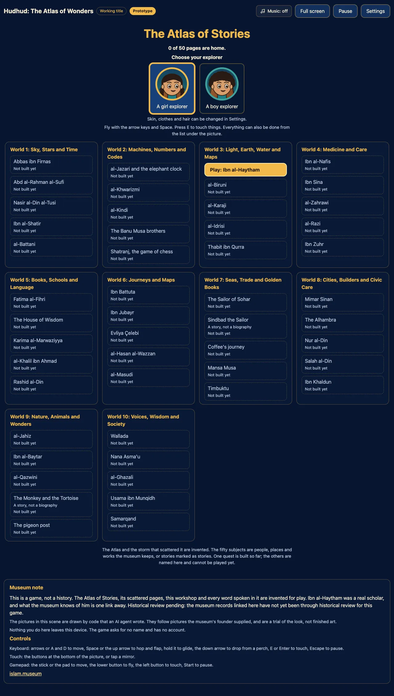
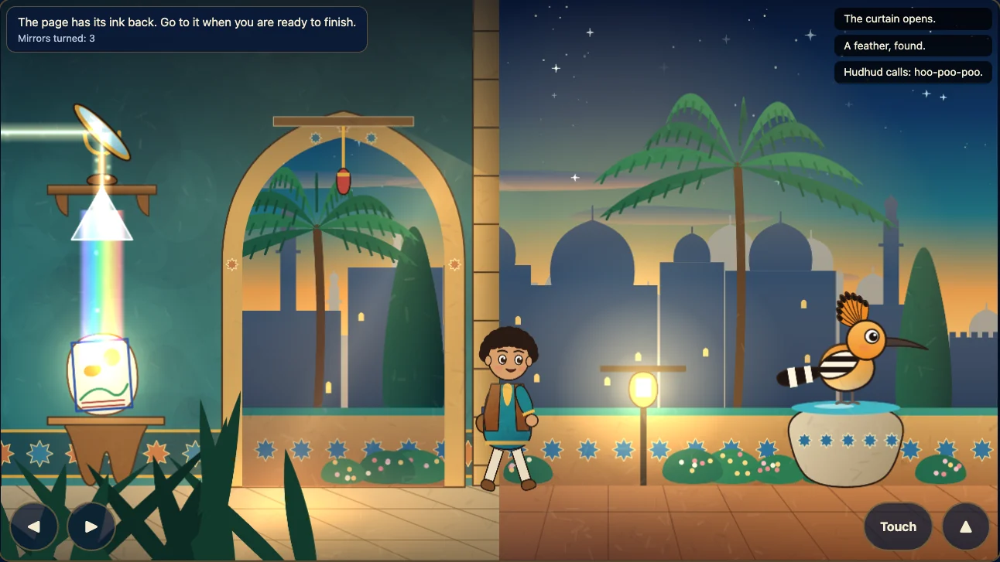

# Hudhud: The Atlas of Wonders — state of the game

_26 November 2026. Release status: **prototype**. Working title. Instruction, plans and decisions: [`../hudhud/`](../hudhud/README.md). Code: `gaming/games/hudhud/`. Not on the site. **On UAT** since 26 November 2026 (now release `20261126-7e6cd96da79`): `https://uat-games.islam.museum/hudhud/?lang=ar`. Not in production._

## What exists

The game opens on **the Atlas**: a page that names the ten worlds and their fifty subjects in seven languages, says how many pages are home, and lets the player choose a girl or a boy explorer. One quest can be played from it; the other forty-nine are named and marked "Not built yet", and the two that are story tradition say so. A finished quest returns to the Atlas with its page home.

One scene of a few minutes, the "golden scene" the founder's instruction asks for before any art is made in number: Ibn al-Haytham's light workshop, opening on a garden and a town at evening.

You play Hudhud, an orange hoopoe. A page of the Atlas of Stories has blown into a dark room and its ink has gone pale. One thin beam of evening light comes in by a hole in the shutter. Fly to the mirrors and turn them until the beam, turned five times and spread by a prism, reaches the page. On the way you can talk to the scholar and ask him for more, greet the cat, pull the curtain's cord to make the room a dark room and see the town appear upside down on the wall, and find a feather in the garden. At the page, the quest ends with three goals (Curiosity, Ingenuity, Kindness) and a museum note with links to the museum's records.

It plays with the keyboard, with on-screen buttons, by tapping mirrors, or entirely from a list in words under the picture. It has three ways of playing (Story, Explorer, Challenge), three effects presets, reduced motion, high contrast, text size and speed, captions, three save slots and, chosen on the first screen, a girl or a boy explorer whose skin, clothes and hair can be changed ([explorers](../hudhud/explorers.md)). It runs in the museum's seven languages, right to left in Arabic and Urdu. Its music is the museum's own suite through the control every game shares.

_Captures of the running game, Chrome, 26 November 2026, made by `gaming/tools/hudhud-play.ts`._

## What it is not

- **Not the game.** The instruction asks for ten worlds, fifty quests and 20 to 30 hours. This is one scene. Phases 2 to 4 are not started.
- **Not accepted art.** Every picture is drawn by code an AI agent wrote. Beside the founder's pictures it is plainly simpler ([the comparison and the routes to real art](../hudhud/art-bible.md)). The game's own page says the pictures are a trial.
- **Not reviewed history.** Nine entries in [the ledger](../historical-review/ledger.md), all pending; no reviewer is named. The page says "Historical review pending" in seven languages. The prism is shown because the founder's pictures show it and is labelled as unsupported by the records read.
- **Not read by a native speaker.** Seven string tables, all machine drafts.
- **Not played by anyone.** Only the author's script has played it.
- **Not measured where it counts.** One machine, the founder's M4 Max; neither reference machine.

## Numbers (one machine; see [the art bible](../hudhud/art-bible.md#measurements-one-machine-not-a-reference-machine))

| | |
|---|---|
| Engine | Phaser 4.2.1, WebGL ([G-0013](../adr/G-0013-hudhud-2d-engine.md)) |
| Page in a release | 1.46 MB of script (311 KB compressed), no picture or sound file |
| Play to scene | about 0.4 s |
| Textures in memory | 20 MB (Low), 45 MB (Medium), 80 MB (High) |
| Draw calls a frame | 15 to 20 |
| Tests | 126 of its own and 21 of the shared platform; 501 in the workspace, all passing |

## Next

Nothing in number until the founder's word on the look. Then the vertical slice of the instruction's Phase 2: a prologue and the Atlas hub, this quest finished, al-Jazari's clock, Ibn Battuta's road, the Monkey and the Tortoise. Done since the first pull request: a quest left in the middle is kept, keys can be changed, and there is a full-screen button. Still before the slice: the room's texture cut in two, the Arabic written first.
