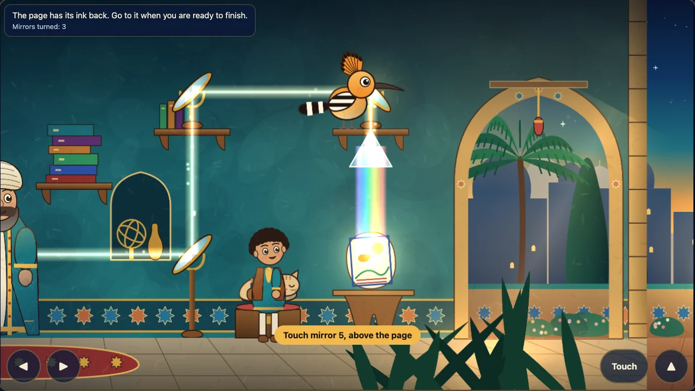
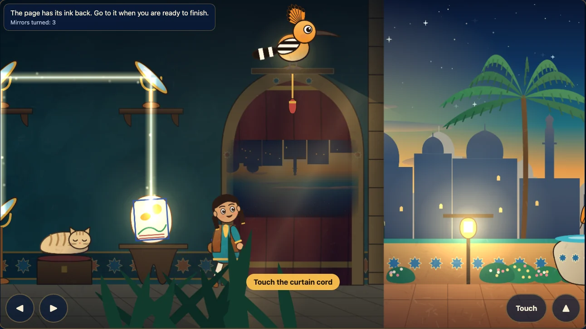

# Hudhud: The Atlas of Wonders — state of the game

_26 November 2026. Release status: **prototype**. Working title. Instruction, plans and decisions: [`../hudhud/`](../hudhud/README.md). Code: `gaming/games/hudhud/`. **Public** at `https://games.islam.museum/hudhud/`: its `release.json` (read 26 November 2026, later in the day) names commit `035b6e4` and lists Hudhud as a prototype; that build has the flying scene and the elephant clock, and does not have the opening story, the Atlas picture, the secret page or the locked box. **On UAT** since 26 November 2026 (`release.json` names commit `709707701f2`): `https://uat-games.islam.museum/hudhud/?lang=ar`. **Not on the museum's own pages**: no Play page and no menu entry exist under `site/`; the game is reached only by its own address._

## What exists

The game opens on **the Atlas**: a page that names the ten worlds and their fifty subjects in seven languages, says how many pages are home, and lets the player choose a girl or a boy explorer. Four quests can be played from it (the light workshop; a second, short trial quest (al-Jazari's elephant clock: a row of parts put in order with ordinary page controls and a simple code-drawn picture that can also be clicked or touched, no flying scene, kept when left in the middle); and a third, al-Kindi and the secret page: the signs of a long sample and the marks of a secret message are counted and ranked in two tables, each mark is given its sign from a list of choices, and the page is read; played with page controls and a code-drawn picture that is not clickable, kept when left in the middle; and a fourth, al-Khwarizmi and the locked box: a problem is said in words as two sides ("3 things less 4 equal 1 thing and 6"), and the player brings it to one thing equal to a number with the moves restore (al-jabr), balance (al-muqabala) and share, a move that does not apply being counted as a slip; played with buttons under a picture of two trays that is not clickable, kept when left in the middle); the other forty-six are named and marked "Not built yet", and the two that are story tradition say so. A finished quest returns to the Atlas with its page home. Above the lists the Atlas page shows one code-drawn picture of the open book, with a medallion for each world (a plain sign on each, not finished art), five page marks round it that fill as pages come home, and a ring round the worlds that have a quest to play; a click on a medallion, or one of ten numbered buttons under the picture, goes to that world's list.

One scene of a few minutes, the "golden scene" the founder's instruction asks for before any art is made in number: Ibn al-Haytham's light workshop, opening on a garden and a town at evening.

You play Hudhud, an orange hoopoe. A page of the Atlas of Stories has blown into a dark room and its ink has gone pale. One thin beam of evening light comes in by a hole in the shutter. Fly to the mirrors and turn them until the beam, turned five times, reaches the page. The puzzle depends on the way of playing: Story has five mirrors with two positions and glowing hints; Explorer has six with three positions (a mirror can be laid flat so that the beam passes) and one that must be left alone; Challenge has seven, all wrong at the start, ten turns at the least, and its description in words says only where the beam ends. On the way you can talk to the scholar and ask him for more, greet the cat, pull the curtain's cord to make the room a dark room and see the town appear upside down on the wall, and find a feather in the garden. At the page, the quest ends with three goals (Curiosity, Ingenuity, Kindness) and a museum note with links to the museum's records.

It plays with the keyboard, with on-screen buttons, by tapping mirrors, or entirely from a list in words under the picture. It has three ways of playing (Story, Explorer, Challenge), three effects presets, reduced motion, high contrast, text size and speed, captions, three save slots and, chosen on the first screen, a girl or a boy explorer whose skin, clothes and hair can be changed ([explorers](../hudhud/explorers.md)). It runs in the museum's seven languages, right to left in Arabic and Urdu. Its music is the museum's own suite through the control every game shares.

_Captures of the running game, Chrome, 26 November 2026, made by `gaming/tools/hudhud-play.ts`._

## What it is not

- **Not the game.** The instruction asks for ten worlds, fifty quests and 20 to 30 hours. This is one scene and three short trial quests. Phases 2 to 4 are not started.
- **Not accepted art.** Every picture is drawn by code an AI agent wrote. Beside the founder's pictures it is plainly simpler ([the comparison and the routes to real art](../hudhud/art-bible.md)). The game's own page says the pictures are a trial.
- **Not reviewed history.** Nineteen entries in [the ledger](../historical-review/ledger.md), all pending; no reviewer is named. The page says "Historical review pending" in seven languages, and every line the scholar speaks is marked "Imagined words, not a quotation". The prism of the founder's pictures, which no record read for the scene supports, is not shown.
- **Not read by a native speaker.** Seven string tables, all machine drafts.
- **Not played by children, parents or teachers, as far as this repository records.** The author's scripts have played it, and one independent play of the UAT release found faults that were then fixed (defects D10 to D12 in the [test plan](../hudhud/test-plan.md)). No observation of anyone playing it in production is recorded here.
- **Not measured where it counts.** One machine, the founder's M4 Max; neither reference machine.

## Numbers (one machine; see [the art bible](../hudhud/art-bible.md#measurements-one-machine-not-a-reference-machine))

| | |
|---|---|
| Engine | Phaser 4.2.1, WebGL ([G-0013](../adr/G-0013-hudhud-2d-engine.md)) |
| Page in a release | main script 1.57 MB (1,574,574 bytes; 337 KB with Brotli), style 13.7 KB, no picture or sound file (measured 26 November 2026, later, by `build:release`; the first measurement, 1.46 MB and 311 KB, is kept in [G-0013](../adr/G-0013-hudhud-2d-engine.md)) |
| Play to scene | about 0.4 s |
| Textures in memory | 20 MB (Low), 45 MB (Medium), 80 MB (High) |
| Draw calls a frame | 15 to 20 |
| Tests | 261 of its own under `games/hudhud/` (thirteen files); 647 in the workspace (36 files), all passing (run 26 November 2026, later in the day, after merging `main`) |

## Next

Nothing in number until the founder's word on the look. The game now opens on a prologue (five still panels with simple code-drawn pictures, read once, skippable and shown again from the Atlas); it is a trial, with no animation and no voice. Then the vertical slice of the instruction's Phase 2: a playable prologue and the Atlas hub, this quest finished, al-Jazari's clock, Ibn Battuta's road, the Monkey and the Tortoise. Done since the first pull request: a quest left in the middle is kept, keys can be changed, and there is a full-screen button. The room's texture was cut so that none is over 2048 pixels (defect D15 in the [test plan](../hudhud/test-plan.md)). Built since the slice was planned, outside its list: al-Jazari's elephant clock, al-Kindi's secret page and al-Khwarizmi's locked box, each as a short trial quest. Still before the slice: Ibn Battuta's road, the Monkey and the Tortoise, a playable prologue and a hub the bird can fly about in, and the Arabic written first (not checked here).
