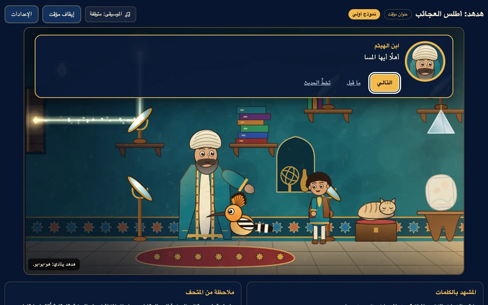

# Hudhud: The Atlas of Wonders — state of the game

_26 November 2026. Release status: **prototype**. Working title. Instruction, plans and decisions: [`../hudhud/`](../hudhud/README.md). Code: `gaming/games/hudhud/`. **Public** at `https://games.islam.museum/hudhud/`: its `release.json` (read again on 26 November 2026, when the paper of Samarkand was written; earlier that day it named commit `035b6e4`) names commit `885c7d97a5a`, dated 26 November 2026 17:22:46 -0500, and lists Hudhud as a prototype; that build has the flying scene, the elephant clock, the opening story, the secret page and the locked box (its Atlas note says four quests are built), and does not have the scattered sheets, the animal cards or the paper of Samarkand. **On UAT** since 26 November 2026 (`release.json` names commit `709707701f2`): `https://uat-games.islam.museum/hudhud/?lang=ar`. **On the museum's own pages** (corrected 26 November 2026; this said that no Play page and no menu entry existed): `site/` on `main` has a Games entry in the top menu and the footer and a landing page, `/<lang>/games/`, that lists the four games and links each to the games host with the page's language; there is no `/<lang>/play/` page and no page of Hudhud's own on the site, and whether the live site has been deployed with them is not shown by this repository._

## What exists

The game opens on **the Atlas**: a page that names the ten worlds and their fifty subjects in seven languages, says how many pages are home, and lets the player choose a girl or a boy explorer. Seven quests can be played from it (the light workshop; a second, short trial quest (al-Jazari's elephant clock: a row of parts put in order with ordinary page controls and a simple code-drawn picture that can also be clicked or touched, no flying scene, kept when left in the middle); and a third, al-Kindi and the secret page: the signs of a long sample and the marks of a secret message are counted and ranked in two tables, each mark is given its sign from a list of choices, and the page is read; played with page controls and a code-drawn picture that is not clickable, kept when left in the middle; and a fourth, al-Khwarizmi and the locked box: a problem is said in words as two sides ("3 things less 4 equal 1 thing and 6"), and the player brings it to one thing equal to a number with the moves restore (al-jabr), balance (al-muqabala) and share, a move that does not apply being counted as a slip; played with buttons under a picture of two trays that is not clickable, kept when left in the middle; and a fifth, al-Idrisi and the scattered sheets: the sheets of an imagined map lie in a grid out of order (2 by 3, 3 by 4 or 3 by 5 sheets), each with a coast, a river or a road reaching some of its edges, and the player exchanges two sheets at a time until every seam matches, each map having one arrangement only; played with a button for every place in the same rows and columns, or by touching two sheets in the picture, with the edges of every sheet also given in words in a table, kept when left in the middle; Story names the seams that do not match, Explorer counts them, Challenge shows nothing until Check the map is pressed; and a sixth, al-Jahiz and the animal cards: eight animals named in one passage of his Book of Animals are drawn as cards, and the player puts each in the tray that is its group in his passage, then presses Show al-Jahiz; Story has four cards and two groups, Explorer eight cards and two groups (the bat and the ostrich are the surprises), Challenge eight cards and five groups, each a phrase of the passage; played with a list of choices for every card and a key in words, or by pressing a card and then a tray in the picture, kept when left in the middle; a showing with a card unplaced is refused and not counted, Story names the cards that are in the wrong group, Explorer says how many are right, Challenge says only that it is not yet his division; the page says that his division is not today's biology; and a seventh, Samarkand and the paper: a papermaker's steps are mixed up and a page of the Atlas cannot be remade until they are in order; the steps of the record's recipe (rags cut small, cleaned, bleached, pounded in water to a pulp, dressed with wheat starch, lifted on a mould and shaken, dried on a wall, rubbed and polished smooth) are cards in a row of places, five in Story (two steps joined into one card in three places, where the record's sentence joins them), seven in Explorer and eight in Challenge, and the player presses Make a sheet; the page says step by step what happened to the material and where the work stopped (Story says what the place needs, Explorer what reached it, Challenge only where it stopped) and draws the material above each place it has passed; played with a list of choices for every place, or by pressing two places in the picture to exchange their cards, kept when left in the middle; the page keeps the story of the Chinese craftsmen captured near the Talas in 751 a report handed down, not a proved beginning, and says, from the record, that the Chinese invented paper and that the Islamic world received, adapted and spread the craft); the other forty-three are named and marked "Not built yet", and the two that are story tradition say so. A finished quest returns to the Atlas with its page home. Above the lists the Atlas page shows one code-drawn picture of the open book, with a medallion for each world (a plain sign on each, not finished art), five page marks round it that fill as pages come home, and a ring round the worlds that have a quest to play; a click on a medallion, or one of ten numbered buttons under the picture, goes to that world's list.

One scene of a few minutes, the "golden scene" the founder's instruction asks for before any art is made in number: Ibn al-Haytham's light workshop, opening on a garden and a town at evening.

You play Hudhud, an orange hoopoe. A page of the Atlas of Stories has blown into a dark room and its ink has gone pale. One thin beam of evening light comes in by a hole in the shutter. Fly to the mirrors and turn them until the beam, turned five times, reaches the page. The puzzle depends on the way of playing: Story has five mirrors with two positions and glowing hints; Explorer has six with three positions (a mirror can be laid flat so that the beam passes) and one that must be left alone; Challenge has seven, all wrong at the start, ten turns at the least, and its description in words says only where the beam ends. On the way you can talk to the scholar and ask him for more, greet the cat, pull the curtain's cord to make the room a dark room and see the town appear upside down on the wall, and find a feather in the garden. At the page, the quest ends with three goals (Curiosity, Ingenuity, Kindness) and a museum note with links to the museum's records.

It plays with the keyboard, with on-screen buttons, by tapping mirrors, or entirely from a list in words under the picture. It has three ways of playing (Story, Explorer, Challenge), three effects presets, reduced motion, high contrast, text size and speed, captions, three save slots and, chosen on the first screen, a girl or a boy explorer whose skin, clothes and hair can be changed ([explorers](../hudhud/explorers.md)). It runs in the museum's seven languages, right to left in Arabic and Urdu. Its music is the museum's own suite through the control every game shares.

_Captures of the running game, Chrome, 26 November 2026, made by `gaming/tools/hudhud-play.ts`._

## What it is not

- **Not the game.** The instruction asks for ten worlds, fifty quests and 20 to 30 hours. This is one scene and five short trial quests. Phases 2 to 4 are not started.
- **Not accepted art.** Every picture is drawn by code an AI agent wrote. Beside the founder's pictures it is plainly simpler ([the comparison and the routes to real art](../hudhud/art-bible.md)). The game's own page says the pictures are a trial.
- **Not reviewed history.** Twenty-five entries in [the ledger](../historical-review/ledger.md), all pending; no reviewer is named. The page says "Historical review pending" in seven languages, and every line the scholar speaks is marked "Imagined words, not a quotation". The prism of the founder's pictures, which no record read for the scene supports, is not shown.
- **Not read by a native speaker.** Seven string tables, all machine drafts.
- **Not played by children, parents or teachers, as far as this repository records.** The author's scripts have played it, and one independent play of the UAT release found faults that were then fixed (defects D10 to D12 in the [test plan](../hudhud/test-plan.md)). No observation of anyone playing it in production is recorded here.
- **Not measured where it counts.** One machine, the founder's M4 Max; neither reference machine.

## Numbers (one machine; see [the art bible](../hudhud/art-bible.md#measurements-one-machine-not-a-reference-machine))

| | |
|---|---|
| Engine | Phaser 4.2.1, WebGL ([G-0013](../adr/G-0013-hudhud-2d-engine.md)) |
| Page in a release | main script 1.62 MB (1,623,139 bytes; 347,824 with Brotli at quality 11, 431,872 with gzip at the highest level), style 14,614 bytes, no picture or sound file (measured 26 November 2026, with the paper of Samarkand, from the file `build:release` wrote, compressed with Node's zlib; the measurements for the animal cards (1,608,920 bytes), the scattered sheets (1,590,733) and the locked box (1,574,574) are kept as past measurements in the [test plan](../hudhud/test-plan.md), and the first, 1.46 MB and 311 KB, in [G-0013](../adr/G-0013-hudhud-2d-engine.md)) |
| Play to scene | about 0.4 s |
| Textures in memory | 20 MB (Low), 45 MB (Medium), 80 MB (High) |
| Draw calls a frame | 15 to 20 |
| Tests | 394 of its own under `games/hudhud/` (sixteen files); 783 in the workspace (39 files), all passing (run 26 November 2026, later in the day); 46 browser check records, all passing |

## Next

Nothing in number until the founder's word on the look. The game now opens on a prologue (five still panels with simple code-drawn pictures, read once, skippable and shown again from the Atlas); it is a trial, with no animation and no voice. Then the vertical slice of the instruction's Phase 2: a playable prologue and the Atlas hub, this quest finished, al-Jazari's clock, Ibn Battuta's road, the Monkey and the Tortoise. Done since the first pull request: a quest left in the middle is kept, keys can be changed, and there is a full-screen button. The room's texture was cut so that none is over 2048 pixels (defect D15 in the [test plan](../hudhud/test-plan.md)). Built since the slice was planned, outside its list: al-Jazari's elephant clock, al-Kindi's secret page, al-Khwarizmi's locked box, al-Idrisi's scattered sheets and al-Jahiz's animal cards, each as a short trial quest. Still before the slice: Ibn Battuta's road, the Monkey and the Tortoise, a playable prologue and a hub the bird can fly about in, and the Arabic written first (not checked here).
