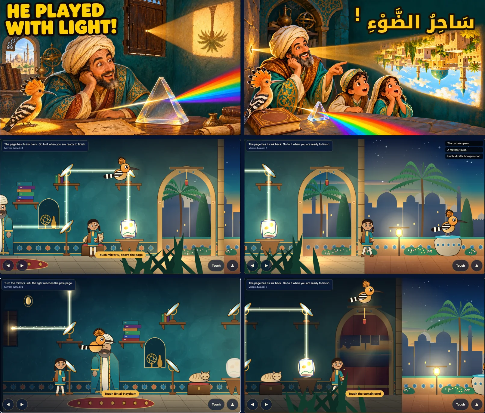

# Hudhud: art bible, the golden scene's brief, and how the art can actually be made

_26 November 2026. Phase 0 and Phase 1. Written by an AI agent. **The look is not accepted.** The founder accepts the visual direction in words before any art is made in number ([instruction](owner-instruction-2026-11-26.md), section 3); until then this page describes a trial._

## Read this first: where the trial stands against the founder's pictures



_Top row: `en-09-ibn-al-haytham.jpg` and `ar-12-ibn-al-haytham.jpg`, as supplied, reduced. Below: four captures of the running game on 26 November 2026 (High preset, Chrome, 1920×1080), unretouched._

**What carries over.** The palette (teal walls, midnight sky, lantern gold, terracotta and lapis tile), Hudhud's silhouette (orange body, fan of black-tipped crest feathers, barred wings, long curved beak), the dark room with one beam, the prism and its colours, the turbaned scholar in a teal robe with gold borders, the town at evening through an opening, the upside-down picture on the wall.

**What does not, and it is most of what makes the founder's pictures what they are.**

- His are painted: modelled faces, cloth with weight and embroidery, soft light wrapping round forms, depth of field, grain. The trial is flat shapes with an outline, a two-colour wash and scattered brush marks. It reads as a tidy vector storybook, not as those paintings.
- His figures act with their whole faces. The trial's faces are two eyes, brows and a smile; they blink and tilt, and that is all.
- His Hudhud has feathers. The trial's has shapes.
- His scenes are composed as pictures. A side-on room that must hold a grid of mirrors is composed as a puzzle first.

**The author's own judgment**, for what an author's judgment is worth: the trial is pleasant, readable and consistent, and a child could play it; it is **not** at the level of the supplied art and would not pass as "premium". It is the same kind of result as Granada's code-made art, of which the founder's decision of 26 November 2026 says that neither set is accepted as a production-quality direction and that scripted generation "has not proved that it can author the required finish by itself" ([`owner-decisions-2026-11-26-c.md`](../spec-production/owner-decisions-2026-11-26-c.md)). The founder should expect to reach the same verdict here, and the plan below is written for that case.

## How the art can actually be made

No artist is engaged. No image-generation service is approved. Nothing has been bought. These are the routes, with what each needs from the founder.

| Route | What it is | What this agent can do | What it cannot | Needs from the founder |
|---|---|---|---|---|
| **A. Code-drawn** (the trial) | every picture drawn by Canvas 2D code when a scene opens; no picture files | all of it, now; consistent; tiny to ship; every picture reproducible from a seed | reach painterly depth; draw expressive faces or feathers; it tops out about where the trial is, with perhaps one more level from weeks of polish | only his verdict |
| **B. An illustrator and an animator** | people draw turnarounds, expressions, cut-out parts, environment layers and effects in the look of the supplied art; the agent builds rigs, atlases and scenes from their files | the brief, sprite lists, sizes, the rigging, atlas packing, the pipeline, a manifest of every file | the drawing | to engage and pay people: his decision alone, and the instruction forbids the agent to engage anyone |
| **C. The process that made the thumbnails** | whatever tool and hand produced the 80 pictures makes game parts in the same look: figures on plain grounds, in parts, in poses; layered backgrounds | prepare exact part lists and prompts or briefs; cut, clean, rig, pack and check what comes back; reject what is inconsistent | make the pictures (no such tool is available to it or approved); promise that parts for animation come out consistent, which is the hard part of this route | to say how the thumbnails were made, and to approve that process, and its licence terms, for game art |
| **D. A blend** | B or C for the cast, key props and hero backgrounds; A for what code is good at: light, beams, particles, sky gradients, tile patterns, parallax silhouettes, UI | the split, the pipeline and the code-drawn half | as B or C for the painted half | as B or C |

**Recommendation: D, with the founder choosing B or C for its painted half.** The golden scene was built so that this costs little: every figure is already a set of named parts pinned at named points (below), so replacing a code-drawn part with a painted one is a change of one texture, not of the scene. The light, the beam, the dust, the dark room, the sky and the tile work can stay code and are the parts of the trial that hold up best.

What may **not** be done on any route without his word: cut the supplied thumbnails into puppets or use them as backgrounds (the instruction forbids both); use an image service; publish AI-made portraits on the museum's pages (the museum's rule; the game's figures are imaginings for play and are labelled so, and whether that rule reaches the game's cast is itself a question for him).

**One question decides the route.** How were the 80 thumbnails made, and can that process make more? The archive does not say; its index says only that the English files were downloaded back from YouTube and the Arabic ones are finished files.

## Visual identity (from the supplied art)

| | |
|---|---|
| Palette | midnight `#0a1a36`, deep blue `#10305a`, teal `#1d6f78` and `#3fa39b`, lantern gold `#f2b94b`, amber `#e8892b`, terracotta `#c2643a`, ochre `#d49a45`, lapis `#2b4fa3`, emerald `#2f8f5b`, cream `#f3e6c8`; hoopoe orange `#f08a24` |
| Light | one warm key (sunset or lamp) against cool shadow; glows are additive and soft; night skies keep colour and never go grey |
| Line | a soft dark brown outline (`#2a1a12`), heavier on figures than on rooms |
| Hudhud | small, orange, a fan of eight crest feathers with black tips that opens when he is surprised, flying or landing and lies back when he is calm; black wings with white bars; a long, gently down-curved beak; one large bright eye; never sarcastic in pose |
| People | open, readable poses; large eyes; warmth before accuracy of feature, because no portraits of these people exist |
| Ornament | geometry (eight-pointed stars, bands) and plant forms. **No script as texture, no invented script, no sacred text as decoration.** The Atlas page in the scene carries plain strokes that are deliberately not writing in any language |
| Not to do | one costume, one face and one skyline for every century and region; "Oriental" clutter; wealth as shorthand for a place |

**What must be reviewed before it is drawn in number** (reviewer R3, architecture, material culture and clothing; not named): clothing and architecture by place and century for each of the fifty; the scholar's dress here follows the founder's pictures and has been checked against nothing.

## The golden scene: brief

| | |
|---|---|
| Subject | Ibn al-Haytham's light workshop, opening on a garden and a town at evening (world 3, quest 1) |
| Proves | the atmosphere; Hudhud moving; the Storykeeper; one person of history; one animal; a layered place; conversation; one puzzle; one secret; three depths of movement; sound; UI; three effects presets |
| The place | a dark teal room 1,760 px wide in a world of 2,400 by 720 (the view is 1,280 by 720): a shutter with a small hole, shelves, a niche, a reading stand, a chest; an arch with a curtain; beyond it a terrace with a lantern, a fountain, palms and cypresses, and roofs in two depths under an evening sky |
| The play | a beam enters by the hole; five to seven mirrors on stands (one hung from the ceiling in Challenge) turn it; a tower of books and a tall glazed jar stop it; it falls on the pale page and the ink returns (the prism was taken out on 26 November 2026) |
| The secret | fly to the ledge over the arch and pull the cord: the curtain closes, the room goes dark and the town appears upside down on the curtain, opposite the hole. A feather waits on the fountain |
| Composite, and said to be | the house and the skyline stand for no real building or city (ledger HR-HH-07) |
| The prism | **taken out on 26 November 2026** by the founder's directive: both supplied pictures show one and no museum record read for the scene supports it. The museum note says why none is shown (ledger HR-HH-03) |

## Sprite and animation list (what exists, by part)

Each figure is a container of parts; "pin" is where the part turns. This is the list an illustrator would be asked to redraw.

| Figure | Parts (logical size in px) | Moves the code makes today |
|---|---|---|
| **Hudhud** (about 100 tall) | body 78×62; tail 54×30 (pin at its root); folded wing 56×40; spread wing 96×84 (pin at the shoulder); head with beak 92×50, eye open and shut; crest 74×56 (pin at its root); legs 34×18 | run bob; hop stretch and landing squash; flap (the spread wing beats) and glide (held open); crest opens in the air, on landing and on alarm; tail wag; head nod when speaking; blink |
| **Storykeeper** (about 210) | leg 30×70 ×2; tunic 96×118; arm 28×78; head 96×104, open and shut, in four styles of hair or headwear; satchel with the Atlas 50×56. A girl or a boy × four skins × three outfits × four styles | walks after the bird, legs and arm swinging; looks up when it flies; gestures when speaking; breathes; blinks |
| **The scholar** (about 335) | robe 210×270; arm 60×140; head 150×170, open and shut | turns to the bird; raises his arm when a mirror turns and when he speaks; nods; blinks |
| **The cat** (about 110 wide) | body 120×60; head 58×52, awake and asleep; tail 70×26 | sleeps; wakes when the bird is near; tail flicks; a small hop when greeted |

Props: mirror, three stands, prism, page (pale and inked), feather, curtain, cord, lamp glow, beam strip, rainbow strip, dust mote, sparkle. Places: sky, far roofs, near roofs, garden, room, a dark foreground column with a lamp, foreground leaves, the wall picture.

**Not yet made, and needed for the slice:** turnarounds (figures face one way and are mirrored); a walk cycle with knees; expressions beyond glad, thinking and alarmed (which today only move the crest and the arm, not the face); hands that hold; a perching pose and a pecking pose for Hudhud; a second animal that moves about.

## UI wireframe (as built)

```
+--------------------------------------------------------------------------------+
| Hudhud: The Atlas of Wonders  (Working title) [Prototype]   [music] [Pause] [Settings]
+--------------------------------------------------------------------------------+
| +----------------------------+                                 +-------------+ |
| | goal · mirrors turned: n   |                                 |  captions   | |
| +----------------------------+        the picture              +-------------+ |
|                                     (canvas, 16:9)                             |
|                          ( Touch mirror 3 )                                    |
|  (<) (>)                                                    ( Touch )   (^)    |
+--------------------------------------------------------------------------------+
| The scene in words                   | Museum note                             |
| "The beam meets: mirror 1 … It stops | game, not history · review pending      |
|  at the tower of books."             | pictures are a code-drawn trial         |
| [Turn mirror 1: leaning up …]        | nothing leaves this device              |
| [Go to Ibn al-Haytham] …             | Controls: keyboard · touch · gamepad    |
+--------------------------------------------------------------------------------+
A talk replaces the goal:  (face)  Name / the line / [choices…] [Next] [Back] what was said · skip
Sheets over the page: Paused · Settings · What was said · Results with the museum note
```

On a narrow screen the goal moves above the picture and the talk below it. Arabic and Urdu mirror the page; the picture, the beam and the arrow buttons are never mirrored.

## Measurements (one machine, not a reference machine)

The founder's MacBook Pro (Apple M4 Max, 128 GB, macOS 27.2.1), Chrome 158, a 120 Hz display, device pixel ratio 1, window 1920×1080; `gaming/tools/hudhud-play.ts`, 26 November 2026. The reports are in [`../evidence/hudhud/golden-scene/`](../evidence/hudhud/golden-scene/). **Neither reference machine (M1 Air 8 GB; Windows 11, i5-1135G7, 8 GB) has run it. No 60-minute profile and no four-hour soak has been run.**

| Preset | Textures | Texture memory (decoded) | Largest | Objects | Draw calls a frame | Frame time over 14 s: mean / p95 / p99 / max | Frames over 16.7 ms | JS heap |
|---|---:|---:|---|---:|---:|---|---:|---:|
| Low | 44 | 19.9 MB | the room, 1760×720 | 79 | 15 | 8.33 / 9.1 / 9.3 / 10.2 ms | 0 of 1,699 | 56 MB |
| Medium | 45 | 44.8 MB | the room, 2640×1080 | 119 | 19 | 8.34 / 9.2 / 9.4 / 18.7 ms | 1 of 1,697 | 82 MB |
| High | 45 | 79.7 MB | the room, 3520×1440 | 170 | 20 | 8.33 / 9.1 / 9.3 / 9.5 ms | 0 of 1,701 | 120 MB |

- The frame time is the display's 8.33 ms: the machine is not being worked, so these numbers say the scene is light, not how light.
- **From Play to the scene on screen: 350 to 415 ms** (every picture is painted in that time). **First flight: 6 s after pressing Play** in the script, which reads three lines first.
- **The download** for Hudhud's page in a release: 1,685,922 bytes of script (362,446 with Brotli at quality 11, 451,506 with gzip at level 9), 16,737 of style, no picture or sound file (measured 27 November 2026, later, with the twelfth quest, al-Razi's loose leaves, from the built file `app-CvlIeSaQ.js` that `build:release` wrote, compressed with Node's zlib). Past measurements, kept: 1,678,439 bytes (360,482 with Brotli) and 16,594 of style with the Alhambra and the dry fountain; 1,656,596 bytes (355,841 with Brotli) and 16,274 of style with the journey of coffee; 1,648,736 bytes (352,941 with Brotli) and 15,330 of style with al-Tusi's two circles; 1,635,886 bytes (350,344 with Brotli) and 14,854 of style with Ibn Battuta's thread; 1,623,139 bytes (347,824 with Brotli) and 14,614 of style with the paper of Samarkand; 1,590,733 bytes (341,288 with Brotli) and 14,272 of style with the five quests, which was what this line gave before and was out of date; the first measurement was 1,456,166 bytes of script, 311,102 with Brotli, and 7,238 of style). The budget in the instruction is 15 to 20 MB.
- **Leaving and returning**: ten restarts of the scene leave the same 45 textures, 119 objects and no running tween. Twelve full rebuilds of the game, with a forced collection after each, read 82 to 83 MB or 132 to 133 MB (a rebuilt generation not yet collected) and do not climb: 81.9 MB after the first, 82.5 MB after the twelfth.
- **A lost graphics context** (forced with `WEBGL_lose_context`): the player is told, and the picture is rebuilt and playing within 2.5 s of the context returning; the quest is kept as it stood and the bird returns to the door.
- **No texture exceeds 2048 pixels** since 26 November 2026: the wide pictures (sky, roofs, room) are uploaded as columns. Before that, High used one of 3520×1440. The table above was measured before the change; the totals in megabytes are the same to within a tenth (19.9, 44.8 and 79.6), and the count of textures rose to 43, 47 and 48.

**Art time.** The code that draws the scene (`src/art/`, 1,715 lines) was written in roughly twenty minutes of the session and corrected in three rounds after looking at captures. That is fast because it is simple, which is the point of the section above.

## What scaling would cost (a projection, not a measurement)

| | One scene today | A world of five quests | Fifty quests |
|---|---|---|---|
| Code-drawn (route A): script | 88 KB of game code over the engine | about 250 to 400 KB | 2 to 4 MB, loaded a world at a time |
| Code-drawn: texture memory at Medium | 45 MB | 45 to 60 MB at a time if one quest's pictures are held and the last released (as now) | the same: it does not add up |
| Painted (routes B to D): files | none | perhaps 6 to 12 MB of WebP atlases a world (cast shared across the game, places per quest) | 60 to 120 MB in all, streamed a world at a time; first load within 15 to 20 MB if the hub and world 1 are kept to that |
| Painted: people's time | none | weeks, by an illustrator and an animator | about a year at a world a month |

The file sizes for painted art are estimates from general practice and have no measurement of this game behind them.

## Media budget (proposed, to be set by measurement before production)

| | Budget |
|---|---|
| First load (page, engine, hub, first quest) | 15 MB compressed at most; today 0.3 MB |
| A world | 12 MB compressed, fetched when the world is entered |
| Texture memory at any moment | Low 48 MB, Medium 96 MB, High 160 MB |
| One texture | 2048 on a side; 4096 only with a measured reason written down |
| Music | the museum's suite, already hosted and streamed; nothing new |
| Sound effects | synthesised in code today (none to host); if recorded later, 1 MB a world |
