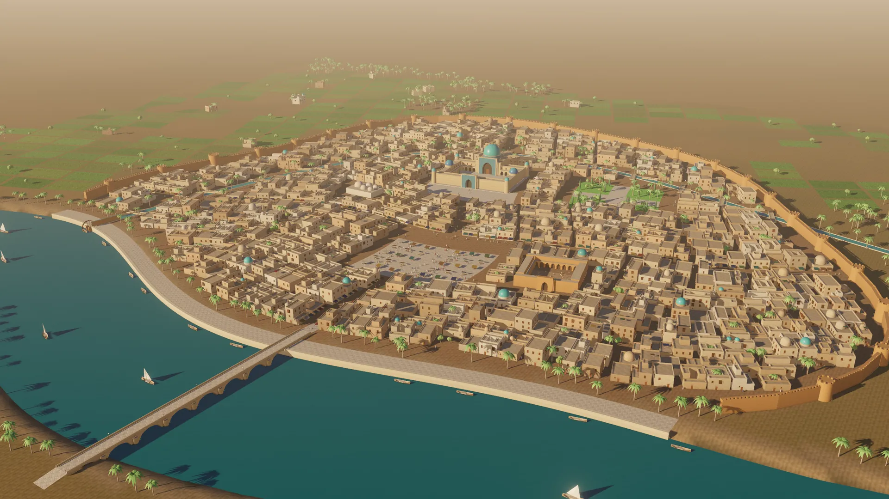
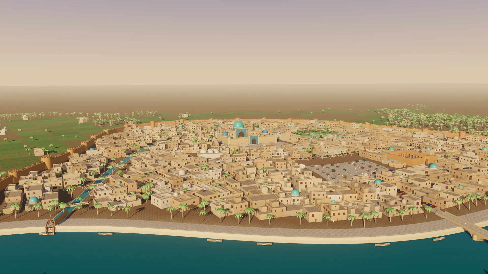
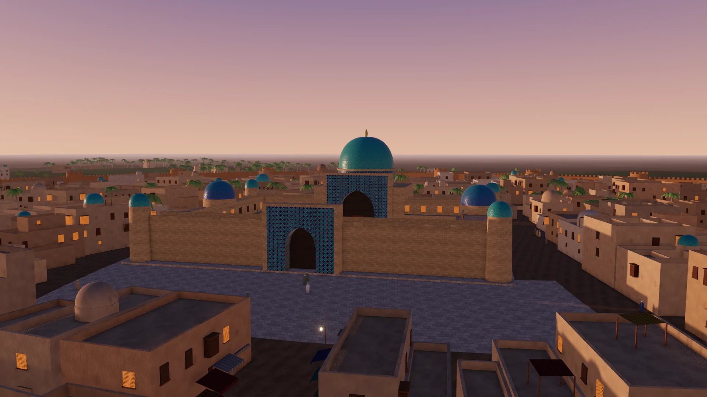
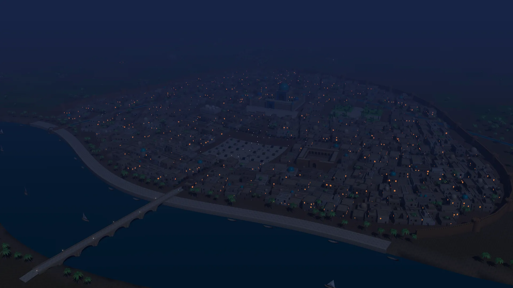
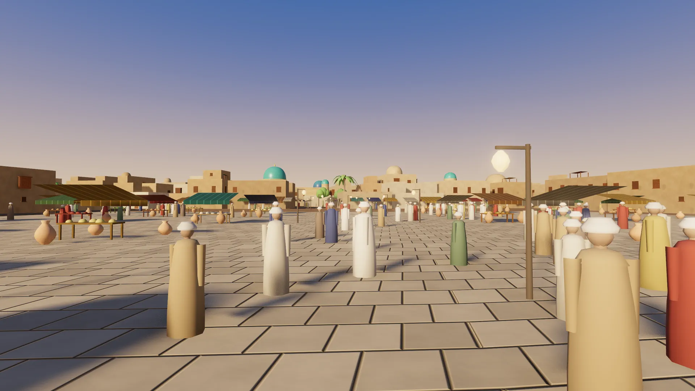
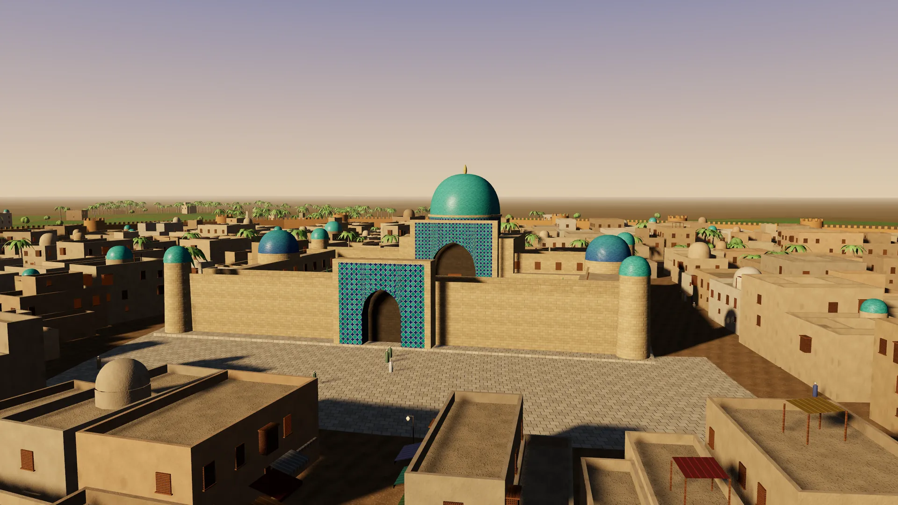
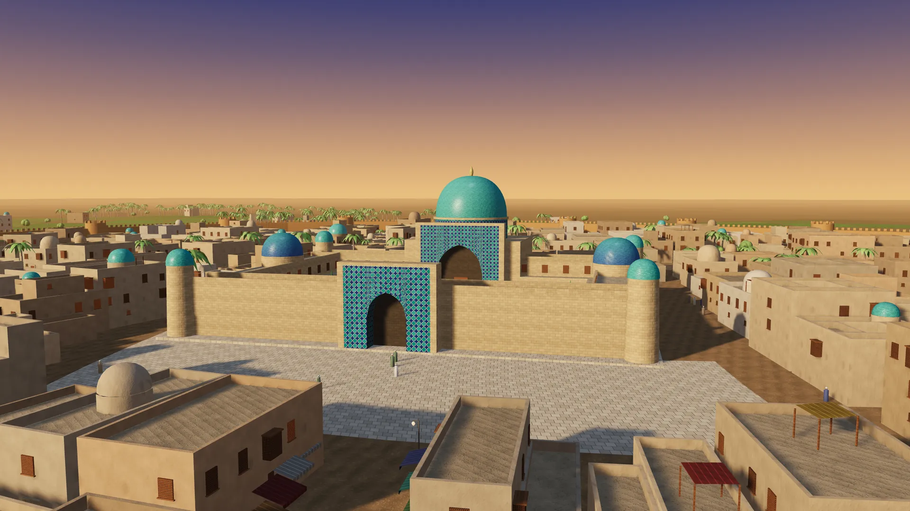

# M1: graphics spike on the Golden Age reference district

_25 November 2026. Status: **measured on one machine; physical tests still open.** The engine comparison, the real captures and a hardware benchmark exist. The soak, device-loss and other-hardware tests the specification asks for do not, and nothing below claims them._

## What was built

A fictional riverside city, generated from seed 7 by `gaming/packages/worldkit`: 770 buildings (courtyard houses, blocks with roof rooms and small domes, shops with awnings), a library with a tiled portal and a glazed dome, a caravanserai, a bath house, a market square with stalls, a walled circuit with towers and three gates, a quay and promenade, a nine-arch bridge, a canal with footbridges where streets cross it, a water wheel and aqueduct, a garden, fields and palm groves outside the wall, 1,041 palms, 3,236 instanced props in all, 640 figures walking the streets, 9 boats under sail. 555,544 vertices and about 1.33 million triangles. It is not Baghdad and not a reconstruction of anything.

Two renderers draw it from the same buffers: `labs/graphics/src/three-renderer.ts` and `labs/graphics/src/babylon-renderer.ts`. Four times of day share one lighting definition (`atmosphere.ts`). The page checks WebGPU with real calls before it starts and says which step failed if one does (`packages/kernel/src/capability.ts`).

## Engine comparison

Method and the full table are in [G-0002](adr/G-0002-rendering-engine.md). In short, at 2560 × 1440 on the parity feature set in Chrome 158: both engines held 120 frames a second with no frame over 9.4 ms; with the frame limit off Three.js reached 221 frames a second and Babylon.js 200; Three.js used about 30% less CPU per frame and started four times sooner. **Three.js was chosen.**

## The presets Three.js would ship with

High, Ultra and Cinematic add sky-based image lighting, ground-truth ambient occlusion and bloom through the node render pipeline, and a node water surface. Same machine, same browser, same camera loop, 20 seconds each, frame limit off unless noted. About 3.78 million triangles are submitted per frame (scene, shadow pass and the depth pre-pass that ambient occlusion needs).

| Backing store | Preset | Average fps | Frame p50 / p95 / p99 / max (ms) | Frames over 16.7 ms |
|---|---|---:|---|---:|
| 2560 × 1440 | High | 164.0 | 6.0 / 6.9 / 7.1 / 12.5 | 0 of 3,280 |
| 2560 × 1440 | Ultra | 164.9 | 6.0 / 6.9 / 7.1 / 12.2 | 0 of 3,298 |
| 2560 × 1440 | Cinematic | 162.9 | 6.0 / 7.0 / 7.2 / 8.1 | 0 of 3,259 |
| 3840 × 2160 | High | 159.9 | 6.1 / 7.2 / 7.5 / 11.2 | 0 of 3,199 |
| 3840 × 2160 | Ultra | 136.0 | 7.0 / 9.5 / 13.8 / 31.4 | 7 of 2,720 |
| 3840 × 2160 | Cinematic | 104.3 | 8.1 / 22.8 / 30.7 / 42.5 | 153 of 2,086 |
| 3840 × 2160, display-synced, 30 s | Ultra | 107.8 | 8.3 / 16.7 / 17.4 / 25.9 | 199 of 3,234 |

Files: `evidence/m1/flagship/*.json`. The engine started in 71 to 112 ms, and the first frame took a further 91 to 175 ms in the recorded runs (`firstFrameMs`), because pipelines compile on first use. Trial runs with an empty shader cache, which were not kept, took about 1 to 1.4 seconds for that first frame.

Read against the specification's targets (p95 at or under 16.7 ms for 60 frames a second, 33.3 ms for Cinematic): High and Ultra meet 60 at both sizes on this machine, Ultra at 4K only just when synced to the display (p95 of 16.7 ms, with 6% of frames late); Cinematic at 4K meets its 33.3 ms target and misses 16.7 ms. **These are results for one Apple M4 Max and are not a statement about any other hardware.** No minimum or recommended specification is published from them.

The three presets differ little at 1440p because they differ only in ambient-occlusion resolution and sample count today. They are placeholders for real tiers.

## Real captures

Sixteen stills, captured from the running page in Chrome at 2560 × 1440 and stored at 1920 × 1080 in [`evidence/m1/captures/`](evidence/m1/captures/). Each is reproducible: `npx tsx gaming/tools/shot.ts out.png "engine=three&preset=ultra&tod=golden&view=establishing" 2560 1440`.

| View | File |
|---|---|
| The whole district at golden hour (shot-list item 1) |  |
| The river front |  |
| The library at dusk, windows lit |  |
| Night (shot-list item 3) |  |
| Street level in the market (shot-list item 2) |  |
| The same view in both engines, parity preset |   |

Also in the folder: bridge, water wheel, garden, noon, and the parity establishing view from each engine.

## Honest visual assessment

Measured against the concept image and the GDD's direction ("warm limestone, turquoise water, richly textured wood and bronze; animated markets, irrigation and evening lamps"):

**Works.** The city reads as a place from the game's own camera: a river, a wall, a street pattern that bends, a landmark the eye goes to, long shadows, haze toward the horizon, lit windows at dusk and at night. The glazed domes and the star-tile portal carry the palette. It runs with a great deal of room to spare.

**Does not yet.** It looks like a clean architectural model, not like the concept painting. Specifically:

1. **The figures are robed cylinders.** Acceptable as crowd proxies from above; not acceptable at street level. This is the largest gap.
2. **Buildings are boxes with windows.** No cornices, door surrounds worth the name, balconies, stairs, wear or clutter. Nothing is under construction, which is the centre of the concept image.
3. **The water is a flat sheet with a moving normal map.** No reflection of the bank, no depth colour at the edge, no wake behind a boat. The ripple pattern shows as radiating streaks at low angles.
4. **The sky is a gradient.** No clouds, no sun disc worth looking at.
5. **The market is sparse**, and its goods are coloured domes.
6. **Vegetation is low-polygon** and the garden's grass is too saturated.
7. **One shadow map for the whole city** is soft at street level. Cascaded shadows are in the package and not yet used.
8. **No sound**, no camera control, no interaction. It is a scene, not a game.

None of this is hidden by the captures; they are in the folder. The measured headroom (164 frames a second at 1440p with everything on, against a target of 60) is the budget for closing these gaps, roughly in the order listed.

## Defects found and their state

| Defect | State |
|---|---|
| Babylon drew nothing: frames rendered outside its render loop are not submitted | Fixed (`beginFrame` / `endFrame`) |
| Babylon drew every mesh inside out in a right-handed scene | Fixed (`sideOrientation` on every material) |
| The two engines' exposure conventions differ by a factor of 0.6 | Fixed and documented in the renderer |
| Dusk haze hid the city | Fixed (fog density halved); captures retaken |
| Market camera was below the ground | Fixed (camera heights come from the landmarks) |
| In the desktop app's embedded browser, procedural textures took about 5 seconds on a cold page load; 147 ms in Chrome 158 | Not a product defect; the embedded browser is not a supported target. Noted so nobody benchmarks there |
| Microsoft Edge 157 under automation: the page loaded but the lab produced no first frame in 120 seconds | **Open.** Not investigated. Edge is therefore untested |
| A 404 for the favicon appears in the console of the lab page | Open, cosmetic |

## Still open (M1 exit items that are not done)

- **Other hardware.** No Windows or Linux run, no NVIDIA, AMD or Intel GPU. Run `npx tsx tools/bench.ts --out <dir> --engines three,babylon --presets parity --size 2560x1440 --seconds 30` in `gaming/` on each machine and commit the JSON.
- **Microsoft Edge**, see above.
- **Soak.** The specification asks for a 30-minute run and 60 minutes of repeated scene switching. The longest run here is 30 seconds.
- **Leak check over 20 scene cycles**, device loss and restore, tab suspension, resize. Not written.
- **GPU time.** Only frame intervals and CPU submission time are recorded. Timestamp queries are available in Three.js and are not wired in.
- **Independent visual review** against the art brief by someone who did not build it. Not done; the assessment above is the author's.
- **Blender evaluation.** Not installed; see [G-0003](adr/G-0003-procedural-assets-first.md).
- **Ten-second motion capture and a material sheet** (specification 05). Stills only so far.

## Reproduce

```bash
npm --prefix gaming ci
npm --prefix gaming test
cd gaming
npx tsx tools/bench.ts --out ../docs/gaming/evidence/m1 --engines three,babylon --presets parity --size 2560x1440 --seconds 30
npx tsx tools/bench.ts --out ../docs/gaming/evidence/m1 --engines three,babylon --presets parity --size 2560x1440 --seconds 20 --uncapped
python3 -I tools/bench-summary.py ../docs/gaming/evidence/m1/*.json
```

The tools start their own local server and the installed Chrome with a visible window. Interactive: `npm --prefix gaming run dev`, then `http://127.0.0.1:4330/labs/graphics/district.html?engine=three&preset=ultra&tod=golden&view=loop`.
