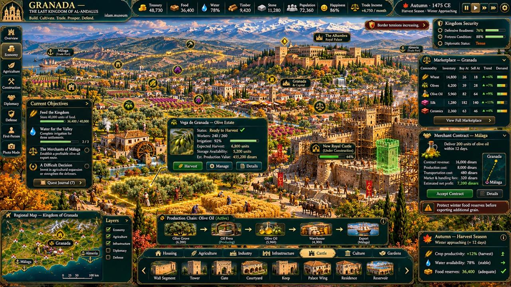

# GRANADA — The Last Kingdom of Al-Andalus
## islam.museum Gaming Platform V2 • Standalone game 11 • Production addendum 1.0
**25 November 2026 | Build. Cultivate. Trade. Prosper. Defend.**

This package authorizes a proposed product design, not a completed game or a live deployment. Its primary visual reference is the founder-supplied Version 3 concept. The original Gaming Platform V2 archive is included unchanged in `reference/` for a fresh session; an existing session should use its existing verified V2 copy and preserve completed work. The Granada addendum changes the catalogue from ten to eleven independent games. It supplements, rather than replaces, the original platform's architecture, governance, security, seven-language support and acceptance gates. Granada is a proposed flagship strategy title, not a renaming of Golden Age. Keep the latter's broad civilization focus intact.

## Start in Claude Code
1. Extract this ZIP intact somewhere accessible to the repository worktree. Attach the last image separately if desired; it is already bundled byte-for-byte.
2. For a continuing session, send [the full launch prompt](01-CLAUDE-MASTER-PROMPT.md) and the package path. For a fresh session, extract the nested V2 ZIP if needed. Verify the worktree, branch, agent ownership and previous checkpoint before changes.
3. Read the master prompt, roadmap and acceptance contract first; load individual design modules before implementing them. Read all applicable repository instructions before writing.
4. Recommended configuration: local Claude Code, Fable 5.2, Extra effort for architecture/rendering/security spikes, High for sustained implementation, normal speed, isolated worktree, scoped permissions. Use actual model selector; don't assume flags or availability. The existing V2 operating protocol remains authoritative for execution practices. Do not restart completed milestones solely to adopt the addendum.

## Documents
| File | Purpose |
|---|---|
| [01 — Claude master prompt](01-CLAUDE-MASTER-PROMPT.md) | Complete implementation mandate for the active or new session |
| [02 — Game design document](02-GAME-DESIGN.md) | Core loop, progression, player fantasy, scenario scope and modes |
| [03 — World and historical content](03-WORLD-AND-HISTORY.md) | Evidence, geography, period, source workflow and campaign framing |
| [04 — Economy and simulation](04-ECONOMY-AND-SIMULATION.md) | Quantitative examples, invariants, agriculture, logistics and balance |
| [05 — Construction, defense and diplomacy](05-CONSTRUCTION-DEFENSE-DIPLOMACY.md) | Modular building, governance, AI opponents, safety and recovery |
| [06 — Visual and interface bible](06-VISUAL-AND-UI.md) | Three images, concrete corrections, camera, art, rendering and HUD modes |
| [07 — Campaigns, quests and retention](07-CAMPAIGNS-AND-QUESTS.md) | Authoring, narrative, challenges, replay and sharing |
| [08 — Architecture, SDK and deployment](08-ENGINE-SDK-DEPLOYMENT.md) | Runtime contracts, mods, storage, release, localization and integration |
| [09 — Quality, release and roadmap](09-QUALITY-AND-ROADMAP.md) | Milestones, playtests, benchmark definitions and release blockers |
| [10 — Visual capture briefs](10-VISUAL-CAPTURE-BRIEFS.md) | Eight distinct production camera/gameplay scenarios |
| [11 — Sources and validation](11-SOURCES-AND-VALIDATION.md) | Verified starting sources and outstanding research |
| [Acceptance matrix](contracts/acceptance.md) | Granada-specific gates extending V2 R01–R18 |
| [Acceptance JSON](contracts/acceptance.json) | Machine-readable gate IDs and evidence |
| [Example economy fixture](contracts/economy-fixture.json) | Illustrative test oracle, not historical evidence |

## Precedence and known limits
Repository governance > explicit founder authorizations > Granada addendum for this title and its registration > existing V2 for shared systems > V1 as background. Where constraints conflict, record an ADR and seek approval only for consequential changes. No release of unvalidated content, spending, external contracts or production deployment is authorized. No live repository audit, actual game implementation, current GPU measurements or human playtests were performed for this package. Numbers in images and this specification are illustrative design fixtures, not historical measurements or final balance. Source links were checked selectively; all record-level content, seasonal calendars, route rights, assets and infrastructure must be validated in the implementation environment. The three raster concepts are supplied, not real gameplay captures. Eight additional shot briefs are instructions for actual in-engine captures, not eight existing screenshots.
