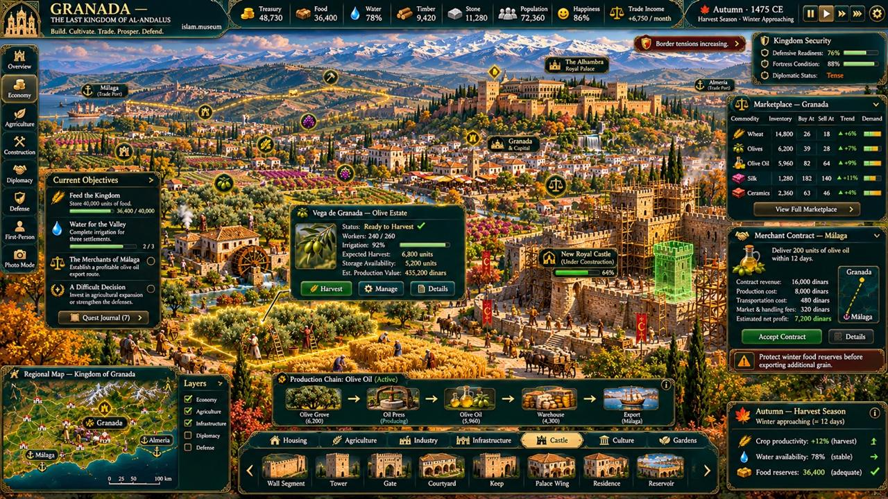
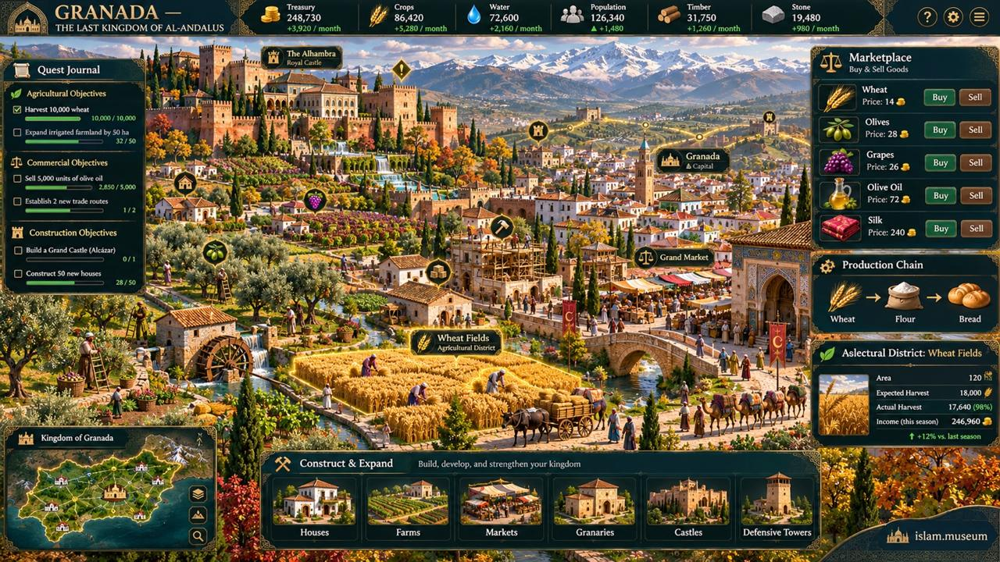
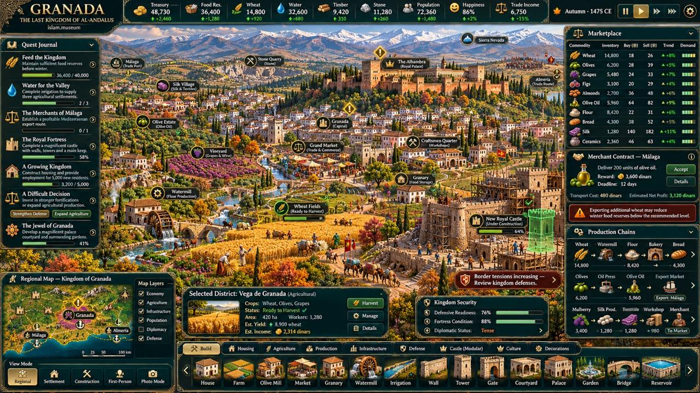

# Visual production bible and UI specification
## Reference hierarchy

V3: approved primary ambition for material richness, terrain, living economy, regional symbols, visual hierarchy and modular castle. The screenshot is not a functional HUD or balanced economy. It still contains excessive concurrent panels, an olive valuation error, and geographically compressed ports. See economy module for exact corrected math. Use it as art direction, not an implementation asset.

V1: stronger intimate environmental immersion, close-up life in the wheat fields, rich vegetation, architecture and sunlit materials. Its marketplace, dates and other values are illustrative and some text is misspelled.

V2: clearer regional scope, quest types, production chains, year/season, modular castle preview and management detail. Its displayed player buy prices are below sell prices; do not replicate. All three are user-provided generated concept images. Retain their source filenames in provenance if available. No claim of historical accuracy or measured rendering.

## Art direction and physical world
Core palette: terracotta fortification walls, cream limewash/plaster, warm timber, blue and green glazed ceramic detail, golden harvest tones, muted olive green, blue-grey distant mountains and cool water. Avoid exaggerated turquoise everywhere, fantasy domes, generic European castle kits, repeated identical facades and indiscriminate gold ornamental UI. Build an original modular grammar with regional roof, wall, doorway, courtyard, window, arch and terrace variations. Distinct silhouette of historically sourced Alhambra, not a generic palace. Local details: chipped plaster, tile variation, stone coursing, timber joinery, worn paths, markets, cloth, plant species, convincing irrigation channels and spatially believable riverbank. Materials carry scale, roughness and weathering. Lighting transitions from cool morning to warm dusk; use physically plausible exposure, controlled bloom, subtle fog and contact shadows, avoid crushed blacks or oversaturation. Mountain snow and local vegetation change with verified season; grain may be stored rather than ripe simultaneously with olives. Show functional state in geometry: water delivered, harvested rows, scaffold phases, moving shipment, work stoppage and warehouse fullness. Decorative ambient characters may be explicitly representative; never fake a quantitative activity.

### Asset production pipeline
Define modular asset list by game need; lock units, axes, pivot, snaps, naming and LOD strategy. Build original assets with Blender/Geometry Nodes or suitable procedural generator at development time, export glTF/GLB, validate geometry/materials/UVs, collision proxy, animation clips and licenses. Evaluate glTF extensions, meshopt/Draco and KTX2/Basis depending on tested decode speed and compatibility. Generate texture atlases and instancing variants; high-quality near-camera meshes and simplified distance LODs, avoid obvious pop-in. Establish a set of hero assets (Alhambra-inspired towers, watermill, olive estate, modular gate, market) and dense style scene before generating hundreds of variations. Artist/independent reviewer inspects silhouette, texture scale, visual diversity, animation, contact with ground and historical period. Source image licensing independent from dataset CC0. Do not ship stock screenshot textures as façades or use unlicensed game assets. Maintain asset registry, generated-source provenance, licenses, creator credit and quality tier. Audio: ambient water, market chatter without invented identifiable historical dialogue, animal and work sounds, optional original/licensed music; spatial cue captions and volume controls; autoplay only after user gesture.

## Renderer and performance
Use existing V2 renderer if its capability is demonstrated; compare Three.js WebGPURenderer/TSL and Babylon.js only if unresolved. Secure HTTPS, feature-detect `navigator.gpu`, request adapter/device, check actual limits and required features; no reliance on browser UA alone. Target recent tested Chrome/Edge; no old-browser requirement or experimental flags for canonical users. If unsupported, show tested versions, diagnostics, screenshot/video, and return to museum. Render world with camera-relative local origin, streamed terrain chunks, vegetation/agent instancing, occlusion/frustum culling, batching, LOD and bounded asset residency. GPU compute for demonstrated workloads, Workers for simulation/pathfinding, OffscreenCanvas if profiling justifies. SharedArrayBuffer only with verified cross-origin isolation and compatible hosting; no mandatory use if ordinary messaging suffices. Keep game state independent of GPU device; device loss triggers pause and safe checkpoint, resource rebuild or recovery UI. Never promise exact VRAM from browser estimates; report observed limits and measurements.

Quality profiles: High (1440p/60 fps target), Ultra (4K/60 target), Cinematic (4K/30+ target). Choose measured hardware classes (V2 proposed 16–32 GB system RAM, discrete GPU 8–16 GB class); don't advertise untested hardware. Adaptive render resolution optional per profile with explicit label, preserve high-quality assets; benchmark native resolution separately. Frame budgets 16.67 ms at 60 fps and 33.33 ms at 30 fps; record p50/p95/p99, stutters, CPU tick, GPU if timestamp available, upload times, resolution, memory and long play. Require real physical GPU for release claim. Target steady frame pacing, responsive UI under sim fast-forward and no sustained memory growth in 60-minute soak. Use bounded asset loads; prioritize first playable village rather than full-region download. Capture loading time under defined network conditions, report actual bytes and timings. Browser tab hidden pauses or follows explicit safe policy; no background punishing progression. See quality module for benchmark evidence.

## UI modes and visibility
V3 contains a left rail, top bar, marketplace, contract, objective, olive card, production chain, construction toolbar, security and seasonal panels. Good for explaining features, unsuitable as permanently visible HUD. Define a persistent thin top status bar, collapsible navigation, one primary inspector and small priority notification; other panels on demand. Target at least 75% unoccluded world area in Overview at 1920×1080, with UI mask measurement. Specialist modes may use more space when task requires; report actual screen coverage and do not make text tiny to meet metric. Preserve aspect-ratio layouts and UI scaling. Do not display a castle placement ghost in economy mode. Opening another mode must not silently commit or cancel a building plan; prompt if necessary.

| Mode | Primary tools | Hidden by default |
|---|---|---|
| Overview | Top resources, 3 tracked quests, map/markers, one alert | Full market, building catalog, production diagrams |
| Economy | Market order book, selected contract, supply chain, shipment | Castle placement ghost, full quest journal |
| Agriculture | Crop, water, labor, storage forecast, plot actions | Market book unless requested |
| Construction | Categories, placement, cost/validity, worker queue | Trade panel, crop inspector |
| Diplomacy | Council, treaty preview, outcomes | Building palette |
| Defense | Readiness, abstract threat, upkeep, repair, civilian safety | Unrelated market detail |
| First-person | Minimal compass, inspect, exit to previous view | Management panels |
| Photo/Cinematic | Hide HUD; optional camera controls only | Gameplay overlays; no state mutation from preview |

Resource strip shows unit, balance, change period and tooltip definitions. Distinguish food reserve quantity and water supply ratio, treasury and net monthly trade, public happiness. Date/season and sim speed persist. Marketplace explicitly uses player buys at / sells at; sort, filter, search, quantity, availability, quote, cost, projected reserves, confirm. Do not use tiny permanently open spreadsheet. Contract card shows deadline, route, costs, local alternative and risk. Selected plot shows crop, workers, water, harvest forecast, free space and correct gross/estimated net; if forecast exceeds space, display 1,600 overflow for fixture. Quests show actionable goal, progress and consequences, collapsed journal. Map markers from stable entity IDs, zoom clustering and filters; no more than a handful of high-priority labels in busy view, no always-on decorative icons. Click marker centers camera/opens relevant inspector; list alternative for keyboard and low-vision users. Warn about upcoming winter by text and icon as well as color. Include undo/cancel, fast speed clearly indicated and pause reachable at all times. Photo mode no essential status but pause/exit shortcuts.

### UI localization and accessibility
Use all seven actual locales from repo. Real text in DOM where possible, no rasterized English labels on concept assets. Text resizing 100–200% without clipped essential controls; RTL panel layout and mixed number/currency isolates; maps and physical coordinates not mirrored. Keyboard navigation, visible focus, no keyboard trap in canvas/pointer lock, accessible inventory and building list, high contrast and color-independent signals, subtitles, reduced motion and camera sensitivity. Evaluate against applicable WCAG 2.2 AA for web UI; document game-specific exceptions and alternate controls rather than claiming blanket compliance. Human language review required. Use brand typography consistent with platform and suitable script coverage, verify rights. Text hierarchy: large action and current task, concise status, expandable detail. Avoid repeated tooltips for same metric and long tutorials. Test high DPI, fullscreen, window resize, loss of focus and restore.
