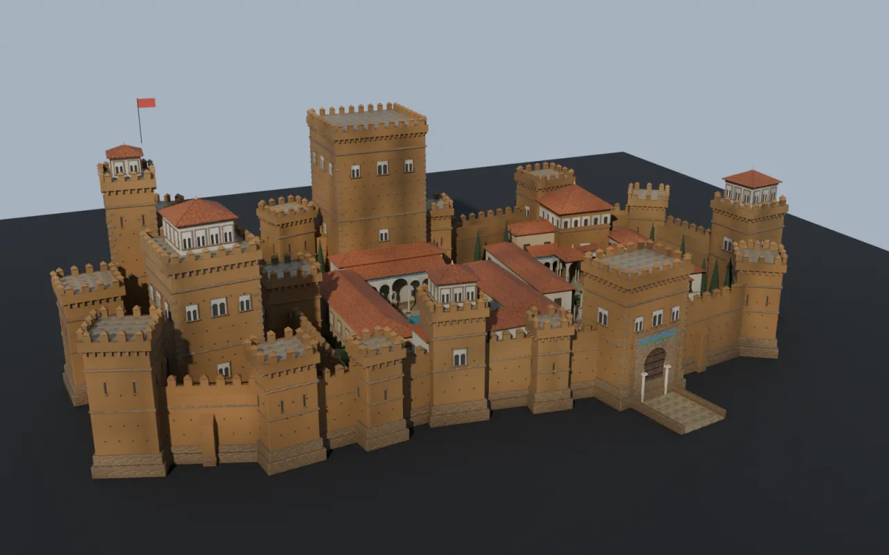
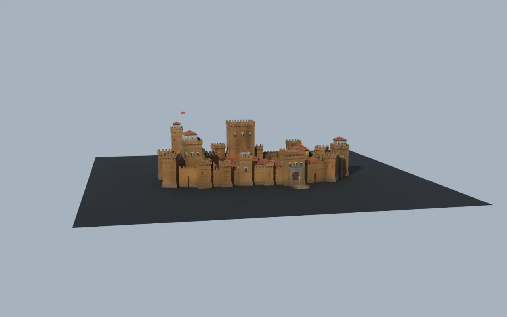
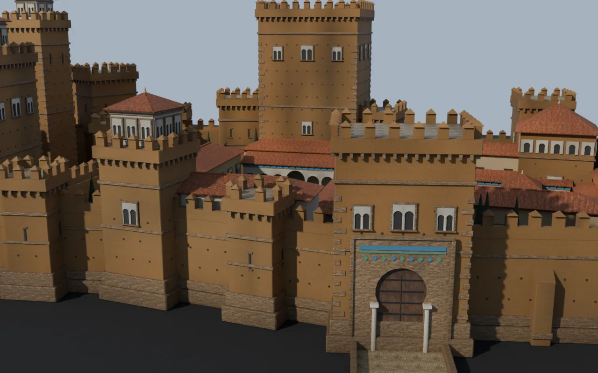
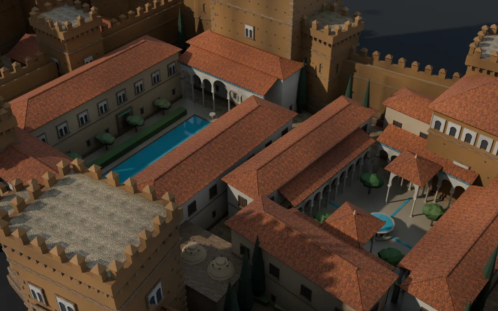

# Granada's art: the three candidates, and what is kept of the second

_Written on 26 November 2026 after the founder's decision on art ([`owner-decisions-2026-11-26-c.md`](owner-decisions-2026-11-26-c.md); his words govern, this is what was done with them). Nothing here is accepted art. Every game is still a prototype._

## Where each candidate stands

| | What it is | Where it is | Standing, by his decision |
|---|---|---|---|
| **Set A** (`granada/2`) | Thirteen buildings made by Blender scripts, with five photographed public-domain surfaces. The proof frame of this morning ([`proof-granada.md`](proof-granada.md)) | On `main` and on UAT | **The running baseline. Not accepted as the direction of production art.** It stays in the game until something better is accepted |
| **Set B** (`granada/3`) | The same thirteen with more scripted detail and one automatic low-detail version each, by a second agent (Devin) | Pull request amado2k5/islam-museum#8312, open; the models only on the machine that made them ([checksums](../evidence/granada/art-set-b/checksums.md)) | **Not merged as it stands. Not accepted. Kept as experimental research**: its engineering may be carried over, its geometry is not a template |
| **Candidate C** | A new proof frame built from `main`: one complete view at the target's finish, in the running game | One piece made, on one machine: the palace (below). Not in the game | To be judged by him against all fourteen lines of the checklist. **No asset is made in number before he accepts it in words.** Its first piece, the palace, is below; the stop rule has been reached on it |

## What "hand-authored or artist-reviewed" can mean here, said plainly

The decision asks that the hero pieces of Candidate C (palace, estate, gate and wall, a street cluster, construction detail, key vegetation) be "hand-authored or artist-reviewed".

- **No artist is engaged.** Paying one, or buying models, needs his separate approval (register, approval 13), and the decision repeats it: nothing is bought.
- **The developer is an AI that makes models by writing Blender scripts.** It cannot model by hand in the sense an artist does. What it can do differently from Sets A and B is author each hero building as its own script, piece by piece, with its own plan, openings and ornament, instead of drawing every building from one kit of parts. That is what "authored" will mean in Candidate C, and it will be said in those words wherever the candidate is described.
- **"Artist-reviewed" stays unmet until a person is named.** The developer looking at its own renders is not an artist's review.
- **The decision's own stop rule applies to this.** If the first palace, street cluster and estate still read as improved boxes after one focused revision, the method stops and a proposal for a professional artist or licensed models comes back to him, with roles, licences, known costs and budgets.

## Set B, file by file

_The fourteen files of the pull request at `f0ed8773035`, against `main` at `c24845bfd35`._

| File | What it is | Verdict | Why |
|---|---|---|---|
| `gaming/art/blender/common3.py` | A copy of `common.py` with ten added helpers | **Port** the helpers into `common.py`: ordered faces and vertices, removal of zero-area faces, a glTF rewrite that makes two exports byte-identical, automatic LOD. **Discard** the copy | The reproducible export is real engineering and is wanted. Two diverging copies of one 800-line file is the duplication the decision forbids |
| `gaming/art/blender/kit3.py` | A copy of `kit.py` with more parts (tile ends, lattices, base courses, wash) | **Rewrite** | Some parts are worth having, but as parts of the one maintained kit, and Candidate C's hero pieces are not kit-built |
| `gaming/art/blender/granada_town3.py` | Set B's houses, wall, tower, gate, scaffold, stall | **Retain only as evidence** | It keeps Set A's outer shapes on purpose; the decision asks for new silhouettes, streets and variety |
| `gaming/art/blender/granada_landmarks3.py` | Set B's palace, estate and crane | **Retain only as evidence** | The palace is the piece the decision finds furthest from the target |
| `gaming/art/blender/granada_mill3.py` | The mill, unchanged in design, with LOD and ordered export | **Port** the LOD and export calls into `granada_mill.py` when the game can choose one LOD; **discard** the copy | The design is Set A's own; only the export changed |
| `gaming/art/compare_granada.py` | Checks set 3 against set 2: same names, origins, outer sizes, one LOD each | **Rewrite** as a general check | As written it enforces the very sameness of shape that Candidate C must break. Its reading of sizes, triangles and LOD pairs from a glTF without Blender is the useful part |
| `gaming/art/blender/render_granada_compare.py` | Renders each piece of two sets side by side | **Port**, made general over any two sets | Needed for the close-up sheet the decision asks for |
| `gaming/art/manifest.py` | Adds `proofAssets` that the publisher does not read, and keeps records of sets missing on a machine | **Port** | It lets a candidate exist beside the baseline without blocking the baseline's publication, which Candidate C needs until it is accepted |
| `gaming/art/manifest.json` | Generated: the proof records of set 3 | **Discard** | It is regenerated from whatever sets exist; set 3's records stay in the pull request |
| `gaming/art/art.gtest.ts` | Tests for the above | **Port** with `manifest.py`, without the three set-3 names | The test that proof assets stay out of the publishable list is the valuable one |
| `gaming/package.json` | Three scripts to build set 3 | **Discard** | They run the copies |
| `gaming/art/README.md` | Describes set 3 and its commands | **Rewrite** when the ports land | It documents the copies |
| `docs/gaming/spec-production/art-finish-granada-3.md` | Set B's own account of what it changed and could not do | **Retain only as evidence**, in the pull request | An honest record of an experiment; it is not a record of anything on `main` |
| `CANARY.md` | One release note for set 3 | **Discard** | The set is not released; this change carries its own note |

**Also kept in mind, not a file:** in Set B's models the low-detail meshes sit in the same scene as the full ones under names ending `-lod1`. A game that adds the whole scene draws both. Candidate C's loader must choose exactly one for each object, and have a test for it.

## The order of work on Candidate C

1. Label the pull request and keep its evidence. **Done with this change.**
2. The stop/go test: one hero palace, one street cluster and the estate, each authored as its own script, rendered and looked at beside the target. One focused revision at most.
3. If it passes the developer's own honest reading: the rest of the one view (foreground estate and fields, mill and water, town, gate and wall with construction, range), LOD selection in the game, the normal build and media path, UAT, and the whole package of evidence the decision lists.
4. If it does not: stop, and bring him the proposal for an artist or licensed models.
5. Either way he judges. The developer's reading passes no gate.

## Candidate C's first piece: the palace, and the stop rule

_Made on 26 November 2026, the same day as the decision. It is on the machine that made it and in no game, on no host._

**What was made.** One building written as its own script ([`gaming/art/blender/granada_palace_c.py`](../../../gaming/art/blender/granada_palace_c.py), with the new tools in [`author.py`](../../../gaming/art/blender/author.py)), not drawn from the town's kit: an uneven ring of twelve stretches of wall with seventeen towers of different widths and heights; a military quarter with a keep and a watchtower; a court with a long pool between two porticoes of horseshoe arches on columns, a hall and a great tower behind; a second court arcaded on four sides with a fountain and two small pavilions; a square hall under a pyramid roof; a bath with three small domes; a garden with a lookout; a gate in a horseshoe arch. Arches are cut as shapes; roofs have four slopes with the tiles running down each; twin windows have a colonette; walls carry the rows of holes that rammed earth keeps. Wear is painted into the mesh as a colour layer (damp at the foot of walls, uneven tone, streaks, shade underneath), which the export carries.

**In figures:** 214,166 triangles; 105 by 70 metres, 36 high; one object; 19 materials, 8 of them photographed surfaces; a 24.6 MB buffer and 7.1 MB of textures before any reduction. No low-detail version yet. Set A's palace is 8,656 triangles and Set B's 14,616. Build and four renders: 75 seconds on the developer's machine.

**The renders** (Blender's own renderer, on a bare ground; **not the game, and not evidence for any line of the proof-frame checklist**):

| | |
|---|---|
|  |  |
|  |  |

**One focused revision was made, as the decision allows** ([before it](../evidence/granada/candidate-c/palace-near-before-revision.webp)): the walls went from one even salmon to an ochre that drifts in tone and hue; rectangles laid on the walls as "repairs" were taken out because they read as labels; the wear was made strong enough to see; the gate's door fills its arch; tile bands were thinned; tree crowns were made uneven.

**The developer's reading, which passes no gate.**

- **Gained over Sets A and B:** it is a place and not a block. The skyline is uneven, the courts, arcades, pool and roofs read from above, and at the distance of a background landmark it holds together as a fortified palace.
- **Not reached:** near to, it is still visibly put together from boxes. Walls are flat planes with sharp clean edges; every merlon, window and corbel is the same as its neighbour; the hedges are boxes and the trees are lumps; nothing is chipped, leaning, patched or grown over. Light falls on it as on a clean model. The target's palace has none of that cleanness.
- **So the stop rule is reached on this piece.** The decision's test was the palace, a street cluster and the estate. The palace is the piece a script suits best, being walls and towers; houses, an estate and above all planting are harder for it, not easier. The developer did not go on to make the other two by the same method, because the rule says to stop iterating it and come back with a proposal.

**The proposal he asked for in that case, as far as it can honestly be made today.**

| Part of the frame | Proposed source | What it needs from him |
|---|---|---|
| The palace, the walls and towers, at the distance the proof camera sees them | Keep this scripted palace as a base, with low-detail versions made for it | Nothing new; his judgement of it in the running game |
| Buildings seen near: the estate, a street cluster, the gate and a wall segment, the construction site | **A 3D artist**, working over these scripted layouts so that footprints, selection and placement stay as the game has them: sculpted wear, broken edges, irregular forms, painted textures. Roles: one environment artist for architecture; the developer for export, LODs, checks and integration | Approval to engage a person, and the person (register, approval 13). **No cost is known and none is guessed here** |
| Trees, crops, hedges, ground cover | **Licensed scanned or modelled plants**, public domain first (Poly Haven's models were to be surveyed for olive, cypress, citrus, cereal and shrubs), brought in through the same table of source, licence, changes, attribution, size, triangles and texture memory that he asked for | The survey could not be made today: the browser he asked to be used for the web was not reachable. Nothing was downloaded |
| People, animals, carts | Not addressed by this piece | His decision once the above is settled |

**What was not done:** the palace has not been put in the game, so nothing is known of how it looks under the game's light, how it sits on the hill (its footprint is larger than Set A's 76 by 50 metres) or what it costs a frame. No street cluster, no estate. No historian has seen it: it is a general picture built from types of building, the game does not call it the Alhambra, and it stays under ledger entry HR-GR-06, review pending.

**What only he can supply and is not waited on:** an artist's review; named historical reviewers (the candidate's buildings are a general picture of a walled town and stay marked "historical review pending"); operators for the minimum machines.
