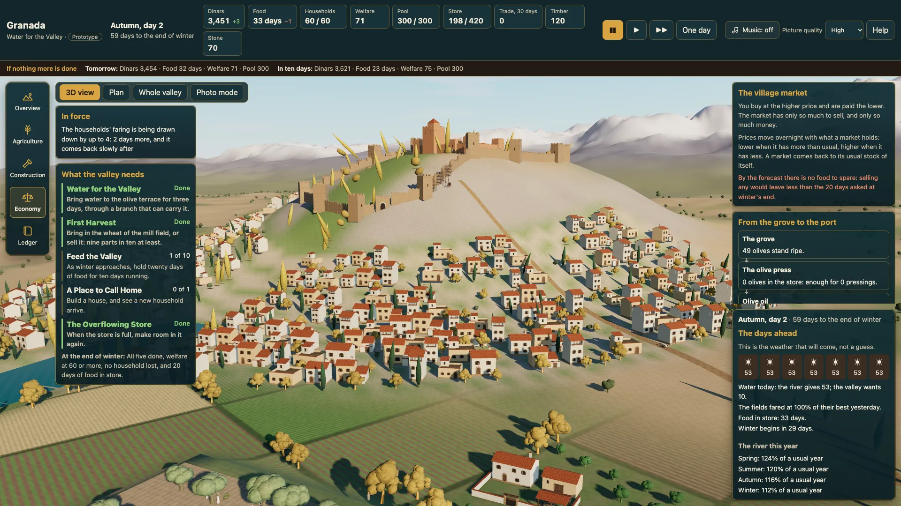

# The Candidate C palace in the running game: a first evaluation, paused unfinished

_Written on 26 November 2026 under the founder's fourth set of decisions ([`owner-decisions-2026-11-26-d.md`](owner-decisions-2026-11-26-d.md), instructions 2, 3, 7, 8 and 9). **Work on Granada was paused the same day by his instruction that another game takes sole priority, so this page is a record of where the evaluation stopped, not the decision package he asked for.** Nothing here is accepted, optimised, historically reviewed or on the test address._

## What exists

- **A selector.** Adding `art=c` to the game's address draws the Candidate C palace in place of Set A's. Without it the game is exactly as before. Nothing is kept in a save. If the palace's file cannot be had, Set A's palace stays and the game says so in its own record of models (`modelFailures`). The change is three small edits (`gaming/games/granada/src/view/three-valley.ts`, `ui/stage.ts`, `ui/app.ts`).
- **A tool** that takes the same game in the same state with each set (`gaming/tools/granada-palace-c.ts`), and one for a ten-minute repeated check (`gaming/tools/granada-palace-cycle.ts`, **written and never run**).
- **One full run** of the first tool on the developer's machine: two sets, two window sizes, three presets, five views each; 12 games, 60 pictures, no console error and no model failure. The record: [`in-game-2026-11-26.json`](../evidence/granada/candidate-c/in-game-2026-11-26.json). Six of the pictures are beside it; the other 54 are media on that machine and not in git.

| | Set A | Candidate C |
|---|---|---|
| The proof view, High, 1920 by 1080 |  |  |
| The nearest view that holds the whole palace |  |  |

Candidate C from farthest out, and through Photo Mode's narrowest lens: [far](../evidence/granada/candidate-c/in-game-c-1920x1080-high-3-farthest-strategic.webp), [Photo Mode](../evidence/granada/candidate-c/in-game-c-1920x1080-high-5-photo-nearest.webp).

## Added when the work was taken up again (26 November 2026, later the same day)

- **Three choices now, one file loaded for each:** `art=c` is the palace as written (214,166 triangles), `art=c1` a lighter making of it (69,676) and `art=c2` the lightest (19,964, by a temporary automatic reduction that is not final art). The two lighter ones are the second agent's work (pull request amado2k5/islam-museum#8320). The game does not change between them by itself; that is still to be built.
- **Loaded once each in the running game** (Low, 1280 by 800, the proof view, no error and no failure): the scene draws 2,306,834 triangles with the full palace, 2,017,854 with the lighter and 1,918,430 with the lightest; the palace's files are 31.7 MB, 13.2 MB and 7.1 MB. The lighter two use 8 surfaces where the full one uses 19, and draw 22 fewer times a frame.
- **All three were exported again** from the scripts as they stand on `main`, so that the record of models (`gaming/art/manifest.json`) names the scripts that made them. The full palace is the same model vertex for vertex as the one in the run below, but for two vertices of its marble (see [`review-flags-8316-8317.md`](review-flags-8316-8317.md)).
- **The game's budget for one building is not met by the palace, and is not relaxed for it.** The rule in the games' tests is under 40,000 triangles and 12 MB. The full palace and the lighter one are over it; only the lightest is within. They are recorded as "under evaluation", held to no budget there, and a new test keeps anything so marked out of the game unless the address asks for it.
- The reviewer's flags are answered in [`review-flags-8316-8317.md`](review-flags-8316-8317.md), which is what the founder's instruction 4 asked before this could merge.

## What the run shows that can be relied on

- **The camera cannot come near the palace.** Its target stays over the worked ground (x up to 760) and the palace stands at x = 930. The nearest view that holds the whole of Candidate C is from 160 metres of camera distance (150 for Set A), where it is about 499 by 204 pixels at 1920 by 1080. At the proof view it is 264 by 97 pixels; from farthest out, 89 by 30. Through Photo Mode's narrowest lens it reaches 817 by 268. The close-up faults seen in the Blender renders are therefore seen in the game only through Photo Mode.
- **What it adds to the scene**, the same at every view: 11 geometries (136 to 147), 18 textures, 22 draw calls (33 on High), and between about 411,000 and 617,000 drawn triangles depending on the preset (the model's 214,166, drawn again for shadow). On High from farthest out the scene is 7.26 million triangles against 6.65 million.
- **What it adds to the download:** 31.7 MB (52.6 MB of models against 21.0), of which the palace's buffer is 24.6 MB; the rest is a second copy of the same textures, because Candidate C's folder shares nothing with Set A's. That copy is waste and would go before any release.
- **It loads, and falls back.** In every game the palace arrived; the fallback to Set A was seen working when the file was absent during development, and is not covered by a test.

## What cannot be relied on: the frame times

**The frame times in the record are not a fair comparison and no conclusion is drawn from them.** The machine was shared: at the start a second agent's application and a local model server were each using about 40% of a processor, and by the end Blender was running at about 250% with a load average of 33. The figures move with that and not with the palace: Set A on Medium at 1920 by 1080 measured slower than Candidate C, which the palace cannot cause. They are kept as measured. A quiet-machine run is owed, and the two minimum machines have not been measured at all.

The record's `machine.gpu` says "no WebGPU adapter". That is a fault in the tool, which asked a blank page; the games themselves ran in 3D on WebGPU in every run.

## The figures, as measured

Frame times in milliseconds are median / 95th / 99th centile over ten seconds; slow frames are those over 16.7 ms / over 33.3 ms in those ten seconds. The palace's box is the projection of its bounding box.

| Set | Window | Preset | View | Palace's box, pixels | Frame ms | Slow frames | Draw calls | Triangles | Geometries | Textures | Heap, MB |
|---|---|---|---|---|---|---|---|---|---|---|---|
| A | 1920x1080 | low | 1-proof | 200 by 88 | 8.3 / 8.9 / 9.2 | 0 / 0 | 175 | 1,895,814 | 136 | 51 | 92.9 |
| A | 1920x1080 | low | 2-nearest-strategic | 382 by 192 | 8.3 / 9.2 / 9.3 | 0 / 0 | 144 | 1,872,543 | 136 | 51 | 101.7 |
| A | 1920x1080 | low | 3-farthest-strategic | 67 by 28 | 8.3 / 9 / 9.3 | 0 / 0 | 284 | 2,303,213 | 136 | 51 | 108 |
| A | 1920x1080 | low | 4-photo-farthest | 39 by 16 | 8.3 / 9 / 9.3 | 0 / 0 | 284 | 2,303,213 | 136 | 51 | 107.9 |
| A | 1920x1080 | low | 5-photo-nearest | 616 by 254 | 8.3 / 9.1 / 9.3 | 2 / 0 | 193 | 1,967,787 | 136 | 51 | 91.5 |
| C | 1920x1080 | low | 1-proof | 264 by 97 | 8.3 / 9 / 9.2 | 0 / 0 | 197 | 2,306,834 | 147 | 69 | 134.8 |
| C | 1920x1080 | low | 2-nearest-strategic | 499 by 204 | 8.3 / 9 / 9.3 | 0 / 0 | 166 | 2,283,563 | 147 | 69 | 117.6 |
| C | 1920x1080 | low | 3-farthest-strategic | 89 by 30 | 8.3 / 9.2 / 9.3 | 0 / 0 | 306 | 2,714,233 | 147 | 69 | 130 |
| C | 1920x1080 | low | 4-photo-farthest | 52 by 17 | 8.3 / 8.9 / 9.3 | 0 / 0 | 306 | 2,714,233 | 147 | 69 | 127.3 |
| C | 1920x1080 | low | 5-photo-nearest | 817 by 268 | 8.3 / 36.9 / 53.5 | 97 / 55 | 215 | 2,378,807 | 147 | 69 | 108.4 |
| A | 1920x1080 | medium | 1-proof | 200 by 88 | 27.1 / 54.2 / 64.2 | 292 / 125 | 193 | 2,020,293 | 136 | 62 | 188.2 |
| A | 1920x1080 | medium | 2-nearest-strategic | 382 by 192 | 26.2 / 46.1 / 55.6 | 302 / 124 | 156 | 1,915,207 | 136 | 62 | 167.1 |
| A | 1920x1080 | medium | 3-farthest-strategic | 67 by 28 | 34.2 / 60 / 70.5 | 272 / 156 | 298 | 3,092,007 | 136 | 62 | 170.1 |
| A | 1920x1080 | medium | 4-photo-farthest | 39 by 16 | 8.4 / 17.4 / 47.2 | 76 / 29 | 298 | 3,092,007 | 136 | 62 | 166.6 |
| A | 1920x1080 | medium | 5-photo-nearest | 616 by 254 | 8.3 / 9 / 9.1 | 0 / 0 | 207 | 2,142,671 | 136 | 62 | 173.9 |
| C | 1920x1080 | medium | 1-proof | 264 by 97 | 8.3 / 9.2 / 16.7 | 16 / 0 | 215 | 2,431,313 | 147 | 80 | 201.8 |
| C | 1920x1080 | medium | 2-nearest-strategic | 499 by 204 | 8.3 / 9 / 16.7 | 12 / 0 | 178 | 2,326,227 | 147 | 80 | 203.8 |
| C | 1920x1080 | medium | 3-farthest-strategic | 89 by 30 | 8.3 / 16.7 / 17.2 | 89 / 0 | 320 | 3,503,027 | 147 | 80 | 203.1 |
| C | 1920x1080 | medium | 4-photo-farthest | 52 by 17 | 8.4 / 16.7 / 17.5 | 123 / 0 | 320 | 3,503,027 | 147 | 80 | 201.2 |
| C | 1920x1080 | medium | 5-photo-nearest | 817 by 268 | 8.3 / 9.1 / 16.7 | 19 / 0 | 229 | 2,553,691 | 147 | 80 | 206.8 |
| A | 1920x1080 | high | 1-proof | 200 by 88 | 16.4 / 19.1 / 25.8 | 276 / 0 | 282 | 3,557,867 | 136 | 66 | 187.5 |
| A | 1920x1080 | high | 2-nearest-strategic | 382 by 192 | 8.4 / 16.7 / 17.4 | 117 / 0 | 235 | 3,250,377 | 136 | 66 | 168.1 |
| A | 1920x1080 | high | 3-farthest-strategic | 67 by 28 | 16.3 / 17.5 / 24.3 | 245 / 0 | 456 | 6,645,149 | 136 | 66 | 172 |
| A | 1920x1080 | high | 4-photo-farthest | 39 by 16 | 16.5 / 17.9 / 25 | 249 / 0 | 456 | 6,645,149 | 136 | 66 | 186.8 |
| A | 1920x1080 | high | 5-photo-nearest | 616 by 254 | 16.3 / 17.5 / 24.3 | 251 / 0 | 290 | 3,787,913 | 136 | 66 | 186.2 |
| C | 1920x1080 | high | 1-proof | 264 by 97 | 16.7 / 25 / 25.5 | 313 / 0 | 315 | 4,174,397 | 147 | 84 | 208.2 |
| C | 1920x1080 | high | 2-nearest-strategic | 499 by 204 | 16.6 / 19 / 25 | 317 / 0 | 268 | 3,866,907 | 147 | 84 | 208 |
| C | 1920x1080 | high | 3-farthest-strategic | 89 by 30 | 17.3 / 26 / 28 | 389 / 0 | 489 | 7,261,679 | 147 | 84 | 207.4 |
| C | 1920x1080 | high | 4-photo-farthest | 52 by 17 | 17.5 / 26.6 / 28.3 | 405 / 0 | 489 | 7,261,679 | 147 | 84 | 215.5 |
| C | 1920x1080 | high | 5-photo-nearest | 817 by 268 | 8.8 / 17.1 / 19.7 | 189 / 0 | 323 | 4,404,443 | 147 | 84 | 202.3 |
| A | 1280x800 | low | 1-proof | 127 by 56 | 11.8 / 37.6 / 46 | 259 / 71 | 175 | 1,895,814 | 136 | 51 | 102.7 |
| A | 1280x800 | low | 2-nearest-strategic | 244 by 123 | 11.6 / 36.2 / 40.5 | 274 / 64 | 144 | 1,872,543 | 136 | 51 | 82.8 |
| A | 1280x800 | low | 3-farthest-strategic | 42 by 18 | 19.8 / 47.2 / 56 | 276 / 109 | 284 | 2,303,213 | 136 | 51 | 86.2 |
| A | 1280x800 | low | 4-photo-farthest | 29 by 12 | 24.2 / 52.7 / 57.9 | 265 / 128 | 284 | 2,303,213 | 136 | 51 | 82.8 |
| A | 1280x800 | low | 5-photo-nearest | 457 by 188 | 8.3 / 9.1 / 9.3 | 0 / 0 | 193 | 1,967,787 | 136 | 51 | 86.2 |
| C | 1280x800 | low | 1-proof | 168 by 62 | 8.3 / 9.1 / 9.2 | 0 / 0 | 197 | 2,306,834 | 147 | 69 | 142.3 |
| C | 1280x800 | low | 2-nearest-strategic | 319 by 130 | 8.3 / 9.2 / 9.3 | 0 / 0 | 166 | 2,283,563 | 147 | 69 | 140 |
| C | 1280x800 | low | 3-farthest-strategic | 57 by 19 | 8.3 / 9 / 9.2 | 0 / 0 | 306 | 2,714,233 | 147 | 69 | 161.3 |
| C | 1280x800 | low | 4-photo-farthest | 38 by 13 | 8.3 / 9 / 9.2 | 0 / 0 | 306 | 2,714,233 | 147 | 69 | 158.8 |
| C | 1280x800 | low | 5-photo-nearest | 605 by 199 | 8.3 / 9.1 / 9.3 | 1 / 0 | 215 | 2,378,807 | 147 | 69 | 134.9 |
| A | 1280x800 | medium | 1-proof | 127 by 56 | 8.3 / 9.1 / 9.3 | 3 / 0 | 193 | 2,020,293 | 136 | 62 | 198.6 |
| A | 1280x800 | medium | 2-nearest-strategic | 244 by 123 | 8.3 / 9.1 / 9.3 | 0 / 0 | 156 | 1,915,207 | 136 | 62 | 195 |
| A | 1280x800 | medium | 3-farthest-strategic | 42 by 18 | 8.3 / 9.3 / 9.4 | 2 / 0 | 298 | 3,092,007 | 136 | 62 | 176.8 |
| A | 1280x800 | medium | 4-photo-farthest | 29 by 12 | 8.3 / 9.1 / 9.3 | 2 / 0 | 298 | 3,092,007 | 136 | 62 | 183.8 |
| A | 1280x800 | medium | 5-photo-nearest | 457 by 188 | 8.3 / 9.2 / 9.3 | 0 / 0 | 207 | 2,142,671 | 136 | 62 | 187.7 |
| C | 1280x800 | medium | 1-proof | 168 by 62 | 8.3 / 9.1 / 9.3 | 2 / 0 | 215 | 2,431,313 | 147 | 80 | 208.6 |
| C | 1280x800 | medium | 2-nearest-strategic | 319 by 130 | 8.3 / 9.2 / 9.3 | 2 / 0 | 178 | 2,326,227 | 147 | 80 | 206.1 |
| C | 1280x800 | medium | 3-farthest-strategic | 57 by 19 | 8.3 / 9.1 / 9.3 | 3 / 0 | 320 | 3,503,027 | 147 | 80 | 217.4 |
| C | 1280x800 | medium | 4-photo-farthest | 38 by 13 | 8.6 / 58.6 / 79.5 | 167 / 86 | 320 | 3,503,027 | 147 | 80 | 208.1 |
| C | 1280x800 | medium | 5-photo-nearest | 605 by 199 | 8.3 / 21 / 41.8 | 75 / 21 | 229 | 2,553,691 | 147 | 80 | 199 |
| A | 1280x800 | high | 1-proof | 127 by 56 | 8.3 / 9.3 / 16.6 | 8 / 0 | 282 | 3,557,867 | 136 | 66 | 205.3 |
| A | 1280x800 | high | 2-nearest-strategic | 244 by 123 | 8.3 / 9.4 / 16.7 | 33 / 0 | 235 | 3,250,377 | 136 | 66 | 172.8 |
| A | 1280x800 | high | 3-farthest-strategic | 42 by 18 | 8.3 / 16.2 / 16.8 | 34 / 0 | 456 | 6,645,149 | 136 | 66 | 180.6 |
| A | 1280x800 | high | 4-photo-farthest | 29 by 12 | 8.3 / 16.6 / 17.3 | 52 / 0 | 456 | 6,645,149 | 136 | 66 | 193.6 |
| A | 1280x800 | high | 5-photo-nearest | 457 by 188 | 9 / 18.2 / 35.7 | 229 / 11 | 290 | 3,787,913 | 136 | 66 | 186.6 |
| C | 1280x800 | high | 1-proof | 168 by 62 | 8.4 / 17 / 24.3 | 125 / 0 | 315 | 4,174,397 | 147 | 84 | 230.3 |
| C | 1280x800 | high | 2-nearest-strategic | 319 by 130 | 8.4 / 17.6 / 27.4 | 175 / 0 | 268 | 3,866,907 | 147 | 84 | 246.1 |
| C | 1280x800 | high | 3-farthest-strategic | 57 by 19 | 8.3 / 17 / 28.3 | 74 / 6 | 489 | 7,261,679 | 147 | 84 | 208.2 |
| C | 1280x800 | high | 4-photo-farthest | 38 by 13 | 16.6 / 25 / 33.3 | 290 / 5 | 489 | 7,261,679 | 147 | 84 | 195.4 |
| C | 1280x800 | high | 5-photo-nearest | 605 by 199 | 8.3 / 15.9 / 24.8 | 43 / 0 | 323 | 4,404,443 | 147 | 84 | 218.4 |

## A first reading, by its maker, of the pictures

At the proof view and from the nearest view the game allows, Candidate C reads as a walled palace with a skyline of towers and roofs, where Set A's reads as a few blocks; it sits inside the hill's wall without cutting through it in these views. Its red-ochre walls are darker than the hill's stone wall beside it, which is Set A's and now looks the poorer of the two. Through Photo Mode's narrow lens the repetition of merlons and windows shows. **This is the maker's eye and settles nothing**: the judgement is the founder's.

Seen in passing, in both sets and not the palace's doing: several cypresses on the hill lean at steep angles or lie along the slope.

## Not done when the work was paused

1. ~~The ten-minute repeated check.~~ Run on 26 November 2026 with the palace the game now shows (), Medium, 1920 by 1080, on the developer's machine ([`../evidence/granada/candidate-c/cycle-10-minutes-2026-11-26.json`](../evidence/granada/candidate-c/cycle-10-minutes-2026-11-26.json)): 28 rounds over 10 loads of the page (camera to three views, a field chosen and let go, the page loaded again every third round). Geometries (144), textures (71), draw calls (308), timers (1) and workers (0) were the same in every round; every model arrived every time; no console error. Heap between 178 and 230.4 MB, its mean by quarter 186.8, 191.9, 195.8, 197.0: no climb that ten minutes can show. Listeners moved between 47 and 99 with the browser's own collection, the same in the last quarter as the first. Frame time median 8.3 ms and 99th centile at most 15.8 ms with no frame over 33 ms; the machine was busy at the start (a load average of 63 from another program's file indexing) and that is not the quiet-machine measurement still owed. It is not the one-hour or four-hour run, and says nothing of the minimum machines.
2. A quiet-machine run of the frame times; anything on the two minimum machines.
3. The checks of terrain fit from above, selection, collision, shadow faults and z-fighting, beyond what the pictures above show.
4. Low-detail versions of the palace and the loading of exactly one of them (asked of the second agent; not seen).
5. The vegetation survey (asked of the second agent; not seen).
6. Nothing of Candidate C was on any host when this was written. The founder has since ruled that the games are released to production only; the palace's files go there with the next release, behind the same address switch.
8. The 87 triangles of no area in square roofs (row D3 of the flags page), to be mended when the palace is next rebuilt.
9. No test covers the fall back to Set A's palace when a file is missing; it was seen working by hand.
7. The recommendation he asked for (keep the palace as a strategic base, send it to an artist, or discard it). It is not made here, because conditions (a) and (b) of his instruction 9 have not both been tested.

The artist's brief and the paid-test page are written and unsent: [`artist-brief-granada.md`](artist-brief-granada.md).
