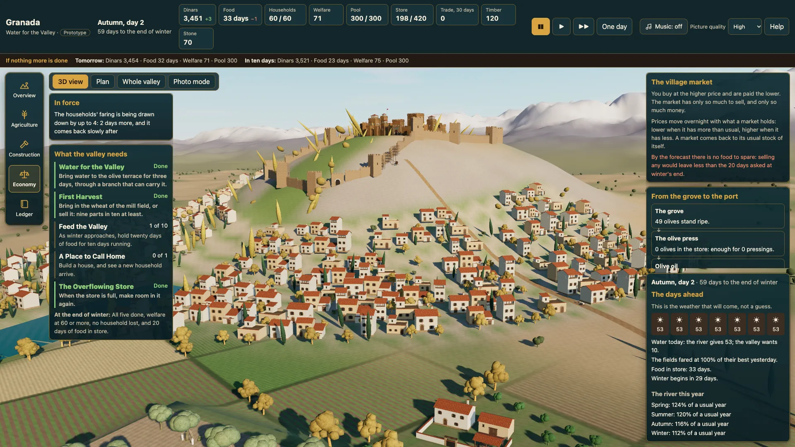
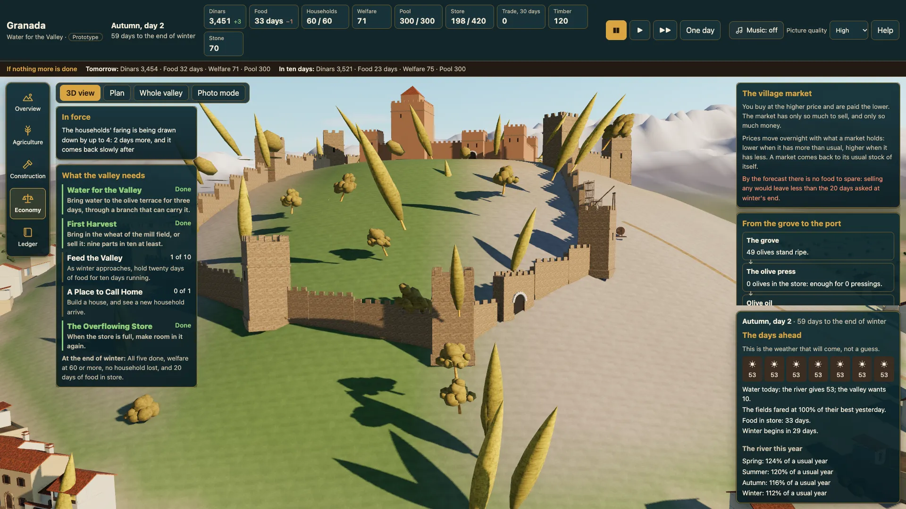
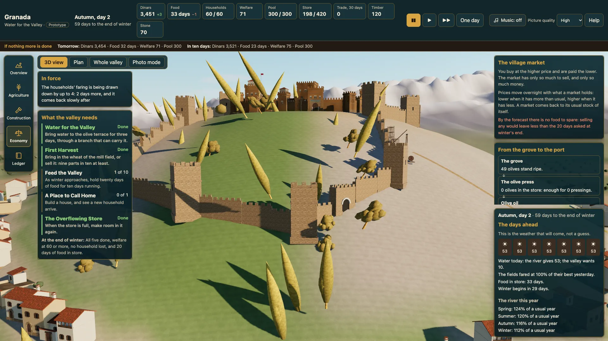

# The Candidate C palace in the running game: evaluation record

_Written on 26 November 2026 under the founder's fourth set of decisions ([`owner-decisions-2026-11-26-d.md`](owner-decisions-2026-11-26-d.md), instructions 2, 3, 7, 8 and 9), and brought up to date on 27 November. Work on Granada was briefly paused that day and then resumed by his later instruction. **This page is an evaluation record, not the decision package he asked for.** Nothing here makes the palace accepted, final, optimised or historically accurate; historical review pending._

## What exists

- **A selector.** The game now shows the lighter making of Candidate C (`granada/p1/palace.gltf`) by default. `art=a` draws Set A's palace; `art=c`, `art=c1` and `art=c2` draw the full Candidate C palace and its two lighter makings for evaluation. Nothing is kept in a save. If the default palace file cannot be fetched, Set A's palace stays and `modelFailures` names `granada/palace`; that fallback is covered by `gaming/tools/granada-palace-fallback.ts` and measured in [`../evidence/granada/palace-fallback/2026-11-27.json`](../evidence/granada/palace-fallback/2026-11-27.json).
- **Tools** that take the same game in the same state with explicit targets (`gaming/tools/granada-palace-c.ts`) and repeat camera movement, selection and reloads (`gaming/tools/granada-palace-cycle.ts`). In both, `default` is the game's own palace with no address flag, while `a`, `c`, `c1` and `c2` are passed explicitly.
- **One full run** of the comparison tool on the developer's machine, before the lighter palace became the default and before the square-roof repair: two sets, two window sizes, three presets, five views each; 12 games, 60 pictures, no console error and no model failure. The record: [`in-game-2026-11-26.json`](../evidence/granada/candidate-c/in-game-2026-11-26.json). Six of the pictures are beside it; the other 54 are media on that machine and not in git.

| | Set A | Candidate C |
|---|---|---|
| The proof view, High, 1920 by 1080 |  |  |
| The nearest view that holds the whole palace |  |  |

Candidate C from farthest out, and through Photo Mode's narrowest lens: [far](../evidence/granada/candidate-c/in-game-c-1920x1080-high-3-farthest-strategic.webp), [Photo Mode](../evidence/granada/candidate-c/in-game-c-1920x1080-high-5-photo-nearest.webp).

## Added when the work was taken up again (26 November 2026, later the same day)

- **The palace the game now shows.** The default is the lighter making in `granada/p1/palace.gltf`, derived from `palace-lod1` and borrowing the first set's texture files rather than carrying copies. After the square-roof repair of 27 November it measures **69,620 triangles**, 8 materials and about 9.1 MB of files unique to it. `art=c` is the full palace (**214,110 triangles** after repair), `art=c1` the same lighter making in the evaluation folder (**69,620**), and `art=c2` the lightest (**19,940**, by disclosed temporary benchmark decimation that is not final art). The game does not switch among these by itself.
- **The first in-game loading comparison** (Low, 1280 by 800, the proof view, no error and no failure, before the roof repair): the scene drew 2,306,834 triangles with the full palace, 2,017,854 with the lighter and 1,918,430 with the lightest; the palace's files were then 31.7 MB, 13.2 MB and 7.1 MB. The lighter two used 8 surfaces where the full one used 19, and drew 22 fewer times a frame.
- **The square-roof repair.** A square hipped roof now exports as a pyramid without collapsed roof triangles. Measured counts fell from 214,166 to 214,110 (full), 69,676 to 69,620 (lighter and default), and 19,964 to 19,940 (lightest); exact zero-area roof triangles fell from 56 to 0 in each. The full and lighter models have exactly the same unique vertex positions per material before and after. The lightest is still temporary benchmark decimation, and its small decimator differences are recorded rather than hidden: [`../evidence/granada/square-roofs/`](../evidence/granada/square-roofs/).
- **Textures are no longer decoded twice for the default palace.** Models whose image files resolve to the same address now share textures. In one fixed measurement with the default palace the renderer counted 71 textures before and 59 after, with triangles, draw calls, models and failures unchanged: [`../evidence/granada/texture-sharing/`](../evidence/granada/texture-sharing/). This is a texture-count measurement, not frame-cost evidence.
- **The budget position is different from first written here.** The ordinary single-building limit remains 40,000 triangles. The palace is a walled complex and the game's own `granada/palace` is held to the founder's separate 45,000–70,000 triangle target for the ordinary view, with the same 12 MB unique-transfer budget. The files in `granada/c/` remain marked “under evaluation”; they are not accepted art and are not budget passes.
- The reviewer's flags are answered in [`review-flags-8316-8317.md`](review-flags-8316-8317.md), which is what the founder's instruction 4 asked before this could merge.

## What the run shows that can be relied on

- **The camera cannot come near the palace.** Its target stays over the worked ground (x up to 760) and the palace stands at x = 930. The nearest view that holds the whole of Candidate C is from 160 metres of camera distance (150 for Set A), where it is about 499 by 204 pixels at 1920 by 1080. At the proof view it is 264 by 97 pixels; from farthest out, 89 by 30. Through Photo Mode's narrowest lens it reaches 817 by 268. The close-up faults seen in the Blender renders are therefore seen in the game only through Photo Mode.
- **What it added to the scene in that original run**, the same at every view: 11 geometries (136 to 147), 18 textures, 22 draw calls (33 on High), and between about 411,000 and 617,000 drawn triangles depending on the preset (the pre-repair model's 214,166, drawn again for shadow). On High from farthest out the scene was 7.26 million triangles against 6.65 million.
- **What the full evaluation palace added to the download then:** 31.7 MB (52.6 MB of models against 21.0), of which the palace's buffer was 24.6 MB; the rest was a second copy of the same textures, because Candidate C's folder then shared nothing with Set A's. That measurement is historical. The later default `granada/p1` borrows the first set's texture paths, and the loader now shares textures whose images resolve to the same address.
- **It loads, and falls back.** In every game the palace arrived. The fallback to Set A is now covered by a scripted browser check: with `granada/p1/palace.gltf` withheld, `modelFailures` names `granada/palace`, the fixed scene matches `art=a` in triangles, draw calls, textures and geometries, and no page error is reported.

## Later evidence that bears on the evaluation

- **The ten-minute repeated check exists, but its label is corrected by the tool repair.** [`cycle-10-minutes-2026-11-26.json`](../evidence/granada/candidate-c/cycle-10-minutes-2026-11-26.json) records 28 rounds over 10 page loads, Medium, 1920 by 1080: geometries (144), textures (71), draw calls (308), timers (1) and workers (0) were the same in every round; every model arrived every time; no console error. Heap ranged from 178 to 230.4 MB, with no climb that ten minutes can show. Its `set` field says `a` because the cycle tool then omitted the art flag for `a`; since the lighter palace was already the default, **the run measured the default palace, not Set A**. It was also taken before the later walking/pathing change and on a busy machine, so it is not current performance evidence.
- **A current-`main` ten-minute repeated check for the default palace now exists.** [`cycle-10-minutes-default-2026-11-27.json`](../evidence/granada/candidate-c/cycle-10-minutes-default-2026-11-27.json) records 28 rounds over 10 page loads; geometries stayed at 149, textures at 59, draw calls at 318, triangles at 3,656,109, intervals at 1, workers at 0, arrived models at 4 and model failures at 0. Heap ranged 182.8–234.8 MB (first 196.9, last 213; quarter means 199.1, 208.3, 196.5, 206.4). Listeners ranged 47–99 (first 47, last 72). Console errors: 0. Its machine was busy, so its frame times are not relied on; the context is in [`cycle-10-minutes-default-2026-11-27.md`](../evidence/granada/candidate-c/cycle-10-minutes-default-2026-11-27.md). This closes neither the long soaks nor the quiet-machine frame-time gate.
- **The older whole-game soaks do not close the current gates.** The 10- and 60-minute files in [`../evidence/granada/soak/`](../evidence/granada/soak/) were taken before the palace and walking changes were merged and do not record a commit. The 60-minute run had no console error, but heap after warm-up to end rose 10.2%, geometries were not marked steady, listeners ended higher than they started, and the machine-load record shows other programs busy. It is evidence to investigate, not a pass.
- **Production is a host check, not acceptance.** Release `20261126-e75e643a761` is live and its read-only production checks passed, including Granada's own checks in Arabic and English and byte-readback of the eight corrected palace media files: [`../evidence/release/20261126-e75e643a761/`](../evidence/release/20261126-e75e643a761/). Those checks do not measure frame cost, memory, either minimum machine or a human player.
- **Byte checksums alone do not identify palace mesh changes.** Blender may reorder binary data between exports. `gaming/art/compare_gltf.py` now compares exact vertex positions and whole-attribute triangles per material; the method and measured examples are in [`../evidence/granada/reproducibility/`](../evidence/granada/reproducibility/).

## What cannot be relied on: the frame times

**The frame times in the record are not a fair comparison and no conclusion is drawn from them.** The machine was shared: at the start a second agent's application and a local model server were each using about 40% of a processor, and by the end Blender was running at about 250% with a load average of 33. The figures move with that and not with the palace: Set A on Medium at 1920 by 1080 measured slower than Candidate C, which the palace cannot cause. They are kept as measured. A quiet-machine run is owed, and the two minimum machines have not been measured at all.

The record's `machine.gpu` says "no WebGPU adapter". That is a fault in the tool, which asked a blank page; the games themselves ran in 3D on WebGPU in every run.

## The figures, as measured

Frame times in milliseconds are median / 95th / 99th centile over ten seconds; slow frames are those over 16.7 ms / over 33.3 ms in those ten seconds. The palace's box is the projection of its bounding box.

| Set | Window | Preset | View | Palace's box, pixels | Frame ms | Slow frames | Draw calls | Triangles | Geometries | Textures | Heap, MB |
|---|---|---|---|---|---|---|---|---|---|---|---|
| A | 1920x1080 | low | 1-proof | 200 by 88 | 8.3 / 8.9 / 9.2 | 0 / 0 | 175 | 1,895,814 | 136 | 51 | 92.9 |
| A | 1920x1080 | low | 2-nearest-strategic | 382 by 192 | 8.3 / 9.2 / 9.3 | 0 / 0 | 144 | 1,872,543 | 136 | 51 | 101.7 |
| A | 1920x1080 | low | 3-farthest-strategic | 67 by 28 | 8.3 / 9 / 9.3 | 0 / 0 | 284 | 2,303,213 | 136 | 51 | 108 |
| A | 1920x1080 | low | 4-photo-farthest | 39 by 16 | 8.3 / 9 / 9.3 | 0 / 0 | 284 | 2,303,213 | 136 | 51 | 107.9 |
| A | 1920x1080 | low | 5-photo-nearest | 616 by 254 | 8.3 / 9.1 / 9.3 | 2 / 0 | 193 | 1,967,787 | 136 | 51 | 91.5 |
| C | 1920x1080 | low | 1-proof | 264 by 97 | 8.3 / 9 / 9.2 | 0 / 0 | 197 | 2,306,834 | 147 | 69 | 134.8 |
| C | 1920x1080 | low | 2-nearest-strategic | 499 by 204 | 8.3 / 9 / 9.3 | 0 / 0 | 166 | 2,283,563 | 147 | 69 | 117.6 |
| C | 1920x1080 | low | 3-farthest-strategic | 89 by 30 | 8.3 / 9.2 / 9.3 | 0 / 0 | 306 | 2,714,233 | 147 | 69 | 130 |
| C | 1920x1080 | low | 4-photo-farthest | 52 by 17 | 8.3 / 8.9 / 9.3 | 0 / 0 | 306 | 2,714,233 | 147 | 69 | 127.3 |
| C | 1920x1080 | low | 5-photo-nearest | 817 by 268 | 8.3 / 36.9 / 53.5 | 97 / 55 | 215 | 2,378,807 | 147 | 69 | 108.4 |
| A | 1920x1080 | medium | 1-proof | 200 by 88 | 27.1 / 54.2 / 64.2 | 292 / 125 | 193 | 2,020,293 | 136 | 62 | 188.2 |
| A | 1920x1080 | medium | 2-nearest-strategic | 382 by 192 | 26.2 / 46.1 / 55.6 | 302 / 124 | 156 | 1,915,207 | 136 | 62 | 167.1 |
| A | 1920x1080 | medium | 3-farthest-strategic | 67 by 28 | 34.2 / 60 / 70.5 | 272 / 156 | 298 | 3,092,007 | 136 | 62 | 170.1 |
| A | 1920x1080 | medium | 4-photo-farthest | 39 by 16 | 8.4 / 17.4 / 47.2 | 76 / 29 | 298 | 3,092,007 | 136 | 62 | 166.6 |
| A | 1920x1080 | medium | 5-photo-nearest | 616 by 254 | 8.3 / 9 / 9.1 | 0 / 0 | 207 | 2,142,671 | 136 | 62 | 173.9 |
| C | 1920x1080 | medium | 1-proof | 264 by 97 | 8.3 / 9.2 / 16.7 | 16 / 0 | 215 | 2,431,313 | 147 | 80 | 201.8 |
| C | 1920x1080 | medium | 2-nearest-strategic | 499 by 204 | 8.3 / 9 / 16.7 | 12 / 0 | 178 | 2,326,227 | 147 | 80 | 203.8 |
| C | 1920x1080 | medium | 3-farthest-strategic | 89 by 30 | 8.3 / 16.7 / 17.2 | 89 / 0 | 320 | 3,503,027 | 147 | 80 | 203.1 |
| C | 1920x1080 | medium | 4-photo-farthest | 52 by 17 | 8.4 / 16.7 / 17.5 | 123 / 0 | 320 | 3,503,027 | 147 | 80 | 201.2 |
| C | 1920x1080 | medium | 5-photo-nearest | 817 by 268 | 8.3 / 9.1 / 16.7 | 19 / 0 | 229 | 2,553,691 | 147 | 80 | 206.8 |
| A | 1920x1080 | high | 1-proof | 200 by 88 | 16.4 / 19.1 / 25.8 | 276 / 0 | 282 | 3,557,867 | 136 | 66 | 187.5 |
| A | 1920x1080 | high | 2-nearest-strategic | 382 by 192 | 8.4 / 16.7 / 17.4 | 117 / 0 | 235 | 3,250,377 | 136 | 66 | 168.1 |
| A | 1920x1080 | high | 3-farthest-strategic | 67 by 28 | 16.3 / 17.5 / 24.3 | 245 / 0 | 456 | 6,645,149 | 136 | 66 | 172 |
| A | 1920x1080 | high | 4-photo-farthest | 39 by 16 | 16.5 / 17.9 / 25 | 249 / 0 | 456 | 6,645,149 | 136 | 66 | 186.8 |
| A | 1920x1080 | high | 5-photo-nearest | 616 by 254 | 16.3 / 17.5 / 24.3 | 251 / 0 | 290 | 3,787,913 | 136 | 66 | 186.2 |
| C | 1920x1080 | high | 1-proof | 264 by 97 | 16.7 / 25 / 25.5 | 313 / 0 | 315 | 4,174,397 | 147 | 84 | 208.2 |
| C | 1920x1080 | high | 2-nearest-strategic | 499 by 204 | 16.6 / 19 / 25 | 317 / 0 | 268 | 3,866,907 | 147 | 84 | 208 |
| C | 1920x1080 | high | 3-farthest-strategic | 89 by 30 | 17.3 / 26 / 28 | 389 / 0 | 489 | 7,261,679 | 147 | 84 | 207.4 |
| C | 1920x1080 | high | 4-photo-farthest | 52 by 17 | 17.5 / 26.6 / 28.3 | 405 / 0 | 489 | 7,261,679 | 147 | 84 | 215.5 |
| C | 1920x1080 | high | 5-photo-nearest | 817 by 268 | 8.8 / 17.1 / 19.7 | 189 / 0 | 323 | 4,404,443 | 147 | 84 | 202.3 |
| A | 1280x800 | low | 1-proof | 127 by 56 | 11.8 / 37.6 / 46 | 259 / 71 | 175 | 1,895,814 | 136 | 51 | 102.7 |
| A | 1280x800 | low | 2-nearest-strategic | 244 by 123 | 11.6 / 36.2 / 40.5 | 274 / 64 | 144 | 1,872,543 | 136 | 51 | 82.8 |
| A | 1280x800 | low | 3-farthest-strategic | 42 by 18 | 19.8 / 47.2 / 56 | 276 / 109 | 284 | 2,303,213 | 136 | 51 | 86.2 |
| A | 1280x800 | low | 4-photo-farthest | 29 by 12 | 24.2 / 52.7 / 57.9 | 265 / 128 | 284 | 2,303,213 | 136 | 51 | 82.8 |
| A | 1280x800 | low | 5-photo-nearest | 457 by 188 | 8.3 / 9.1 / 9.3 | 0 / 0 | 193 | 1,967,787 | 136 | 51 | 86.2 |
| C | 1280x800 | low | 1-proof | 168 by 62 | 8.3 / 9.1 / 9.2 | 0 / 0 | 197 | 2,306,834 | 147 | 69 | 142.3 |
| C | 1280x800 | low | 2-nearest-strategic | 319 by 130 | 8.3 / 9.2 / 9.3 | 0 / 0 | 166 | 2,283,563 | 147 | 69 | 140 |
| C | 1280x800 | low | 3-farthest-strategic | 57 by 19 | 8.3 / 9 / 9.2 | 0 / 0 | 306 | 2,714,233 | 147 | 69 | 161.3 |
| C | 1280x800 | low | 4-photo-farthest | 38 by 13 | 8.3 / 9 / 9.2 | 0 / 0 | 306 | 2,714,233 | 147 | 69 | 158.8 |
| C | 1280x800 | low | 5-photo-nearest | 605 by 199 | 8.3 / 9.1 / 9.3 | 1 / 0 | 215 | 2,378,807 | 147 | 69 | 134.9 |
| A | 1280x800 | medium | 1-proof | 127 by 56 | 8.3 / 9.1 / 9.3 | 3 / 0 | 193 | 2,020,293 | 136 | 62 | 198.6 |
| A | 1280x800 | medium | 2-nearest-strategic | 244 by 123 | 8.3 / 9.1 / 9.3 | 0 / 0 | 156 | 1,915,207 | 136 | 62 | 195 |
| A | 1280x800 | medium | 3-farthest-strategic | 42 by 18 | 8.3 / 9.3 / 9.4 | 2 / 0 | 298 | 3,092,007 | 136 | 62 | 176.8 |
| A | 1280x800 | medium | 4-photo-farthest | 29 by 12 | 8.3 / 9.1 / 9.3 | 2 / 0 | 298 | 3,092,007 | 136 | 62 | 183.8 |
| A | 1280x800 | medium | 5-photo-nearest | 457 by 188 | 8.3 / 9.2 / 9.3 | 0 / 0 | 207 | 2,142,671 | 136 | 62 | 187.7 |
| C | 1280x800 | medium | 1-proof | 168 by 62 | 8.3 / 9.1 / 9.3 | 2 / 0 | 215 | 2,431,313 | 147 | 80 | 208.6 |
| C | 1280x800 | medium | 2-nearest-strategic | 319 by 130 | 8.3 / 9.2 / 9.3 | 2 / 0 | 178 | 2,326,227 | 147 | 80 | 206.1 |
| C | 1280x800 | medium | 3-farthest-strategic | 57 by 19 | 8.3 / 9.1 / 9.3 | 3 / 0 | 320 | 3,503,027 | 147 | 80 | 217.4 |
| C | 1280x800 | medium | 4-photo-farthest | 38 by 13 | 8.6 / 58.6 / 79.5 | 167 / 86 | 320 | 3,503,027 | 147 | 80 | 208.1 |
| C | 1280x800 | medium | 5-photo-nearest | 605 by 199 | 8.3 / 21 / 41.8 | 75 / 21 | 229 | 2,553,691 | 147 | 80 | 199 |
| A | 1280x800 | high | 1-proof | 127 by 56 | 8.3 / 9.3 / 16.6 | 8 / 0 | 282 | 3,557,867 | 136 | 66 | 205.3 |
| A | 1280x800 | high | 2-nearest-strategic | 244 by 123 | 8.3 / 9.4 / 16.7 | 33 / 0 | 235 | 3,250,377 | 136 | 66 | 172.8 |
| A | 1280x800 | high | 3-farthest-strategic | 42 by 18 | 8.3 / 16.2 / 16.8 | 34 / 0 | 456 | 6,645,149 | 136 | 66 | 180.6 |
| A | 1280x800 | high | 4-photo-farthest | 29 by 12 | 8.3 / 16.6 / 17.3 | 52 / 0 | 456 | 6,645,149 | 136 | 66 | 193.6 |
| A | 1280x800 | high | 5-photo-nearest | 457 by 188 | 9 / 18.2 / 35.7 | 229 / 11 | 290 | 3,787,913 | 136 | 66 | 186.6 |
| C | 1280x800 | high | 1-proof | 168 by 62 | 8.4 / 17 / 24.3 | 125 / 0 | 315 | 4,174,397 | 147 | 84 | 230.3 |
| C | 1280x800 | high | 2-nearest-strategic | 319 by 130 | 8.4 / 17.6 / 27.4 | 175 / 0 | 268 | 3,866,907 | 147 | 84 | 246.1 |
| C | 1280x800 | high | 3-farthest-strategic | 57 by 19 | 8.3 / 17 / 28.3 | 74 / 6 | 489 | 7,261,679 | 147 | 84 | 208.2 |
| C | 1280x800 | high | 4-photo-farthest | 38 by 13 | 16.6 / 25 / 33.3 | 290 / 5 | 489 | 7,261,679 | 147 | 84 | 195.4 |
| C | 1280x800 | high | 5-photo-nearest | 605 by 199 | 8.3 / 15.9 / 24.8 | 43 / 0 | 323 | 4,404,443 | 147 | 84 | 218.4 |

## A first reading, by its maker, of the pictures

At the proof view and from the nearest view the game allows, Candidate C reads as a walled palace with a skyline of towers and roofs, where Set A's reads as a few blocks; it sits inside the hill's wall without cutting through it in these views. Its red-ochre walls are darker than the hill's stone wall beside it, which is Set A's and now looks the poorer of the two. Through Photo Mode's narrow lens the repetition of merlons and windows shows. **This is the maker's eye and settles nothing**: the judgement is the founder's.

Seen in passing in that run, in both sets and not the palace's doing: several cypresses on the hill leaned at steep angles or lay along the slope. That separate wind/height fault was repaired in the later life change.

## Still not done

1. **A quiet-machine run of the frame times on current `main`.** The comparison table above is not a fair comparison, the older ten-minute cycle was pre-walking, the current ten-minute cycle was busy, and production host checks measure no frame cost.
2. **Anything on the two minimum machines.** No M1 Air or Windows i5 operator has run the suite.
3. **The checks of terrain fit from above, selection, collision, shadow faults and z-fighting**, beyond what the pictures above show.
4. **A current-commit one-hour repeated-action profile and four-hour soak.** The existing soak files are older, lack a commit, and do not close the gate.
5. **Automatic LOD selection.** The game loads the fixed default palace or the one evaluation file requested in the address; it does not yet choose full/lighter/lightest by distance, preset or memory pressure.
6. **Vegetation acquisition and integration.** The public-domain-first survey is written ([`vegetation-survey-granada.md`](vegetation-survey-granada.md)), but nothing has been downloaded, bought, approved or put in the game; pomegranate remains a plainly recorded gap.
7. **The recommendation the founder asked for** (keep the palace as a strategic base, send it to an artist, or discard it). It is still not made here, because the quiet-machine and minimum-machine conditions have not been tested.
8. **Historical review and the founder's visual judgement.** Both remain pending.

The artist's brief and the paid-test page are written and unsent: [`artist-brief-granada.md`](artist-brief-granada.md).
