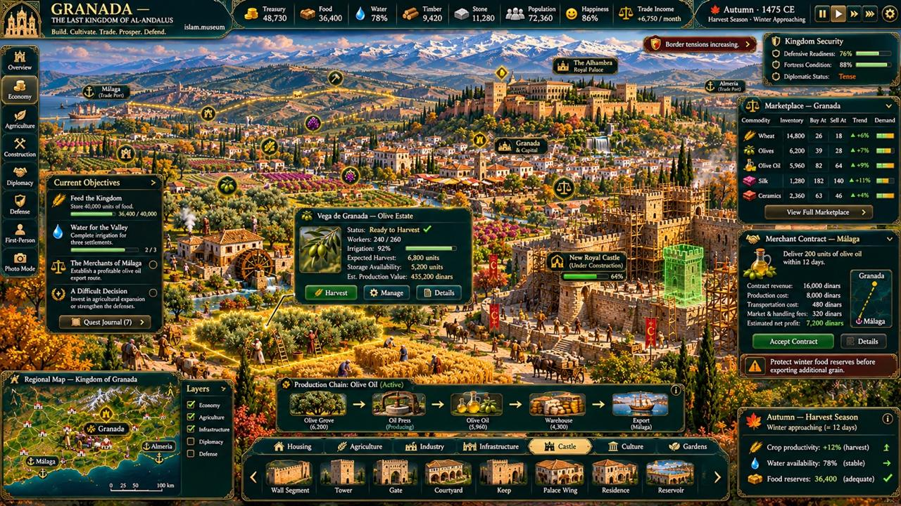
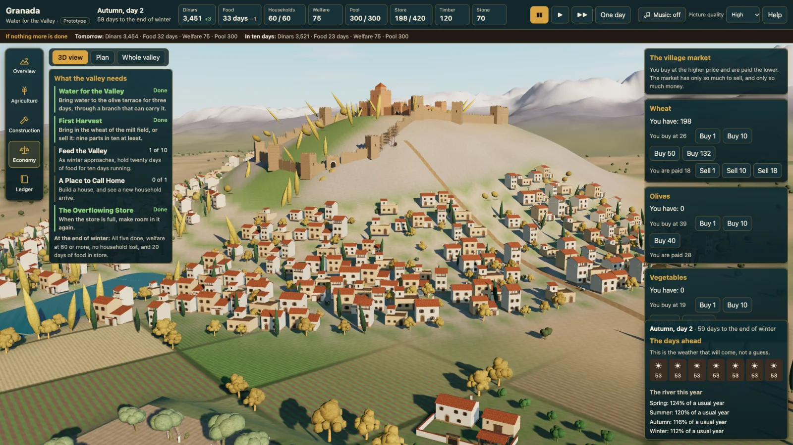

# Granada's proof frame

_Taken on 26 November 2026, during the eight hours the founder gave to Granada, for his decision O3 ([`owner-decisions-2026-11-26-b.md`](owner-decisions-2026-11-26-b.md)). **It is ready for him to judge. It is not accepted, and it is not at the target's finish.** Acceptance, if he gives it, is of the direction of quality and not of the game; no asset is made in number before then._

## The two pictures

The target:

The running game, the same day, at the High preset, in autumn with the olive harvest ordered:

**How it was taken.** `npx tsx --tsconfig tsconfig.json tools/granada-proof.ts <folder>` from `gaming/`. It opens the game in real Chrome at 1920 by 1080, starts a new game, plays it by the game's own orders (the wheat brought in, the branch mended, 37 days passed until the olives are ripe), stands the camera at one fixed view, and keeps three pictures of the page at each preset with what the game counted of itself. Nothing is composed, retouched or drawn elsewhere. Captures and figures: [`../evidence/granada/proof-frame/`](../evidence/granada/proof-frame/).

## What the picture has, and what the target has that it has not

- **It has the target's structure:** an estate and its olives in front, a town of tiled houses in streets on the slope, a wall with towers and a gate climbing the hill with builders' scaffolding and a crane on it, a palace with a great tower on the top, a snow range behind; panels round the land in the target's places.
- **It has not the target's finish.** The buildings are simple volumes with photographed plaster, tile and stone on them: no arcades in the town, no carved or moulded detail, no wear, no variety beyond four houses. The trees are rounded heads. The fields are bands of colour. The people are simple figures and few. There is no port, no ship, no waterfall, no banners, no market crowd.
- **It has perhaps a quarter of the target's panels:** no marketplace of five goods with trends, no contract, no production chain, no construction catalogue, no regional map or layers, no security panel, because those systems do not exist yet and nothing is drawn that does not work.

## The checklist

| | It asks | Where this frame stands |
|---|---|---|
| P0 | Taken from the running browser game | **Met.** The tool above; `main` at `9484b8315ef` with this change; Chrome 158; 1920 by 1080 |
| P1 | A camera composition comparable to the target | **In part.** The same thirds: estate and fields low, town in the middle, palace hill and range above. The target's camera is lower and nearer, and its foreground fills the frame |
| P2 | Authored foreground, midground and background | **In part.** Authored in Blender: the estate (foreground); the houses, wall, towers, gate, scaffolding, crane (midground); the palace (background). Made by the game's code, not authored: the land, the fields, every tree, the river, the range |
| P3 | Target-quality architecture and materials | **The founder's judgement.** The developer's own reading: not at target quality. The materials are real photographs (public domain, from Poly Haven); the architecture is plain |
| P4 | Terrain, water, vegetation, atmosphere and lighting | **In part.** All five are in the game; in this view the water is only the river at the left edge, the air is haze and a clear sky with no cloud, and the light is one autumn afternoon |
| P5 | An animated group of people at an activity | **Met, plainly.** 24 pickers at the dozen olive trees nearest the estate, with ladders and baskets, and carriers to the press. Simple figures, small at this distance |
| P6 | Weather or environmental motion | **Met.** Everything that grows leans in the wind; the water moves; on a day of rain it rains |
| P7 | Working panels in the target's hierarchy | **In part.** Working: the top bar, a rail of five parts, the steward's tasks, the market, the season, the card beside a chosen field. Absent, because the systems are: contract, production chain, catalogue, map, security |
| P8 | A building or place that can be selected | **In part.** A field can be chosen in the valley and shows its card; a building cannot yet |
| P9 | A visible change of the simulation's state | **Met.** Before the order nobody is in the terrace; a moment after, 24 people are; three days on the crop is in (49 standing became 49 brought in) and they are gone. Counted by the tool at each preset: 0, 24, 0 |
| P10 | Low, medium and high compared | **Met.** The three captures are below; the tool plays the game through at each |
| P11 | Frame time, memory and resources | **Met for this machine only.** The table below. Nothing has been measured on either minimum machine |
| P12 | Time taken, and the cost of scaling | **Stated below**, with what is not known |
| P13 | The founder accepts the direction | **Waiting on him** |

## The three presets

| | Low | Medium | High |
|---|---|---|---|
| Picture | [low](../evidence/granada/proof-frame/low-2-the-harvest.webp) | [medium](../evidence/granada/proof-frame/medium-2-the-harvest.webp) | [high](../evidence/granada/proof-frame/high-2-the-harvest.webp) |
| What it spends | pixel ratio 1; shadows 1,024; no corner shading, no glow; trees in full to 40% of High's distance | pixel ratio 1.5; shadows 2,048; glow; trees to 70% | pixel ratio 2; shadows 4,096; corner shading and glow; trees in full |
| Triangles a frame | 1.90 million | 2.02 million | 3.56 million |
| Draw calls | 176 | 194 | 284 |
| Textures, geometries | 51, 137 | 62, 137 | 66, 137 |
| JavaScript heap | 92 MB | 166 MB | 187 MB |
| Frame time, median / 95th / 99th | 8.3 / 27.7 / 43.5 ms | 8.3 / 8.8 / 9.2 ms | 8.3 / 8.9 / 9.1 ms |
| Frames over 33 ms in ten seconds | 34 of 944 | 0 of 1,199 | 0 of 1,200 |

**Machine:** Apple M4 Max, Chrome 158, WebGPU on Metal, window 1920 by 1080 (canvas 1920 by 975), pixel ratio 1. **This is a fast machine; the figures say nothing about the founder's two minimum machines, and no performance gate passes on them.**

**One figure to distrust:** the Low run's slow frames. It was the first of the three runs, the lightest of the three presets, and a separate ten-second measurement of Low the same hour gave 8.3 / 9.0 ms with no frame over 33. It is reported as it was counted and not explained.

One WebGPU context, no worker, one or two timers, and two frame callbacks a frame (the game's and the renderer's own) at every preset.

## What it took, and what scaling would take

By the times the pull requests were merged, on 26 November 2026 (UTC), one agent working alone:

| Step | Merged | Since the step before |
|---|---|---|
| Counters and the measuring tool | 04:20 | |
| Five photographed surfaces; four houses, wall, tower, gate, scaffolding, stall (10,728 triangles) | 04:37 | 17 minutes |
| Palace, estate, crane (12,508 triangles); placed on the hill | 04:56 | 19 minutes |
| The lower town in streets | 05:04 | 8 minutes |
| The page arranged round the valley | 05:13 | 9 minutes |
| People at the harvest | 05:21 | 8 minutes |
| Fuller trees | 05:26 | 5 minutes |

- **Twelve authored pieces in about 36 minutes**: making more pieces of this kind is cheap. Granada's catalogue in the target names eight kinds of building in one of seven categories; fifty or sixty pieces at this level would be a few sessions.
- **That is not what stands between this frame and the target.** What does is the finish of each piece: a house here is a few dozen boxes with a photograph on them. A building at the target's finish has arcades, mouldings, carved doors, balconies, worn edges, awnings, and things lying about it; by script, each such building is many times the work, and whether script alone reaches it is **not shown by this frame**. The trees, the land and the people are further from the target than the buildings are.
- **The developer's recommendation:** if this direction is not near enough, the choice is the founder's among a 3D artist, licensed model packs, or modelling tools beyond scripts; each is a cost or a licence to weigh, and none was used or bought here.

## What is said of history

The valley is fiction and the game says so. The town, the wall and the palace are a general picture of a walled town of the western Mediterranean. They copy no building, the game does not call the palace the Alhambra, and nothing here has been seen by a historian: ledger entry HR-GR-06, a reconstruction, review pending. The page of the game carries the words "historical review pending".
