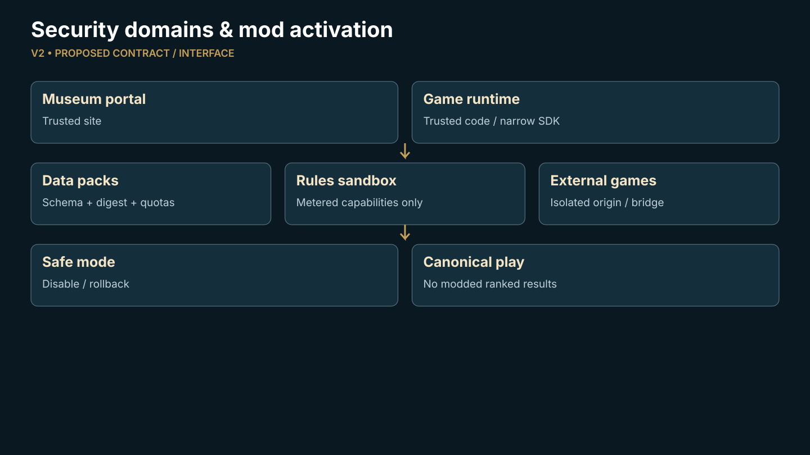

# Mod security and threat model

Trust levels: T0 official reviewed game code and signed/pinned assets; T1 validated declarative content only (models, skins, quests, scenes, data); T2 bounded programmable behavior; T3 independent third-party game. Museum public origin is never an executable extension host. Evaluate separate game origin/subdomain and untrusted runtime origin using exact Cloudflare routing and COOP/COEP/CSP needs. Cross-origin isolation required for SharedArrayBuffer, can conflict with embedded portal SDKs; design separate profiles. A Worker alone cannot safely execute arbitrary JavaScript. Default T2 off until independent audit. Prefer limited declarative rules DSL with bounded interpreter and no network/time/files/DOM access. If Lua/WASM considered, prove isolation, import allowlist, metered instructions/memory, cancellation and denial of host escape. Do not assume WASM is automatically safe. T3 sandbox iframe on separate origin, restricted permissions and validated message bridge; no cookies/credentials/privileged parent APIs. Avoid same-origin sandbox combinations granting escape. Explicitly validate sender identity/origin or channel nonce for opaque sandbox; schema, sequence, size, rate and permission checks. No user-provided HTML or SVG rendered unsanitized. No arbitrary eval, remote dynamic import, npm scripts or unrestricted shaders from mods.

## Ingestion and limits
Manifest schema + canonical URL rules (HTTPS only for remote, no credentials, no unsafe redirect, no private address fetch via any future server proxy). SHA-256 per asset and release lock, optional verified signature with documented trust roots; checksum does not establish safety or author identity. ZIP parser rejects traversal, symlinks, duplicate names, nested archive bombs and decompression ratio/total size; enforce bytes, texture dimensions, mesh vertex count, animation channels, object counts, parsing time and dependency depth. Parse JSON with strict schemas and prototype-safe handling; sanitize rich text, strip executable URLs; validate glTF references, forbid remote external buffers unless packaged and allowlisted. Decode in bounded worker/process when supported; discard on timeout. Require content-license/provenance and age-appropriate labeling, no default public publication. Read remote manifests without sending account cookies; no secrets in query strings. Maintain SBOM, pinned dependencies, vulnerability audit and policy for supply-chain updates.

## UX and ranked integrity
Review permissions before activation; display source, version, digest, author, network capabilities, storage budget, unverified status. Separate profile, local saves and canonical ranking. Mods cannot overwrite official history or score. Disable, uninstall, clear caches, restore backup, safe boot without extensions; dependency removal prompts with consequences. No automatic new permissions. Signed or reviewed packs still sandboxed. User can export/import data, delete local records and revoke permissions. Public sharing later requires moderation, abuse reporting, takedown and privacy policy, never expose arbitrary user content to children by default.

## Test matrix
Malicious SVG/HTML/JSON, XSS, prototype pollution, ZIP traversal/bombs, malformed glTF, oversized GPU assets, dependency cycle, CPU spin, memory pressure, untrusted script attempts network/DOM/cookie/storage, spoofed postMessage, credential redirect, replay/score tampering, mod crash, broken update, save rollback, isolation/iframe headers and denied permissions. Each test has expected deny/recovery and proof no museum regression. Independent reviewer approves T2 only after attack fixtures pass; otherwise ship T1 and label T2 unavailable. [MDN CSP](https://developer.mozilla.org/en-US/docs/Web/HTTP/CSP), [crossOriginIsolated](https://developer.mozilla.org/en-US/docs/Web/API/Window/crossOriginIsolated), [iframe sandbox](https://developer.mozilla.org/en-US/docs/Web/HTML/Element/iframe), [OWASP](https://owasp.org/).
