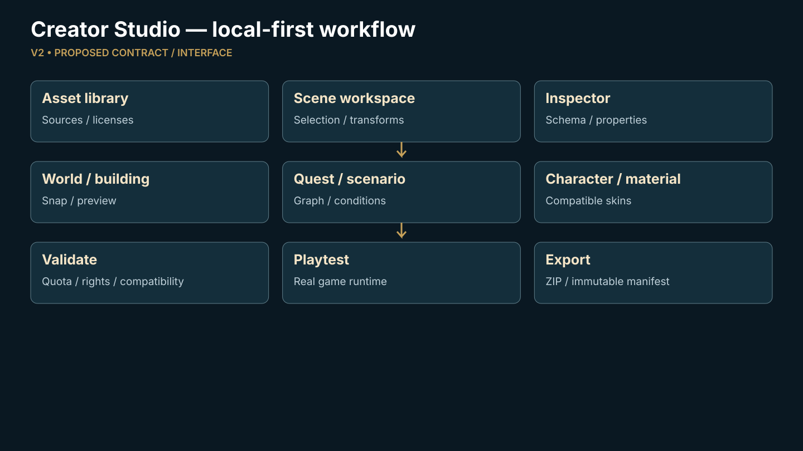

# Creator Studio

Two paths: no-code editor for artists/historians and professional SDK for programmers. Local-first workspace, clear distinction between edit, test and published build. Start with scenario/skin/building editors that are actually used by two games; incrementally add world/terrain, character/outfit, quest/dialogue and material editors. Do not build a general Unreal clone. Shared schema and preview runtime are the contract. Editing must not write official museum records.

Layout: asset library/search and source/license panel left; scene/canvas center; inspector right; timeline/validation below; toolbar with undo/redo, snapping, grid, transform, playtest, save/export, accessibility and performance stats. Use searchable commands, shortcuts documented and remappable, keyboard alternatives for drag, consistent selection, multiselect, undo transaction grouping, autosave, project version and recovery. Show size, LOD and performance estimates while editing; no fake simulation. Quest editor uses explicit nodes, legal conditions, reachable states, localization keys, rewards and provenance; validator identifies unreachable quests, circular dependencies and missing references. World editor supports bounded cells, scale, material presets, spawn and collision preview. Character editor imports validated compatible rigs/skins, previews animations; avoid identity imitation. Editor must show which features target game supports and any conversion loss.

Professional workflow: create sample repo from template, edit in local IDE, run validator and preview server, package immutable manifest and assets, publish release manually or approved CI, add manifest/ZIP in game and test. Browser never needs npm or Git installed for players; creators may use development tools. Local-only import must work without a remote registry. Publish wizard checks license, content labels, API range, digest, sizes, game compatibility, seven-locale strings or fallback, preview, test report and moderation policy. Publishing public content is a separate consent and infrastructure decision. Showcase locally created items first. Demonstrate undo/reload, export/reimport, change and rollback in real game. Creator tutorial: from empty building to exported pack in five minutes, as a measured usability hypothesis. Measure novice comprehension, not only developers.
