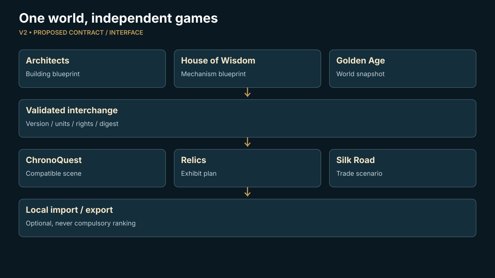

# Optional cross-game interchange

Ten games remain independently enjoyable. Shared museum IDs and versioned interchange bundle support creativity without compulsory cross-game progression. Local exports first; no shared economic ledger or account required. Data types: `BuildingBlueprint`, `MechanismBlueprint`, `WorldSnapshot`, `TradeScenario`, `ExhibitPlan`, `InvestigationCase`, `ChallengeSeed`. Each includes format version, author, license, game/version, historical provenance and reconstruction status, dependencies with digests, units, coordinate convention, bounding box, content references and compatibility. Validate before import and preview any lossy conversion; never silently import a whole executable mod.

Examples: Architects library blueprint → Golden Age building skin/approved rules; House of Wisdom mechanism → Golden Age visual/infrastructure prop with bounded balancing, Relics demonstration; Golden Age compatible district snapshot → ChronoQuest exploration scene; Silk Road routes → Golden Age optional trade scenario; Relics exhibit → ChronoQuest optional gallery; Dynasty scenario → Golden Age only if era/region compatible; Knowledge Web graph → Lost Manuscripts case editor after solver validation. Canonical ranked mode excludes user-altered mechanics; modded/sandbox clearly labeled. No cross-game transfer of resources to ranked games. No new historical claims from player fiction. Make one building round trip and one challenge round trip before extending. ADR documents which transformations are supported; unsupported types get clear error. Preserve original export and migration path.
