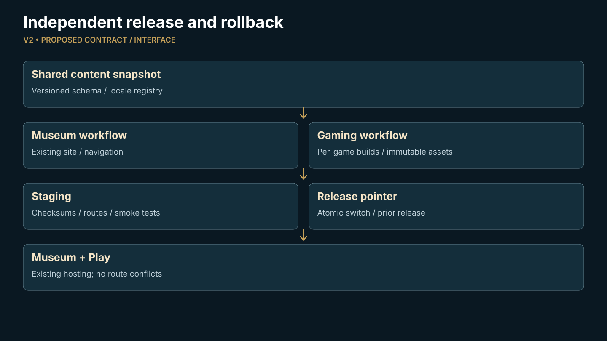

# Separate CI/CD and operational contracts

Inventory actual scripts, branch rules, deployment mechanism, artifact store, route ownership and CI duration. Prioritize no regression to catalog rendering or deployment. Same repo, separate gaming workspace and workflows; game-only changes trigger gaming build, not full museum build unless shared schema/locale/navigation dependency changes. Museum integration consumes small versioned game registry manifest. Path filters include shared data/schema dependencies, manual dispatch and periodic validation; test changed-path matrix. Pin actions and packages, no prod secrets on PRs, least privilege, approved protected environment. Bound job parallelism and cache keys by inputs/lockfile/tool versions. Content graph compiled once per source digest into versioned game-specific data packs; never load full graph on startup. Deduplicate immutable assets via digest. Record actual CI wall time and cache hit/miss; do not promise specific time before evidence.

## Proposed script contract (adapt names)
`gaming:build --game <id|all> --profile <canonical|portal>` produces reproducible distribution and manifests; `gaming:validate` checks data/licenses/locale/links; `gaming:test` runs unit, browser, fuzz and visual; `gaming:package` creates root index ZIP; `gaming:deploy --env staging --release <id> --dry-run` validates target and routes; `gaming:rollback --env staging --release <previous>` verifies compatibility and atomically updates pointer. Real production gated by repository workflow. Scripts fail nonzero on errors, report paths, never touch unrelated routes. Dry run produces expected file diff and deletion list; no implicit recursive removal. Staging environment isolated from production. Test interrupted upload, simultaneous deploy, stale manifest, checksum mismatch, incompatible shared schema and rollback of individual game. Immutable release files uploaded and verified first; publish small atomic pointer last using actual backend semantics (if unsupported, document alternative). Retain prior release and content hashes; pin active sessions to release to avoid mixed assets. Cache immutable long-lived assets; short-lived release pointers; scope service worker; route conflict guard. Rollback preserves saved-game migration backups and compatibility.

## Integration gates
Game-only change leaves museum pages unaffected; shared manifest update does correct locale nav/home build; existing validators 0 errors and citations 0 failures; links in all locales; no broken MIME/cache/CORS/COOP/COEP/CSP, sitemap and canonical; real CDN staging smoke tests. Verify no heavy assets in museum page initial network requests. If no credentials, perform local/dry-run staging and mark live gate pending. Operations docs: local dev, build, deployment, release registry, rollback, secrets boundaries, asset retention, incident response, dependency updates and recovery. Report changed routes, before/after times, sizes, constraints and failure recovery.
