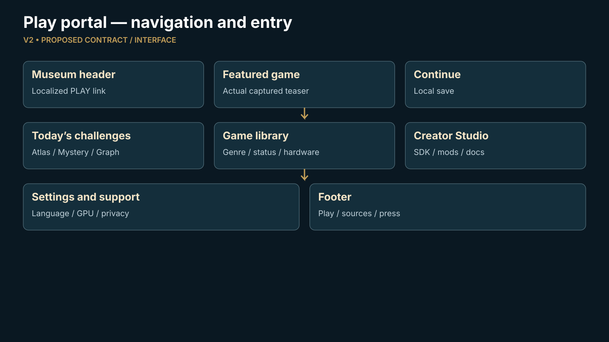

# Museum integration and platform routes

Discover actual templates and locale conventions. Mandatory top and bottom navigation link localized Play; prominent homepage feature box with lightweight artwork/real captured teaser poster, clear CTA and accessible alt. No unsolicited autoplay audio, heavy game JS or GPU init on museum pages. Do not hardcode English routes. Suggested logical routes (adapt): `/[locale]/play/`, `/play/[game]/`, `/play/[game]/play/`, `/play/daily/`, `/play/settings/`, `/play/developers/`, `/play/create/`, `/play/mods/`, `/play/support/`, `/play/press/`. Each real game has status, synopsis, playable CTA, hardware and browser support, controls, accessibility, source history, release notes, credits. Unreleased titles labelled preview/coming later; never misleading Play button. Developer docs include SDK quickstart, API reference, manifest/permissions, examples, troubleshooting and contribution process. Platform settings: language, display, audio, accessibility, privacy, developer toggle, storage/export/delete, mod profiles; settings persisted scoped to appropriate origin. Museum links from discoveries open without state loss, return to game preserves save.

SEO: static indexable descriptive pages, canonical and hreflang matching actual conventions, sitemap, metadata and share cards. No fabricated rating structured data; actual screenshots only after build. Public crawling stays open. Keep game-only data separate and avoid multiplying all catalog pages per game. Link game relevant history using stable IDs, not thousands of noisy links. Existing museum nav tests plus all seven locale link checks, homepage performance baseline, no regressions in museum UI/RTL, feature flag only for staged visibility. Add engineering index, ADRs, architecture diagram, support policy, operational docs, development guides, license/credits and release evidence. Integrate with repo status/lane ownership conventions and PR review. Validate game navigation on unsupported browsers too.
