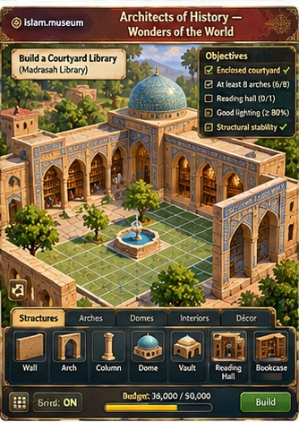
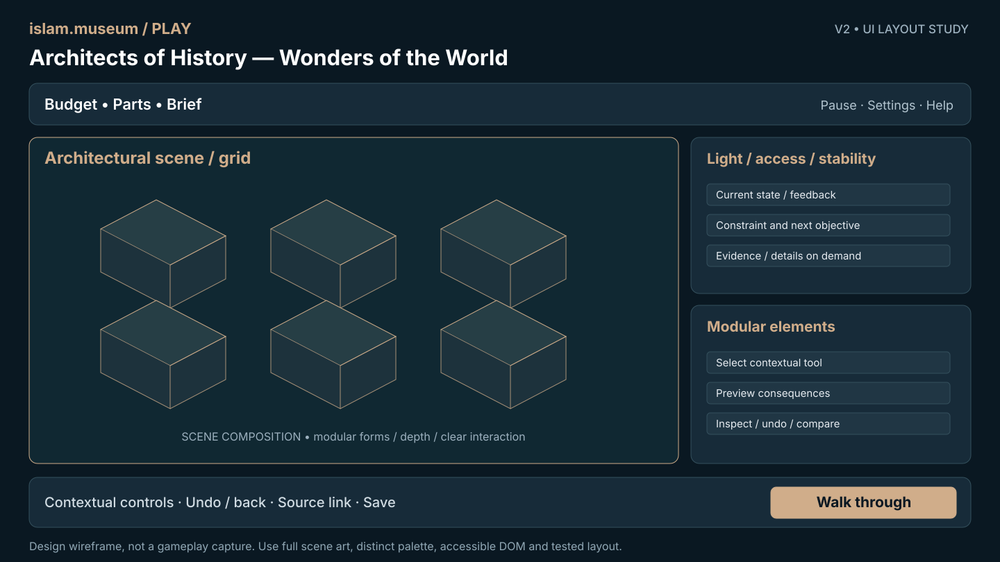

# Architects of History — Wonders of the World
## Production Game Design Document — V2
**Genre:** Architectural design and creative puzzles  
**Player promise:** Design beautiful spaces with real constraints, then walk through what you made.

## Creative direction
Premium architectural visualization, Andalusian/Maghrebi/Central Asian or other verified style sets, sunlight through arches, reflective water, precise editor with walkthrough.

The concept image is not an actual gameplay screenshot and may contain anachronisms, implausible architecture or incorrect labels. Use it to discuss camera, atmosphere and composition only. The V2 board is a scalable layout reference, not a rendered scene. Build real in-engine style frames and record motion before scaling content.

## Plot and player fantasy
A fictional architect receives public building commissions: a courtyard library, market hall, garden or civic institution. Balance beauty, use and resources without presenting fictional designs as documented monuments.

## Core gameplay and meaningful choices
Choose brief → place modular elements → inspect structural/lighting/accessibility overlays → adjust → walk through → submit or share. Sandbox enables expressive design with undo.

Cost, span/structural rules, daylight, circulation, material palette and symmetry or brief-specific goals. Multiple valid aesthetic solutions; no engineering certification.

## Progression and pacing
30s place an arch and see light/shadow. Five minutes complete small courtyard. Hour complete first commission. Week create custom style. Month share portfolio and remix structures.

## Launch content and release boundary
12+ authored commissions, three historically vetted modular style families if evidence supports them, 40+ reusable components, sandbox, walkthrough and daily brief. Prioritize convincing material and geometry.

This is a candidate scope, not permission to ship low-quality filler. Each authored scenario must have tested beginning, escalation, outcome, recovery and replay. If source coverage is insufficient, document the gap and use an alternate verified setting rather than invent evidence.

## Simulation and implementation
Snapping, pivots, hierarchy, transform gizmos, parametric components, collision and simplified structural graph, daylight proxy, path/accessibility checks, undo stack, export glTF/blueprint only as licensed.

Separate rule state from rendering. Expose legal action previews, meaningful feedback and inspectable causes. Persist game/version/content/mod lock, seed and checkpoint; include replay/export, settings, explicit exit and recovery. Profile actual frame times and loading on supported browser hardware. Use [shared systems](../06-SHARED-GAME-SYSTEMS.md) and [graphics](../04-GRAPHICS-ENGINE.md) as applicable.

## Daily and long-term replay
Same brief, parts/budget and goals; share photo and blueprint; scoring constraints and optional design jury separate.

Use UTC seed/version, archived challenges, no streak penalty, unlimited practice where applicable. The daily mechanic supplements the campaign or creative loop rather than substituting for it. No unverified score presented as ranked.

## Win, failure and player recovery
Invalid span or inaccessible entry flagged with explicit cause; no forced reset. Win on brief conditions; sandbox never imposes score. No real-world structural advice.

## Interface, controls and localization
The board describes the key HUD hierarchy: primary action, current objective, world state and contextual explanation. Use the game's camera and palette, not a common ornate template. Show action consequences before commitment when practical; pause, restart, help, keyboard/gamepad mappings when applicable, UI scale, reduced motion, captioned cues and volume. All seven actual locales, RTL panels but not reversed physical geometry or maps. Essential actions have accessible alternatives; test in real browser at different zoom and resolution. No forced login.

## Creator and developer capabilities
BuildingBlueprint, materials, modular style packs, custom geometry with quotas; Golden Age and ChronoQuest compatible import.

Use stable schema/SDK and capability-based sandbox. Example pack must load, display, be disabled and survive reload without core edits; separate modded/unmodded saves and ranks. Source/licensing required.

## Acceptance scenarios
Snap/rotate/undo round trip, structural fixture rules, daylight and path checks, 365 validated briefs, malicious geometry bounds, export/import and real 1000-piece benchmark; creative human evaluation.

Independent reviewer plays without instruction from author; test first minute, five-minute loop, alternate strategy, complete scenario, retry, save/reload, daily/archive, accessibility, seven locales and actual game capture. Verify museum links/claims and rights. Run applicable [hard release gates](../contracts/acceptance.md).

## Known pitfalls and prevention
Beautiful but unusable editor, repetitive domes, impossible snapping, false structural claims, tiny controls. Prioritize tactile placement, accessible editing, style provenance and walkthrough.

## Production prompt for this title
Implement the GDD inside the V2 platform, using actual repository evidence and approved contracts. Start with one polished vertical slice, capture real footage and collect independent feedback; then complete scoped campaign/content, tests, mods and integrations. Do not substitute placeholders, static concept art, generic quiz, fake physics or unverified claims. Report evidence and open gates; do not call it released until validated.
