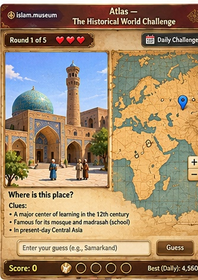
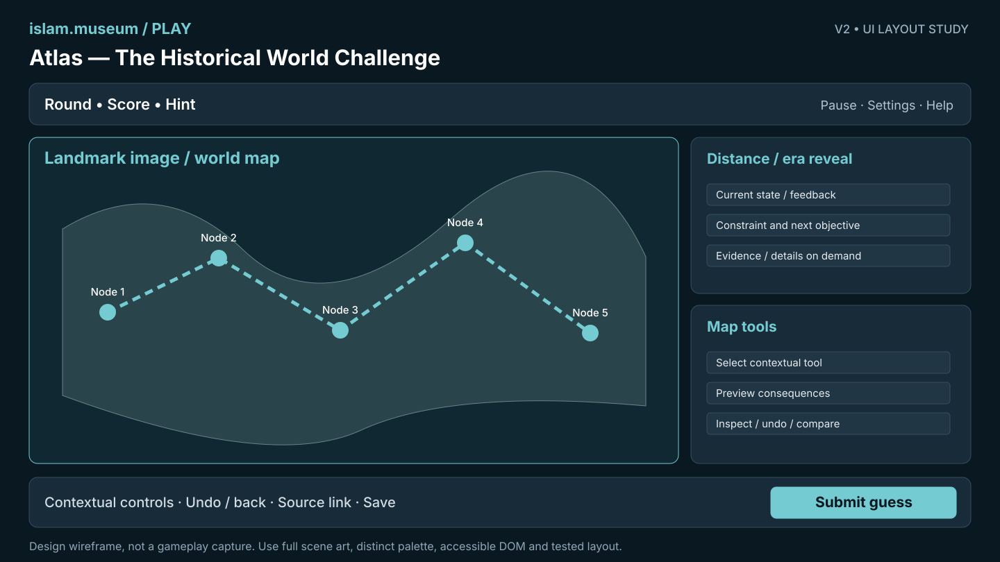

# Atlas — The Historical World Challenge
## Production Game Design Document — V2
**Genre:** Daily geography and chronology  
**Player promise:** Guess the location and historical era from carefully chosen visual and contextual evidence.

## Creative direction
Premium modern cartography, rich terrain/globe, crisp imagery, clean navy/ivory UI, satisfying zoom and reveal. Avoid antique parchment clutter.

The concept image is not an actual gameplay screenshot and may contain anachronisms, implausible architecture or incorrect labels. Use it to discuss camera, atmosphere and composition only. The V2 board is a scalable layout reference, not a rendered scene. Build real in-engine style frames and record motion before scaling content.

## Plot and player fantasy
A fictional explorer assembles a world atlas of historical places and objects. The story is discovery and improving geographical intuition, not an artificial narrative gate.

## Core gameplay and meaningful choices
View clue → pan/zoom map → place guess and optional era estimate → submit → animate distance/date reveal → discover verified museum record → next round. Five rounds per daily.

Limited hints versus accuracy; location may have multiple plausible candidates so choose only unambiguous prompts or accept valid set. Optional time mode, never mandatory.

## Progression and pacing
30s make first guess. Five minutes finish daily and share. Hour try routes and chronology modes. Week improve regional mastery. Month expert sets and community packs.

## Launch content and release boundary
Five-round daily, practice, regional and era modes, route reconstruction and artifact origin mode only with precise source coordinates; initial 150+ validated clue records or evidence-backed equivalent, 365-day schedule with controlled reuse.

This is a candidate scope, not permission to ship low-quality filler. Each authored scenario must have tested beginning, escalation, outcome, recovery and replay. If source coverage is insufficient, document the gap and use an alternate verified setting rather than invent evidence.

## Simulation and implementation
Geodesic distance (haversine or equivalent), documented scoring curve, precision handling, historical era bins and uncertainty, tile attribution and offline-friendly static maps. Use licensed images with metadata, hide answer spoilers in display labels while retaining required credit.

Separate rule state from rendering. Expose legal action previews, meaningful feedback and inspectable causes. Persist game/version/content/mod lock, seed and checkpoint; include replay/export, settings, explicit exit and recovery. Profile actual frame times and loading on supported browser hardware. Use [shared systems](../06-SHARED-GAME-SYSTEMS.md) and [graphics](../04-GRAPHICS-ENGINE.md) as applicable.

## Daily and long-term replay
UTC challenge manifest includes dataset version and IDs; identical across locales; score distance and optional century consistently. Share five-round summary without revealing sites.

Use UTC seed/version, archived challenges, no streak penalty, unlimited practice where applicable. The daily mechanic supplements the campaign or creative loop rather than substituting for it. No unverified score presented as ranked.

## Win, failure and player recovery
No hard fail for guess; clear score and learning reveal. In practice allow skip, daily score rules fixed. Completion all five rounds; optional challenge thresholds.

## Interface, controls and localization
The board describes the key HUD hierarchy: primary action, current objective, world state and contextual explanation. Use the game's camera and palette, not a common ornate template. Show action consequences before commitment when practical; pause, restart, help, keyboard/gamepad mappings when applicable, UI scale, reduced motion, captioned cues and volume. All seven actual locales, RTL panels but not reversed physical geometry or maps. Essential actions have accessible alternatives; test in real browser at different zoom and resolution. No forced login.

## Creator and developer capabilities
Clue packs, map skins, region sets, scenario routes; content validator ensures coordinates and evidence. Canonical daily excludes unreviewed user packs.

Use stable schema/SDK and capability-based sandbox. Example pack must load, display, be disabled and survive reload without core edits; separate modded/unmodded saves and ranks. Source/licensing required.

## Acceptance scenarios
Antimeridian/poles distance tests, map projection correctness, 365-day seed proof, duplicate/ambiguous record checks, image/license audit, keyboard coordinate selection and locale score equivalence.

Independent reviewer plays without instruction from author; test first minute, five-minute loop, alternate strategy, complete scenario, retry, save/reload, daily/archive, accessibility, seven locales and actual game capture. Verify museum links/claims and rights. Run applicable [hard release gates](../contracts/acceptance.md).

## Known pitfalls and prevention
Unlicensed imagery, GPS answer leak, historical borders treated as exact, huge map downloads, unfair clues, score obsession. Use transparent scoring and reliable records.

## Production prompt for this title
Implement the GDD inside the V2 platform, using actual repository evidence and approved contracts. Start with one polished vertical slice, capture real footage and collect independent feedback; then complete scoped campaign/content, tests, mods and integrations. Do not substitute placeholders, static concept art, generic quiz, fake physics or unverified claims. Report evidence and open gates; do not call it released until validated.
