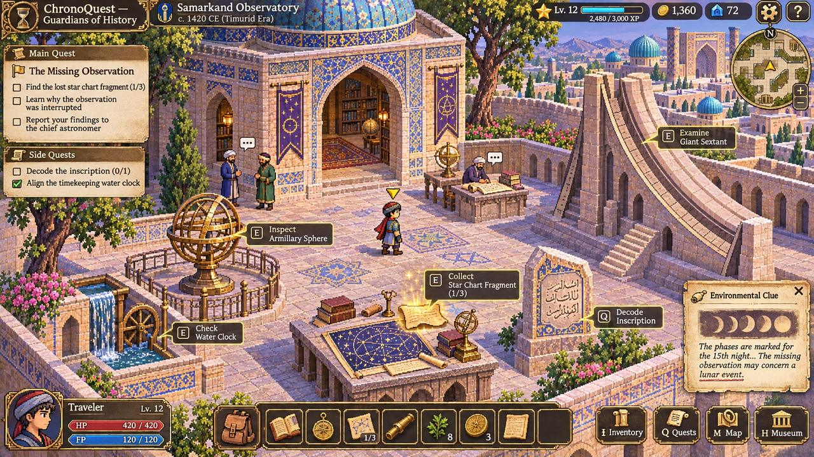
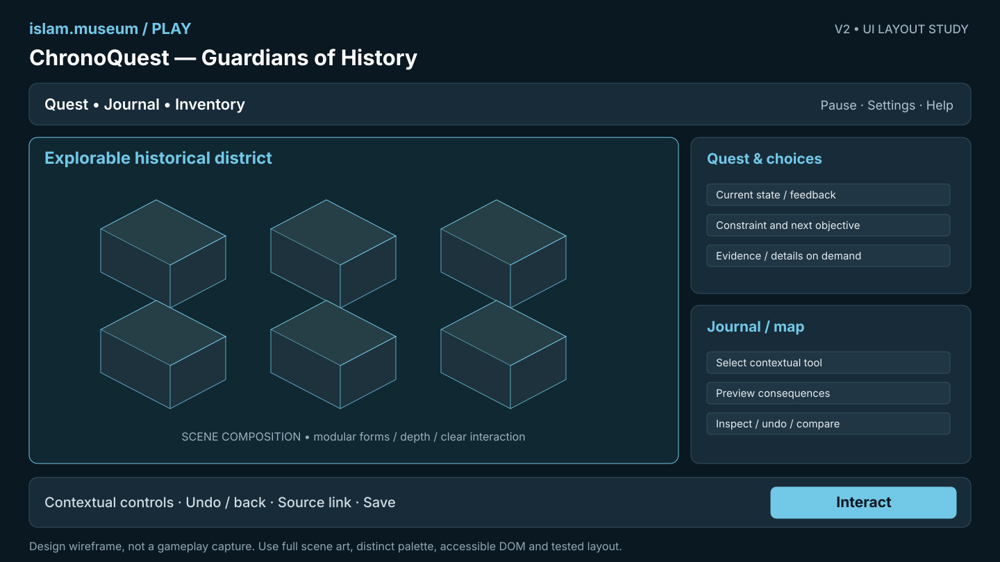

# ChronoQuest — Guardians of History
## Production Game Design Document — V2
**Genre:** Narrative exploration RPG  
**Player promise:** Explore a living historical world, solve mysteries and make decisions that change a fictional story.

## Creative direction
Stylized cinematic 3D or high-quality isometric art after spike; blue tiles, gardens, animated fictional characters, readable silhouettes, atmospheric shifts and environmental audio.

The concept image is not an actual gameplay screenshot and may contain anachronisms, implausible architecture or incorrect labels. Use it to discuss camera, atmosphere and composition only. The V2 board is a scalable layout reference, not a rendered scene. Build real in-engine style frames and record motion before scaling content.

## Plot and player fantasy
A fictional courier entrusted with a damaged archive must rebuild a chain of knowledge across periods. Their companion has conflicting priorities: save the current community or chase missing records. Choices alter relationships and routes, not documented history.

## Core gameplay and meaningful choices
Explore a district → meet fictional NPC → collect evidence or tool → solve environmental puzzle → choose response → discover new area/story consequence. Fast travel after discovery, journal for unresolved threads.

Time and resources within quests, trust, optional side objectives and alternate solution paths. No compulsory combat or sacred figure roleplay. Meaningful branching and narrative consequences without locking essential progress.

## Progression and pacing
30s move through memorable scene and interact with a clue. Five minutes solve first environmental puzzle. Hour finish first chapter. Week uncover optional story and new region. Month replay alternate paths and creator quests.

## Launch content and release boundary
Complete three-chapter story with beginning/middle/end, at least two detailed historically supported city districts, 10+ distinct quests including optional ones, fictional companion arc, two meaningful endings or epilogues. Do not inflate world size at expense of density.

This is a candidate scope, not permission to ship low-quality filler. Each authored scenario must have tested beginning, escalation, outcome, recovery and replay. If source coverage is insufficient, document the gap and use an alternate verified setting rather than invent evidence.

## Simulation and implementation
Scene streaming, navigation mesh/pathing, dialogue graph, journal, inventory, quest state, collision, camera accessibility, environmental puzzle conditions, checkpoint saves; actual playable routes. NPC fictional dialogue and source facts separated.

Separate rule state from rendering. Expose legal action previews, meaningful feedback and inspectable causes. Persist game/version/content/mod lock, seed and checkpoint; include replay/export, settings, explicit exit and recovery. Profile actual frame times and loading on supported browser hardware. Use [shared systems](../06-SHARED-GAME-SYSTEMS.md) and [graphics](../04-GRAPHICS-ENGINE.md) as applicable.

## Daily and long-term replay
Daily micro-adventure with authored/validated variants, puzzle or exploration route; no forced daily story grind.

Use UTC seed/version, archived challenges, no streak penalty, unlimited practice where applicable. The daily mechanic supplements the campaign or creative loop rather than substituting for it. No unverified score presented as ranked.

## Win, failure and player recovery
Recoverable failed objective and safe checkpoint; softlock prevention via quest graph validation and alternate routes. Victory completes story and resolves choices, not collection checklist only.

## Interface, controls and localization
The board describes the key HUD hierarchy: primary action, current objective, world state and contextual explanation. Use the game's camera and palette, not a common ornate template. Show action consequences before commitment when practical; pause, restart, help, keyboard/gamepad mappings when applicable, UI scale, reduced motion, captioned cues and volume. All seven actual locales, RTL panels but not reversed physical geometry or maps. Essential actions have accessible alternatives; test in real browser at different zoom and resolution. No forced login.

## Creator and developer capabilities
WorldSnapshot/Quest packs, skins, location modules, dialogue editor; compatible Golden Age district imports read-only sandbox.

Use stable schema/SDK and capability-based sandbox. Example pack must load, display, be disabled and survive reload without core edits; separate modded/unmodded saves and ranks. Source/licensing required.

## Acceptance scenarios
Quest reachability and branch coverage, collision/navigation and streaming stress, save at all quest states, no blocked critical item, human narrative comprehension and pacing tests; real hardware traversal capture.

Independent reviewer plays without instruction from author; test first minute, five-minute loop, alternate strategy, complete scenario, retry, save/reload, daily/archive, accessibility, seven locales and actual game capture. Verify museum links/claims and rights. Run applicable [hard release gates](../contracts/acceptance.md).

## Known pitfalls and prevention
Empty procedural city, generic fetch quests, repetitive dialogue, camera motion sickness, impossible quest state, fake historical person dialogue. Prefer dense authored streets, distinct characters, alternate routes and accessible camera.

## Production prompt for this title
Implement the GDD inside the V2 platform, using actual repository evidence and approved contracts. Start with one polished vertical slice, capture real footage and collect independent feedback; then complete scoped campaign/content, tests, mods and integrations. Do not substitute placeholders, static concept art, generic quiz, fake physics or unverified claims. Report evidence and open gates; do not call it released until validated.
