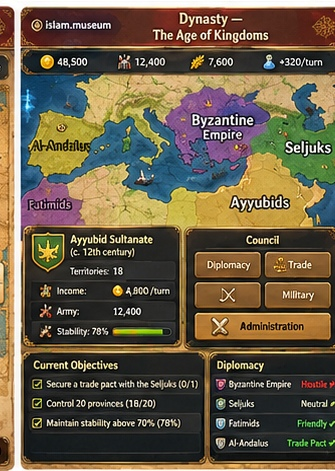
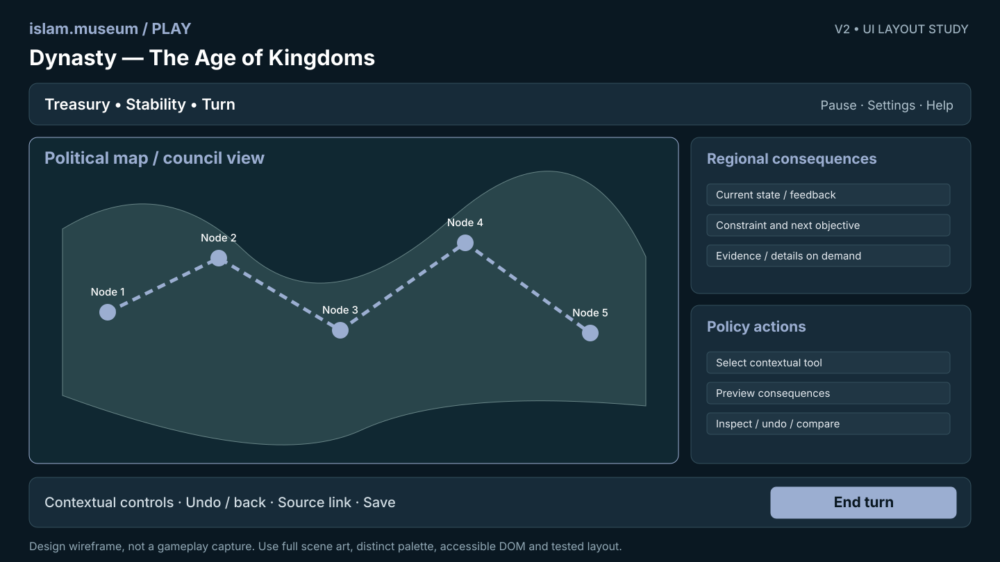

# Dynasty — The Age of Kingdoms
## Production Game Design Document — V2
**Genre:** Political and economic grand strategy  
**Player promise:** Guide a polity through difficult decisions where prosperity and stability are as valuable as territory.

## Creative direction
Elegant high-detail strategy cartography, political overlays, terrain relief, council portraits only fictional/allowed, restrained interface with clear tooltips and timeline.

The concept image is not an actual gameplay screenshot and may contain anachronisms, implausible architecture or incorrect labels. Use it to discuss camera, atmosphere and composition only. The V2 board is a scalable layout reference, not a rendered scene. Build real in-engine style frames and record motion before scaling content.

## Plot and player fantasy
A fictional council administrator manages a historically grounded starting scenario. Competing institutions, regional partners and shocks make decisions consequential. All alternate outcomes are simulation, not history.

## Core gameplay and meaningful choices
Review council and resources → choose policy/investment/diplomatic action → resolve turn → inspect regional consequences → adjust long-term strategy. Optional pause and turn preview.

Revenue vs stability, infrastructure vs immediate response, alliances vs independence, regional inequality and legitimacy modeled as secular governance metrics. Abstract conflict, not ethnic/religious superiority.

## Progression and pacing
30s resolve first council dilemma. Five minutes complete first turn cycle. Hour survive first crisis and establish alliance. Week replay different polity. Month advanced scenario editor and strategic mastery.

## Launch content and release boundary
Three sourced polity scenarios, each 20–40 meaningful turns with multiple goals, diplomacy, trade, institutions, succession events, abstract conflict and sandbox. Bound scope before adding more map.

This is a candidate scope, not permission to ship low-quality filler. Each authored scenario must have tested beginning, escalation, outcome, recovery and replay. If source coverage is insufficient, document the gap and use an alternate verified setting rather than invent evidence.

## Simulation and implementation
Graph territories with uncertainty overlays, population/economy model, diplomacy relation and treaty rules, faction needs, event scheduler and AI with legal actions. Historical starting conditions vs simulated transitions clearly labeled.

Separate rule state from rendering. Expose legal action previews, meaningful feedback and inspectable causes. Persist game/version/content/mod lock, seed and checkpoint; include replay/export, settings, explicit exit and recovery. Profile actual frame times and loading on supported browser hardware. Use [shared systems](../06-SHARED-GAME-SYSTEMS.md) and [graphics](../04-GRAPHICS-ENGINE.md) as applicable.

## Daily and long-term replay
Weekly council scenario and daily decision puzzle, same seed and rules; score prosperity/resilience/diplomacy rather than one conquest metric.

Use UTC seed/version, archived challenges, no streak penalty, unlimited practice where applicable. The daily mechanic supplements the campaign or creative loop rather than substituting for it. No unverified score presented as ranked.

## Win, failure and player recovery
Crisis warnings and recoverable reforms; scenario ends when governance collapses or target date reached. Multiple victory conditions documented. No false map precision.

## Interface, controls and localization
The board describes the key HUD hierarchy: primary action, current objective, world state and contextual explanation. Use the game's camera and palette, not a common ornate template. Show action consequences before commitment when practical; pause, restart, help, keyboard/gamepad mappings when applicable, UI scale, reduced motion, captioned cues and volume. All seven actual locales, RTL panels but not reversed physical geometry or maps. Essential actions have accessible alternatives; test in real browser at different zoom and resolution. No forced login.

## Creator and developer capabilities
TradeScenario, policy/event packs, map styles and alternate scenario export to Golden Age where compatible.

Use stable schema/SDK and capability-based sandbox. Example pack must load, display, be disabled and survive reload without core edits; separate modded/unmodded saves and ranks. Source/licensing required.

## Acceptance scenarios
Simulation lab 1,000+ campaigns, stable finance, AI strategies, no dominant conquest path, treaty/turn rules, accessibility of maps, historical boundary review and independent balance playtest.

Independent reviewer plays without instruction from author; test first minute, five-minute loop, alternate strategy, complete scenario, retry, save/reload, daily/archive, accessibility, seven locales and actual game capture. Verify museum links/claims and rights. Run applicable [hard release gates](../contracts/acceptance.md).

## Known pitfalls and prevention
Paint-the-map monotony, opaque AI cheating, impossible tax spiral, modern borders, historical oversimplification. Use readable causes, alternate victories and uncertainty.

## Production prompt for this title
Implement the GDD inside the V2 platform, using actual repository evidence and approved contracts. Start with one polished vertical slice, capture real footage and collect independent feedback; then complete scoped campaign/content, tests, mods and integrations. Do not substitute placeholders, static concept art, generic quiz, fake physics or unverified claims. Report evidence and open gates; do not call it released until validated.
