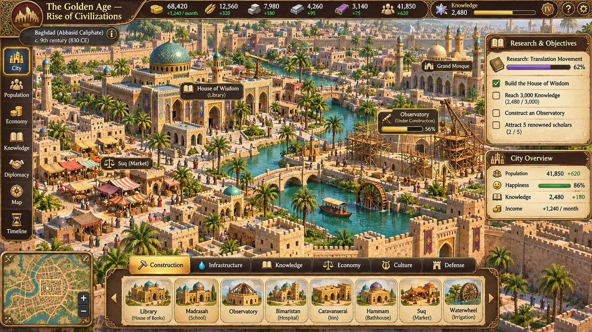
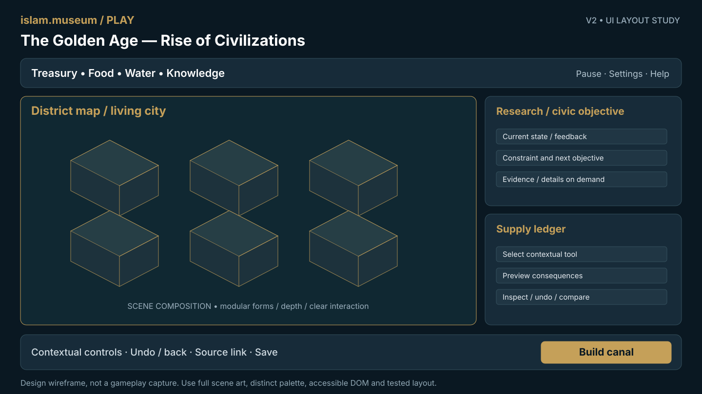

# The Golden Age — Rise of Civilizations
## Production Game Design Document — V2
**Genre:** Cinematic city-building and resource strategy  
**Player promise:** Create a living city where a thriving economy funds scholarship and public welfare.

## Creative direction
Warm limestone, turquoise water, richly textured wood and bronze; high isometric camera with ground-level photo mode. Original landmark silhouettes, animated markets, irrigation and evening lamps.

The concept image is not an actual gameplay screenshot and may contain anachronisms, implausible architecture or incorrect labels. Use it to discuss camera, atmosphere and composition only. The V2 board is a scalable layout reference, not a rendered scene. Build real in-engine style frames and record motion before scaling content.

## Plot and player fantasy
A fictional administrator inherits a struggling district and must build a resilient city whose people, traders and scholars have competing needs. In the first scenario, a failing water network and limited treasury force a choice between quick revenue and long-term public infrastructure.

## Core gameplay and meaningful choices
Survey district → place a building/route → run a season → inspect feedback → adjust production and public services → complete civic milestone. Building placement and roads matter: a distant market is less effective, a poorly supplied library cannot sustain research.

Trade-off between food security, water, employment, revenue and learning. Invest in canals for resilience, markets for cash, or education for later innovation. Different city layouts and resource strategies must succeed. Weather and demand shift, but warn players and allow recovery.

## Progression and pacing
30 seconds: place a canal link and see water flow and citizens respond. Five minutes: resolve first shortage. Hour: complete first district and research milestone. Week: design a flourishing second city under a constraint. Month: sandbox megacity, alternate scenarios and shared blueprints.

## Launch content and release boundary
One complete 60–90 minute authored campaign across three linked chapters, three verified city starting scenarios, sandbox, at least 25 meaningful buildings/upgrades grouped in production chains; daily seeded constraint scenario. These are proposed minimum launch targets; validate era and sources.

This is a candidate scope, not permission to ship low-quality filler. Each authored scenario must have tested beginning, escalation, outcome, recovery and replay. If source coverage is insufficient, document the gap and use an alternate verified setting rather than invent evidence.

## Simulation and implementation
Aggregate households and jobs, supply chains, bounded agents, transport costs, water graph, research prerequisites, seasonal economy, demand feedback, construction queue, planning overlay, save/replay. Simulate on fixed turns or discrete ticks independent of camera. Avoid simulating every citizen at full fidelity.

Separate rule state from rendering. Expose legal action previews, meaningful feedback and inspectable causes. Persist game/version/content/mod lock, seed and checkpoint; include replay/export, settings, explicit exit and recovery. Profile actual frame times and loading on supported browser hardware. Use [shared systems](../06-SHARED-GAME-SYSTEMS.md) and [graphics](../04-GRAPHICS-ENGINE.md) as applicable.

## Daily and long-term replay
Build a prosperous district with fixed starting resources and a seasonal constraint. Score balanced prosperity and resilience, not pure wealth; compare only same seed/rules. Archive challenge and replay.

Use UTC seed/version, archived challenges, no streak penalty, unlimited practice where applicable. The daily mechanic supplements the campaign or creative loop rather than substituting for it. No unverified score presented as ranked.

## Win, failure and player recovery
Insolvency or unmet public needs over multiple seasons triggers recovery plan or scenario loss, never instant unexplained game over. Show causal ledger and optional restart/checkpoint. Win by meeting scenario thresholds with stable supply, not merely building everything.

## Interface, controls and localization
The board describes the key HUD hierarchy: primary action, current objective, world state and contextual explanation. Use the game's camera and palette, not a common ornate template. Show action consequences before commitment when practical; pause, restart, help, keyboard/gamepad mappings when applicable, UI scale, reduced motion, captioned cues and volume. All seven actual locales, RTL panels but not reversed physical geometry or maps. Essential actions have accessible alternatives; test in real browser at different zoom and resolution. No forced login.

## Creator and developer capabilities
BuildingBlueprint, WorldSnapshot, region material packs, production recipes constrained to sandbox and scenario mods. Export architecture to ChronoQuest only if validated.

Use stable schema/SDK and capability-based sandbox. Example pack must load, display, be disabled and survive reload without core edits; separate modded/unmodded saves and ranks. Source/licensing required.

## Acceptance scenarios
At least three feasible winning strategies; simulation lab 1,000+ seeded campaigns, no negative inventories/overflow, economic stress and runaway profit checks, path bottleneck and save/migration tests; real dense city benchmark and human test of meaningful trade-offs.

Independent reviewer plays without instruction from author; test first minute, five-minute loop, alternate strategy, complete scenario, retry, save/reload, daily/archive, accessibility, seven locales and actual game capture. Verify museum links/claims and rights. Run applicable [hard release gates](../contracts/acceptance.md).

## Known pitfalls and prevention
Dominant building spam, meaningless research, traffic that looks busy but has no effect, wall of numbers, anachronistic structures, boring waiting. Accelerate time, explicit consequences, event pacing and grounded era filters.

## Production prompt for this title
Implement the GDD inside the V2 platform, using actual repository evidence and approved contracts. Start with one polished vertical slice, capture real footage and collect independent feedback; then complete scoped campaign/content, tests, mods and integrations. Do not substitute placeholders, static concept art, generic quiz, fake physics or unverified claims. Report evidence and open gates; do not call it released until validated.
