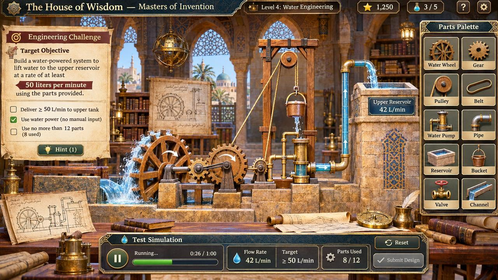
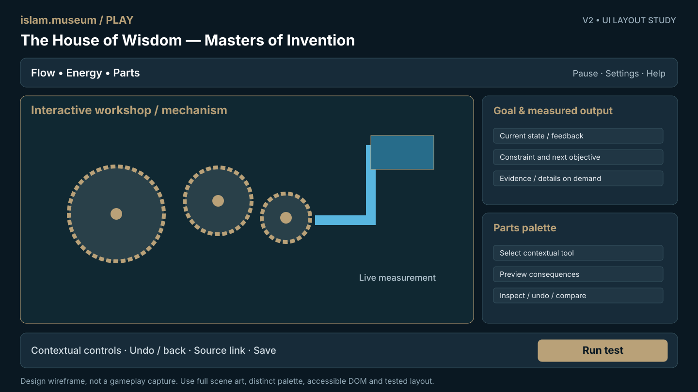

# The House of Wisdom — Masters of Invention
## Production Game Design Document — V2
**Genre:** Engineering construction puzzles  
**Player promise:** Design, test and optimize working mechanisms inspired by historical instruments.

## Creative direction
Tactile workshop, close-up brass, wood, rope and water; precise exploded view and clean analytical overlay, not ornate HUD. Natural mechanical sound.

The concept image is not an actual gameplay screenshot and may contain anachronisms, implausible architecture or incorrect labels. Use it to discuss camera, atmosphere and composition only. The V2 board is a scalable layout reference, not a rendered scene. Build real in-engine style frames and record motion before scaling content.

## Plot and player fantasy
A fictional apprentice must solve public engineering commissions. A broken water supply, optical experiment and astronomical observation each introduce a physical constraint and a reason to improve a design.

## Core gameplay and meaningful choices
Read brief → drag/snap components → connect shafts, pipes or optical paths → simulate → diagnose measured failure → revise → submit efficient solution. Sandbox experimentation never consumes real resources.

Torque vs speed, head vs flow, energy source, component budget, precision and stability. Multiple valid designs; efficiency, reliability and cost as separate optional goals. Clear measured units and physical simplifications.

## Progression and pacing
30s attach wheel/gear and see movement. Five minutes raise water in first test. Hour solve multi-stage mechanism. Week create original contraption. Month optimize expert puzzles and share blueprints.

## Launch content and release boundary
At least 18 authored puzzles across mechanical, hydraulic and optics/astronomy categories, tutorial per family, sandbox, daily validated challenge. Avoid requiring full CFD or real structural safety calculations.

This is a candidate scope, not permission to ship low-quality filler. Each authored scenario must have tested beginning, escalation, outcome, recovery and replay. If source coverage is insufficient, document the gap and use an alternate verified setting rather than invent evidence.

## Simulation and implementation
Rapier where suitable; custom constraints and gear ratios, simplified hydraulic head/flow/energy rules, analytical reflection/refraction, stable solver time-step, visual particles independent of measured output. Parts schema includes ports, tolerances, costs and limits.

Separate rule state from rendering. Expose legal action previews, meaningful feedback and inspectable causes. Persist game/version/content/mod lock, seed and checkpoint; include replay/export, settings, explicit exit and recovery. Profile actual frame times and loading on supported browser hardware. Use [shared systems](../06-SHARED-GAME-SYSTEMS.md) and [graphics](../04-GRAPHICS-ENGINE.md) as applicable.

## Daily and long-term replay
Seeded goal and components from known-solvable template; score completion and efficiency independently. Archive and show alternative solutions without giving away current puzzle.

Use UTC seed/version, archived challenges, no streak penalty, unlimited practice where applicable. The daily mechanic supplements the campaign or creative loop rather than substituting for it. No unverified score presented as ranked.

## Win, failure and player recovery
Failed simulation highlights disconnected shaft, leak, wrong ratio or insufficient energy; pause and undo, no arbitrary penalty. Success when measured constraints met over test interval.

## Interface, controls and localization
The board describes the key HUD hierarchy: primary action, current objective, world state and contextual explanation. Use the game's camera and palette, not a common ornate template. Show action consequences before commitment when practical; pause, restart, help, keyboard/gamepad mappings when applicable, UI scale, reduced motion, captioned cues and volume. All seven actual locales, RTL panels but not reversed physical geometry or maps. Essential actions have accessible alternatives; test in real browser at different zoom and resolution. No forced login.

## Creator and developer capabilities
MechanismBlueprint, component skins, bounded custom parts and validated puzzle packs. Export visual demonstration to Relics, approved functional variant to Golden Age sandbox.

Use stable schema/SDK and capability-based sandbox. Example pack must load, display, be disabled and survive reload without core edits; separate modded/unmodded saves and ranks. Source/licensing required.

## Acceptance scenarios
Known ratio/flow/optics analytic fixtures, energy conservation within documented tolerance, impossible circuit detection, no NaN/unstable state, solver validation 365 seeds, drag and keyboard alternatives, independent engineering review.

Independent reviewer plays without instruction from author; test first minute, five-minute loop, alternate strategy, complete scenario, retry, save/reload, daily/archive, accessibility, seven locales and actual game capture. Verify museum links/claims and rights. Run applicable [hard release gates](../contracts/acceptance.md).

## Known pitfalls and prevention
Fake water physics, single prescribed design, cluttered parts menu, visually impressive but disconnected animation, unclear unit conversions. Show live readings and causal diagnostics.

## Production prompt for this title
Implement the GDD inside the V2 platform, using actual repository evidence and approved contracts. Start with one polished vertical slice, capture real footage and collect independent feedback; then complete scoped campaign/content, tests, mods and integrations. Do not substitute placeholders, static concept art, generic quiz, fake physics or unverified claims. Report evidence and open gates; do not call it released until validated.
