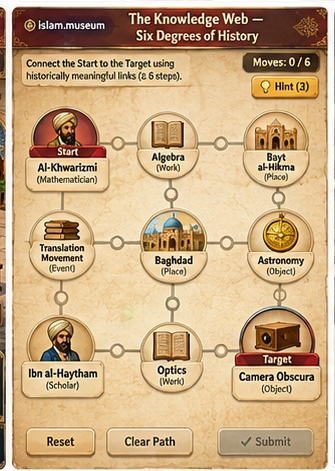
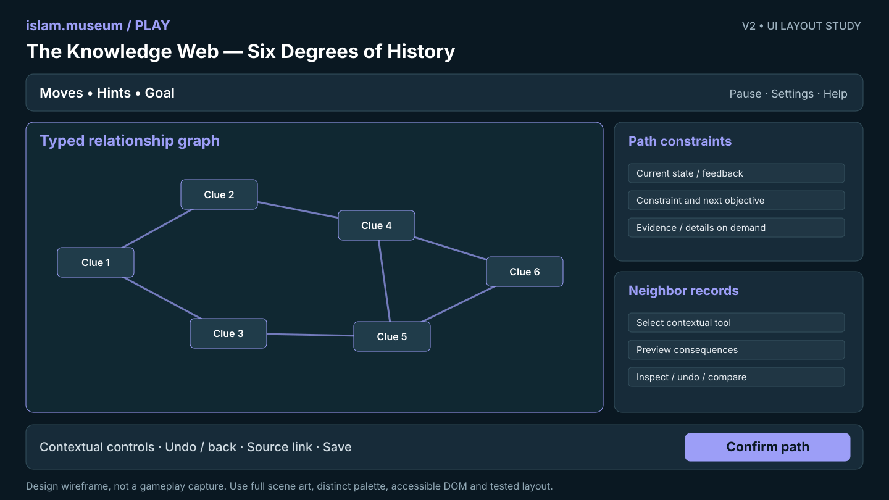

# The Knowledge Web — Six Degrees of History
## Production Game Design Document — V2
**Genre:** Graph navigation and logic  
**Player promise:** Discover surprising, verifiable connections between apparently distant historical subjects.

## Creative direction
Dark constellation of ideas or crisp light graph mode; animated path reveal, readable labels, semantic relation colors with non-color alternatives, focus mode and keyboard list.

The concept image is not an actual gameplay screenshot and may contain anachronisms, implausible architecture or incorrect labels. Use it to discuss camera, atmosphere and composition only. The V2 board is a scalable layout reference, not a rendered scene. Build real in-engine style frames and record motion before scaling content.

## Plot and player fantasy
A fictional knowledge explorer tries to connect historical subjects using documented relationships. The satisfaction is a surprising path and learning why each edge matters.

## Core gameplay and meaningful choices
Read endpoints → inspect neighboring records and relation labels → choose next node → revise path → submit → compare shortest valid route → see explanations. Expert constraints vary allowed relation types.

Shorter path vs meaningful detour, hints vs mastery, avoid generic hubs and spurious edges. Direction and relation meaning matter; no arbitrary guess.

## Progression and pacing
30s choose first edge. Five minutes solve a daily path. Hour master constrained graph modes. Week create challenge for friend. Month expert routes and curated collections.

## Launch content and release boundary
Daily puzzle, unlimited practice, expert relation constraints, authored onboarding, 100+ verified candidate pairs and 365-day schedule. Graph sliced/indexed not loaded wholesale at launch.

This is a candidate scope, not permission to ship low-quality filler. Each authored scenario must have tested beginning, escalation, outcome, recovery and replay. If source coverage is insufficient, document the gap and use an alternate verified setting rather than invent evidence.

## Simulation and implementation
Directed/typed graph, adjacency chunks, BFS/Dijkstra according to rules, proof certificate, generic hub blacklist or weight policy, path validity, text search and semantic accessible list.

Separate rule state from rendering. Expose legal action previews, meaningful feedback and inspectable causes. Persist game/version/content/mod lock, seed and checkpoint; include replay/export, settings, explicit exit and recovery. Profile actual frame times and loading on supported browser hardware. Use [shared systems](../06-SHARED-GAME-SYSTEMS.md) and [graphics](../04-GRAPHICS-ENGINE.md) as applicable.

## Daily and long-term replay
Same endpoint/rules/content digest across languages. Score moves and optional hint count; share spoiler-free path length.

Use UTC seed/version, archived challenges, no streak penalty, unlimited practice where applicable. The daily mechanic supplements the campaign or creative loop rather than substituting for it. No unverified score presented as ranked.

## Win, failure and player recovery
Dead-end offers backtrack without score ambiguity; show invalid relationship reason. Success valid path within constraint or any valid practice path; shortest solution reveal after.

## Interface, controls and localization
The board describes the key HUD hierarchy: primary action, current objective, world state and contextual explanation. Use the game's camera and palette, not a common ornate template. Show action consequences before commitment when practical; pause, restart, help, keyboard/gamepad mappings when applicable, UI scale, reduced motion, captioned cues and volume. All seven actual locales, RTL panels but not reversed physical geometry or maps. Essential actions have accessible alternatives; test in real browser at different zoom and resolution. No forced login.

## Creator and developer capabilities
ChallengeSeed, graph themes and verified local custom subgraphs; import into Lost Manuscripts only after case compiler validates.

Use stable schema/SDK and capability-based sandbox. Example pack must load, display, be disabled and survive reload without core edits; separate modded/unmodded saves and ranks. Source/licensing required.

## Acceptance scenarios
Graph optimality and direction property tests, disconnected nodes, forbidden hubs, 365-day seeds, locale equivalence, malformed subgraph tests and blind human evidence comprehension.

Independent reviewer plays without instruction from author; test first minute, five-minute loop, alternate strategy, complete scenario, retry, save/reload, daily/archive, accessibility, seven locales and actual game capture. Verify museum links/claims and rights. Run applicable [hard release gates](../contracts/acceptance.md).

## Known pitfalls and prevention
Trivial universal hubs, unclear relationship labels, impossible endpoints, huge graph visual hairball. Enforce meaningful typed paths, small neighborhoods and focus.

## Production prompt for this title
Implement the GDD inside the V2 platform, using actual repository evidence and approved contracts. Start with one polished vertical slice, capture real footage and collect independent feedback; then complete scoped campaign/content, tests, mods and integrations. Do not substitute placeholders, static concept art, generic quiz, fake physics or unverified claims. Report evidence and open gates; do not call it released until validated.
