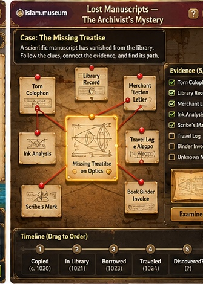
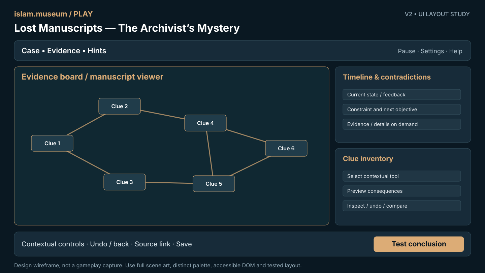

# Lost Manuscripts — The Archivist’s Mystery
## Production Game Design Document — V2
**Genre:** Deductive investigation  
**Player promise:** Reconstruct the missing history using evidence, not guessing.

## Creative direction
Atmospheric dark archive, warm desk light, high-resolution readable manuscript facsimiles with source metadata, minimal evidence board with restrained red/blue links.

The concept image is not an actual gameplay screenshot and may contain anachronisms, implausible architecture or incorrect labels. Use it to discuss camera, atmosphere and composition only. The V2 board is a scalable layout reference, not a rendered scene. Build real in-engine style frames and record motion before scaling content.

## Plot and player fantasy
A fictional archivist receives an incomplete catalogue and must trace a missing work. Cases combine fictional framing with verified relationships; authorship disputes remain open where evidence cannot decide.

## Core gameplay and meaningful choices
Inspect evidence → record observation → connect clue to candidate → order timeline → test hypothesis → submit evidence-backed conclusion → reveal source explanation. Optional hints gradually reveal method, not answer.

Limited initial clues, conflicting plausible candidates, chronological and geographical constraints. Player chooses what to inspect, no hidden pixel hunt. Evidence sufficiency, not speed alone, determines success.

## Progression and pacing
30s inspect a fragment and infer a date clue. Five minutes exclude a suspect/candidate. Hour finish first multi-case arc. Week new case chains. Month expert mode and case creation.

## Launch content and release boundary
12+ authored cases in three arcs, progressive difficulty, deterministic daily case compiler, practice board, optional expert no-hint mode. No historical accusations or invented provenance claimed as true.

This is a candidate scope, not permission to ship low-quality filler. Each authored scenario must have tested beginning, escalation, outcome, recovery and replay. If source coverage is insufficient, document the gap and use an alternate verified setting rather than invent evidence.

## Simulation and implementation
Graph compiler filters disputed/missing data, builds candidate set and proof certificate for uniquely solvable cases, validates distractor exclusion; timeline precision and uncertainty, notes, accessibility-friendly list alternative to board.

Separate rule state from rendering. Expose legal action previews, meaningful feedback and inspectable causes. Persist game/version/content/mod lock, seed and checkpoint; include replay/export, settings, explicit exit and recovery. Profile actual frame times and loading on supported browser hardware. Use [shared systems](../06-SHARED-GAME-SYSTEMS.md) and [graphics](../04-GRAPHICS-ENGINE.md) as applicable.

## Daily and long-term replay
One daily case with same evidence and permitted solution. Spoiler-free share: clues used, time optional, hint count; no score for unsupported claims.

Use UTC seed/version, archived challenges, no streak penalty, unlimited practice where applicable. The daily mechanic supplements the campaign or creative loop rather than substituting for it. No unverified score presented as ranked.

## Win, failure and player recovery
Incorrect submission shows contradiction categories and allows revise; no forced guessing. If evidence supports multiple answers, accept all proven valid or reject case before publish. Victory requires sufficient cited clues.

## Interface, controls and localization
The board describes the key HUD hierarchy: primary action, current objective, world state and contextual explanation. Use the game's camera and palette, not a common ornate template. Show action consequences before commitment when practical; pause, restart, help, keyboard/gamepad mappings when applicable, UI scale, reduced motion, captioned cues and volume. All seven actual locales, RTL panels but not reversed physical geometry or maps. Essential actions have accessible alternatives; test in real browser at different zoom and resolution. No forced login.

## Creator and developer capabilities
InvestigationCase packs, visual themes, fictional narrative templates, imported graph challenge with solver. No arbitrary unsupported facts in ranked canonical puzzles.

Use stable schema/SDK and capability-based sandbox. Example pack must load, display, be disabled and survive reload without core edits; separate modded/unmodded saves and ranks. Source/licensing required.

## Acceptance scenarios
Solver proves unique answer or permitted set, contradictory dates/distractors, 365-day validation, keyboard board navigation, no source reveal before conclusion unless practice; blind humans solve without unexplained guess.

Independent reviewer plays without instruction from author; test first minute, five-minute loop, alternate strategy, complete scenario, retry, save/reload, daily/archive, accessibility, seven locales and actual game capture. Verify museum links/claims and rights. Run applicable [hard release gates](../contracts/acceptance.md).

## Known pitfalls and prevention
Trivial name match, fake historical allegations, ambiguous answer, pixel hunt, mandatory reading wall. Use layered evidence, optional context and fair clues.

## Production prompt for this title
Implement the GDD inside the V2 platform, using actual repository evidence and approved contracts. Start with one polished vertical slice, capture real footage and collect independent feedback; then complete scoped campaign/content, tests, mods and integrations. Do not substitute placeholders, static concept art, generic quiz, fake physics or unverified claims. Report evidence and open gates; do not call it released until validated.
