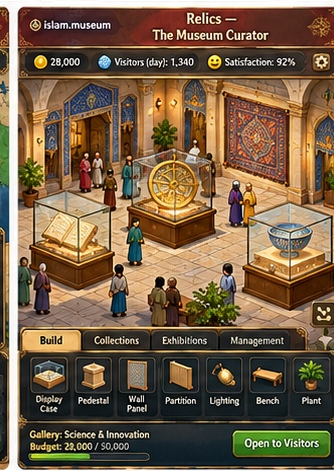
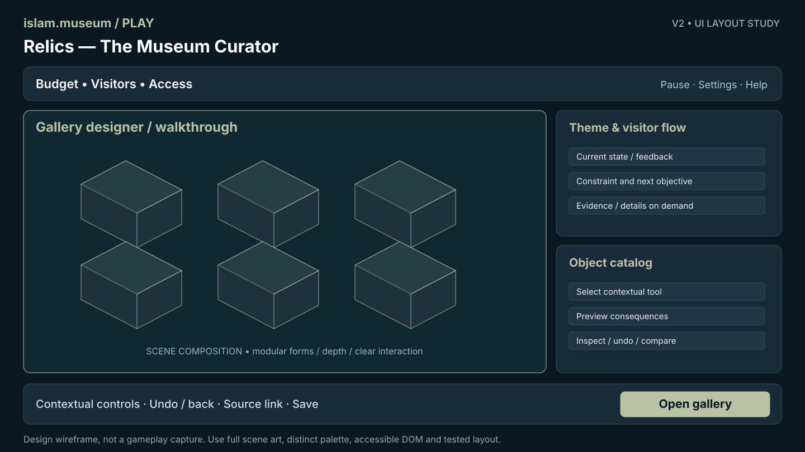

# Relics — The Museum Curator
## Production Game Design Document — V2
**Genre:** Creative museum management  
**Player promise:** Curate meaningful exhibitions and watch a living gallery respond to your choices.

## Creative direction
Contemporary gallery interiors, soft realistic lighting, artifact closeups and clean curator UI. Emphasize accurate scale and licensed actual imagery/models.

The concept image is not an actual gameplay screenshot and may contain anachronisms, implausible architecture or incorrect labels. Use it to discuss camera, atmosphere and composition only. The V2 board is a scalable layout reference, not a rendered scene. Build real in-engine style frames and record motion before scaling content.

## Plot and player fantasy
A fictional museum director starts with a modest gallery and wants to tell a compelling story with limited space and budget. Virtual loans and digital exhibits, never claimed ownership or looting.

## Core gameplay and meaningful choices
Choose exhibition brief → research objects → lay out gallery → write/select verified labels → open simulated gallery → observe visitor flow and feedback → revise. Creative mode unlimited.

Thematic coherence, visitor accessibility, budget, conservation constraints, circulation and educational value. Multiple good narratives; no single culturally biased score.

## Progression and pacing
30s place first object and spotlight. Five minutes open mini-gallery. Hour complete first exhibition and feedback. Week rotate themes. Month create portfolio and remix compatible exhibits.

## Launch content and release boundary
Three campaign exhibition themes, 30+ eligible sourced artifacts with imagery or validated representation, 10+ layout tools, creative sandbox, daily brief; expand only from licensed records.

This is a candidate scope, not permission to ship low-quality filler. Each authored scenario must have tested beginning, escalation, outcome, recovery and replay. If source coverage is insufficient, document the gap and use an alternate verified setting rather than invent evidence.

## Simulation and implementation
Grid or freeform gallery with collision and visitor flow, object metadata/provenance, virtual loan schedule, lighting budget, accessibility path test, transparent simulated visitor scoring.

Separate rule state from rendering. Expose legal action previews, meaningful feedback and inspectable causes. Persist game/version/content/mod lock, seed and checkpoint; include replay/export, settings, explicit exit and recovery. Profile actual frame times and loading on supported browser hardware. Use [shared systems](../06-SHARED-GAME-SYSTEMS.md) and [graphics](../04-GRAPHICS-ENGINE.md) as applicable.

## Daily and long-term replay
Daily curated brief with fixed space/budget and object pool; score multiple dimensions; share gallery image and export layout.

Use UTC seed/version, archived challenges, no streak penalty, unlimited practice where applicable. The daily mechanic supplements the campaign or creative loop rather than substituting for it. No unverified score presented as ranked.

## Win, failure and player recovery
Show unmet path width, label missing, budget exceeded or thematic issues before opening; repair/undo. Success is meeting chosen exhibition goals and visitor needs, not pure attendance.

## Interface, controls and localization
The board describes the key HUD hierarchy: primary action, current objective, world state and contextual explanation. Use the game's camera and palette, not a common ornate template. Show action consequences before commitment when practical; pause, restart, help, keyboard/gamepad mappings when applicable, UI scale, reduced motion, captioned cues and volume. All seven actual locales, RTL panels but not reversed physical geometry or maps. Essential actions have accessible alternatives; test in real browser at different zoom and resolution. No forced login.

## Creator and developer capabilities
ExhibitPlan, compatible gallery skins, label translations, object display assets subject to license; export optional ChronoQuest gallery.

Use stable schema/SDK and capability-based sandbox. Example pack must load, display, be disabled and survive reload without core edits; separate modded/unmodded saves and ranks. Source/licensing required.

## Acceptance scenarios
Collision/path accessibility, object provenance/rights, save and import, visitor scoring explainability, no invalid ownership claims, actual gallery walkthrough benchmark and novice design test.

Independent reviewer plays without instruction from author; test first minute, five-minute loop, alternate strategy, complete scenario, retry, save/reload, daily/archive, accessibility, seven locales and actual game capture. Verify museum links/claims and rights. Run applicable [hard release gates](../contracts/acceptance.md).

## Known pitfalls and prevention
Generic tycoon loop, arbitrary visitor scores, objects treated as loot, licensing gaps, labels illegible. Reward intentional interpretation and creativity.

## Production prompt for this title
Implement the GDD inside the V2 platform, using actual repository evidence and approved contracts. Start with one polished vertical slice, capture real footage and collect independent feedback; then complete scoped campaign/content, tests, mods and integrations. Do not substitute placeholders, static concept art, generic quiz, fake physics or unverified claims. Report evidence and open gates; do not call it released until validated.
