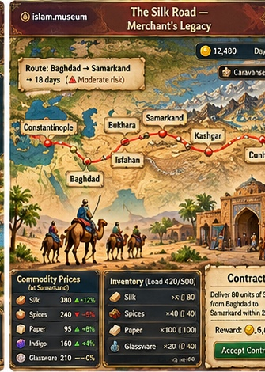
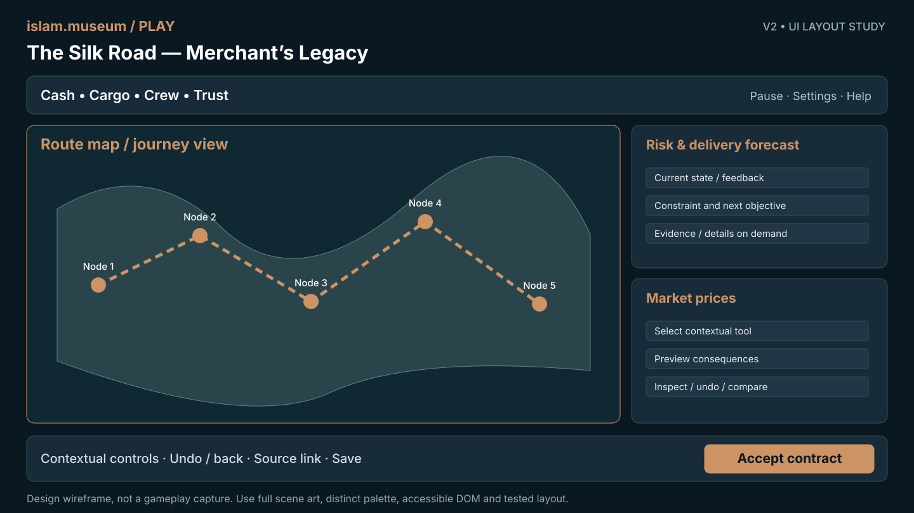

# The Silk Road — Merchant’s Legacy
## Production Game Design Document — V2
**Genre:** Trading and exploration strategy  
**Player promise:** Build a commercial network across a gorgeous, dangerous landscape without sacrificing the people who make it possible.

## Creative direction
Painterly sweeping terrain, desert horizons, green valleys, detailed ports and mountain passes; tactical route map plus cinematic travel vignettes. Muted indigo, ochre and jade.

The concept image is not an actual gameplay screenshot and may contain anachronisms, implausible architecture or incorrect labels. Use it to discuss camera, atmosphere and composition only. The V2 board is a scalable layout reference, not a rendered scene. Build real in-engine style frames and record motion before scaling content.

## Plot and player fantasy
A fictional family enterprise has debts and broken partnerships. You start with a small caravan; choices affect trust, finances and relationships across multiple journeys. Historical trading cities supply context, not fabricated prices or testimony.

## Core gameplay and meaningful choices
Inspect contracts and price signals → choose cargo, route, supplies and crew → travel through bounded encounters → negotiate or deliver → reinvest in warehouses and partners. Travel can be accelerated; key encounters require decisions.

Cash tied in cargo, perishability, seasonal route risk, crew welfare, reputation and opportunity cost. Safe short route vs risky high margin; honorable delivery vs opportunistic sale affects trust. Avoid arbitrary surprise losses; preview risks and countermeasures.

## Progression and pacing
30s select a shipment and route, see projected margin. Five minutes make first delivery. Hour complete family debt arc. Week unlock maritime trade and warehouse strategy. Month experiment with different networks, routes and challenge seeds.

## Launch content and release boundary
Three authored chapters, at least two trade corridors and one maritime corridor if supported by evidence, 12+ city/port nodes, 12+ commodities, 15+ distinct encounter templates with meaningful consequences; endless trade sandbox and daily contract.

This is a candidate scope, not permission to ship low-quality filler. Each authored scenario must have tested beginning, escalation, outcome, recovery and replay. If source coverage is insufficient, document the gap and use an alternate verified setting rather than invent evidence.

## Simulation and implementation
Route graph with documented/reconstructed tags, travel time and seasonal costs, inventory units, dynamic bounded economy, contract deadlines in simulation time, risk preview, crew/reputation model. Price history UI; simulation prices labeled fictional. No real-time loss when absent.

Separate rule state from rendering. Expose legal action previews, meaningful feedback and inspectable causes. Persist game/version/content/mod lock, seed and checkpoint; include replay/export, settings, explicit exit and recovery. Profile actual frame times and loading on supported browser hardware. Use [shared systems](../06-SHARED-GAME-SYSTEMS.md) and [graphics](../04-GRAPHICS-ENGINE.md) as applicable.

## Daily and long-term replay
Same route contract and starting cargo for all, maximize value and crew welfare with fixed simulation deadline; share path and result, no spoiler.

Use UTC seed/version, archived challenges, no streak penalty, unlimited practice where applicable. The daily mechanic supplements the campaign or creative loop rather than substituting for it. No unverified score presented as ranked.

## Win, failure and player recovery
Bankruptcy or inability to complete contracts with recovery loan/downsizing option and clear cost; campaign victory by debt resolution and trusted network milestones, not arbitrary grinding.

## Interface, controls and localization
The board describes the key HUD hierarchy: primary action, current objective, world state and contextual explanation. Use the game's camera and palette, not a common ornate template. Show action consequences before commitment when practical; pause, restart, help, keyboard/gamepad mappings when applicable, UI scale, reduced motion, captioned cues and volume. All seven actual locales, RTL panels but not reversed physical geometry or maps. Essential actions have accessible alternatives; test in real browser at different zoom and resolution. No forced login.

## Creator and developer capabilities
TradeScenario, cargo and ship/caravan skins, route/market packs, fictional encounters with validator; export route as compatible Golden Age scenario.

Use stable schema/SDK and capability-based sandbox. Example pack must load, display, be disabled and survive reload without core edits; separate modded/unmodded saves and ranks. Source/licensing required.

## Acceptance scenarios
No unbounded arbitrage from buy/sell loop; inventory conservation, route reachability, risk distribution, contract solvability and AI trader stress tests; human players perceive alternatives and understand why price shifts.

Independent reviewer plays without instruction from author; test first minute, five-minute loop, alternate strategy, complete scenario, retry, save/reload, daily/archive, accessibility, seven locales and actual game capture. Verify museum links/claims and rights. Run applicable [hard release gates](../contracts/acceptance.md).

## Known pitfalls and prevention
Repetitive buy low/sell high, fake procedural geography, tedious travel animations, random disasters without agency, mislabelled historical prices. Use authored encounters, geographic provenance and time compression.

## Production prompt for this title
Implement the GDD inside the V2 platform, using actual repository evidence and approved contracts. Start with one polished vertical slice, capture real footage and collect independent feedback; then complete scoped campaign/content, tests, mods and integrations. Do not substitute placeholders, static concept art, generic quiz, fake physics or unverified claims. Report evidence and open gates; do not call it released until validated.
