# islam.museum Gaming Platform
## Illustrated product design, research and technical reference
**25 November 2026 · Companion to `01-FABLE-5.2-MASTER-PROMPT.md`**

This is a creative and engineering brief, not a claim that the games exist. All illustrations are AI-generated proposed gameplay concepts, not actual game captures or historically authenticated reconstructions. Seven supported languages are required; discover exact locale identifiers from the live repository. The founder prioritizes premium graphics and gameplay on recent high-spec desktop hardware over maximum compatibility. The platform remains free and browser-native.

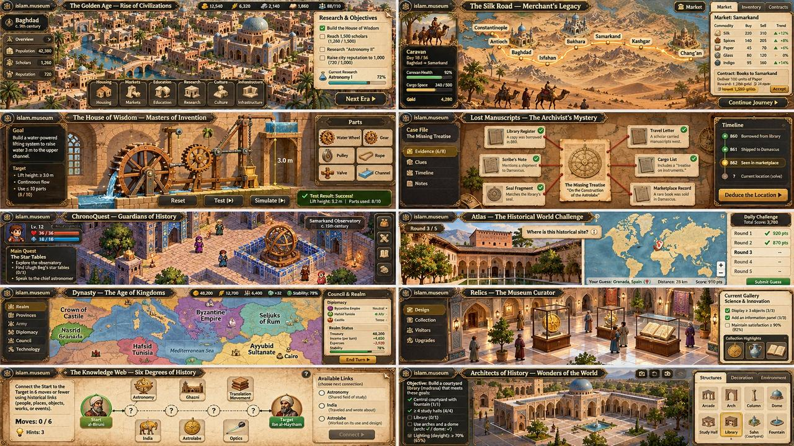

## Executive direction
**Positioning:** a premium historical games studio powered by a real museum knowledge graph. The game must be worth playing without a prior interest in history. The differentiator is that every meaningful discovery can lead to an actual sourced exhibit, person, place or work. No other experience should be copied wholesale; use genre references as design language, not as a license to copy intellectual property. Prioritize three pillars: visually unforgettable worlds, consequential choices, and an open creator ecosystem. The ten games share a platform but never a forced common gameplay loop.

A player sees Play in the museum header and footer, a large homepage feature and a cinematic hub. Hub modules: Continue playing, featured world, daily challenges, games library, new campaigns, community creations, challenge archive, developer portal, settings and device benchmark. The game cards use actual captured gameplay on release, not fabricated screenshots. Show a premium trailer on unsupported devices, with truthful requirements. Developer portal is discoverable without sign-in. Avoid a homepage bundle that slows the existing museum. Museum brand: ivory #f9f8f6, ink #1a1a1a, lapis #0a2533, teal #113f4e, gold #c5a059, sand #e6d5b8; adapt in games for distinct visual identities. Use readable typography rather than ornamental clutter; use actual localized fonts and shaping.

## Research: what Fable 5.2 is being used to build
Official launch and model documentation: [overview](https://platform.claude.com/docs/en/models/fable-5-2/overview), [model changes](https://platform.claude.com/docs/en/models/fable-5-2/whats-new-fable-5-2), [specific prompting guide](https://platform.claude.com/docs/en/build-with-claude/prompt-engineering/prompting-claude-fable-5-2), [effort](https://platform.claude.com/docs/en/build-with-claude/effort). Model launched Nov 9, 2026; API context 1M, output ceiling 128K, adaptive thinking always on. Available effort levels low, medium, high, xhigh, max. Anthropic says high captures most improvement, higher settings have uneven marginal benefit. Use Claude Code, xhigh initially for difficult integration; high for bounded implementation; max selectively for genuinely difficult review, not every task. Normal speed initially. Verify actual CLI/model selector in current installed Claude Code; do not assume all API settings exist in every UI. Plan mode can be used for a short read-only repository discovery if needed, but switch to editing/agentic execution to implement. Keep PR-only controls and normal permission boundaries. Long-running work needs persistent checkpoints; large context does not mean unlimited execution.

Anthropic's guidance emphasizes calibrating effort, persistent completion despite routine obstacles, narrowly defined approval boundaries, explicit code ownership, meaningful updates and measured delegation. The master prompt uses these principles but restricts ownership to gaming code so unrelated museum changes are not encouraged. Avoid asking for hidden reasoning or bloating prompts with repeated mandates. Use goal-based acceptance evidence and independently review diffs.

### Community examples (creator-reported; not independently played or benchmarked)
| Example | Reported technology / experience | Applicable design lesson |
|---|---|---|
| MAAD MAXXING, Andrew Blumson | Three.js/WebGPU, procedural desert vehicle action, no external models/textures reported | GPU-generated landscapes, atmospheric dust, readable high-speed camera and procedural asset spikes |
| Mist-Locked Gate | Single-page snowy lantern-lit wuxia game | Strong silhouette, localized atmosphere, limited scene with cohesive visual identity |
| CROSSTOWN, Matt Shumer | Open-world Manhattan exploration, partly updated using Fable 5.2, WebGPU and sign-in reported | Stream city chunks; traversal modes and dense streets; do not claim whole game was created by Fable |
| Cayley, Lionel Mora | Browser flight simulator with real wing physics and streamed globe, creator-reported | Meaningful simulation plus large-world streaming; historical navigation and photo mode |
| Valley Ride | Three.js/WebGPU horse ride, valley and sunset | Calm exploration, audio and environmental pacing between challenging sections |
| The Waking River | Sailing through visually distinct fantasy worlds | Environmental transitions, reveal moments and emotional narrative |
| Chasm | Torchlit WebGPU dungeon | Directional lighting, spatial audio and navigation cues |
| Oil Paint | Procedural painterly rendering experiment | Region-specific art styles and procedural textures; distinguish rendering demo from full gameplay |

Research indexes: [VibeGamer Fable 5.2 games](https://vibegamer.io/made-with/claude-fable-5-2), [Fable games gallery](https://vibegamer.io/model/claude-fable-games), [Three.js case studies](https://threejs.cc/en/topic/fable-5-2/), [Crewmark game roundup](https://crewmark.ai/blog/claude-fable-5-2-games), [curated examples and prompts](https://github.com/sandbase-lab/awesome-fable-5-2), [creator video collection](https://github.com/mofa-si/awesome-fable-5-2-videos), [Oil Paint](https://patch.gg/blendi/oil-paint). Collections may change; inspect original creator posts and actual runtime before adopting any technique. Short demos prove feasibility of a visual experiment, not reliability, production scope, performance or retention. No game listed here is certified as free of login, hardware requirements or all network dependencies.

## Ten game design briefs
Each concept has a screenshot reference, differentiated mechanics, launch scope, progression and extensibility. Several images are cropped from a shared concept sheet and therefore lower resolution; use them as compositional inspiration, not final assets. All fictional characters, simulations and reconstruction should be labeled; source claims come from verified records.

### 1. The Golden Age — Rise of Civilizations
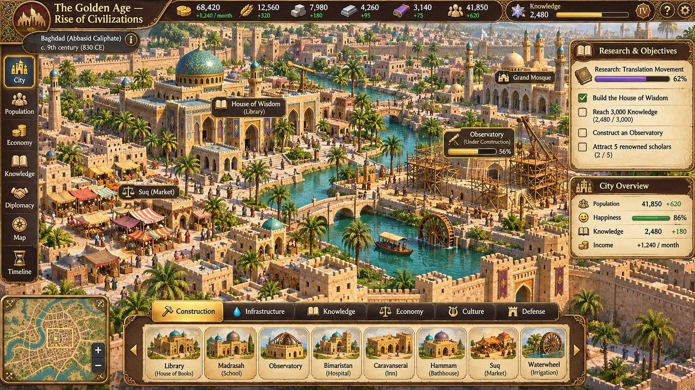
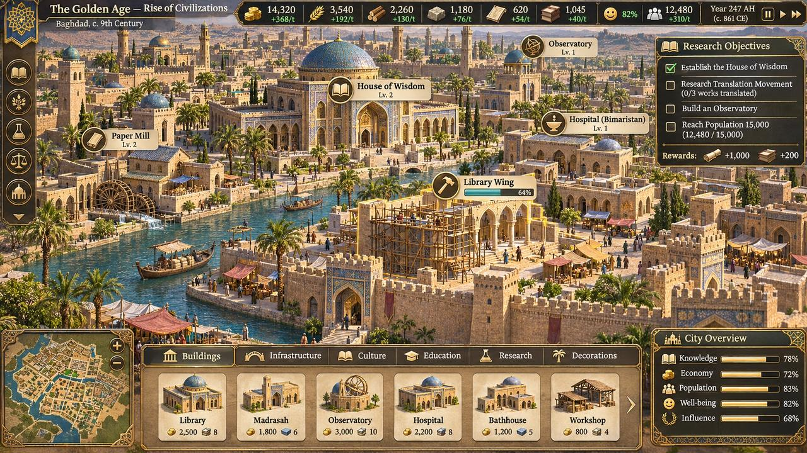
**Genre:** deep city-building and grand strategy. **Fantasy:** turn a small settlement into a flourishing center of scholarship, commerce and art. Begin with historically informed Baghdad, Cairo or Córdoba, then unlock additional scenarios after research. The core loop is inspect demand → plan districts → allocate resources → observe citizens and production → trade/research → adapt to events. Build roads, water systems, farms, markets, libraries, hospitals, workshops and observatories. Production chains should have genuine bottlenecks (paper requires inputs, labor and distribution). Residents need housing, water, food and services; schools and cultural influence create long-term benefits. Design multiple viable city forms, not a single dominant solution. Use historical starting conditions and clearly fictional alternate outcomes. No single civilization score based on religion.
**Campaign:** three city scenarios with different terrain, climate, economic constraints and milestones; tutorial progresses from water supply to a knowledge hub. 30+ meaningful buildings/upgrades, research branches, trade partners and civic dilemmas. Endings based on prosperity, welfare, scientific influence and resilience. Daily challenge: one seeded civic crisis, limited turns and distinct optional objectives. Long-term: sandbox, city blueprint exports, time-lapse replay, challenge seeds and custom scenarios.
**Graphics:** high-detail 3D isometric city, sunlight across canals, articulated water wheels, animated markets, caravans, boats and garden vegetation. Day/night changes social activity. Camera transitions from regional map to streets; LOD and instancing handle city density. UI top resources, contextual build toolbar, right objective inspector, minimap, overlay maps for water/traffic/education. Avoid tiny text and clutter. Sound: flowing water, market ambience and construction feedback, optional music.
**Creator hooks:** building archetypes, architectural skins, production recipes, research nodes, city maps, scenario rules and events. Expose validated simulation commands and read-only state. **Failure traps:** generic idle timers, invisible supply problems, meaningless buildings, citizen performance bottlenecks. **Gate:** playtest a complete city arc with two viable strategies and clear failure recovery; compare frame times on high-spec GPU.

### 2. The Silk Road — Merchant's Legacy
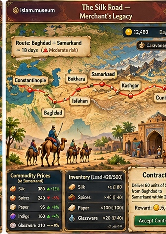
**Genre:** trading, exploration and economic survival. **Fantasy:** grow an inherited caravan business into a network crossing regions and ports. Loop: assess market → choose cargo and contract → route/supply plan → immersive travel encounter → negotiate/sell → reinvest. Dynamic supply and demand, seasonal costs, spoilage, crew, vehicles, warehouses, reputation, nonviolent negotiation and route risk. Prices are fictional model values, not historical price claims. Players can specialize in rare goods, high-volume staples, maritime trade or reliable courier contracts.
**Campaign:** three arcs (local merchant, interregional network, maritime expansion), 20+ verified locations, 15+ commodities, meaningful route choices. Daily contract generated with proof of feasible paths and constraints. Avoid simple click-through travel; encounters require resource decisions, navigation or short environmental puzzles. Optional scenic traversal segments and map mode. Share successful route/ledger replay; custom contract seeds.
**Graphics:** relief map with animated routes, wind and weather, detailed caravanserais, ports and bazaars, cinematic desert dawn, ships and cloth. Seamless transitions between strategic map and 3D encounter vignettes. Market UI should explain margins, cargo capacity, time, risks and uncertainty. Spatial ambience changes by region; accurate sound attribution.
**Creator hooks:** route graph extensions, commodities, trade scenarios, skins, ships, fictional encounter scripts with bounded rule APIs. **Failure traps:** dominant buy-low/sell-high loop, random unavoidable losses, real-world unsupported trade claims, tedious clicking. **Gate:** simulation shows varied profitable strategies and no unwinnable published daily contracts.

### 3. The House of Wisdom — Masters of Invention
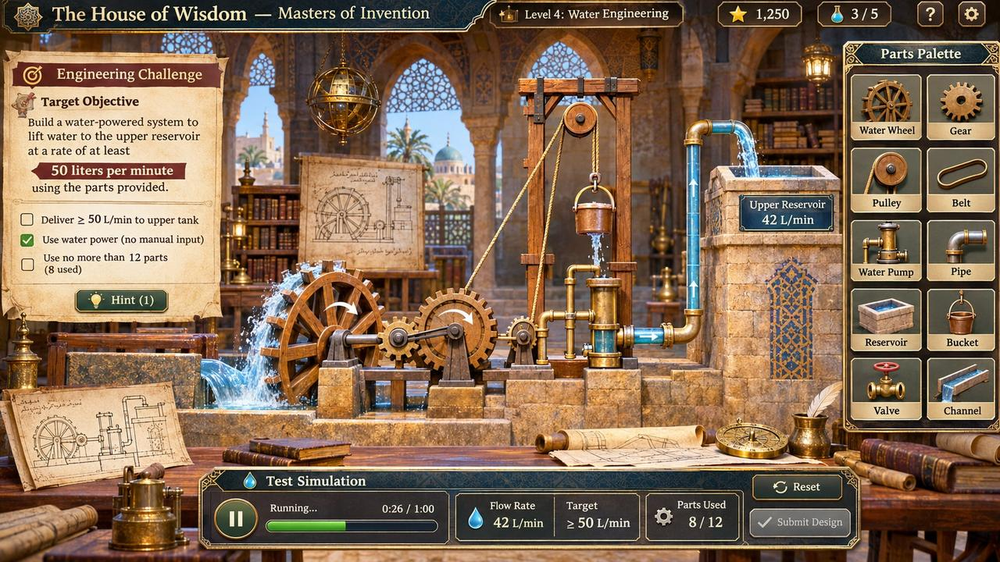
**Genre:** physics construction, experimentation, invention. **Fantasy:** solve the problems of a historical workshop using ingenuity. Loop: inspect brief → select and assemble parts → simulate → diagnose → refine → share. Gears, belts, levers, pumps, valves, mirrors, light, measuring instruments, geometry and astronomical devices. Different disciplines use meaningful models, not one fake universal physics engine. Hydraulic approximation must conserve relevant quantities and clearly label simplifications. Provide useful diagnostic overlays: flow, torque, alignment, leaks, collision and power budget.
**Campaign:** 30+ challenges across hydraulics, mechanics, optics and astronomy; introduce principles gradually, include open-ended capstones. Daily engineering brief with multiple valid solutions, optional efficiency score, unlimited retries. Sandbox and blueprint exchange with versioned validated designs. Reward creativity as much as minimal parts. Verified museum references for each invention; avoid inventing historical origin claims.
**Graphics:** tactile 3D wood/brass/stone components, animated water, visible gear meshing, soft workshop sunlight, authentic-looking diagram layout using sourced or authored schematic labels. Close-up camera and exploded views, transparent diagnostic overlays, satisfying test animation. HUD objectives left, parts palette right, test/results bottom. No ornamental UI obscuring connections.
**Creator hooks:** components, parameters, assembly sockets, challenge definitions, materials, custom test evaluators through safe declarative rules. **Failure traps:** fiddly drag/drop, physics instability, one exact solution, hidden constraints, excessive effects masking motion. **Gate:** multiple solutions verified, intuitive snapping/undo, no unstable simulations or unrealistic success claims.

### 4. Lost Manuscripts — The Archivist's Mystery
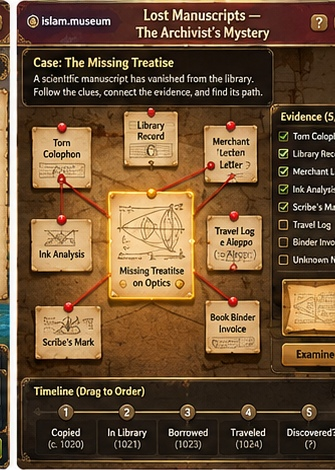
**Genre:** deduction, narrative mystery. **Fantasy:** uncover a lost identity or provenance by reasoning from evidence. Loop: read fictional case brief → inspect documents and objects → connect dates/people/places → form hypotheses → resolve contradictions → submit reasoned conclusion. The graph is the puzzle engine, not a trivia bank. Design evidence in layers: direct, indirect and contradictory; distinguish a plausible conclusion from one proved by available facts. If case uses invented letters or events, clearly identify fictional narrative evidence separately from sourced history. No real person's invented crimes.
**Campaign:** 20+ handcrafted cases, episodic investigations with a larger fictional archive storyline, 365-day generated archive where feasible. Daily case 5–20 minutes, weekly multi-part case, hint system that reveals reasoning steps rather than immediately answering. Case compiler validates intended solution and alternate ambiguity; disputed records not used for single-answer certainty. Share spoiler-free results; community case editor with evidence validation.
**Graphics:** atmospheric archive desk, zoomable manuscript fragments, raking light on artifact surfaces, interactive connection board, magnification, document tabs, timeline, notes and clear evidence tags. Readable text and screen-reader equivalent to visual clues; no generated pseudo-Arabic. Optional 3D inspect mode. Audio: paper, rain, quiet room tone.
**Creator hooks:** authored cases, clue templates, relation filters, fictional dialogue, evidence assets and localization. **Failure traps:** pixel hunting, ambiguous solutions, red herrings with no logic, relying on external search, linear hint spam. **Gate:** blind playtests solve without spoilers or external tools, show reasoning and alternative accepted answers where justified.

### 5. ChronoQuest — Guardians of History
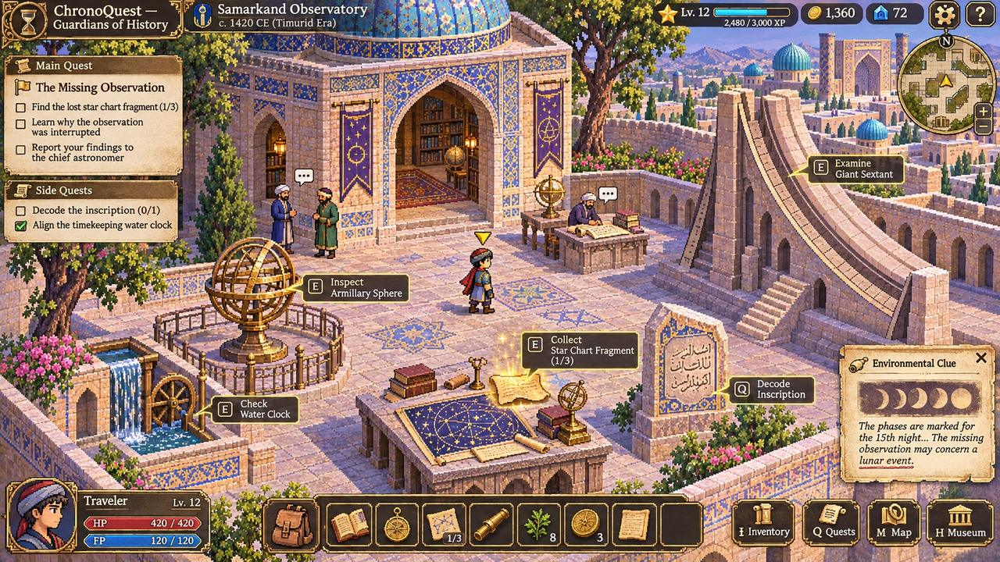
**Genre:** story-driven adventure RPG. **Fantasy:** a fictional archive links eras; restore broken connections by visiting historical settings. Loop: explore → encounter character/obstacle → discover evidence or tool → solve environmental challenge → advance narrative. Create fictional protagonists and NPCs rather than impersonating sacred figures or inventing words for real scholars. Historical people can appear in sourced archival records. Strong central mystery and emotional stakes; each episode contains a revelation, not repetitive fetch quests.
**Campaign:** three substantial episodes, e.g. Baghdad workshop, Andalusian city and Timurid astronomy setting (verify dates and sites); interconnected clues, optional side quests, discovery journal, character skills for observation/navigation/engineering and meaningful choices. Daily short anomaly and replayable puzzles. No artificial gear grind. Design choices that change how a puzzle resolves, not historical reality without clear fictional framing.
**Graphics:** premium 3D isometric or third-person view, or exceptionally polished pixel art with dynamic lighting if chosen through vertical-slice comparison. Detailed tiled courtyards, interiors, bustling streets, astronomical instruments, realistic materials, dynamic time of day. Use expressive fictional characters with consistent silhouettes and animation states. Camera readability before spectacle. Music/ambient storytelling and accessible dialogue subtitles.
**Creator hooks:** maps, NPC archetypes, branching dialogue graphs, quests, puzzle components, characters and cosmetic skins. **Failure traps:** empty open worlds, generic dialogue, camera collision, confusing objectives, weak endings, repetitive travel. **Gate:** first episode has compelling beginning, escalation and satisfying resolution, independent testers want to continue.

### 6. Atlas — The Historical World Challenge
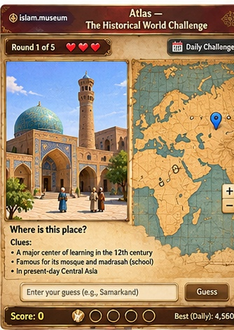
**Genre:** geography and historical deduction. **Fantasy:** uncover a location and period from visual and textual clues. Loop: inspect scene → request optional clue → pan/zoom map → pin location/date → receive distance and explanation → next round. Modes: monument location, artifact origin, scholar journeys, route reconstruction, century and expert combined. Include high-quality licensed photos or verified labeled reconstructions. Avoid source URL/file names revealing the answer. Accessible clues must convey equivalent information without spoiling.
**Campaign:** 365 validated five-round days; unlimited practice, regional mastery, expert challenges, friend seed, archive and post-round museum discovery. Score distance and date error with published rules; use great-circle distance, avoid false precision where source approximate. Daily competition local by default; real shared ranking later with verified backend. Spoiler-free emoji/text scorecard, shareable challenge URL and instant replay.
**Graphics:** elegant terrain globe or 2D map with smooth zoom, high-resolution clue pane, annotated reveal animation, readable distance rings, regional labels and dark/light map style. 3D monument inspection as optional premium mode. Don't force 3D for ordinary map guesses. Map data license and attribution always visible.
**Creator hooks:** challenge packs, clue styles, regional maps, scoring variants for unranked play. **Failure traps:** duplicated clues, ambiguous origins, map projection errors, inaccessible map, slow loading, stale daily versions. **Gate:** five rounds playable quickly; solver checks valid targets and no repeated targets within day; test boundary distances and keyboard controls.

### 7. Dynasty — The Age of Kingdoms
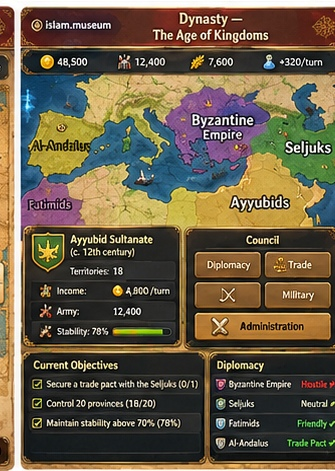
**Genre:** political simulation and diplomacy. **Fantasy:** steer a historically informed polity toward stability, prosperity and cultural flourishing. Loop: read situation → negotiate/manage budget → issue policies → advance turn → evaluate consequences. Provinces, trade, infrastructure, factions, succession, diplomacy, abstract conflict and uncertainty. Opponents have understandable goals and imperfect information. Multiple victory conditions; never rank religions or peoples as superior. Historical map borders use uncertainty bands rather than false precision.
**Campaign:** three distinct era starts, 20–50 turn scenarios, branching outcomes, optional sandbox and weekly council challenge. Consequences derive from simulation with transparent modifiers. Allow recoverable setbacks. Explain why a policy failed; no opaque random punishment. Share after-action narrative labeled alternate history.
**Graphics:** tactile relief map, cities with regional architectural miniatures, animated trade lines and province overlays, council chamber UI, layered ledger and decision cards. Distinguish map modes with accessible color/pattern. Camera zoom from region to province, dynamic boundary highlights. Avoid cluttered map labels.
**Creator hooks:** starting scenarios, polity data, faction rules, policies, AI behavior parameters, maps and events. **Failure traps:** spreadsheet-only play, snowballing, opaque diplomacy, impossible victory, misleading borders. **Gate:** multiple viable paths, AI can compete without omniscience, decisions traceable to simulation.

### 8. Relics — The Museum Curator
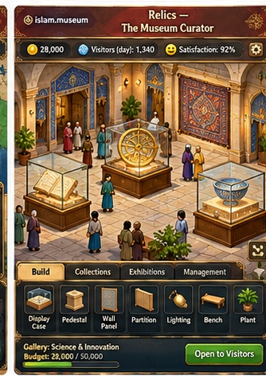
**Genre:** museum management and creative exhibition design. **Fantasy:** build remarkable exhibitions around real documented objects. Loop: accept exhibition brief → research/arrange virtual loans → design galleries → open doors → observe visitors and accessibility → revise. Use actual object records and licensed images/models. Virtual loans avoid suggesting legal ownership or looting. Simulated attendance and finances must be labeled. Make thematic coherence and interpretation matter more than collecting rarity.
**Campaign:** themed briefs across science, trade, textiles, art and architecture, budget and visitor challenges, creative mode, daily five-object exhibit, weekly showcase and shareable virtual gallery. Visitor types have observable needs, bottlenecks and learning outcomes; not meaningless happiness meters. Include accessibility routes, readable labels and seating.
**Graphics:** physically based gallery lighting and materials, glass cases with controlled reflections, artifact close-ups, visitor animation and smooth first-person walk-through. Drag/drop layout, placement preview, floor plan and lighting heatmap. Reuse existing museum 3D components only after profiling and licensing review. No high-poly assets without LOD.
**Creator hooks:** galleries, display furniture, layouts, exhibit themes, approved artifact representation, visitor behavior rules. **Failure traps:** generic tycoon grind, blocked paths, invisible evaluation, dubious provenance, copied third-party images. **Gate:** one complete exhibition opens, visitors navigate and respond to changes, exported gallery shares without installing software.

### 9. The Knowledge Web — Six Degrees of History
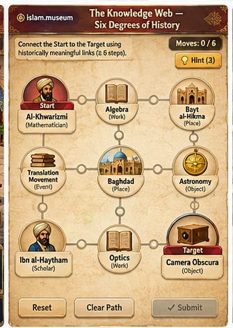
**Genre:** graph navigation, logic and discovery. **Fantasy:** connect two apparently distant historical subjects through meaningful sourced relationships. Loop: inspect endpoints → explore neighbors → select typed edges → avoid shortcuts/traps → prove chain → compare optimum. Use indexed adjacency and filtered edge types, not random generic links. Constrained paths can require a work/place/event or forbid high-degree hubs. Provide answer explanations and sources.
**Campaign:** 365 validated daily seeds, unlimited practice, expert paths, friend challenge and custom builder. Score shortest valid path and optional hints; avoid time as only measure. Maintain replay versions when graph updates. Historical links with uncertainty excluded or labeled depending mode. Reveal alternate optimal paths to reward discovery.
**Graphics:** animated graph constellation, readable entity cards, zoom/pan, path ribbon, relationship types and accessible text-list navigation. Elegant transitions from nodes to exhibit images. Avoid hairball graph: reveal only relevant neighborhoods and provide progressive disclosure. Use WebGPU only where graph size merits it; DOM/SVG for readable core interaction.
**Creator hooks:** relationship filters, authored puzzles, themes, scenario generators constrained by solver. **Failure traps:** generic hub shortcuts, contradictory edges, impossible paths, graph clutter and answer leakage. **Gate:** every ranked puzzle proven solvable, no invalid edges accepted, all alternate legitimate shortest paths recognized.

### 10. Architects of History — Wonders of the World
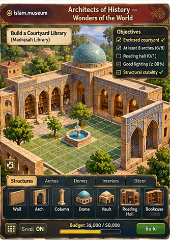
**Genre:** 3D construction, geometry and creative simulation. **Fantasy:** fulfill architectural commissions using regionally informed design elements. Loop: read brief → assemble structural modules → analyze daylight/space/simplified stability → revise → walk through → publish. Arches, columns, domes, courtyards, gardens, water features, patterns and materials. No implication that simplified game structural rules certify real buildings. Respect sacred sites and do not gamify sacred worship.
**Campaign:** 25+ commissions across different architectural traditions and environmental constraints, pattern puzzles, creative sandbox, daily restricted-component brief, weekly showcase. Multiple acceptable solutions and explanation of trade-offs. Export design files and shareable camera tours. Include grid/snap, rotate, duplicate, mirror, undo/redo, measurement, layer visibility, collision and accessibility indicators.
**Graphics:** premium 3D architecture editor, sun-position simulation, physically based stone, tile and wood, soft shadows, light shafts, vegetation, animated fountains, photo mode, first-person walkthrough. Readable snap guides and placement ghost; immediate performance feedback. Support large scenes via instancing and LOD. Region styles must not collapse into one generic gold-and-blue aesthetic.
**Creator hooks:** modular geometry, sockets, materials, pattern definitions, commission constraints and environment packs. **Failure traps:** awkward controls, clipping, limited undo, fake structural feedback, beautiful but shallow sandbox. **Gate:** players can create markedly different valid buildings, export/import losslessly and share a walkthrough.

## Visual production playbook
| Layer | Direction | Proof |
|---|---|---|
| Art direction | Unique regional palettes, silhouettes, materials, era references; coherent shape language | Art bible per game, reference board, independent visual review |
| Lighting | Motivated sun/interior sources; atmospheric depth; restrained post effects | Compare daylight, night and interiors; inspect shadow/acne/flicker |
| Environments | Authored landmarks plus procedural modularity; terrain, vegetation, crowd/traffic | Screenshot and camera flythrough at near/mid/far distances |
| Characters | Fictional readable silhouettes, consistent animation, no restricted portrayals | Animation state tests; historical costume review |
| UI | Contextual HUD, readable text, focus states, minimal chrome, RTL | Actual screenshots in all locales; keyboard and contrast checks |
| Audio | Ambient layers, spatial cues, meaningful feedback, mute/subtitles | No autoplay before gesture; pause/mute/focus integration |
| Performance | Frame pacing, memory lifecycle, shader warmup, streaming | GPU trace, p50/p95/p99 frame timings, long soak |

Concept images demonstrate visual ambition but their text, architecture and dates may be incorrect. Do not extract production textures or inscriptions from these images blindly. Create original procedural models, authored vector art and properly licensed assets. Prefer visual evidence over declarations: capture actual screenshots at fixed seeds and cameras; compare against art goals. Avoid generic fantasy medieval assets, overdone bloom, repetitive buildings, poorly animated crowds and disconnected interface panels. Each game needs a recognizable visual hook for a 10-second trailer: city reveal, caravan sunset, water machine starts, evidence resolves, observatory reveal, map pin reveal, diplomacy map shift, gallery opens, graph chain lights up, courtyard construction timelapse.

## Browser and graphics stack: research and decisions
Chrome 158 was in stable rollout during November, with 159 early stable to a small percentage on November 24. Edge 157 release notes published November 5. These are **dated candidate baselines**, not a guarantee of the latest version installed on every OS. Verify stable releases when coding. [Chrome releases November 2026](https://chromereleases.googleblog.com/2026/11/), [Chrome DevTools November cycle](https://developer.chrome.com/blog/new-in-devtools-december-2026), [Edge 157](https://learn.microsoft.com/en-us/microsoft-edge/web-platform/release-notes/157), [Edge stable updates](https://learn.microsoft.com/en-us/deployedge/microsoft-edge-relnote-stable-channel), [WebGPU feature history](https://developer.chrome.com/docs/web-platform/webgpu/news). Edge 157 notes include atomic-vec2u-min-max; use optional features only if adapter reports support and benefit is measured. Do not require experimental flags. Version checks are secondary to secure context, adapter availability, GPU limits and tested behavior.

| Technology | Use | Constraint |
|---|---|---|
| WebGPU / WGSL | PBR, compute, instancing, GPU particles, terrain | Actual adapter feature/limit checks, device loss, GPU memory budgets |
| Three.js WebGPURenderer / TSL | Primary 3D candidate, shader graph and scene assets | WebGPU backend can fall back to WebGL2 by default; explicitly verify canonical profile uses desired backend; spike missing features |
| Babylon.js | Alternative if engine spike wins | Do not maintain duplicate primary 3D stacks without reason |
| Rapier WASM | Rigid body simulation and collision | Measure determinism; custom fluid/optics abstractions |
| PixiJS / Canvas / SVG / DOM | 2D gameplay, puzzle HUD and accessible interfaces | Do not use 3D for every puzzle |
| Workers / OffscreenCanvas | Parallel content processing or render path where useful | Worker support varies by API; verify data transfer cost |
| WASM SIMD, threads | Heavy simulation where benchmark supports | Threads/SAB require isolation and may not work in portals |
| glTF, KTX2/Basis, meshopt | Efficient streamed assets | Validate imported models, textures and licensing |
| Web Audio | Spatial effects, mixing and music | User gesture and focus/mute behavior |
| IndexedDB / OPFS | Save state, cached assets, mod profiles | Quota, eviction, private browsing and export/recovery |
| Pointer Lock, Fullscreen, Gamepad | Premium interaction | Gesture/iframe permissions; remapping and Escape |
| WebCodecs | Optional replay video creation | Codec/runtime support; fallback to replay data |
| WebRTC / WebSocket | Future peer/authoritative multiplayer | Signaling/TURN/backend, abuse controls and real costs |

References: [Three.js WebGPU renderer](https://threejs.org/manual/pages/webgpurenderer), [Poki engine comparison](https://developers.poki.com/guide/web-engine), [OffscreenCanvas](https://developer.mozilla.org/en-US/docs/Web/API/OffscreenCanvas), [WebGPU](https://developer.mozilla.org/en-US/docs/Web/API/WebGPU_API), [WebGPU specification](https://www.w3.org/TR/webgpu/), [glTF](https://www.khronos.org/gltf/), [Rapier](https://rapier.rs/). Proposed high tier 16 GB RAM/8 GB VRAM and ultra tier 32 GB RAM/12–16 GB VRAM are design targets, not verified minimums. Actual minimums must come from benchmarking. 1440p/60 fps High and 4K/60 fps Ultra aspirational; 30 fps Cinematic optional. No browser reliably reveals exact VRAM. Use real GPU tests and graceful error screen rather than false detection. Modern hardware support does not justify memory leaks or unbounded asset loading.

## Creator ecosystem: borrow patterns, not code
Factorio exposes versioned mod APIs and an in-game mod portal ([API](https://lua-api.factorio.com/latest/), [modding overview](https://wiki.factorio.com/Modding)). Minecraft distinguishes resource and behavior packs with manifests ([resource packs](https://learn.microsoft.com/minecraft/creator/documents/resourcepack), [manifest](https://learn.microsoft.com/minecraft/creator/reference/content/addonsreference/examples/addonmanifest)). mod.io documents dependency handling and UGC integration ([dependencies](https://docs.mod.io/dependency-management/), [getting started](https://docs.mod.io/getting-started)). Adopt discoverable APIs, manifests, dependency resolution, version pinning, profiles and safe update UX. Browser threat model differs from native modding; do not allow arbitrary JavaScript in museum origin. Avoid required third-party platform services; a public GitHub release or direct HTTPS manifest plus local ZIP can be sufficient for initial creators.

### Proposed developer flow
Developer Settings → Enable developer mode → Add source → paste public repo/release/manifest URL or import local pack → resolve immutable version → show author/license/permissions/size/compatibility → validate → preview → enable in unranked profile → reload game if needed → rollback/uninstall. A community game submission is separate: SDK starter repo, build portable game, register manifest, preview isolated, submit PR or review request. Public directory only after moderation; private local mods require no account. No token entry, background cloning or automatic execution.

Example illustrative manifest (schema to implement, not existing):
```json
{
  "schemaVersion": 1,
  "id": "org.example.samarkand-garden",
  "version": "1.0.0",
  "game": "architects",
  "gameVersion": ">=1.0.0 <2.0.0",
  "sdkVersion": "^1.0.0",
  "kind": "content-pack",
  "license": "CC-BY-4.0",
  "dependencies": [],
  "permissions": ["content:buildings", "content:materials"],
  "assets": [{"path":"models/garden.glb","sha256":"REPLACE_WITH_REAL_DIGEST"}],
  "content": "content.json",
  "locales": {"en":"locales/en.json"}
}
```
The placeholder digest is intentionally invalid for production. Manifest must identify actual publisher, source, asset credits and supported languages. Namespaced IDs, no path traversal, no implicit remote code. Hashes provide integrity, not trust in publisher. Sandbox code with dedicated origin, CSP, limited RPC and quotas; worker alone is insufficient. Moderation and consent needed for published user content. Ranked content hashes must match official versions. Document CLI `create`, `validate`, `preview`, `pack`, `test` (proposed commands). Provide full API reference, event schemas, migration guide, security rules, examples, compatibility matrix, debugging console and contribution rules. In-browser visual editors for cases, quests, buildings, scenarios and skins can grow incrementally. Add mod profiles and export/replay portability; preserve source attribution. If safe programmable mods are not ready, explicitly restrict them rather than launching unsafe functionality.

## Hosting and independent build/deploy
Static architecture can support rich single-player games without a dedicated game server. Existing Cloudflare-backed origin is assumed from prior project context, but actual storage, plan and routing must be inspected. Use hashed static assets and cacheable chunk manifests. Separate `/gaming` workspace and route deployment, keep museum pages light. Separate gaming build and publish workflow with path triggers and shared-content dependencies, staging, artifact validation, atomic release pointer, rollback, concurrency controls and least privilege. No need to rerender museum catalog for each gameplay change if nav metadata and schema compatibility remain unchanged. Document release ownership of common routes. Use current hosting for static assets first; optional R2 for larger immutable asset packs, subject to account limits/cost. Cloudflare Workers for small APIs, Durable Objects per session for authoritative shared state/WebSockets, D1 for leaderboard metadata, R2 for opt-in replay data. Hibernation helps idle rooms, not constant simulation. [Workers pricing](https://developers.cloudflare.com/workers/platform/pricing/), [R2 limits](https://developers.cloudflare.com/r2/platform/limits/), [Durable Objects WebSockets](https://developers.cloudflare.com/durable-objects/best-practices/websockets/), [Durable Objects design rules](https://developers.cloudflare.com/durable-objects/best-practices/rules-of-durable-objects/). No new service or spend until approved. Real-time games need capacity models and load tests; current CDN traffic allowance does not imply unlimited compute/storage. Optional future dedicated authoritative servers or managed providers if edge tick latency/cost fails benchmarks. WebRTC needs signaling and often TURN; not automatically serverless or cheat-resistant.

## Publishing and review strategy
Canonical high-end edition is independent. Portal requirements may contradict a desktop-only WebGPU experience: build separate distribution profiles or skip incompatible portals. Do not compromise flagship or promise acceptance. Verify policies and contracts immediately before submission.
| Destination | Route / requirements / risk |
|---|---|
| itch.io | [HTML5 upload guide](https://itch.io/docs/creators/html5): ZIP root index.html, embedded browser mode, platform limits and AI disclosure; excellent indie launch |
| CrazyGames | [technical requirements](https://docs.crazygames.com/requirements/technical/), [SDK](https://docs.crazygames.com/sdk/intro/): evaluate initial download, focus/mute, gameplay events, full-launch SDK, device support |
| Poki | [quality rules](https://developers.poki.com/guide/requirements-quality): editorial review, SDK, adaptive inputs, thumbnails, ads/exclusivity review; no contract without approval |
| Coolmath Games | [submission](https://www.coolmathgames.com/submit-a-game): HTML5/plugin-free, editorial fit, educational puzzle mechanics |
| YouTube Playables | [program](https://developers.google.com/youtube/gaming/playables), [certification](https://developers.google.com/youtube/gaming/playables/certification/requirements): mobile compatibility and restricted external network calls; flagship may not qualify, separate puzzle editions only |
| Game Jolt | https://gamejolt.com/ — indie profiles and feedback; verify current browser hosting policies |
| GamePix / GameDistribution / Playgama | https://www.gamepix.com/ / https://gamedistribution.com/ / https://playgama.com/ — investigate SDK, commercial terms, compatible browser profiles |
| Foundplay / VibeGamer | https://foundplay.io/ / https://vibegamer.io/ — discovery of browser/AI-built games; verify current submission and ranking rules |
| Product Hunt / Show HN | https://www.producthunt.com/ / https://news.ycombinator.com/ — launch platform and technical story |
| Reddit | https://www.reddit.com/r/WebGames/ and https://www.reddit.com/r/IndieGaming/ — authentic demos, feedback, observe self-promotion rules |
| Indie DB | https://www.indiedb.com/ — development logs and game profiles |
| YouTube, Twitch, short video | actual game captures, developer walkthroughs, creator challenge videos |
| Review sites | Pitch Rock Paper Shotgun, PC Gamer, Eurogamer, IndieGameReviewer and relevant independent creators after polished release; editorial decisions independent. Metacritic/OpenCritic coverage is not a self-service guarantee. Do not pay for positive reviews, manipulate votes or create fake testimonials. |

Submission packet per game: 16:9 actual gameplay captures, thumbnails, icon, 15–30 second hook clip and 60–90 second trailer, controls, game description, supported devices, asset licenses, AI disclosure, QA report, portable ZIP, contact and press kit. External links and mod loading may be restricted in embedded portals; disable only in that export and disclose. Test on actual portal preview. Keep ads/SDK out of canonical museum, no forced monetization. Ranking factors vary and algorithms are not known; measure real retention and satisfaction rather than reverse-engineering fake ranking signals.

## Quality, retention and viral mechanics
Design for first meaningful action within 60 seconds after assets load. No compulsory account or lengthy intro. Give the player an irresistible immediate problem; show visual payoff quickly. Every 3–5 minutes in a campaign should introduce a new choice, discovery, challenge or consequence; this is a playtest heuristic, not a rigid timer. Teach by doing and provide optional help. Create a long-term mastery curve: early competence, increasing challenge, optional expert goals and sandbox. Make failure informative and recoverable. Keep daily events optional with archives, no missed-day punishment. Share seeds, replay highlights, building blueprints, gallery tours, engineering solutions, daily scorecards and spoiler-free detective outcomes. Friend challenges work via URLs without accounts; validate official scores only if backend exists. Creator packs and community spotlights can extend longevity far beyond handcrafted content.

Review pitfalls and mitigations: long loading → staged assets and playable loading sequence; beautiful but shallow → blind playtest core loop before polish; confusing UI → contextual controls, undo and explicit goals; repetition → authored variation and meaningful strategy; impossible procedural content → solver/property testing; performance spikes → frame-time profiling and memory caps; bad camera → collision, FOV and motion settings; accessibility neglect → keyboard, readable UI, alternate clues, captions; loss of progress → versioned saves/export and recovery; unfair competition → separate modded/ranked and authoritative scoring; historical misinformation → sources and uncertainty; broken launches → staged deployment and rollback; community abuse → moderation and scoped capabilities. Do not confuse a large feature count with quality.

Suggested internal metrics (hypotheses, not industry benchmarks): tutorial completion >=70%, D1 retention >=35%, D7 >=15%, D30 >=8%, result shares >=5%, related museum exploration >=15%, zero invalid published daily challenges. Define denominators, cohorts and measurement windows; opt-in or privacy-preserving analytics, no PII by default. Run voluntary diverse playtests and record qualitative findings. Aim for independent review acclaim, not promises of a top rating. No purchased reviews or engagement manipulation.

## Roadmap and release decisions
1. Foundation: inspect repository, SDK contract, build separation, WebGPU benchmark and portal integration. Atlas tests content/daily engine; Golden Age vertical slice tests visual ambition. Neither should be marketed as complete until gates pass.
2. First polished releases: Atlas, Knowledge Web, Lost Manuscripts and a flagship Golden Age scenario if fully ready. Validate gameplay with real players.
3. Creative/scientific expansion: House of Wisdom, Architects and Relics; ship creator tooling, example packs and documentation alongside.
4. Deeper worlds: Silk Road, ChronoQuest, Dynasty and Golden Age expansion. Add optional network services only after measured demand, threat model and approval.
All ten are requested deliverables; sequencing does not waive completion. Avoid ten simultaneous incomplete prototypes. Report actual scope, performance and blockers. Source URLs and platform rules are research snapshots, not binding current requirements. The museum repo was not audited or changed in preparing this brief. Final engineering decisions must be grounded in actual repository inspection and testing.
