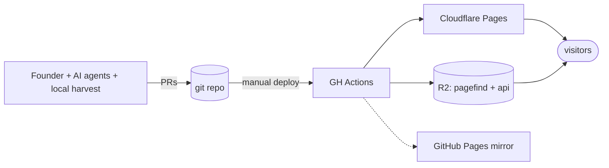

# islam.museum
## An engineering overview for developers

An open, free, all-digital museum of Islam — a **knowledge graph in git**,
published as a **static site**, built by humans and AI agents together.

Companion docs: `docs/engineering/` (this deck's sources).

---

## What it is

- A museum with no building: persons, events, places, ideas, objects, texts
  and living culture — from late antiquity to today.
- ~36k entities across 21 classes (8.7k+ people, 9.5k Qur'an passages,
  4.4k events, 1.7k places) plus the `edu/` programme — all draft until
  human review.
- Arabic first, English and Urdu always. RTL is structural.
- Licensed open: code MIT, data CC0, prose CC BY-SA 4.0.

---

## The two rules that shape everything

1. **The graph lives in git.** Facts are `data/<class>/<slug>.yaml`; prose
   is `content/<lang>/<class>/<slug>.md`. Immutable IDs; renames via
   `aliases`; each edge written once.
2. **Nothing runs at request time.** No server, no database, no AI call per
   visitor (ADR 0002). Search, maps, related-entities, "on this day" — all
   precomputed at build.

> All expensive work happens offline; the visitor only ever gets a file.

---

## System context



- Host: **Cloudflare Pages** (paid plan — file limit, since 18 Oct 2026).
- Search index + `api/v1` JSON: **R2** (zero egress).
- **GitHub Pages kept as fallback mirror.**

---

## Content model in one slide

- **21 classes**: person, group, polity, event, period, journey, place,
  building, object, media, dataset, concept, language, work, passage,
  source, practice, question, exhibit, listing, screen (+124 themes).
- **Dates**: EDTF + Hijri + calendar + precision; conversions flagged
  `derived`; never invented.
- **Edges**: only predicates from `schema/predicates.yaml`; inverses
  computed; `story_roles` are time-scoped.
- **Perspectives**: contested topics = labelled, cited positions; Sunni
  frame first (default scope), no verdict.
- **Qur'an**: frozen Tanzil text, verified byte-for-byte by the validator;
  never typed into prose.

---

## Build pipeline

```
data/ + content/ + geo/ + schema/
  → validate.ts   (schema, EDTF, links, licences, honorifics, Qur'an bytes)
  → build-graph   (→ .cache/graph.json)
  → derive        (timelines, maps, journeys, related, on-this-day)
  → astro build   (entity pages × languages, halls, JSON-LD, OG, feeds)
  → pagefind      (ar / en / ur chunked indexes)
  → export-api    (api/v1 static JSON)
  → r2-sync       (manifest diff → R2)
  → pages deploy  (stripped dist) → IndexNow
```

Total validation every run — no incremental hiding of bad data.

---

## The site

- **Astro 5** + Tailwind 4 + logical CSS properties (RTL by construction).
- **Svelte islands**, lazy (`client:visible`): depth dial, dual-calendar
  timeline, MapLibre+PMTiles map, Sigma.js graph, search, kids interactives.
- **Every page readable with JS disabled** (WCAG 2.2 AA).
- Discovery: 8 halls, themes, exhibits, questions, screening room,
  `wander`, `today`, `llms.txt`, JSON-LD, RSS.
- Passage pages are rendered but **excluded from Pagefind** (−44% chunks).

---

## Trust & quality gates

- **PR-only `main`** (ruleset): agents open and may merge their own PRs.
- `validate.yml` on every PR: schema + tests + build.
- AI output is always `status.review: draft` + `provenance` block; **only
  humans mark reviewed/verified** (pipeline exception: gated illustrations).
- Every dated fact: two sources or a flag. Wikipedia = pointer, not source.
- `docs/ai-change-gates.md`: written proposal → scope gate → merge gate →
  quality gate → content gates → attribution trailers
  (`AI-Agent`/`AI-Model`/`AI-Editor`).

---

## Parallel lanes (how many agents build one repo)

- One worktree/clone per session; explicit-path commits; ≤25 entities/batch.
- Fetch + three-way merge before every push; never revert others' work;
  duplicates become aliases.
- Shared files append-only (`_stubs.yaml`, `status.md`, enums); per-lane
  stubs in `data/_stubs.d/<lane>.yaml`.
- `npm run coverage` regenerates `docs/coverage.md` in the same commit.
- Two filed submissions (DPGA, UNESCO) quote repo state → every proposal is
  labelled `submission-impacting` or `non-impacting`.

---

## Deployment

- **Manual, founder-only.** Pushing to `main` publishes nothing; `deploy.yml`
  is `workflow_dispatch`, run ≈daily.
- Content-change gate: no `data/`/`content/` diff ⇒ R2 sync skipped.
- R2 sync = manifest diff (hundreds of ops, not tens of thousands);
  pagefind chunks `immutable`.
- Secrets: scoped CF token, R2 keys, account id — repo secrets only.
- Rollback: revert PR + redeploy, or CF Pages previous deployment.

---

## Performance

| Lever | Effect |
|---|---|
| Everything static + edge-cached | no origin compute, near-zero TTFB |
| Zero-JS pages + lazy islands | fast first paint, AA accessibility |
| Pagefind chunked, content-addressed | ~100 KB lazy loads, immutable cache |
| Passage exclusion | −44% search chunks |
| AVIF/WebP thumbs + IIIF full-res | small pages, no re-hosting |
| PMTiles + range requests | one-file basemap, no tile keys |
| Lighthouse CI on Arabic pages | budget enforced on the hard case |
| `check:weight` per-route budgets | education pages can't gain weight silently |

---

## Security & privacy, briefly

- No accounts, no PII, cookieless analytics, no forms → almost nothing to steal.
- Supply chain: tiny pinned dep set + lockfile + `site-deps.test`.
- `check-static.ts` audits built output for cookies/forms/3rd-party calls.
- Cloudflare NEL + email obfuscation **disabled on purpose** (they inject JS).
- Licence whitelist enforced by validator; copyrighted source material
  physically cannot be committed (harvest lives outside git).

---

## Cost

| Item | $/month |
|---|---|
| Cloudflare Pages plan (the one paid line) | small, fixed |
| R2, DNS, CDN, analytics, CI, GitHub Pages | ~0 (free tiers) |
| Per-visitor marginal cost | **$0** |
| Build-side (Mac, 1 TB disk, ~215 GiB dumps, local models) | owned hardware + electricity |

Costs stay flat at 10× traffic; the only watch items are CF Pages file
count and R2 storage.

---

## Extensibility recipes

- **New class**: schema + templates + validators + (usually) the generic
  entity page. *Submission-impacting.*
- **New language**: `i18n/<lang>.yaml` + `content/<lang>/` + a pagefind run
  + R2/strip lists. *Submission-impacting.*
- **New island**: Svelte component + derived JSON feed; page must still
  read without it.
- **New predicate**: append to `predicates.yaml` — inverses are free.
- **New lane**: owner+scope in `lanes.md` = the standing proposal.
- **New API endpoint**: emit JSON from `export-api.ts`.

---

## Where to start in the code

| To learn… | Read |
|---|---|
| The vision | `docs/plan/01-vision.md` |
| The data model | `docs/plan/02-content-model.md`, `schema/` |
| The build | `scripts/validate.ts` → `build-graph.ts` → `derive.ts` → `export-api.ts` |
| The site | `site/src/layouts/`, `pages/[lang]/`, `loaders/graph.ts` |
| Working rules | `AGENTS.md`, `docs/ai-change-gates.md`, `docs/agents/workflow.md` |
| Live state | `docs/status.md`, `docs/coverage.md` |

---

## The one-sentence summary

> A museum built like software: **facts as code, prose as content, review as
> CI, publication as a static artifact** — free to run, durable by design,
> and authored in the open by humans and agents under the same gates.
