# The Place wing map: review of 11 November 2026 and what was done

The founder asked for a review of the map on the Place wing (`/ar/place/`, `/en/place/`, `/ur/place/`) under these headings: usability, interface, interactions, events, information, display, layout, functionality, graphics. This file is that review, written before any code was changed, and then the record of what was fixed. The requirements the map is measured against are the founder's own, [`docs/engineering/19-islam-map-requirements.md`](../engineering/19-islam-map-requirements.md) (cited below as R1.1 to R8.4).

## How it was reviewed

- **What:** `main` at commit `8bbf678441`, not the live site. The live site (deploy of 10 November, version 1.10.0) is older: it has no place list beside a region and no chooser for stacked markers. A problem already fixed on `main` is not listed here.
- **Where:** a production build of the wing pages with the real configuration (a full build needs 19 GB; this machine had 8), served from disk. Chromium through Playwright for the measurements and the pictures, and a second browser by hand.
- **Covered:** Arabic and English (and Urdu for the strings); 390, 820 and 1280 pixels wide; light and dark; with JavaScript off; keyboard only; touch; the page as a screen reader meets it.
- **Not covered:** Safari and Firefox (not installed here), a real phone, a real screen reader. Those are named again at the end.

Two reviewers had already listed what they saw in still pictures of this page (rows S42 to S45 of the Grand Tour vision review). Their findings were treated as leads and each was confirmed or dropped here.

## Findings

Severity: **critical** (the page fails at its job or breaks a house rule), **major** (a reader is blocked or misled), **minor** (friction), **cosmetic**.

### Layout

| Id | Where | What is wrong | Severity |
|---|---|---|---|
| PM-01 | whole page, every width | The map is a fixed panel over the entire window (`position: fixed; inset: 0; z-index: 60`). It hides the site header (logo, menu, language switch, search, theme and accessibility controls) and the footer. The page has no `h1`, no banner and no breadcrumb. The page behind still scrolls (1,439 px tall at 1280) though nothing of it can be seen. Against R6.1 and R6.2. | critical |
| PM-02 | whole page, JavaScript off | The map's markup is still drawn over the window, dead. The only readable content (a list of 4,103 cards inside `<noscript>`, 457,298 px tall on a phone) is underneath it. On a phone the page also scrolls sideways by 196 px (Arabic) and 290 px (English). Against the house rule that a page must be readable without JavaScript, and R8.3. | critical |
| PM-03 | opening view | The world is centred on longitude 0 and cropped to fill. At 1280 px the left 45% of the map is the Atlantic and the Americas; on a phone everything east of Arabia is off the screen. | major |
| PM-04 | phone, 390 px | The control row stacks into four rows and takes 222 of 844 px. The place list covers half the map and lies over the year bar. At city level 12 of 18 orbit nodes are off the screen, and the two paging buttons sit on top of the picture. | major |

### Information

| Id | Where | What is wrong | Severity |
|---|---|---|---|
| PM-05 | region lists | 867 of the 3,875 places with coordinates (22%) cannot be reached from the map. A place appears only if it carries one of the twelve region ids; 625 places carry none, 141 carry `global`, 93 `americas-oceania` and 8 `africa`. | critical |
| PM-06 | region names on the world map | The names are printed over one another and off the edge at every width (S43 confirmed). In English they fall back to a Times-like face, because the font variable holds the Arabic stack. In the light theme they are tan on tan. | major |
| PM-07 | region names | A region is renamed after the era in force at the chosen year. At the opening year Arabia is labelled «العصر النبوي» / "The Prophetic Era", and that is also its name for a screen reader. On the Urdu page the era name is in Arabic. A place name is replaced by a period name. | major |
| PM-08 | markers inside a region | Markers are not where the places are. To keep markers 58 units apart, the page moves each one up to 220 units from its true position, in alphabetical order. Bisha, three degrees away, is drawn beside Mecca; on the live site a click on Mecca opened Abha. | major |
| PM-09 | city and entity levels | The people and events around a city are 18 identical circles with no names. A name shows only while a mouse is over a circle: never on touch, never on keyboard focus. There is no key for the shapes and no panel for the city (R5.1 asks for one): no summary, no counts, no visible link to its page. | major |
| PM-10 | region level at the opening year | 473 of 474 markers in Europe and 273 of 304 in Arabia are drawn at 28% opacity, close to invisible in the light theme, and nothing says what a faint marker means. 213 of 474 rows in the Europe list end in a bare "0". | major |
| PM-11 | year bar | The range is 990 BH to 1449 AH, so 40% of the slider's travel lies before the Hijra, where almost nothing is recorded. Only the Hijri year is shown (R3.1 asks for the CE year), with no era name. The arrows jump ten years without saying so. | minor |
| PM-12 | breadcrumb in the control row | The parts are not links, so there is no way to jump back to the world. The separator "‹" points the wrong way in English. | minor |
| PM-13 | strings | Relation names ("born in", "taught") are typed into the component in Arabic and English only, so the Urdu page shows Arabic. Region names are typed into the page file. Lists sort with Arabic collation in every language. Against R7.1. | minor |
| PM-14 | map | No credit line for the basemap (Natural Earth), which `docs/site/dates-timeline-maps.md` says to keep. | minor |

### Interactions and events

| Id | Where | What is wrong | Severity |
|---|---|---|---|
| PM-15 | city level, click on an orbit node | Choosing a person or event that is not "active" in the chosen year leaves an empty map and a breadcrumb that ends in "‹". Example: Mecca, then «إبراهيم», at 11 AH. | critical |
| PM-16 | year slider | Dragging the slider also drags the map, because the pointer events reach the map underneath. On a phone, moving the year from 11 to 754 AH moved the map 62 px. | major |
| PM-17 | pan and zoom | The mouse wheel, a pinch and a double click do nothing. Zoom is a small slider in the control row, around the centre and never around the pointer, up to 4×. No keyboard panning or zooming. A drag that leaves the map never ends. | major |
| PM-18 | detail dialog and marker chooser | The dialog does not take focus, Escape does not close it, and focus is not returned. The chooser for stacked markers is a dialog with no close control. | major |
| PM-19 | keyboard | 86 tab stops lie under the map before its first control, all invisible. Region and marker "buttons" answer Enter but not Space. They sit inside an SVG marked `role="img"`, which tells assistive technology to treat the whole map as one picture. The focus ring is near-black, so it cannot be seen on the dark map. | major |
| PM-20 | touch | No hover on touch, so markers and orbit nodes never show a name. Both sliders are 16 px tall, under the 24 px minimum (R5.4). | major |
| PM-21 | control row | "Back" carries a reset icon and looks switched off; the home icon floats between groups; the map has its own theme button, different from the header's (S45). | minor |
| PM-22 | year controls | The slider reads out a bare number to a screen reader: no era, no calendar. | minor |

### Graphics

| Id | Where | What is wrong | Severity |
|---|---|---|---|
| PM-23 | first paint | The map is always drawn dark first and turns light when the script starts, in the light theme (a flash; against R2.5). The small preview map stays black in the light theme. | major |
| PM-24 | city level | The background is the world outline magnified twenty times: a few straight lines that mean nothing. All but about seventy cities share one generic glyph. | minor |

### Performance

| Id | Where | What is wrong | Severity |
|---|---|---|---|
| PM-25 | page weight | Each language's page is 25.9 MB of HTML (4.6 MB compressed): 14 MB of data for the script (18,921 records with their full summaries and 28,609 links), a 1.5 MB `<noscript>` list, and the markup. | critical |
| PM-26 | build | Each of the three pages takes about 80 seconds to render (moving markers apart with a point-in-polygon test per try); the development server takes three to six minutes per request. | major |
| PM-27 | script | 126 KB for the map plus an animation library, a positioning library and an icon set, for effects that are small. | minor |

### Accessibility, beyond the rows above

| Id | Where | What is wrong | Severity |
|---|---|---|---|
| PM-28 | whole page with JavaScript on | There is no text alternative to the map: the list of places exists only inside `<noscript>`. A reader who cannot use the map has nothing. | major |

### Site-wide, met on this page, not this page's to fix

| Id | Where | What is wrong |
|---|---|---|
| SW-1 | `site/src/styles/global.css` | `[dir="rtl"] .flip { transform: scaleX(-1) }` does not mirror an arrow in running text, because a transform does not apply to an inline box. |
| SW-2 | header, JavaScript off, phone | The header menu makes every page scroll sideways. |

Both sit in files that are written into every page, so a fix re-uploads the whole site. They are left for a separate pull request the founder can batch with other shell changes.

## What was done

The map was rebuilt on the same idea (world, region, place, record, with a year bar) and the same palette (R1: black, white and gold). The page keeps the site header and scrolls normally; the map fills the window under the header. Inside the map a drag moves the map and the wheel zooms it, as on any map; the row above it and the strip under it ("Index of all places") scroll the page, and the strip is a link to the index.

| Before (`main`) | After |
|---|---|
| 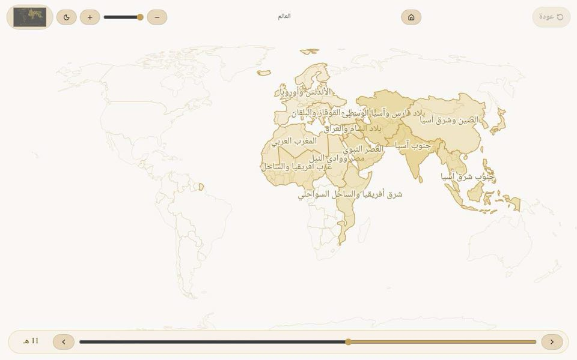 | 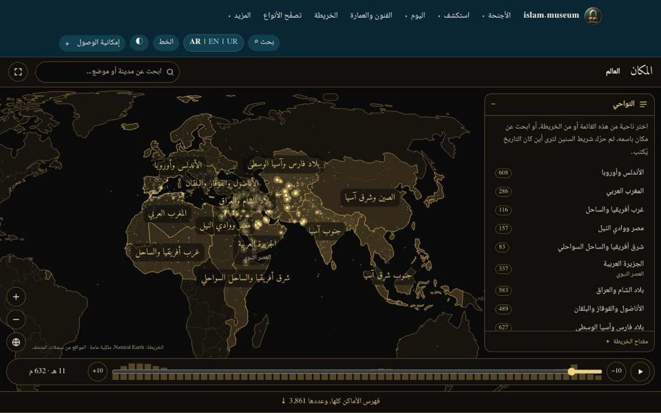 |
| 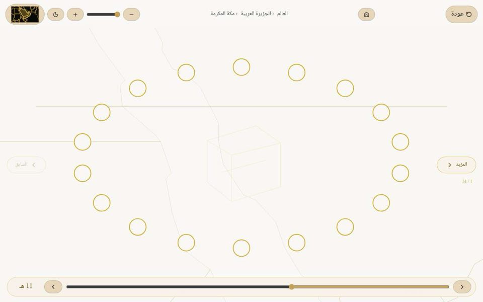 | 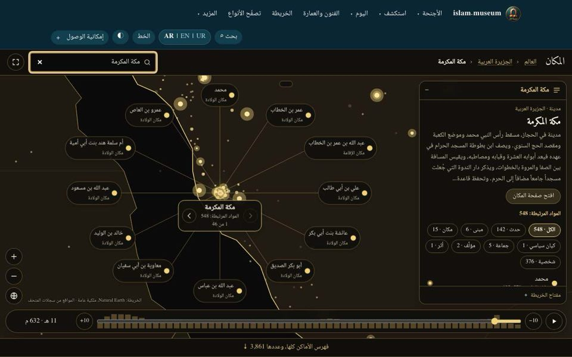 |
| 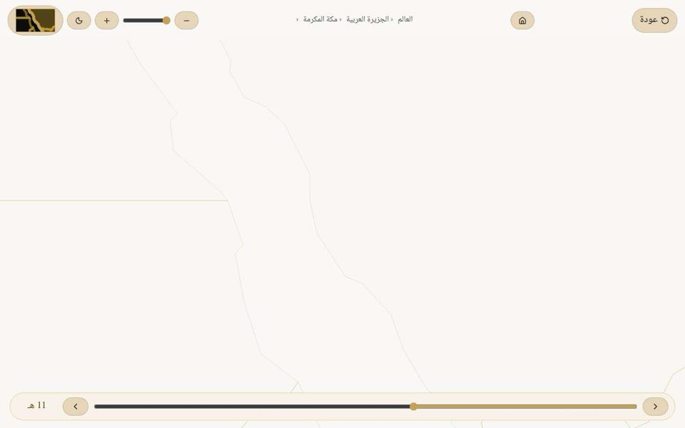 | 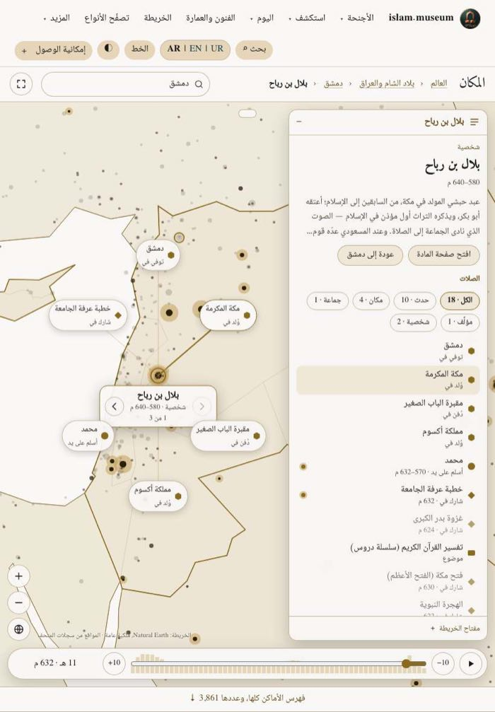 |
| 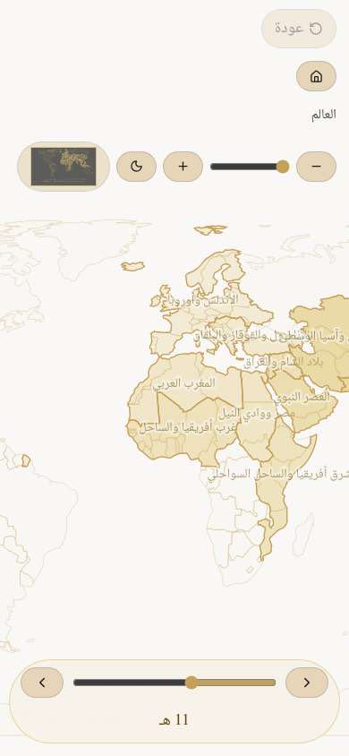 | 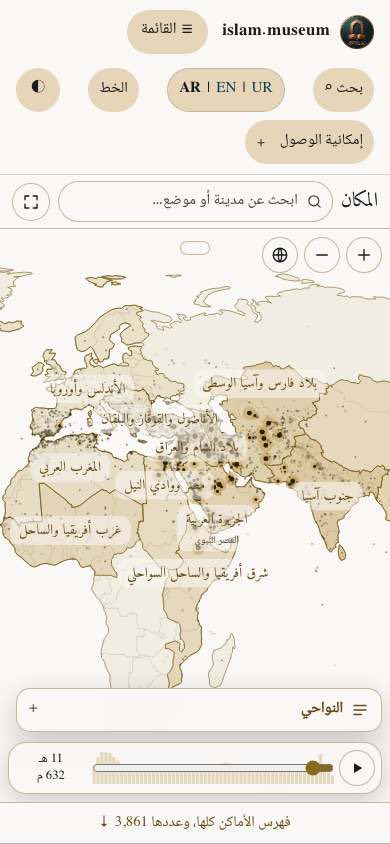 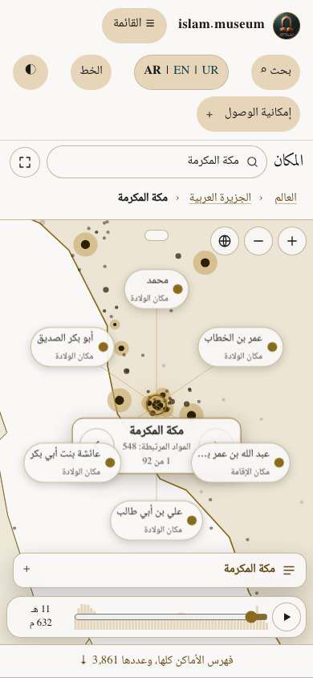 |
| 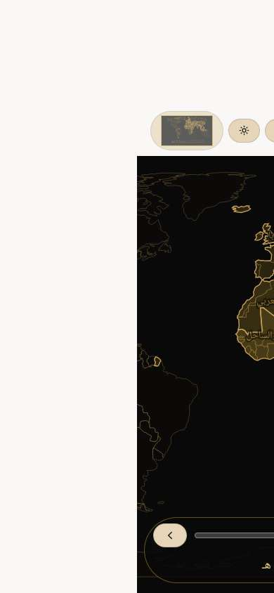 | 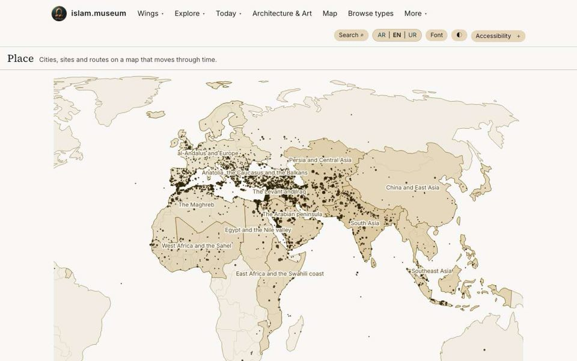 |

More views: [a region](place-map-review/after-region-desktop.jpg), [the light theme in English](place-map-review/after-world-desktop-light-en.jpg).

### Each finding

**Fixed** means the fault is gone and was checked in a browser. **Improved** means it is better but not finished, and the row says what is left.

| Id | Result | What changed, and how it was checked |
|---|---|---|
| PM-01 | Fixed | The map is part of the page, under the site header, as tall as the window. The page has an `h1` and a trail. Full screen is a button, and Escape leaves it. Checked at 390, 820 and 1280 px in both directions: the element at the top of the window is the site header. |
| PM-02 | Fixed | Without JavaScript the page shows the map as a picture, a note, and the index of every place. No dead controls. The 196 px sideways scroll that remains on a phone comes from the site header (SW-2), not the map, whose own overflow is 0. |
| PM-03 | Fixed | The opening view is fitted to the twelve regions, and on a narrow screen to Morocco–Bengal. The whole world can still be panned to on any screen (R2.2). |
| PM-04 | Fixed | Phone: the control row is 54 px (was 222). The panel is a sheet that opens for a region's list and folds for a place, so the orbit has the stage. Six named nodes fit; none overlaps or leaves the screen. |
| PM-05 | Fixed | All 3,861 places with a real position are on the map. A place's region is its first tag among the twelve, else the region whose outline holds it, else "Rest of the world" (122 places). Decision dec-20261111-236. |
| PM-06 | Fixed | Names are placed by measured width; one that would lie on another is moved a line or dropped. Regions are named while the view is wide, towns once the reader is close. English uses the site's serif and sans faces. |
| PM-07 | Fixed | A region keeps its name. The era in force is a small second line under it, and is in the list and the year label. (An era with no Urdu name still falls back to Arabic, as every label on the site does.) |
| PM-08 | Fixed | Every place is drawn at its coordinates. Where several share a spot, a click zooms in, and at full zoom offers a list to choose from. |
| PM-09 | Fixed | Orbit nodes carry the record's name and what ties it to the place ("born here", "burial place"), always, on touch and keyboard too. The panel shows the place's summary, counts by kind, the full list and a link to its page. The key explains sizes, brightness and shapes. |
| PM-10 | Fixed | A marker has four states (active in the chosen year, earlier, not yet, undated); the faintest is still visible in both themes and the key explains each. Counts of zero are no longer printed. |
| PM-11 | Fixed | The range comes from the data: from the first percentile of start years (75 BH) to the latest. The label gives both calendars ("11 AH · 632 CE") and never prints a Hijri year 0. Step buttons say "−10" and "+10". A bar chart behind the slider shows how much is dated in each 25 years, and a play button runs through the years. |
| PM-12 | Fixed | Each part of the trail is a button. The separator follows the direction of the page. |
| PM-13 | Fixed | Region names, kinds of place and the relation phrases a place shows are in `i18n` in three languages. Record-to-record relations come from the predicate registry, as on entity pages (Arabic and English; Urdu falls back to English there too). Lists sort in the page's language. |
| PM-14 | Fixed | The credit is on the map and under the static picture. |
| PM-15 | Fixed | A record opens at any year; the year only dims what is not current. Checked at the earliest year of the bar. |
| PM-16 | Fixed | The year bar sits outside the map's pointer area. Dragging it from 11 to 688 AH left the camera untouched. |
| PM-17 | Fixed | Wheel and pinch zoom at the pointer; double click and double tap zoom; drag pans with pointer capture; arrow keys pan, plus and minus zoom, 0 resets; up to 56 times the opening scale. Median frame 16.7 ms while panning in the test browser. |
| PM-18 | Fixed | The old dialog is gone: details are in the panel. The chooser takes focus, has a close button, closes on Escape and returns focus. |
| PM-19 | Fixed | The header's links are visible again, so the tab order is honest. Regions are real links (Enter works natively), the SVG is no longer one "image", and focus shows as a gold outline in both themes. |
| PM-20 | Fixed | The names of orbit nodes, regions and listed places never depend on hover; an unnamed dot is opened by a tap. No control is under 24 px in either direction (measured on every button, link and input of the map). |
| PM-21 | Fixed | One row: title, trail, search, full screen. The map's own theme button is gone; it follows the header's. |
| PM-22 | Fixed | The slider announces "11 AH, 632 CE" and the era. |
| PM-23 | Fixed | The theme is applied in CSS from the site's own selectors, so the first paint is already right; no script sets it. |
| PM-24 | Improved | The glyphs are gone; a place is its dot and its name on real coastlines. The basemap is still the 1:110m outline, so at the closest zoom a coast is a few straight segments. Left: a finer outline (see "Left"). |
| PM-25 | Fixed | 601 KB of HTML per language (was 25.3 MB), 174 KB compressed. The data is fetched: 125 KB compressed for all places, then at most 36 KB for a place. Decision dec-20261111-235. |
| PM-26 | Fixed | The data model builds in 0.6 s for all three languages (was about 80 s per page). The scoped build of 36 pages took 51 s (was 250 s). |
| PM-27 | Fixed | One plain script, 52 KB (16 KB compressed), no library. Script memory 10 MB (was 69 MB). |
| PM-28 | Fixed | The index of all 4,103 records of the wing is on the page for everyone, by region, under the map; the map's regions link to it when there is no script. |

Automated checks on the result: axe (WCAG 2.2 AA rules) reports no violation in eight states (two languages, three widths, light and dark, world and place); `scripts/place-map.test.ts` holds the helpers, the script's copies of them, and what the script may do on a reader's device (same-origin static JSON only, nothing stored).

### Against the founder's requirements (doc 19)

Met: R1.1 to R1.4, R2.1 to R2.5, R3.2, R3.3, R4.1 to R4.4, R5.1 to R5.4, R6.1 to R6.3, R7.2, R7.3, R8.1 to R8.4. Two with a note: **R3.1** asks for a slider in CE years; the bar counts Hijri years, as the wing always has, and shows the CE year beside it. **R7.1**: every string the map itself adds is in `i18n`; record-to-record relation names in Urdu fall back to English because the predicate registry has no Urdu yet (a site-wide gap). The document's header still says "MapLibre + PMTiles"; the map is SVG from the Natural Earth outline, with no tiles.

### What a deploy uploads

- The three Place pages, the two new files under `/shell/`, and 771 small JSON files under `/<lang>/place-map/` (3 × 257). **No Worker, wrangler or workflow file changes**: paths under `/ar/`, `/en/` and `/ur/` are already served from R2.
- **No other page changes.** Compared file by file against a build of `main` at the same path: both entity pages, the courses page and the eight other wing pages are byte-identical in all three languages, and the hashed script names are the same.
- That held because the old Svelte component stayed a build entry that no page drew: taking it out renames the chunks it shared with the depth dial on every entity page. So the rebuild was merged without that removal (decision dec-20261111-234), and the removal is a change of its own, below.

**How to repeat the comparison** (a full build needs about 19 GB; this needs under 1 GB and about a minute a build). Copy `site/src` into a sibling folder at the same depth (so relative imports resolve), keep only the page files to compare (the wing page, the entity route cut down to two entities, the courses page: between them they carry every Svelte island), point a temporary Astro config at that folder with the real `astro.config.mjs` as its base, and run `astro build` into `.cache/`. The build reads `.cache/graph.json`, the derived files and `.cache/time-browser/`, so run the steps of `npm run prebuild` after `validate` first (an entity page fails without `time-browser/explorer.json`). Do it once on `main` and once on the change, **at the same path** (Astro derives hashed names from the source path), then `diff -rq` the two outputs. The first version of this method is `scripts/fable/scoped-build.sh` on the branch `fable-run/phase-7-verification`.

### Taking the old component out (12 November 2026)

After the rebuild was merged, `site/src/components/MapViewer.svelte` was deleted, with its import and the never-true expression in the wing page, the three packages only it used (`motion`, `@floating-ui/dom`, `@lucide/svelte`) and the `map.viewer` strings only it read (19 strings and eight of the nine names under `cls`; the script still reads `cls.place`). **This change re-uploads every entity page**: it is labelled `rewrites-all-pages` and is meant for the founder's weekly batch.

Measured as above: `main` at `b6cf287d75` against the change, 36 pages (the nine wing pages, two entities and the courses page, in three languages) and the 771 map data files, built at the same path.

| Under `_astro/` | On `main` | After |
|---|---|---|
| Renamed (same role, new content) | `DepthDial.B7CPdv1S.js`, `LearnPicker.DzfSPJlO.js`, `client.svelte.EtH_UJpc.js`, `attributes.CifQEj-d.js`, `render.BRXDr885.js` | `DepthDial.DvKltnZ5.js`, `LearnPicker.4bR947Me.js`, `client.svelte.Dpplluno.js`, `attributes.BAnX3AOF.js`, `render.Bzjt8KfY.js` |
| Gone | `MapViewer.WVmvzB_e.js` (131.5 KB), `props.C9YBT8MN.js`, `branches.C8dFU8fh.js`, `if.Bm6MMWZU.js`, `snippet.Dyvup3wN.js` | their code that is still used moved into the files above |
| Unchanged | `convert.CJs3Ra4U.js`, the timeline and today scripts, every font file | the same names |

The names of `DepthDial`, `LearnPicker` and `client.svelte` depend on the folder the build runs in, so the real build gives them other names than these; `attributes.CifQEj-d.js`, `props.C9YBT8MN.js` and `render.BRXDr885.js` were the same in the earlier comparison at another path, so those are the names a deploy of `main` carries.

| Kind of page | What differs | Bytes |
|---|---|---|
| Every entity page (`/{lang}/{class}/{slug}/`, about 160,000) | Two script names in the depth dial's tag (`component-url`, `renderer-url`); nothing else | Same size (84 characters replaced) |
| The courses page (3) | The same two names, for the picker | Same size |
| The eight other wing pages (24) | The old component's styles are no longer in the page's `<style>` | 11,172 fewer each |
| The Place wing page (3) | The same styles, and the removed strings in the map's settings | English 585,690 → 573,782; Arabic 616,171 → 603,994; Urdu 616,898 → 604,734 |
| The 771 map data files, `/shell/` files, fonts | Nothing | Identical |

Removing the packages changed no built file, and removing the strings changed only the three Place pages (checked with a build after each step). Page kinds with no Svelte island (the home page, the browsers, the readers) were not in the build; they name none of the renamed files, and the scripts they do load kept their names, so no change is expected there, but that was reasoned, not measured.

A reader gains a little on every entity page: the depth dial now loads 4 script files, 38.9 KB (16.0 KB compressed), where it loaded 7 files, 53.4 KB (22.1 KB compressed), because Svelte runtime code that only the old map needed is no longer in the shared files. The courses page goes from 52.5 KB to 42.8 KB of script. `_astro/` holds 8 scripts and 74 KB where it held 13 and 217 KB.

### Left, and why

| What | Why it was left |
|---|---|
| A finer coastline at close zoom (PM-24) | Needs a second outline file (1:50m) loaded on demand; worth doing, not needed for the fixes. |
| Safari, Firefox, a real phone, a real screen reader | Not available on the machine this was done on. The script uses only long-standing features (pointer events, SVG, `fetch`), and markers are drawn as tiny strokes with round caps so that they do not depend on how a browser treats a zero-length line; it still needs a look. |
| Record-to-record relation names in Urdu | The predicate registry (`schema/predicates.yaml`) has Arabic and English only; adding Urdu is a schema change for the whole site. |
| SW-1, SW-2 | In files written into every page; a separate pull request for the founder to batch. |
| The header of doc 19 ("MapLibre + PMTiles", `/<lang>/map`) | The founder's document; noted above rather than edited. |

### Data found on the way, for the lanes that own it

- 14 place records carry the coordinates `[0, 0]` and so are not on the map (they are in the index): `al-makassed-philanthropic-islamic-association-of-beirut`, `al-nawbakhti-shrine`, `al-wardya-cemetery`, `ayyubid-dynasty`, `buhut`, `buyid-dynasty`, `fadl-mosque`, `fatimid-caliphate`, `grave-of-al-ghazali`, `jabal-amel`, `mamluk-egypt`, `rashidun-caliphate`, `samail`, `sirwan`.
- 8 place records have no coordinates and no neighbour that has: `haykal-al-jawhara`, `jazirat-al-qurud`, `madinat-al-sufur`, `magnetic-temple-china`, `namnaj`, `royal-court`, `unknown`, `waq-waq-islands`.
- 867 places carry none of the twelve region tags; the map now places them by geometry, but the records themselves are unchanged.
- Only 825 of 3,883 places have an Urdu name; the rest show the Arabic one on the Urdu page.
